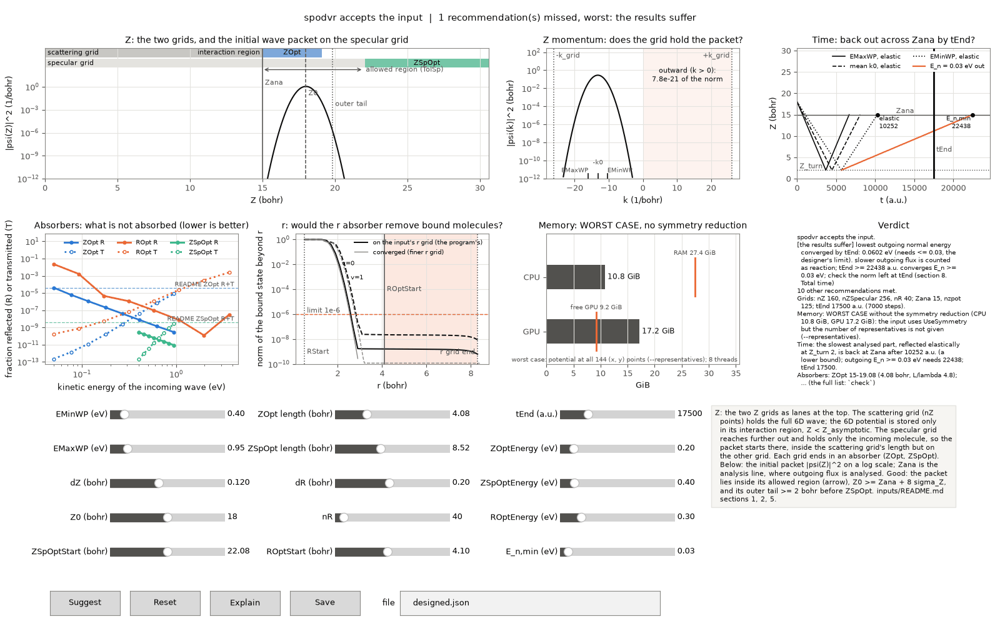

```text
>>=============================================================================================<<
 _____                  _____  _   _ ______   ___     _____ ______  _____   ______  _   _ ______
/  __ \   _      _     /  __ \| | | ||  _  \ / _ \   /  ___|| ___ \|  _  |  |  _  \| | | || ___ \
| /  \/ _| |_  _| |_   | /  \/| | | || | | |/ /_\ \  \ `--. | |_/ /| | | |  | | | || | | || |_/ /
| |    |_   _||_   _|  | |    | | | || | | ||  _  |   `--. \|  __/ | | | |  | | | || | | ||    /
| \__/\  |_|    |_|    | \__/\| |_| || |/ / | | | |  /\__/ /| |    \ \_/ /  | |/ / \ \_/ /| |\ \
 \____/                 \____/ \___/ |___/  \_| |_/  \____/ \_|     \___/   |___/   \___/ \_| \_|
>>=============================================================================================<<
```

# Cpp-SPO-DVR

[](LICENSE)
[](#dependencies)
[](docs/cuda.md)

**Six-dimensional quantum dynamics of H₂ on metal surfaces, on CPUs and NVIDIA GPUs.**

Cpp-SPO-DVR computes energy-resolved state-to-state scattering, diffraction and reaction
probabilities, and the S matrix, for a diatomic molecule colliding with a metal surface. It
propagates one wave packet in all six molecular coordinates with the split-operator method. It is
a modern C++20 rewrite of the Fortran SPO-DVR code of M. F. Somers and the Theoretical Chemistry
Group at Leiden University, and it runs on multi-core CPUs (OpenMP) and, optionally, on an NVIDIA
GPU (CUDA).

- **Validated:** five acceptance tests compare it with the Fortran code. On a production-size
  calculation (Fig. 5.3 of Somers' thesis), all 111 reaction probabilities of the default GPU build
  lie within half a unit of the Fortran's 7th printed digit ([Validation](#validation)).
- **Fast:** that calculation took 15.8 h with the Fortran code on 8 CPU threads and 1.4 h on a
  desktop GPU (RTX 4070 Ti; single runs, [Performance](#performance)).
- **Fortran-compatible:** the input uses the Fortran's key names, and runs restart from the Fortran
  code's files ([Coming from the Fortran SPO-DVR](#coming-from-the-fortran-spo-dvr)).

[Quick start](#quick-start) · [Installation](#installation) · [Running](#running) ·
[Inputs](#inputs) · [Validation](#validation) · [Performance](#performance) ·
[From the Fortran code](#coming-from-the-fortran-spo-dvr) · [Documentation](#documentation) ·
[How to cite](#how-to-cite)

## What it computes

**The model.** A diatomic molecule collides with a rigid, periodic surface on one potential energy
surface (Born–Oppenheimer, static surface; the static corrugation model, SCM, takes one distorted
surface per run).
The wave packet depends on all six molecular coordinates: the distance to the surface Z, the bond
length r, the position over the surface unit cell (x, y) and the orientation (θ, φ). One wave
packet covers a whole range of collision energies.

**The results**, per collision energy:

- the S matrix and the state-to-state scattering probabilities into the final vibrational,
  rotational and diffraction states (v, j, mJ; diffraction order n, m);
- the reaction (dissociation) probability, P_reaction = 1 − P_scattered. It is derived, not
  measured: a run that ends before the scattered packet has passed the analysis lines overestimates
  it;
- the mean final vibrational, rotational and diffraction energies of the scattered molecules.

**The method.** Split-operator propagation; FFT grids in Z, r, x and y; a Gauss–Legendre/FFT DVR
(discrete variable representation) in θ and φ; a long (Z, r) "specular" grid that carries the
incoming packet in its initial channel; the asymptotic analysis of Balint-Kurti (BK) at a fixed Z
(the initial rotational and diffraction state, every v, at its own line on the specular grid once that
line is fixed), during the run and as a fine analysis afterwards.

**The potentials** (input key `SystemID`):

| SystemID | Potential energy surface |
|---|---|
| `H2Cu111DaiLight` | H₂/Cu(111): the LEPS PES of Dai and Zhang (the "DZ PES"; the Fortran calls it Dai–Light) |
| `H2Cu111Persson` | H₂/Cu(111): the LEPS PES of Persson et al. (the "ER PES"; ER = Eley–Rideal) |
| `CRPlibrary` | a PES interpolated with the corrugation reducing procedure (CRP; Olsen et al. 2002): any C3v, C4v or C6v data set of the Fortran CRP library (implemented by M. Wijzenbroek); included: H₂/Cu(111) SRP48 ([docs/crp_library.md](docs/crp_library.md)) |
| `CRPDistrtSurface` | a CRP data set plus the SCM correction of one distorted surface; a surface temperature needs an average over many runs, outside the program ([docs/scm.md](docs/scm.md); [open questions](docs/scm_open_questions.md)) |
| `HardWallPES` | a test potential that depends only on Z and r |

**Also:** oblique incidence; surface symmetry (C2v, C3v, C4v, C6v) to compute and store the
potential only at symmetry-unique points; absorbing potentials at both ends of the Z grids and at
large r; restarts; analysis-only and potential-only runs; 2D cuts of the potential (`write2DPES`,
written to `pes_cut_2d.dat`); results as TSV and JSON files; a
[wave-packet designer](#designing-an-input-the-wave-packet-designer) for new inputs.

**Not available** (the full list, feature by feature: [docs/port_status.md](docs/port_status.md)):

- the flux analysis (`doFluxAnalysis`): a propagating run refuses it
  ([why](docs/flux_analysis_findings.md));
- 23 of the Fortran code's 28 potentials (their data files are in `potentials/`): input errors;
- the `.pes` potential cache (the potential is always computed);
- PES morphing: a `pesmorphparameters.dat` file is ignored without a warning;
- the single-grid options (`ProjOp` 0 and 1) and MPI.

## Quick start

On a recent Debian or Ubuntu (CMake ≥ 3.24 and GCC ≥ 13, e.g. Ubuntu 24.04 or newer), CPU only,
with FFTW. oneMKL, as fast as FFTW or faster on realistic grids, and the GPU:
[Installation](#installation).

```bash
sudo apt install build-essential cmake ninja-build git pkg-config \
  libfftw3-dev liblapack-dev python3 python3-pandas
git clone https://github.com/ewfsmeets/Cpp-SPO-DVR.git
cd Cpp-SPO-DVR
cmake -S . -B build -G Ninja -DCMAKE_BUILD_TYPE=Release -DSPODVR_BUILD_TESTS=OFF   # the program only
cmake --build build
./build/spodvr inputs/hardwall_small/input.json --threads 8 --output-dir runs/hardwall_small
```

Set `--threads` to your number of physical cores. The example, H₂ on a hard-wall test potential
(7000 time steps), takes about 3 minutes with 8 threads: its long test, which runs this input, took
164 s on an AMD Ryzen 7 5800X (2026-11-15).

- **Two set-up warnings are expected:** "Rotational basis too small to describe all open channels"
  and "the diffraction basis is too small to describe all open channels". JMax = 4 and the 4 × 4
  surface grid are kept small for speed. The warnings are harmless here: the hard wall depends only
  on Z and r, so the wave packet stays in the initial rotational state and the specular diffraction
  channel.
- **Nothing reacts on a hard wall:** P_reaction = 1 − P_scattered then only shows the error of this
  small grid, up to about 6e-3 of either sign (the Fortran's output has the same).

The results are tab-separated tables in `runs/hardwall_small/`; `#` lines at the top of each file
explain the columns:

```python
import pandas as pd
s = pd.read_csv("runs/hardwall_small/scattering_summary.tsv", sep="\t", comment="#")
print(s[["E_coll", "P_scattered", "P_reaction"]])
```

Next steps: an H₂/Cu(111) calculation on a small grid, and your own input ([Inputs](#inputs)).

## Installation

### Dependencies

- **Build tools:** GCC 13 or newer with OpenMP (the code uses C++20 `std::format`), CMake ≥ 3.24,
  Ninja, git. Tested with GCC 15, the Ubuntu 26.04 default.
- **Math libraries**, one of:
  - **Intel oneMKL** (recommended; tested with 2026.2, found through its `MKLConfig.cmake`):
    BLAS/LAPACK and the FFTs, through its FFTW3 interface. At realistic grid sizes its FFTs are as
    fast as FFTW's or faster ([performance](docs/performance.md#measurements-amd-ryzen-7-5800x-16-threads-wsl2-propagation-time-only));
  - FFTW3 + LAPACK, found through pkg-config (the fallback when oneMKL is not installed).
- nlohmann/json and GoogleTest are downloaded by CMake (internet access needed on the first
  configure).
- **[uv](https://docs.astral.sh/uv/)** and Python: the tests run the scripts in `tools/` with the
  repository's own Python environment, which `uv sync` creates in `.venv/` from `pyproject.toml` and
  `uv.lock` (numpy, matplotlib, pytest, and shellcheck for the pre-commit hook) with Python 3.14, as
  `.python-version` names (uv downloads it if the system has no 3.14). Without uv: configure with
  `-DPython3_EXECUTABLE=` a Python ≥ 3.10 that has the three test packages (numpy, matplotlib, pytest).
- **Optional, for the GPU backend:** an NVIDIA GPU of compute capability 7.5 (Turing) or newer, its
  driver, and the CUDA toolkit (nvcc, cudart, cuFFT). At run time the cuFFT callback also needs
  nvJitLink and NVRTC.
  - Use the newest CUDA 13 that the driver supports. Tested with 13.3.
  - FP64 speed matters: data-centre GPUs (A100, H100) run FP64 at 1/2 of the FP32 rate, GeForce
    cards at 1/64.
- uv also runs the window of the [wave-packet designer](#designing-an-input-the-wave-packet-designer):
  the window's file lists its packages (numpy, matplotlib, PyQt6), and uv installs them into its own
  cache on the first run.

<details>
<summary>Step by step on Debian/Ubuntu (also under WSL2)</summary>

**1. Build tools** (always needed):

```bash
sudo apt install build-essential cmake ninja-build git
```

Any GCC from 13 on works; the project is tested with GCC 15 (Ubuntu 26.04's default). For another
compiler, configure a new build directory with e.g. `CXX=g++-14 cmake ...`; nvcc then uses it too,
unless the environment variable `CUDAHOSTCXX` is set.

**2a. Intel oneMKL** (recommended), from Intel's apt repository:

```bash
wget -O- https://apt.repos.intel.com/intel-gpg-keys/GPG-PUB-KEY-INTEL-SW-PRODUCTS.PUB \
  | gpg --dearmor | sudo tee /usr/share/keyrings/oneapi-archive-keyring.gpg > /dev/null
echo "deb [signed-by=/usr/share/keyrings/oneapi-archive-keyring.gpg]" \
     "https://apt.repos.intel.com/oneapi all main" \
  | sudo tee /etc/apt/sources.list.d/oneAPI.list
sudo apt update
sudo apt install intel-oneapi-mkl-devel
```

CMake finds oneMKL in `$MKLROOT` or in `/opt/intel/oneapi/mkl/latest` (no `setvars.sh` needed for
building). The program always uses the sequential, LP64 oneMKL.

**2b. Without oneMKL**, FFTW3 and LAPACK instead (pkg-config finds FFTW3):

```bash
sudo apt install libfftw3-dev liblapack-dev pkg-config
```

**3. CUDA** (optional, for `--device cuda`), CUDA 13 from NVIDIA's apt repository (repository
`wsl-ubuntu` under WSL2, `ubuntu2604` / `ubuntu2404` on a native Ubuntu 26.04 / 24.04). First run
`nvidia-smi`: the GPU must be visible, and its "CUDA Version" line (newer drivers: "CUDA UMD
Version") is the newest CUDA the driver runs. Then install the newest 13.x that is not newer than
that, e.g. 13.3:

```bash
wget https://developer.download.nvidia.com/compute/cuda/repos/wsl-ubuntu/x86_64/cuda-keyring_1.1-1_all.deb
sudo dpkg -i cuda-keyring_1.1-1_all.deb
sudo apt update
sudo apt install cuda-toolkit-13-3
```

- The toolkit installs into `/usr/local/cuda`.
- Do not install a toolkit newer than the driver supports: it compiles, but the kernels then fail
  at run time.
- **WSL2:** the GPU driver is the Windows NVIDIA driver (update it in Windows). Never install a
  Linux driver inside WSL; the `wsl-ubuntu` repository contains none.
- `/usr/local/cuda/bin` need not be on `PATH`: CMake finds nvcc there.
- Ubuntu's own `nvidia-cuda-toolkit` packages (CUDA 12.0 on 24.04, 12.4 on 26.04) are untested since
  the kernels became C++20 and the cuFFT callback was added: use NVIDIA's repository.
- nvcc compiles with the C++ compiler of the build. If the CUDA release rejects that GCC
  ("unsupported GNU version"; CUDA 13.0 is the first release whose version check accepts GCC 15),
  set `CUDAHOSTCXX` or `-DCMAKE_CUDA_HOST_COMPILER` to a GCC it accepts.

**4. Python and uv** (the tests' Python environment and the designer's window):

```bash
sudo apt install python3 pipx
pipx install uv
```

Then, in the repository after cloning it ([Building](#building)), `uv sync` creates `.venv/` (numpy,
matplotlib, pytest, shellcheck).

- CMake's tests use `.venv/bin/python`; a configure without `.venv/` stops and says to run `uv sync`.
  An existing build directory switches to it at its next configure. Another Python with numpy,
  matplotlib and pytest (e.g. apt's `python3-numpy python3-matplotlib python3-pytest`):
  `-DPython3_EXECUTABLE=/usr/bin/python3` (the shellcheck pre-commit hook still needs `uv sync`).
- After `git pull`, run `uv sync` again if `uv.lock` changed.
- `pipx install` puts `uv` into `~/.local/bin`; `pipx ensurepath` adds that to `PATH` if it is not
  there yet.
- Under WSL2 the designer's window opens through WSLg. If it does not open, Qt names the system
  library it misses; install that with apt.

</details>

### Building

```bash
git clone https://github.com/ewfsmeets/Cpp-SPO-DVR.git
cd Cpp-SPO-DVR
uv sync                      # the tests' Python environment (.venv/)
cmake -S . -B build -G Ninja -DCMAKE_BUILD_TYPE=Release
cmake --build build
```

The configure step reports which libraries it uses, e.g.
`SPO-DVR: BLAS/LAPACK from oneMKL 2026.2.0 (sequential), FFT library MKL`.

With the GPU backend:

```bash
cmake -S . -B build-cuda -G Ninja -DCMAKE_BUILD_TYPE=Release -DSPODVR_USE_CUDA=ON
cmake --build build-cuda
```

The kernels are compiled for the GPU of the build machine (CMake's `native`). For another GPU set
`-DCMAKE_CUDA_ARCHITECTURES` (`89-real` RTX 40xx, `80-real` A100, `90-real` H100,
`"80-real;90-real"` for both). The configure step prints the nvcc version, host compiler and
architectures.

<details>
<summary>CMake options</summary>

| Option | Default | Meaning |
|---|---|---|
| `-DSPODVR_USE_MKL=OFF` | `ON` | ignore oneMKL; use the system LAPACK and FFTW |
| `-DSPODVR_FFT_LIBRARY=FFTW` | `AUTO` | use the real FFTW for the FFTs even when oneMKL is present (`AUTO` picks oneMKL when found); needs FFTW3 and pkg-config |
| `-DSPODVR_ARCH=native` | `x86-64-v3` | `-march` value (`x86-64-v3` = AVX2; `x86-64-v4` = AVX-512) |
| `-DSPODVR_PGO=GENERATE/USE` | `OFF` | profile-guided optimisation: two builds and a training run ([performance](docs/performance.md#profile-guided-optimisation-1116--less-time-on-the-medium-grid-2026-10-26)) |
| `-DSPODVR_FAST_MATH=ON` | `OFF` | experimental: `-ffast-math` with NaN and inf kept (with CUDA also FMA in the GPU kernels); changes results at the 1e-12 to 1e-11 level ([details and known test failures](docs/performance.md#the-fast-math-build-spodvr_fast_math)) |
| `-DSPODVR_LTO=OFF` | `ON` | no link-time optimisation in Release builds (quicker links, sanitizer builds); bitwise identical output on the hard-wall test case (2026-11-22) |
| `-DSPODVR_USE_CUDA=ON` | `OFF` | build the GPU backend (`--device cuda`; [docs/cuda.md](docs/cuda.md)) |
| `-DSPODVR_BUILD_TESTS=OFF` | `ON` | skip the tests |

Developer options and the build variants: [docs/CONTRIBUTING.md](docs/CONTRIBUTING.md#build-variants).
Performance notes and reproducibility across machines: [docs/performance.md](docs/performance.md).

</details>

<details>
<summary>Running a copied oneMKL build</summary>

The executable records the absolute path of the oneMKL libraries. On a machine where oneMKL lives
elsewhere, make the libraries findable first, with `setvars.sh` or by setting `LD_LIBRARY_PATH`
(e.g. to `/opt/intel/oneapi/mkl/latest/lib`):

```bash
source /opt/intel/oneapi/setvars.sh
```

`export MKL_CBWR=AVX2` makes oneMKL take the same code path on machines with different vector
extensions ([reproducibility](docs/performance.md#reproducibility)).

</details>

### Testing

```bash
export OMP_NUM_THREADS=8
# everything (~17 min): the Python tests side by side, then the rest serially
ctest --test-dir build -L python -j 8 --output-on-failure && ctest --test-dir build -LE python --output-on-failure
# quick tier (~3.5 min)
ctest --test-dir build -L python -E PlotRuns -j 8 --output-on-failure &&
  ctest --test-dir build -LE python -E RegressionPropagation --output-on-failure
ctest --test-dir build-cuda -R Cuda --output-on-failure                         # GPU tests (~2 min)
```

- Run the C++ tests serially (no `-j`): many use all OpenMP threads. Set `OMP_NUM_THREADS` to the
  number of physical cores. The Python tests (`-L python`: pytest, one thread each) may run side by side
  with `-j` up to that number; the plot fixtures' writer among them reserves 6 of the slots.
  A plain serial `ctest --test-dir build` runs everything too, about 3.5 min slower.
- The quick tier leaves out the propagation gates (gates 3 and 4 against the Fortran) and the plot
  tool's runs (`PlotRuns.*`). Use it while
  working on a change; run everything before committing a change to the code
  ([when](docs/CONTRIBUTING.md#testing)).
- On 2026-11-22 (8 threads, AMD Ryzen 7 5800X and RTX 4070 Ti): 987 tests (83 Python, 904 C++), 981
  pass and 6 long or reference-less tests skip, about 1000 s (the Python tests side by side 462 s,
  the plot tool's runs among them; the C++ tests 536 s, of which the propagation gates 357 s); the
  quick tier 959 tests (2 skip), about 205 s; 32 GPU tests, 30 pass and the 2 long ones skip, about
  115 s.
- The regression tests compare with Fortran output stored in the repository; they do not need the
  Fortran code. The Python tests (the tools' and the wave-packet designer's, `ctest -L python`) run
  with pytest in the repository's environment ([Dependencies](#dependencies)).
- Selecting tests, the long tests, the other build variants and the developer checks:
  [docs/CONTRIBUTING.md](docs/CONTRIBUTING.md#testing).

## Running

The program reads one JSON input file and writes its data files into the output directory (an
example: [Quick start](#quick-start)).

### Command-line options

```text
spodvr <input.json> [--threads N] [--schedule dynamic|static] [--device cpu|cuda]
       [--output-dir DIR] [--no-color] [--help] [--version]
```

- `--threads N`: the number of OpenMP threads (default: the OpenMP default, i.e. `OMP_NUM_THREADS`
  or all hardware threads). Recommended: the number of physical cores
  ([threads and scheduling](docs/performance.md#threads-and-loop-scheduling)).
- `--schedule dynamic|static`: how the (Z, r) points are shared out over the threads. `dynamic`
  balances the uneven work best on one NUMA node (one CPU socket); `static` keeps every thread on
  the memory it first wrote (several NUMA nodes). Default: chosen from the number of NUMA nodes.
- `--device cpu|cuda`: propagate on the CPU (default) or on an NVIDIA GPU, where the wave packet
  stays in GPU memory (needs a build with `-DSPODVR_USE_CUDA=ON`; [docs/cuda.md](docs/cuda.md)). The
  results agree with the CPU's to rounding (≈1e-13, the level of a different FFT library).
- `--output-dir DIR`: where the data files are written (default: the current directory).
- `--version`: the version and the git commit the program was built from (`spodvr 0.1.0 (git <commit>)`;
  `-dirty` when tracked files had uncommitted changes), also recorded in `run_info.json`.
- The results do not depend on the number of threads or on the schedule.

### Exit codes

Defined in `src/app/run.cpp` and `src/app/main.cpp`:

- 0: success (also `--help` and `--version`);
- 1: any other error, e.g. an output file that cannot be opened;
- 2: an input error (the message names the key), a wrong command line, or a restart or analysis-only
  file that is missing or unreadable (checked before the set-up);
- 3: not supported: a feature that is not ported ("Not supported: …");
- 4: a checkpoint or BK file error: a restart or analysis-only file that is corrupt, truncated or
  written with other parameters, or a checkpoint that cannot be written;
- 5: a non-finite result: the scattering results (energies, S-matrix elements, probabilities, phases,
  their sums and mean energies) of the on-the-fly or the fine analysis hold a NaN or an infinity. The run goes on and
  writes every file; for each result set (on the fly, the fine analysis's spectrum, its interpolated
  energies) one "Non-finite result" line names the first such number.

An error that stops the run after a non-finite result (e.g. a BK file error in the fine analysis of
`alsoAnalysis`) gives its own exit code, not 5.

### Output

- **Screen:** an input summary, the grids, a memory estimate, the surface symmetry (with
  `UseSymmetry`), the gas-phase states, the initial wave packet, the analysis basis, a table of
  averages during the propagation, and compact probability tables (one row per energy) at the end.
  On a terminal a live progress line shows the step, the time per step and the estimated remaining
  time. Colour and the progress line are off when the output is not a terminal (a pipe, `tee`, a
  file) or with `--no-color`.
- **Data files** (in the output directory, numbers in full precision):
  - the results: tab-separated tables (`.tsv`, energies in eV) with `#` comment lines that explain
    every column, then one header line; they load with `pandas.read_csv(f, sep="\t", comment="#")`;
  - `run_info.json` (every run) and `analysis.json` (runs with an analysis): the run metadata;
  - the `.dat` files: space-separated columns after `#` comment lines (atomic units, unless a column
    says otherwise); they load with `numpy.loadtxt(f)`;
  - the binary restart files.

| File | Content |
|---|---|
| `scattering_summary.tsv` | per energy: total scattering and reaction probability, P(v), average final energies |
| `s_matrix.tsv` | per energy and open final state (v, j, mJ, n, m): S-matrix element, probability, phase |
| `probabilities_rovib.tsv` | (with `writeProbs`) per energy and (v, j, mJ), summed over diffraction |
| `probabilities_diffraction.tsv` | (with `writeRDProbs`) per energy, (v, j, mJ) and diffraction order |
| `run_info.json` | every run: program version and git commit, input, grids, rotational basis, lattice, wave packet, analysis energies, absorbers ([fields](docs/output_files.md#run-metadata)) |
| `analysis.json` | run metadata: basis sizes, initial state, energy grid, file list; the SCM identity of a `CRPDistrtSurface` run |
| `averages.dat` | time (a.u.), norm, ⟨Z⟩, ⟨r⟩ (bohr), rest norm during the propagation |
| `asymptotic_potential.dat`, `gas_phase_states.dat` | set-up data: V_asy(r) (hartree and eV); the gas-phase energies (hartree) and wave functions |
| `checkpoint.bin`, `bk_coefficients.bin` | the final wave packet (as large as ψ in memory; not written with `"CheckpointFormat": "fortran"`) and the Balint-Kurti coefficients, for a restart |

- E_total = E_coll + E(v_in, j_in) includes the initial rovibrational energy. For the DZ PES,
  E(0, 0) = −4.477 eV, so E_total is negative.
- The rest norm is the norm of the specular wave between the two analysis lines
  ([terms](inputs/README.md#1-terms)).
- With `alsoAnalysis` (or an analysis-only run, `onlyAnalysis`) the fine-analysis results go to
  `fine_analysis/` in the output directory.
- Every file and column: [docs/output_files.md](docs/output_files.md).

### Continuing a run (restart)

To continue a run, copy its input and change:

1. `"NewCalc": false`, and `"RestartDir"`: the earlier run's output directory;
2. `"tStart"`: the end time of the earlier run;
3. `"nStep"`: the number of steps to add, and `"tEnd"` = tStart + nStep·dtStep (the input check
   requires this).

Start it with a *different* `--output-dir`.

- Keep all other parameters, apart from output switches. The program checks the grids, masses,
  time steps, wave packet and absorbers against the checkpoint.
- The S matrix of the restarted run covers the whole propagation; a split run gives bitwise the
  same results as one long run.
- **Fortran restart files:** read them with `"RestartFormat": "fortran"` (fort.8/fort.9 and
  fort.22/fort.21) and write them with `"CheckpointFormat": "fortran"` or `"both"`
  ([keys](docs/input_schema.md#checkpoint--restart-keys-c-only)).
- **Fast-math builds:** native restart files (`checkpoint.bin`, `bk_coefficients.bin`) only work
  between builds with the same `SPODVR_FAST_MATH` setting. A restart or `onlyAnalysis` run checks
  the stored set-up parameters exactly, and the fast-math builds compute one of them (the effective
  `ZOptFactor`) 1 ulp (unit in the last place) differently. Files in the Fortran format carry no parameter list and work
  across builds.

### Plotting a run

`tools/plots/` draws the figures of a run (or of every segment of a restarted one) from its output files,
and writes a report that opens with a verdict on the run's completeness and convergence. It runs in the
repository's Python environment (`uv sync`, [Dependencies](#dependencies)); for the run of the
[Quick start](#quick-start):

```bash
uv run python -I -B tools/plots/spodvr_plot.py report runs/hardwall_small --out runs/hardwall_small/report
uv run python -I -B tools/plots/spodvr_plot.py verdict runs/hardwall_small    # the verdict only
```

A run with frames (`dtFrames`) can also be looked at in a window: `uv run tools/plots/view.py <run directory>`
shows the probability over the unit cell and ρ(Z, r) above a point picked by a click, against time
([the viewer](tools/plots/README.md#the-viewer)).

The figures, the verdict's findings and how to add a plot: [tools/plots/README.md](tools/plots/README.md).

Every figure and movie on a production run, explained: [the analysis gallery](docs/analysis_gallery.md).

## Inputs

Ready-to-run inputs, from small to production size:

| Input | What it computes | Cost |
|---|---|---|
| `inputs/hardwall_small/` | H₂ on a hard wall, 0.2–0.6 eV; `DVR.inp` is the same calculation for the Fortran code | about 3 min, 8 threads |
| `tests/reference/cu111_dailight_small/` | H₂/Cu(111) on the DZ PES, on a small grid and basis for quick tests (176 × 56 × 8 × 8, JMax 4: 15 rotational basis functions) | about 10 min, 8 threads (its long test: 607 s, 2026-11-15) |
| `inputs/scm_example/` | a technical example of the SCM potential: one snapshot on a small grid, not physics | see its [README](inputs/scm_example/README.md) |
| `inputs/thesis_fig5_3_dz/`, `inputs/thesis_fig5_3_er/` | H₂/Cu(111) on the DZ and the ER PES: the two curves of Fig. 5.3 of Somers' thesis, at the thesis grid sizes (with a finer Z grid), JMax 28 | DZ: 8.2 h on the CPU (fast-math build), 1.4 h on the GPU ([Performance](#performance)) |
| `inputs/thesis_fig5_3_dz_plotting/` | the DZ input above with every plot key switched on: the run behind the [analysis gallery](docs/analysis_gallery.md) | 4.0 h on the GPU (fast build), 16 GB of disk |

- The JSON keys mirror the Fortran `DVR.inp` field names. All keys, defaults, units and checks:
  [docs/input_schema.md](docs/input_schema.md). Unknown keys and inconsistent parameters are
  errors.
- How to choose the Z grids, the wave packet, the analysis lines and the absorbers for a new input,
  and how to check a finished run: [inputs/README.md](inputs/README.md).
- Each thesis input has a README with its parameter choices. On the CPU they need 7.9 GiB (DZ) and
  9.6 GiB (ER) of memory, from their set-up memory estimates
  ([DZ validation log](docs/validation_thesis_fig5_3_dz/data/logs/cleaned_cpu_fast.txt),
  [ER README](inputs/thesis_fig5_3_er/README.md)); finer grids and larger rotational bases need
  more. The DZ case is the GPU benchmark: it needs 8.8 GiB on the GPU, while the ER case needs
  14.8 GiB and does not fit a 12 GiB card ([docs/cuda.md](docs/cuda.md#memory)).
- The other test cases in `tests/reference/` (with the Fortran's output) run the same way, e.g.
  `crp_cu111_srp48_small` (H₂/Cu(111) SRP48 on coarse grids). The `crp_*` and `scm_*` cases and
  `inputs/scm_example` must be run from the repository root: their data paths are relative to it.

### Designing an input: the wave-packet designer

`tools/wave_packet_designer/` designs and checks the Z and r part of an input before any run: the Z
grids, the initial wave packet, the absorbers, the r grid, tEnd, and the CPU and GPU memory. It applies
the rules of [inputs/README.md](inputs/README.md), says whether `spodvr` would accept the input, and
needs no build of the program. The window has sliders for the recipe's knobs and explains each panel
and slider; it needs uv. The command line runs in the repository's Python environment
([Dependencies](#dependencies)). The window, then the checks and the memory estimate on the
command line:

```bash
uv run tools/wave_packet_designer/gui_mpl.py inputs/thesis_fig5_3_dz/input.json
uv run python -I -B tools/wave_packet_designer/wave_packet_designer.py check \
  inputs/thesis_fig5_3_dz/input.json
uv run python -I -B tools/wave_packet_designer/wave_packet_designer.py memory \
  inputs/thesis_fig5_3_dz/input.json
```



The window on the DZ input, with the mouse over the Z panel. The panels, the sliders, the commands
and their options: [tools/wave_packet_designer/README.md](tools/wave_packet_designer/README.md).

## Validation

**Five acceptance tests ("gates")** compare the C++ program with the Fortran code it was ported
from, upstream SPO-DVR 5.24 (svn r1727) built with `-O3`, on small grids:

1. the potential (the gas-phase curve and the 6D grid);
2. the gas-phase rovibrational states;
3. the propagation: the norms and averages during the run;
4. the on-the-fly analysis: the probabilities, the BK coefficients and a restarted run;
5. the fine analysis.

- Values the Fortran prints are compared to half a unit in their last printed digit.
- Gates 3 and 4 run the hard-wall, DZ and SCM cases, gate 5 the hard-wall and DZ cases; the ER and
  CRP cases are compared in gates 1 and 2. Gates 3 and 4 also run on the GPU.
- The cases, tolerances and results: [docs/validation.md](docs/validation.md).

**On a production-size calculation**, the DZ calculation behind Fig. 5.3 of Somers' thesis (with
a finer Z grid; 7000 steps, 435 rotational basis functions, 111 energies), the Fortran, the C++
CPU and the C++ GPU code were run and compared state by state:

- End to end, all 111 reaction probabilities of the default (strict) GPU build lie within half a
  unit of the Fortran's 7th printed digit.
- Its propagation alone (both runs' BK coefficients analysed by the same C++ code) agrees with the
  Fortran's to 3.5e-13 in the S matrix (norm-weighted relative) and 8.2e-13 in the reaction
  probability.
- One weakly populated family of channels differs more (single elements up to 1.8e-7 relative),
  which the record traces, in part, to 1-ulp differences in the θ quadrature nodes of the angular
  transform.
- That Fortran run used 5.19; built with `-O3`, 5.24 gives bitwise the same potential and first
  40 steps on that grid.
- The full record, with figures: [docs/validation_thesis_fig5_3_dz](docs/validation_thesis_fig5_3_dz/README.md).

**The validated domain.** The cases compared with the Fortran start H₂ in (v = 0, j = 0) at normal
incidence, and one in (v = 0, j = 1, mJ = −1) at oblique incidence (`cu111_dailight_oblique`: 0.1 eV parallel
energy at 17°). Other initial states (v > 0, larger j) and other molecules are not compared with the Fortran
code. Convergence remains the user's task: [inputs/README.md](inputs/README.md) covers the
Z and r grids, the wave packet and the absorbers; the rotational basis (JMax, MJMax) and the surface
grid (nX, nY) are checked by runs with larger values.

## Performance

The production-size calculation above (DZ PES, 7000 steps), as run on one desktop machine with
8 threads of an AMD Ryzen 7 5800X and an NVIDIA RTX 4070 Ti (2026-11-06/07, the strict GPU run
2026-11-08; GCC 15.2, CUDA 13.3):

| Run | Build | Wall time | Speed-up |
|---|---|---|---|
| Fortran 5.19 | gfortran `-O3`, FFTW | 15.8 h | 1× |
| C++, CPU | fast-math, `-march=native`, oneMKL | 8.2 h | 1.9× |
| C++, GPU | default (strict) | 1.4 h | 11.1× |
| C++, GPU | fast-math (FMA in the kernels) | 1.3 h | 12.3× |

- These are single runs as run, not a like-for-like benchmark: the C++ CPU run used the
  experimental fast-math build, the Fortran a generic `-O3` build with FFTW ESTIMATE plans. The
  speed-ups are ratios of the wall times in the record's
  [timing table](docs/validation_thesis_fig5_3_dz/README.md#performance-as-run).
- The RTX 4070 Ti is a GeForce card (FP64 at 1/64 of its FP32 rate). Per-stage GPU timings, the
  effect of fast math on the GPU and the limits of this card: [docs/cuda.md](docs/cuda.md).
- On the small `cu111_dailight_small` grid, the default CPU build was slower than the Fortran
  (764 s against 680 s; 2026-11-05, GCC 13, Fortran 5.19), most likely through load imbalance in
  one loop. That loop has since been rescheduled; the comparison was not re-run
  ([details](docs/performance.md#fortran-vs-c-full-dailight-run-8-threads-2026-11-05)).
- The default build is strict floating point without FMA; the fast-math builds change results by
  1e-12 to 1e-11 ([docs/performance.md](docs/performance.md)).

## Coming from the Fortran SPO-DVR

- **Version:** the port started from 5.19 (2023) and follows upstream 5.24 (svn r1727). Built with
  `-O3`, 5.24 is bitwise identical to 5.19 on every gate case of 5.19 features.
- **Input:** a JSON file with the Fortran's `DVR.inp` key names (case-sensitive). There is no
  converter; `inputs/hardwall_small/` has the same calculation in both formats. `TolSp` is
  required, `ProjOp` must be 2, some checks are stricter, and an input error stops with exit code 2
  (the Fortran exits with 0).
- **Restart:** the C++ reads and writes the Fortran's restart files
  ([restart](#continuing-a-run-restart)).
- **Output:** TSV and JSON files replace fort.25, fil10 and unit 3
  ([correspondence](docs/output_files.md#correspondence-with-the-fortran-output)).
- **Results that differ on purpose:**
  - the Fortran's fine analysis has interpolation and sign errors, fixed in the C++: the
    probabilities are the same, the S-matrix elements and phases differ
    ([docs/fortran_fine_analysis_bugs.md](docs/fortran_fine_analysis_bugs.md));
  - a restart carries over the whole state of the specular analysis line; the Fortran does not save
    one part of it, `anlyTol` ([restart bug](docs/fortran_deviations.md#fortran-restart-bug));
  - the phase of the S-matrix elements of the initial rotational and diffraction state (elastic and
    vibrationally inelastic) refers to the specular analysis line where they are measured; the
    Fortran refers it to `ZAnalysis`, several radians off (the probabilities are the same)
    ([analysis D2](docs/fortran_deviations.md#analysis-d2));
  - the surface symmetry is also used for C2v and C4v.
- **Flux analysis:** not ported. With `ProjOp` 2 the Fortran's flux leaves out the initial channel
  on the specular grid ([findings](docs/flux_analysis_findings.md)).
- **Feature by feature:** [docs/port_status.md](docs/port_status.md). Every known difference:
  [docs/fortran_deviations.md](docs/fortran_deviations.md). The upstream changes since 5.19:
  [docs/upstream_sync.md](docs/upstream_sync.md).

## Documentation

| Document | Contents |
|---|---|
| [inputs/README.md](inputs/README.md) | how to choose the grids, wave packet, analysis lines and absorbers; how to check a run |
| [docs/method.md](docs/method.md) | the method as the code implements it: grids, the two grids, one analysis step in code order, FFT conventions, the S matrix |
| [docs/input_schema.md](docs/input_schema.md) | every input key: type, default, unit, checks |
| [docs/output_files.md](docs/output_files.md) | every output file and column; the correspondence with the Fortran output |
| [docs/validation.md](docs/validation.md) | the five gates: cases, tolerances, results, reference data |
| [docs/validation_thesis_fig5_3_dz/](docs/validation_thesis_fig5_3_dz/README.md) | the production-grid validation: Fortran vs C++ CPU vs C++ GPU, with figures |
| [docs/analysis_gallery.md](docs/analysis_gallery.md) | what one run shows: every figure and movie of the plot tool on the thesis grid, explained |
| [docs/port_status.md](docs/port_status.md) | every Fortran feature and its status in the C++; the additions |
| [docs/fortran_deviations.md](docs/fortran_deviations.md) | every known difference from the Fortran code |
| [docs/fortran_input_bugs.md](docs/fortran_input_bugs.md), [docs/fortran_fine_analysis_bugs.md](docs/fortran_fine_analysis_bugs.md), [docs/fortran_elastic_phase_bug.md](docs/fortran_elastic_phase_bug.md), [docs/fortran_analysis_limits_bugs.md](docs/fortran_analysis_limits_bugs.md) | Fortran bugs found during the port and later |
| [docs/upstream_sync.md](docs/upstream_sync.md) | the upstream changes since 5.19 and their port status |
| [docs/performance.md](docs/performance.md) | build options, threads and NUMA, memory, benchmarks |
| [docs/cuda.md](docs/cuda.md) | the GPU backend: design, numerics, memory, performance |
| [docs/crp_library.md](docs/crp_library.md) | the port of the CRP library and its data sets |
| [docs/scm.md](docs/scm.md), [docs/scm_open_questions.md](docs/scm_open_questions.md) | the SCM potential; its open physics questions |
| [docs/flux_analysis_findings.md](docs/flux_analysis_findings.md) | why the flux analysis is not ported |
| [tools/wave_packet_designer/README.md](tools/wave_packet_designer/README.md) | the wave-packet designer |
| [tools/plots/README.md](tools/plots/README.md) | the plots and the report of a run |
| [tools/fortran_reference/README.md](tools/fortran_reference/README.md) | building the Fortran reference and regenerating the reference data |
| [docs/developer_guide.md](docs/developer_guide.md) | for changes to the code: the module map, the propagation in one page, the coding rules, checklists (a new PES, input key, large array, output file, a Fortran routine) |
| [docs/CONTRIBUTING.md](docs/CONTRIBUTING.md) | build variants, the test suite in detail, formatting and linting, the repository layout |

## Contributing

Bug reports and questions: [GitHub Issues](https://github.com/ewfsmeets/Cpp-SPO-DVR/issues). Build
variants, the test suite in detail, formatting and linting, the developer checks and the repository
layout: [docs/CONTRIBUTING.md](docs/CONTRIBUTING.md).

## How to cite

If you use this program, please cite it and the original Fortran code, and the potential energy
surface you used:

- **This program:** GitHub's "Cite this repository" button (from [CITATION.cff](CITATION.cff)),
  with the version and commit (`spodvr --version`, also in `run_info.json`).
- **The original Fortran code:**
  - E. Pijper, *Quantum dynamics of diffraction and reaction: scattering of H₂ from LiF(001) and
    Pt(111)*, PhD thesis, Leiden University (2002),
    [WorldCat 66180975](https://search.worldcat.org/title/66180975);
  - M. F. Somers, *Six-Dimensional Quantum Dynamics of Dissociative Chemisorption of Hydrogen on
    Metal Surfaces*, PhD thesis, Leiden University (2004),
    [hdl.handle.net/1887/3250648](https://hdl.handle.net/1887/3250648);
  - G. J. Kroes and M. F. Somers, *Six-dimensional dynamics of dissociative chemisorption of H₂ on
    metal surfaces*, J. Theor. Comput. Chem. 4, 493 (2005),
    [doi:10.1142/S0219633605001647](https://doi.org/10.1142/S0219633605001647).
- **The potential:**
  - DZ: J. Dai and J. Z. H. Zhang, J. Chem. Phys. 102, 6280 (1995);
  - ER: Persson et al., J. Chem. Phys. 110, 2240 (1999);
  - CRP (`CRPlibrary`, and the ideal surface of `CRPDistrtSurface`): the method,
    R. A. Olsen, H. F. Busnengo, A. Salin, M. F. Somers, G. J. Kroes and E. J. Baerends, J. Chem.
    Phys. 116, 3841 (2002), [doi:10.1063/1.1446852](https://doi.org/10.1063/1.1446852), and the paper
    of your data set;
  - the included CRP data set (SRP48): A. Mondal et al., J. Phys. Chem. A 117, 8770 (2013),
    [doi:10.1021/jp4042183](https://doi.org/10.1021/jp4042183);
  - SCM: M. Wijzenbroek and M. F. Somers, J. Chem. Phys. 137, 054703 (2012),
    [doi:10.1063/1.4738956](https://doi.org/10.1063/1.4738956), and P. Spiering, M. Wijzenbroek
    and M. F. Somers, J. Chem. Phys. 149, 234702 (2018),
    [doi:10.1063/1.5058271](https://doi.org/10.1063/1.5058271) (more in [docs/scm.md](docs/scm.md)).

## About this project

This project is a reimplementation of the original SPO-DVR Fortran 90 code of the Theoretical
Chemistry Group at Leiden University, developed by Dr. Mark F. Somers during his PhD there, and by
others in the group (his thesis and the review with G. J. Kroes are under [How to cite](#how-to-cite)).

I am very grateful that I could use the original Fortran code during my own PhD
([thesis](https://scholarlypublications.universiteitleiden.nl/handle/1887/3193529)). Making it faster
and porting it to CUDA has been a years-long endeavour: faster calculations open the door to more
avenues of approach with quantum dynamics calculations.

Over the years SPO-DVR has been my go-to code whenever I wanted to apply newly learned programming
skills to highly complex, performance-critical code. I tinkered with and refactored small parts of
it by hand, but it took Claude to pull all the ideas together into a working program and to
benchmark its accuracy. Without Claude this would have been too big for a hobby project.

## License

This program is free software: you can redistribute it and/or modify it under the terms of the GNU
General Public License as published by the Free Software Foundation, either version 3 of the
License, or (at your option) any later version (SPDX: `GPL-3.0-or-later`). See [LICENSE](LICENSE).
It is a port of the Fortran SPO-DVR code (Copyright © Theoretical Chemistry
Group, Leiden University; GPL), and the data files in `potentials/` are copied unchanged from that
code's repository.
