# Analysis gallery: what one run shows

**One six-dimensional wave-packet calculation of H₂ on Cu(111): 23 figures and 4 movies, drawn from
the run's own output files.**

Every image on this page comes, unedited, from one calculation. It follows H₂(v = 0, j = 0)
scattering from Cu(111) on the Dai–Zhang ("DZ") potential energy surface, on the production grid of
Somers' thesis (Fig. 5.3). The calculation has 400 million grid points (a 6.0 GiB wave function) and
7000 time steps. With every plot output switched on it took 4.0 hours on one desktop GPU (1.3 hours
without). The plot tool ([tools/plots](../tools/plots/README.md)) then draws all figures in about a
minute. Each figure below has three short parts: **what it shows**, **why it matters** and **the
take-away**.

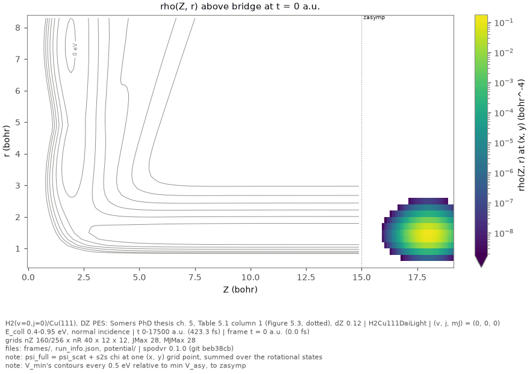

*Above the bridge site, where the barrier is lowest. The packet comes in along Z; part of it
stretches along r (the H–H bond) and dissociates, and the rest bounces back. Grey: the potential,
contours 0.5 eV apart.*

- **The answers:** reaction, scattering and diffraction probabilities, final rotational and
  vibrational states, scattering angles and time delays, all against the collision energy.

- **The pictures:** the wave packet moving over the potential, above any surface site and over the
  unit cell, and broken down into rotational, vibrational and diffraction states.

- **The checks:** the run is checked from its own files. A verdict lists what is not or may not be
  converged; figures show where the norm went, whether the grids hold the wave packet, and whether
  the run was long enough.

[The calculation](#the-calculation) · [The results](#the-results) ·
[The potential](#the-potential-the-molecule-meets) ·
[The wave packet in motion](#the-wave-packet-in-motion) ·
[Inside the wave packet](#inside-the-wave-packet) ·
[Stationary states](#stationary-states-at-chosen-energies) ·
[Can you trust it?](#can-you-trust-it-the-runs-own-checks) ·
[Make your own](#make-your-own)

## The story in five sentences

1. The molecule's best way in is over a **bridge site, lying flat** with its axis across the Cu–Cu
   bond it bridges (towards the hollows). The lowest classical barrier on the run's grid is
   0.67 eV there, against 0.85 eV over the hollow and 1.10 eV over the top site
   ([elbow plots](#elbow-plots-and-the-minimax-barrier)).
2. Reaction becomes visible at about **0.52 eV** and climbs to **60 %** at 0.95 eV
   ([results](#reaction-and-energy-disposal)). At impact, the dissociating part of the wave packet
   above a bridge site is about a thousand times denser than above a top site
   ([the packet above a site](#the-packet-above-a-site)).
3. Below about 0.56 eV most molecules bounce back without rotational excitation. Above that, j′ = 2
   is the largest channel, and these molecules rotate preferentially like a **helicopter**, parallel
   to the surface ([final states](#final-rotational-and-vibrational-states)).
4. They scatter in a **hexagonal pattern of diffraction spots**. The specular spot gets less than
   8 %: most molecules are diffracted ([diffraction](#diffraction)).
5. The run flags its own limits. From 0.46 eV upward, scattered flux reaches the outermost diffraction
   orders the 12 × 12 surface grid can hold (9.5 % of it at 0.675 eV, 22 % at 0.9 eV). The
   diffraction results therefore need a check on a larger grid ([verdict](#the-verdict)).

| Reaction against energy | Where the packet stretches | Diffraction at 0.675 eV |
|---|---|---|
| [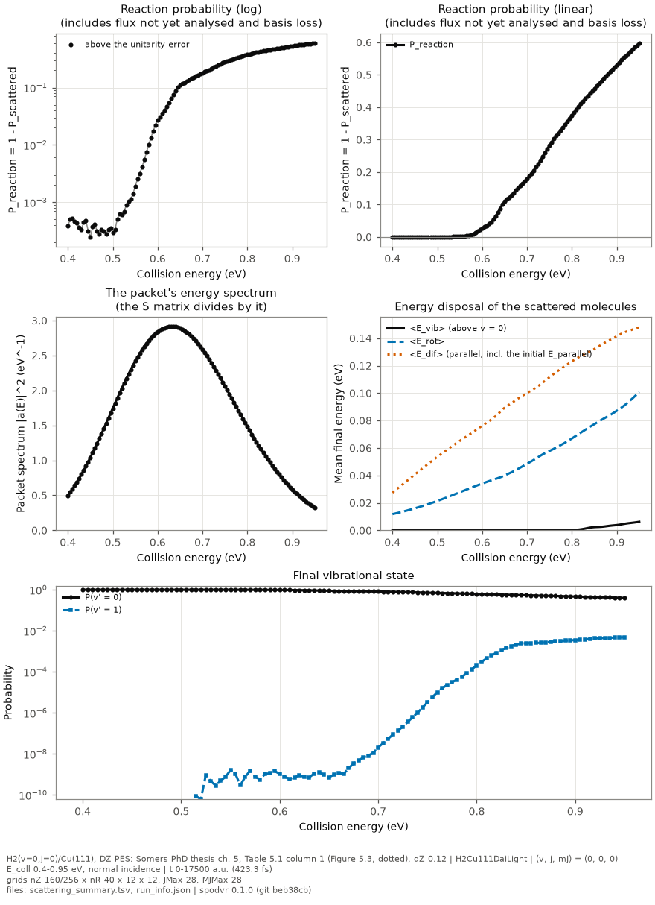](#reaction-and-energy-disposal) | [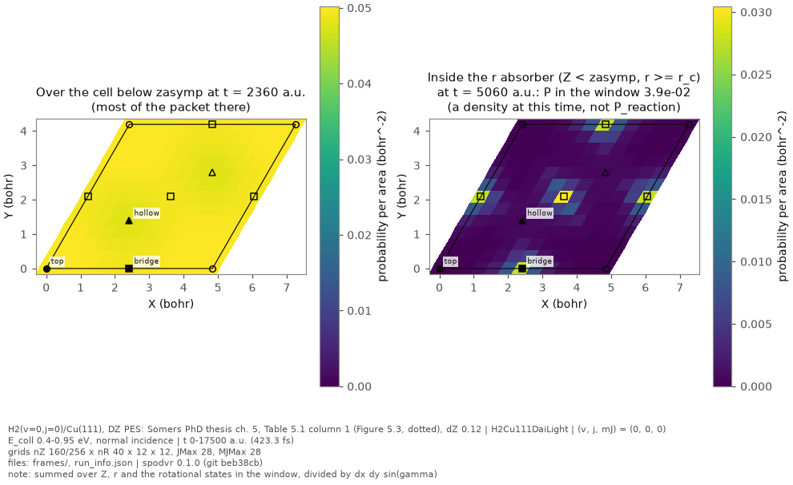](#the-packet-over-the-unit-cell) | [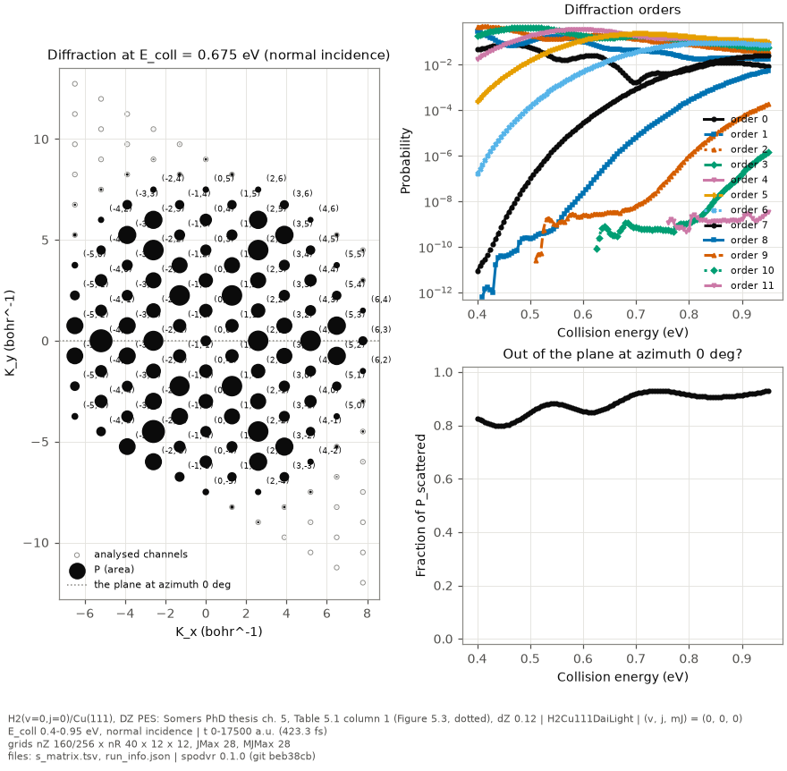](#diffraction) |

## The calculation

| | Value |
|---|---|
| System | H₂ on Cu(111): the Dai–Zhang LEPS potential (J. Chem. Phys. 102, 6280 (1995); `SystemID` `H2Cu111DaiLight`), a model surface with C6v symmetry |
| Initial state | v = 0, j = 0, mJ = 0, at normal incidence |
| Collision energies | 0.40–0.95 eV, 111 energies 5 meV apart, all from one wave packet |
| Grids | Z: 160 points, ΔZ 0.12 bohr, to 19.08 bohr (specular grid: 256 points, to 30.6 bohr); r: 40 points, 0.5–8.3 bohr; x, y: 12 × 12 over the unit cell (a = 4.84 bohr) |
| Rotations | even j ≤ 28 with all mJ: 435 states (H₂ is homonuclear: j = 0 couples only to even j) |
| Size | 400.9 million grid points: a 6.0 GiB wave function; the potential stored at 19 of the 144 surface points (symmetry) |
| Time | 7000 steps of 2.5 a.u., to 17 500 a.u. (423 fs); analysis every 20 a.u. |
| Analysis line | Z = 15.0 bohr, where the DZ potential is cut off to its gas-phase form |
| Absorbers | Z 15.0–19.08 bohr (scattering grid), Z 22.08–30.60 bohr (specular grid), r 4.1–8.3 bohr (dissociation) |

The physics is that of [inputs/thesis_fig5_3_dz](../inputs/thesis_fig5_3_dz/README.md), whose
README explains every choice of grid, wave packet and absorber. On that input the C++ program
reproduces the Fortran code and the thesis curve
([validation record](validation_thesis_fig5_3_dz/README.md)). This run only adds the keys that write
the plot data ([inputs/thesis_fig5_3_dz_plotting](../inputs/thesis_fig5_3_dz_plotting/README.md)).

<details>
<summary>The full input file (<code>inputs/thesis_fig5_3_dz_plotting/input.json</code>)</summary>

```json
{
  "Title": "H2(v=0,j=0)/Cu(111), DZ PES: Somers PhD thesis ch. 5, Table 5.1 column 1 (Figure 5.3, dotted), dZ 0.12",
  "SystemID": "H2Cu111DaiLight",
  "NewCalc": true,

  "ZDoF": true, "RDoF": true, "XDoF": true, "YDoF": true, "ThetaDoF": true, "PhiDoF": true,

  "Mass1": 1.0078, "Mass2": 1.0078, "HomoNuc": true,

  "ZStart": 0.0, "dZ": 0.12, "nZ": 160, "nZSpecular": 256,
  "RStart": 0.5, "dR": 0.20, "nR": 40,
  "nX": 12, "nY": 12,
  "JMax": 28, "MJMax": 28,
  "ProjOp": 2,

  "tStart": 0.0, "tEnd": 17500.0, "dtStep": 2.5, "nStep": 7000,

  "dtAna": 20.0, "dtAve": 500.0, "DynamZSpAna": true, "Zana": 15.0, "NrOfEs": 111,

  "EMinWP": 0.40, "EMaxWP": 0.95, "Z0": 18.0,
  "VIn": 0, "JIn": 0, "MJIn": 0,
  "EParallel": 0.0, "PhiParallel": 0.0,

  "ZOptStart": 15.0, "ZOptEnd": 19.08, "ZOptEnergy": 0.2,
  "ZSpOptStart": 22.08, "ZSpOptEnd": 30.60, "ZSpOptEnergy": 0.4,
  "ROptStart": 4.1, "ROptEnd": 8.3, "ROptEnergy": 0.3,

  "TolSp": 1.0e-7,

  "writeSMatrix": false, "writeProbs": true, "writeRDProbs": true, "alsoAnalysis": true,
  "UseSymmetry": true, "nPhisOptimal": true,

  "writeDensities": true, "writePotential": true, "NormBudget": true,
  "dtFrames": 20.0,
  "FrameExtras": ["angular", "diffraction", "vibration", "rotation_moments", "momentum"],
  "PlotSites": [
    {"name": "top", "x": 0.0, "y": 0.0},
    {"name": "bridge", "x": 0.5, "y": 0.0},
    {"name": "hollow", "x": 0.3333333333333333, "y": 0.3333333333333333}
  ],
  "EnergyResolvedSites": ["top", "bridge", "hollow"],
  "EnergyResolvedEnergies": [0.50, 0.65, 0.80]
}
```

</details>

### Reading the figures

- **Units:** distances in bohr (1 bohr = 0.529 Å), times in atomic units (1 a.u. = 0.0242 fs; the
  run lasts 423 fs), energies in eV.

- **Two energy zeros:**
  - **Collision energies** count from the incoming molecule, H₂(v = 0, j = 0).
  - **Potentials and barriers** count from the bottom of the gas-phase H₂ well on the run's r grid.
    The true well bottom lies 0.03 eV lower, between the grid points.
  - **The offset:** the molecule's zero-point energy, 0.22 eV on this grid. The bridge barrier
    (0.67 eV) therefore lies 0.45 eV above the incoming molecule's energy, if all of its
    zero-point energy could be used.

- **Log colour scales** are common: much of the physics sits many decades below the peak.
- **The grey strip** under each figure records the run, the grids, the source files and the git
  commit.

### Words on the figures

- **Scattering grid:** the full six-dimensional grid, Z up to 19.08 bohr.
- **Specular grid** (also "specular wave", χ): a longer grid in Z and r only, to 30.6 bohr. It
  carries only the incoming channel (v = 0, j = 0, no parallel momentum), cheaply, while the
  packet is far from the surface. ψ_full is the whole wave packet, both parts together.

- **zasymp** (= Zana = 15 bohr here): beyond it the potential is the gas-phase one.
- **Analysis line** (Zana): where the outgoing wave packet is projected on the final states at
  every analysis step. These are the Balint-Kurti (BK) coefficients c(t); their time sums give the
  S matrix. The **specular analysis line** does the same for the incoming channel on the specular
  grid.

- **On-the-fly and fine analysis:** the S matrix summed during the run, and recomputed afterwards
  from the stored c(t) (`alsoAnalysis`).

- **Absorbers** (ZOpt, ZSpOpt, ROpt): complex absorbing potentials at the end of the scattering grid,
  the end of the specular grid and at large r. Whatever reaches r ≥ 4.1 bohr (ROpt) is counted as
  dissociated.

- **DVR nodes:** the orientations (θ from the surface normal, φ around it) at which the program
  represents the molecule. **V_min** is the lowest potential over these nodes at each point.

- **Diffraction order:** the diffraction channels (n, m) grouped in hexagonal rings, counted outward
  from the specular spot (order 0). Order 1 is the six nearest spots.

## The results

These figures come from the files every run writes (`scattering_summary.tsv`, `s_matrix.tsv`,
`bk_coefficients.bin`): no extra key is needed.

### Reaction and energy disposal


**What it shows.**

- Top: the reaction probability against the collision energy, on a log and a linear axis.
- Middle left: the wave packet's energy spectrum, the weight with which each energy is present.
- Middle right: where the energy of the scattered molecules goes: vibration, rotation, and motion
  parallel to the surface.

- Bottom: the final vibrational state.

**Why it matters.** The reaction probability against energy is the headline result of a
molecule-surface calculation. Molecular-beam experiments measure it, averaged over the beam's
energy spread.

**Take-away.**

- **Reaction:** 0.2 % at 0.55 eV, 11 % at 0.65 eV, 37 % at 0.80 eV and 60 % at 0.95 eV. On this
  input the validated builds reproduce the thesis curve at all 67 digitised points
  ([validation](validation_thesis_fig5_3_dz/README.md)).

- **The onset** lies between the two classical limits: above 0.45 eV (the bridge barrier with all of
  the zero-point energy used) and below 0.67 eV (with none of it). The barrier is "late" (the bond is
  stretched there; next section): the H–H vibration softens on the way, and its zero-point energy
  helps, as does tunnelling.

- **The change of slope** near 0.65 eV, on the log axis, is where the rise stops being exponential:
  the barrier is passed over more of the cell (hollow 0.85 eV, top 1.10 eV).

- **The floor** of 2.5–5 × 10⁻⁴ below 0.5 eV is most likely not reaction. It is probability the
  finite basis loses at the surface ([the norm budget](#where-did-the-norm-go)), which
  P_reaction = 1 − P_scattered counts as reaction.

- **Energy disposal:** parallel motion (diffraction) takes the most, up to 0.15 eV; rotation up to
  0.10 eV; vibrational excitation (v′ = 1) stays below 0.5 %.

### Final rotational and vibrational states

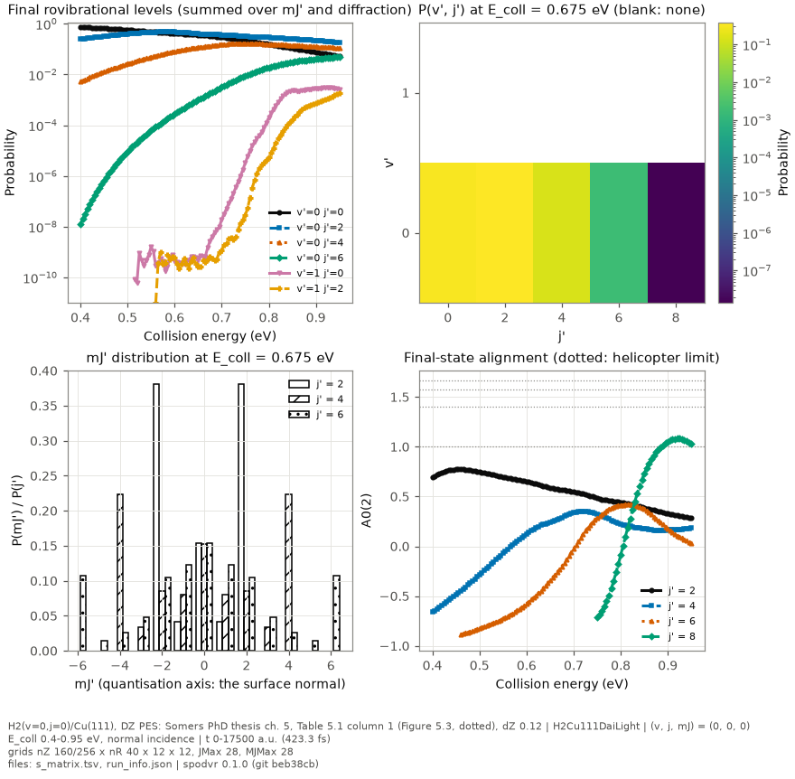

**What it shows.**

- Top left: the probability of each final (v′, j′) against energy. Top right: the same at one energy,
  0.675 eV.

- Bottom left: how each j′ is divided over mJ′, its projection on the surface normal.
- Bottom right: the rotational alignment A₀⁽²⁾ = ⟨3mJ′² − j′(j′+1)⟩ / j′(j′+1). It is −1 for a
  pure "cartwheel" (rotating in a plane that contains the normal) and 0 for no preference. Its
  maximum, a pure "helicopter" (rotating parallel to the surface), is the dotted line for each j′:
  1.0 for j′ = 2.

**Why it matters.** State-to-state probabilities and alignments are what laser-detection
experiments resolve, and they are a sensitive test of the potential's anisotropy.

**Take-away.**

- **At 0.675 eV:** j′ = 0 holds 33 % of all molecules, j′ = 2 38 % and j′ = 4 14 % (together:
  P_scattered = 0.86).

- **j′ = 2 is a helicopter state:** mJ′ = ±2 dominates, A₀⁽²⁾ = +0.57. The molecule starts with
  mJ = 0, and the potential's dependence on the polar angle θ alone would only produce cartwheels.
  Helicopters need its dependence on φ: at the bridge barrier, lying flat along the Cu–Cu line
  costs 0.48 eV more than lying across it.

- **Higher j′** are cartwheel-like at low energy (j′ = 4 below about 0.55 eV, j′ = 6 up to
  0.73 eV).

### Diffraction


**What it shows.**

- Left: the diffraction pattern at 0.675 eV. Each open circle is an analysed diffraction channel
  (n, m) at its final parallel momentum. Each filled circle has an area proportional to the
  probability of scattering into it.

- Right: the probability of each diffraction order against energy, and the fraction scattered out of
  the plane along the first lattice vector. At normal incidence there is no plane of incidence, so
  the tool takes azimuth 0°.

**Why it matters.** A periodic surface acts like a grating for the molecule's de Broglie wave. The
intensities of the spots probe how strongly the potential varies over the unit cell (its
corrugation).

**Take-away.**

- **The specular spot is weak:** (0, 0) holds at most 8 % and almost vanishes near 0.70 eV (0.17 %).
  Most of the flux is diffracted, so the DZ model is strongly corrugated for H₂ at these energies.

- **The pattern is only approximately six-fold.** The analysed channels form a parallelogram, the
  12 × 12 grid's momentum box, not a hexagon. That is the grid limit
  [the verdict](#the-verdict) flags.

### Scattering angles

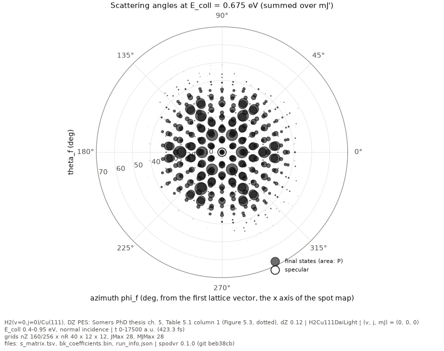

**What it shows.** The final states as a detector would see them: every open (v′, j′, n, m) at its
polar angle from the surface normal (distance from the centre) and its azimuth (angle around it),
with area proportional to probability.

**Why it matters.** This is the angular distribution an experiment with a movable detector measures.
It combines diffraction (the direction of the parallel momentum) and rotational excitation, which
takes energy out of the normal motion and so tilts the outgoing direction.

**Take-away.** At normal incidence the specular direction is the centre. Nearly all scattered flux
lies within about 40° of the normal. Each diffraction spot splits into several, one per final
rotational state.

### Time delays

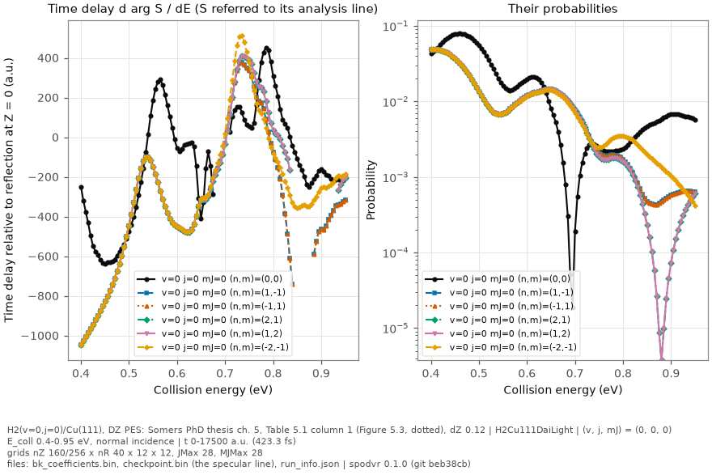

**What it shows.**

- Left: for the six most probable final channels, how long the molecule takes compared with an
  ideal reflection at Z = 0. It comes from the energy derivative of the phase of the S matrix, each
  channel referred to its own analysis line.

- Right: the probabilities of the same channels.

**Why it matters.** Time delays show how the collision unfolds in time: an early turning point gives
a negative delay; a slowdown near the barrier or temporary trapping a positive one. Probabilities
alone do not show this.

**Take-away.**

- **Early turning:** at 0.40 eV the diffracted channels come back about 1000 a.u. (24 fs) early,
  as if reflected about 1.4 bohr further out than Z = 0. The delays then oscillate by about
  ±500 a.u. with energy.

- **Near-zeros of S:** sharp spikes sit where a channel's probability dips to almost zero; they
  are not real times.

- **The specular channel** (0, 0) is analysed at the specular line, which is fixed near the
  starting packet, so its delay also counts the incoming packet's slow tail.

- **Symmetry partners:** they coincide up to about 0.6 eV and split above it, (−2, −1) most
  visibly: the same grid limit as in the diffraction pattern.

## The potential the molecule meets

The `writePotential` key saves the potential exactly as the propagation uses it, on the run's own
grid. This is the landscape behind the results above.

### The potential over the unit cell

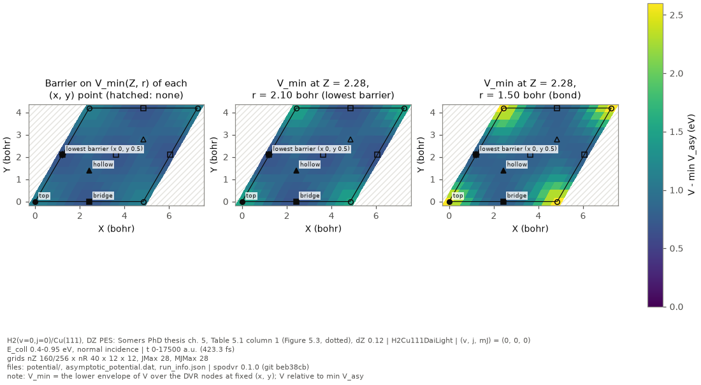

**What it shows.**

- **The cell:** the Cu(111) unit cell is the parallelogram. Circles mark top sites, squares bridges,
  triangles hollows; filled markers are the named sites of `PlotSites`, open ones the
  symmetry-equivalent sites. The DZ model has C6v symmetry, so its two kinds of hollow are
  equivalent.

- **Left:** for each surface point, the lowest barrier the molecule must cross to dissociate there.
- **Middle and right:** the potential at the height of the lowest barrier (Z = 2.28 bohr), with the
  bond stretched to r = 2.10 bohr (middle) and at the gas-phase bond length r = 1.50 bohr (right).

- **Orientation:** at each point the molecule takes its best orientation on the run's angular grid.

**Why it matters.** Dissociation is site-specific. This map shows at a glance which part of the
surface is open for reaction, before you look at any dynamics.

**Take-away.**

- **The barrier** is lowest around the bridge sites (marked "lowest barrier") and highest over the
  top sites, where the copper atoms sit.

- **The bond length** matters most over the top sites. At this height an unstretched bond costs
  2.6 eV there, a stretched one 1.5 eV. Over the bridges and hollows, stretching the bond to
  2.1 bohr changes the potential by only about 0.1 eV.

### Elbow plots and the minimax barrier

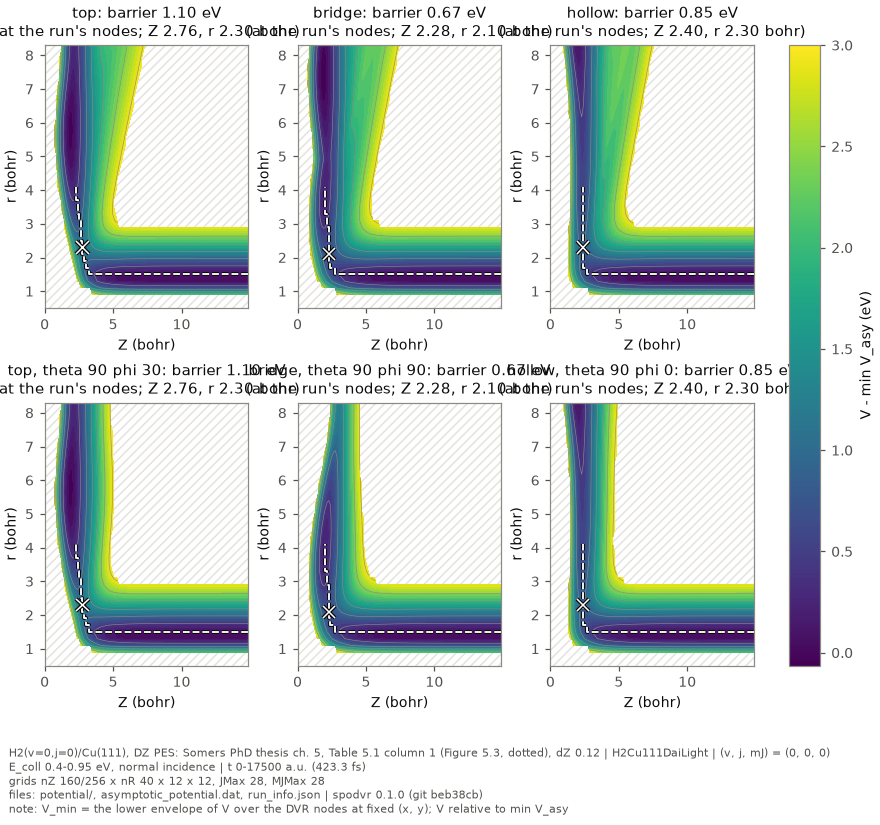

**What it shows.** The classic "elbow" picture: the potential against the molecule-surface distance
Z and the bond length r, at each of the three sites.

- **The two arms:** the lower arm (r ≈ 1.4 bohr, large Z) is the intact molecule far from the
  surface; the upper arm (large r, small Z) is two H atoms on the surface.

- **The barrier:** the × marks the minimax barrier, the lowest possible highest point on a path from
  one arm to the other; the dashed line is one such path.

- **The rows:** top row, the best orientation at every point; bottom row, the fixed orientation of
  the barrier.

**Why it matters.** The height and position of the barrier decide how translational and vibrational
energy help the reaction. Surface scientists read a potential this way.

**Take-away.**

- **The barriers:** bridge 0.67 eV, hollow 0.85 eV, top 1.10 eV, all with the molecule lying flat
  (θ = 90°).

- **Late barriers:** they lie at Z ≈ 2.3–2.8 bohr with the bond stretched to 2.1–2.3 bohr, against
  1.4 bohr in the gas phase. By the Polanyi rules, vibrational energy should therefore promote
  reaction.

- **A caveat:** these are classical barriers at the run's grid points; the potential's own minimum
  can lie between them.

### The potential against the orientation

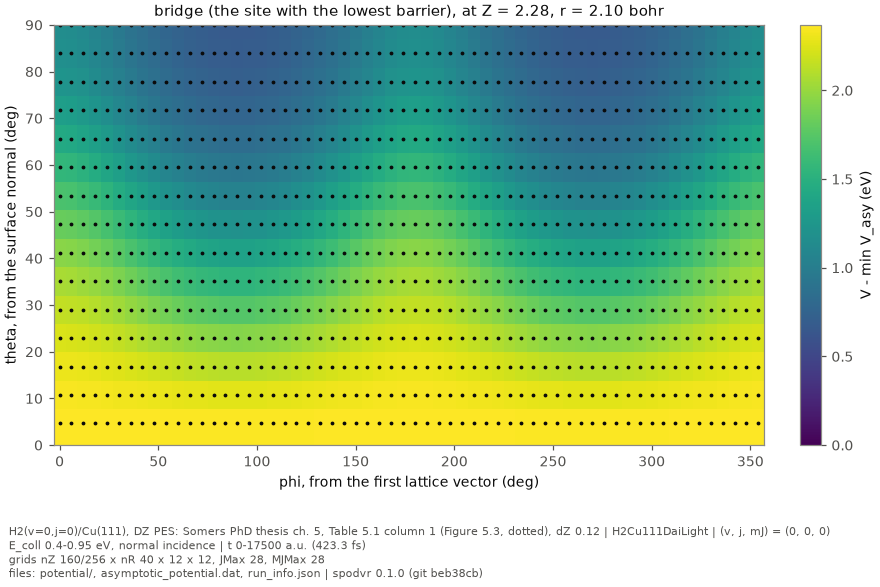

**What it shows.** At the barrier point above the bridge, the potential for every orientation the
calculation uses (dots: θ from the surface normal, φ around it, from the first lattice vector).

**Why it matters.** The dependence on orientation is what turns the molecule: it drives rotational
excitation and alignment.

**Take-away.**

- **Standing up** (θ near 0°) costs more than 2 eV.
- **Lying flat:** the cost depends strongly on where the axis points. Across the Cu–Cu bond
  (φ ≈ 90°, 270°) is cheapest; along it (φ ≈ 0°, 180°) costs 0.48 eV more.

- **This φ dependence** is what produces the helicopter alignment of the scattered molecules.

## The wave packet in motion

`writeDensities` and `dtFrames` save the wave packet during the run. These figures show the
collision itself, and they are often the quickest way to see that something is wrong.

### The whole packet over (Z, r)

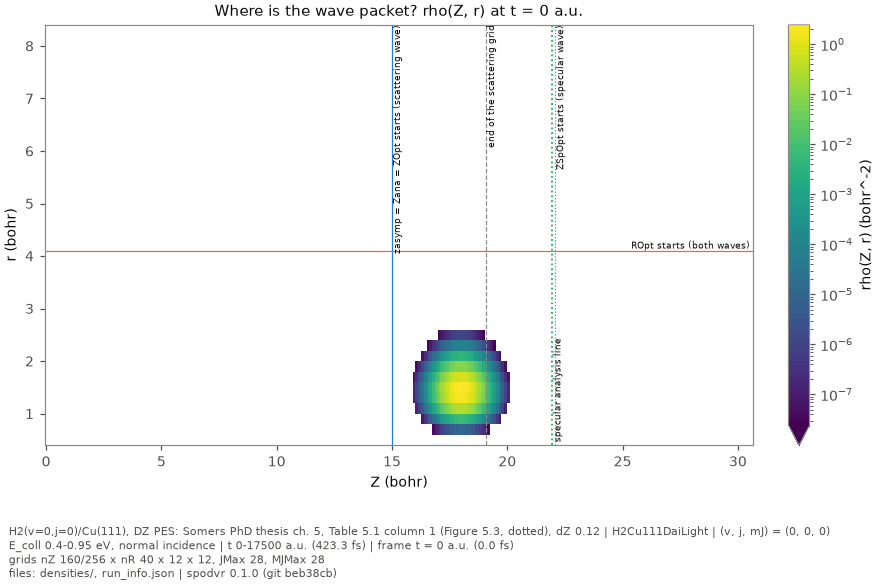

**What it shows.** The probability density over the molecule-surface distance Z and the bond length
r, summed over the surface position and the orientation, every 500 a.u. Lines mark the analysis
line, the end of the scattering grid and where the absorbers start.

**Why it matters.** This is the whole collision in one picture: approach, impact, dissociation (up
the r axis) and the return.

**Take-away.**

- **Impact:** the packet arrives at the surface around t = 5000 a.u. (120 fs). Part of it climbs up
  the r axis into the dissociation absorber; the rest leaves again.

- **The end:** only the slow tail of the elastically reflected wave remains, on the specular grid.

### The packet in Z and r against time

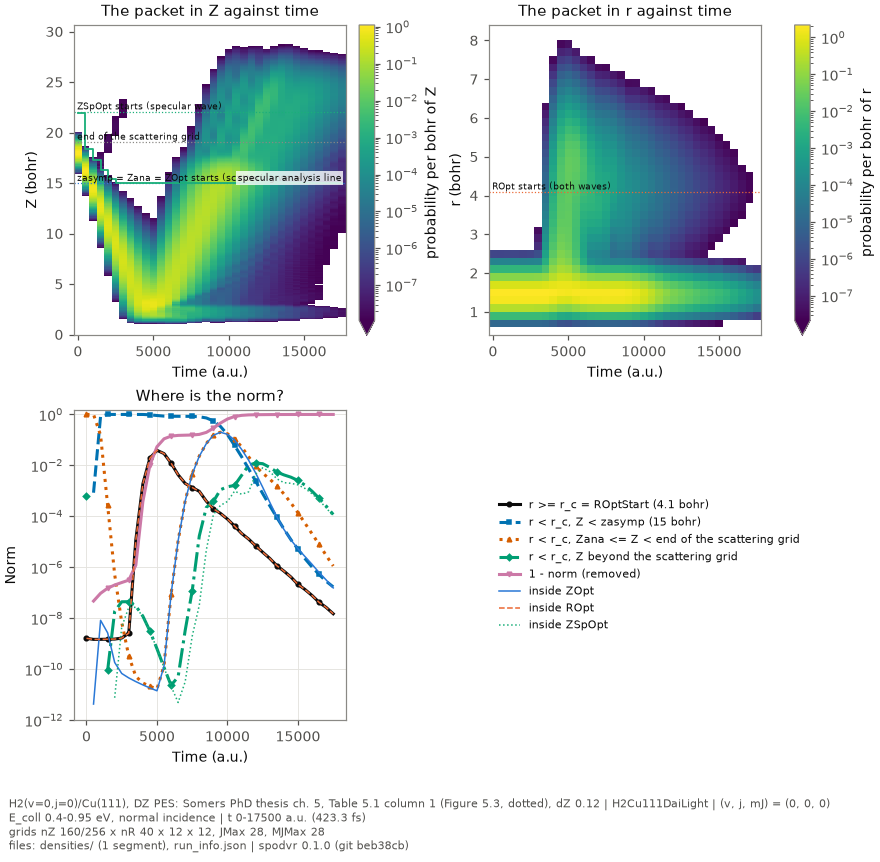

**What it shows.**

- Top: the same density flattened onto time: where the packet is in Z (left) and in r (right) at
  every moment.

- Bottom: how much of the packet is in each region (dissociating, near the surface, beyond the
  analysis line, on the specular grid), how much each absorber holds, and how much has been removed
  (1 − norm).

**Why it matters.** One figure shows the whole time line, and the bottom panel turns "where is the
packet" into numbers.

**Take-away.**

- **The turning point:** a sharp V at Z ≈ 2.5 bohr and t ≈ 5000 a.u.
- **Reaction:** the stretch into large r happens only during the impact. The step in "1 − norm"
  (pink) to 0.15 is the reaction probability averaged over the packet's energy spectrum, plus the
  small loss of [the norm budget](#where-did-the-norm-go).

- **The exit:** the packet then leaves through the absorbers in order, scattering grid first,
  specular grid last.

### The packet above a site

| Top | Bridge | Hollow |
|---|---|---|
| 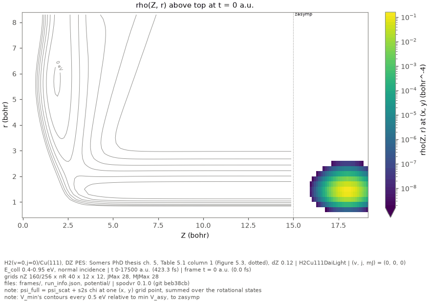 |  |  |

At impact, t = 5440 a.u. (frames of the movies above):

| Top | Bridge | Hollow |
|---|---|---|
| 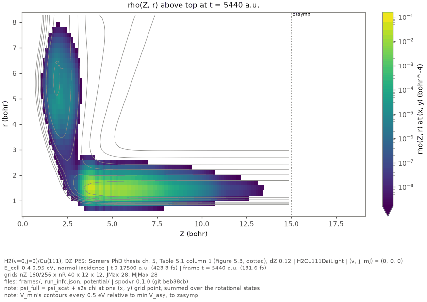 | 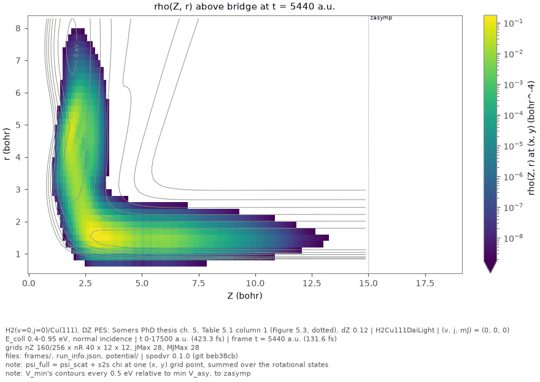 | 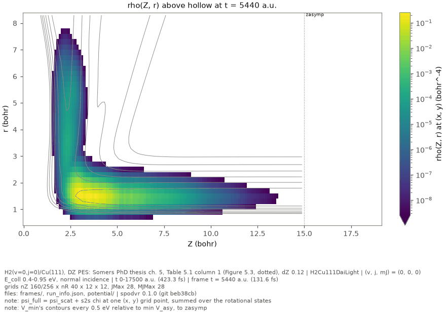 |

Click an image to open it at full size.

**What it shows.** One movie per site of `PlotSites`: the density over (Z, r) directly above that
surface point, with the potential at the same point (grey, every 0.5 eV). Nothing is summed over the
surface: this is the molecule's centre of mass right above a top, bridge or hollow site.

**Why it matters.** It connects the potential to the dynamics, site by site: you see the packet run
into the elbow of [the elbow plots](#elbow-plots-and-the-minimax-barrier) and either turn round or
go through.

**Take-away.**

- **Bridge:** the bright lobe that reaches up the r axis is the reaction.
- **Hollow:** a weaker lobe.
- **Top:** almost nothing.
- **In numbers:** at t = 5000–5440 a.u. the dissociating part (r ≥ 4.1 bohr) above the bridge is
  900–1150 times denser than above the top site, and 90–290 times denser than above the hollow.

- **More sites:** the viewer (`tools/plots/view.py`) shows the same at any of the 144 surface
  points.

### The packet over the unit cell


**What it shows.**

- Left: the probability over the unit cell while the packet approaches.
- Right: the part inside the dissociation absorber (r ≥ 4.1 bohr) at the moment it is largest,
  t = 5060 a.u., when it holds 3.9 % of the packet.

**Why it matters.** It shows where on the surface the packet stretches towards dissociation.

**Take-away.**

- **On approach** the packet covers the whole cell evenly (normal incidence, j = 0).
- **The dissociating part** is concentrated over the bridge sites (the squares): the map of
  reactivity follows the barrier map.

- **A caveat:** this is a density at one time, not a reaction probability; the reaction probability
  comes from the S matrix.

## Inside the wave packet

The `FrameExtras` key breaks every frame down further: into rotational, diffraction and vibrational
states, molecular-axis directions and momenta, at every Z.

**A caveat for this run:** the figures pick two frames by themselves. The first, titled "at the
surface", is t = 2360 a.u.: most of the packet has passed the analysis line, but it is still at
Z ≈ 9.5 bohr, before impact. The second is the last frame, which holds only the slow remainder. The
impact itself (around t = 5000 a.u.) appears in the time traces, and in the viewer, which steps
through all 876 frames.

### Rotational states over Z and in time

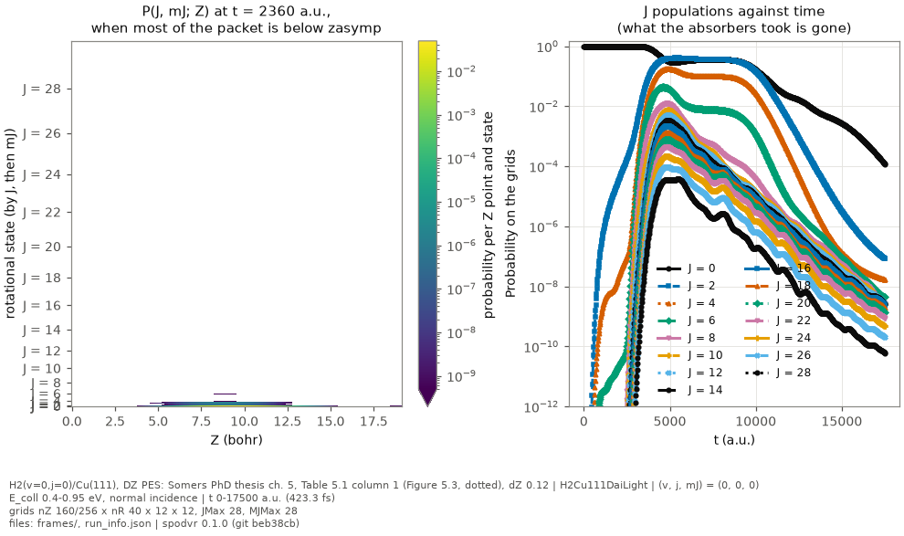

**What it shows.**

- Left: the probability of each rotational state (J, mJ) along Z at one moment.
- Right: the probability of each J on the grid against time.
- Near the surface, J labels the basis states in which the packet is expanded; only beyond zasymp are
  these the rotational states of the free molecule.

**Why it matters.** It shows when the molecule picks up rotation, and how much of the rotational
basis (here up to J = 28) the collision really uses.

**Take-away.**

- **Before impact** the packet is still pure J = 0 (left).
- **At impact** (t ≈ 5000 a.u.) J = 2 rises to 40 % and J = 4 to about 10 %, and the populations fall
  off steadily up to J = 28, which still holds 3 × 10⁻⁵.

- **Afterwards** they settle as the packet leaves.

<details>
<summary>Four more breakdowns per frame: the molecular axis, diffraction orders, vibrational levels, alignment</summary>

### The distribution of the molecular axis

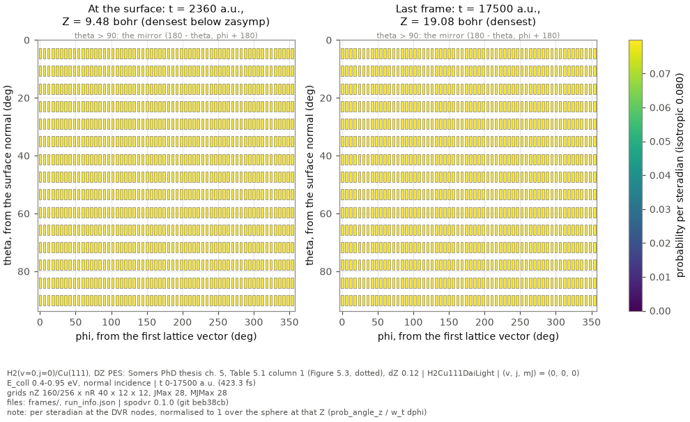

**What it shows.** How the molecular axis points, per unit solid angle, at the Z point where the
packet is densest: one square per orientation of the angular grid, normalised so that an isotropic
distribution is 1/4π = 0.080 everywhere.

**Why it matters.** It shows whether the surface orients the molecules, a direct picture of the
steric effect.

**Take-away.** Both frames are uniform, as they must be:

- **Before impact:** the incoming j = 0 molecule is isotropic.
- **Last frame:** at Z = 19.08 bohr the elastically reflected j = 0 wave dominates by about two decades
  ([diffraction orders](#diffraction-orders-over-z), right).

- **At impact:** step to t ≈ 5000 a.u. in the viewer to see the alignment there.

### Diffraction orders over Z

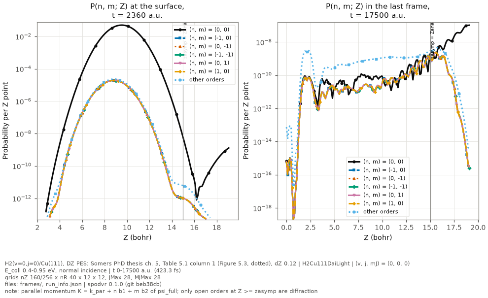

**What it shows.** The probability in each parallel-momentum order (n, m) along Z, before impact
(left) and in the last frame (right). Beyond the analysis line (Z = 15 bohr) these are the
diffraction channels.

**Why it matters.** It shows diffraction taking shape in space, and whether the diffracted flux has
left the surface region by the end of the run.

**Take-away.**

- **On approach** the packet is almost pure (0, 0), with 10⁻⁵ of the other orders where the potential
  still varies slightly over the cell (about 8 meV at Z = 9 bohr).

- **By the end** less than 10⁻⁷ per Z point remains anywhere: the diffracted flux has left the grid.

### Vibrational levels over Z

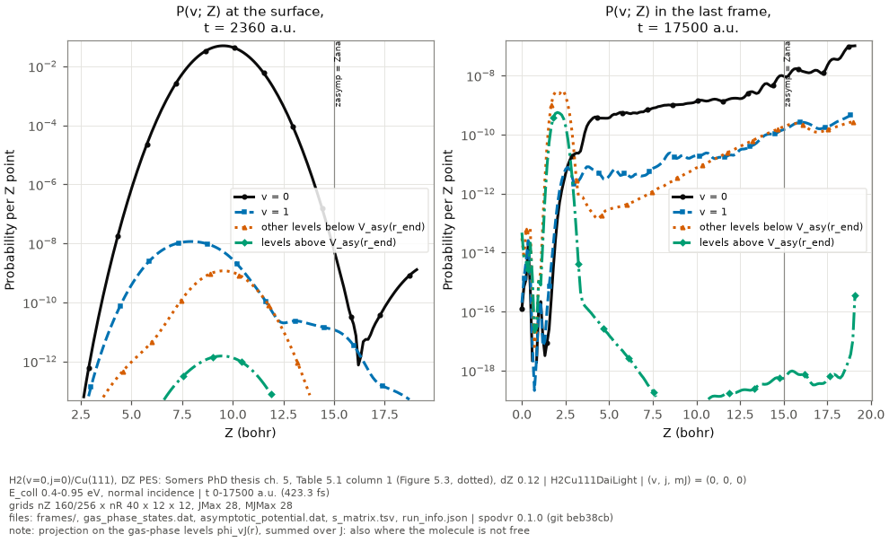

**What it shows.** The probability per gas-phase vibrational level along Z: v = 0, v = 1, the other
bound levels, and the levels above the dissociation limit of the r grid.

**Why it matters.** It separates vibrational excitation (v = 1 leaving the surface) from
dissociation, and shows how far the bond stretches at each Z.

**Take-away.**

- **On approach,** v = 1 is tiny (about 10⁻⁸ per Z point) and grows towards the surface side of the
  packet: the bond responding to the approaching surface, not excitation into the open v = 1 channel.

- **In the last frame,** a remnant near Z ≈ 2 bohr sits in high bound levels (v ≥ 2, about
  2.5 × 10⁻⁹) and the continuum (about 5 × 10⁻¹⁰).

### Alignment and rotational energy over Z

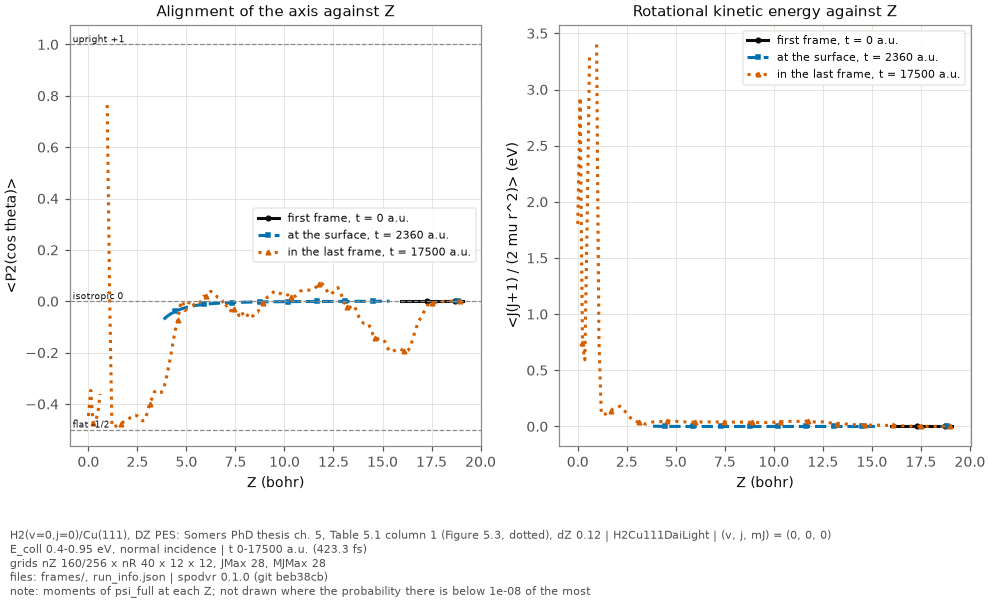

**What it shows.**

- Left: the alignment ⟨P₂(cos θ)⟩ against Z: +1 for molecules standing up, −1/2 for molecules lying
  flat, 0 for no preference.

- Right: the rotational kinetic energy at every Z.

**Why it matters.** The two numbers per Z summarise the angular motion along the whole grid.

**Take-away.**

- **Coming in:** the alignment is 0 (j = 0).
- **The slow remainder** at Z ≈ 16–17 bohr in the last frame lies preferentially flat (−0.2),
  consistent in sign with the helicopter alignment of j′ = 2 but not a measure of it.

- **Near Z ≈ 1.5–3 bohr** a 10⁻⁹ remnant lies flat (−0.45).
- **Below 1 bohr** the population (about 10⁻¹⁴) is too small to interpret.

</details>

## Stationary states at chosen energies

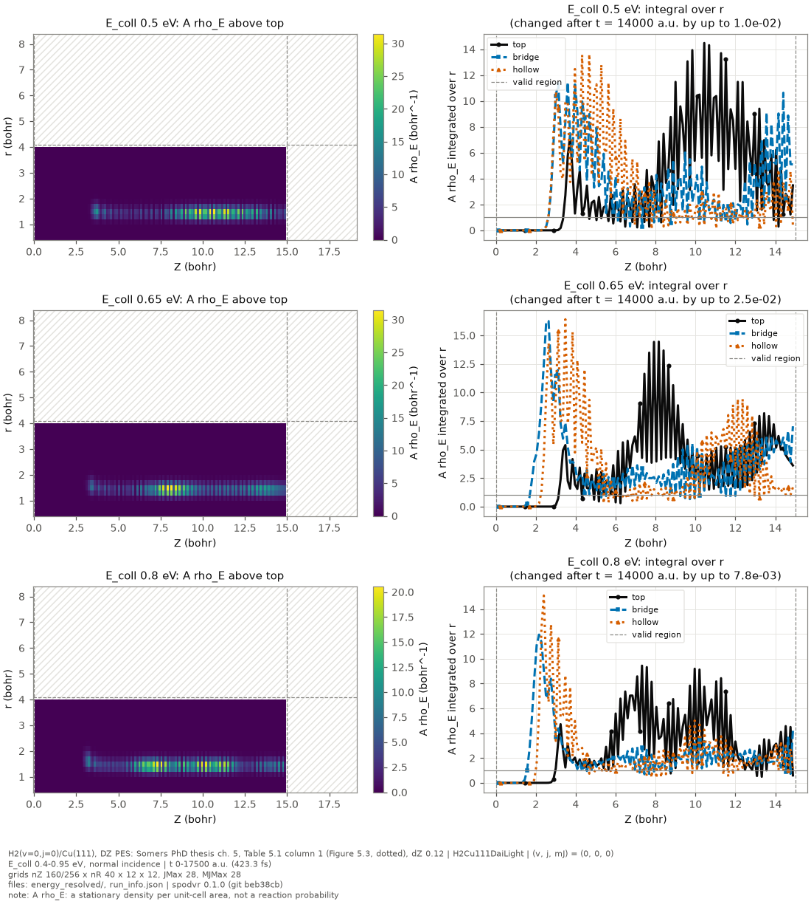

**What it shows.**

- **The method:** from one time-dependent run, the time-independent scattering state at three chosen
  energies (0.50, 0.65 and 0.80 eV), above three sites (`EnergyResolvedSites`,
  `EnergyResolvedEnergies`). It is a Fourier transform of the wave packet in time.

- **Left:** the density over (Z, r) above the top site.
- **Right:** the density integrated over r against Z above each site.
- **The scale:** A·ρ_E, with A the unit-cell area, is normalised so that the incoming wave alone
  gives 1.

- **Drawn region:** only Z < 15 bohr and r < 4.1 bohr. Elsewhere the absorbers remove the wave, so the
  time sum is not the stationary state.

**Why it matters.** A wave packet mixes all energies; the stationary state is the textbook object of
scattering theory at one energy. It shows how close the molecule gets at that energy, site by site,
and where incoming and outgoing waves interfere.

**Take-away.**

- **The zigzag** from point to point is the interference of the incoming and the reflected wave,
  with a period of half a de Broglie wavelength (0.21–0.27 bohr, about two grid points).

- **The large values** (up to 15) and **the slow modulation** come from many diffraction channels
  interfering at one site.

- **How close:** the molecule comes closest above the bridge and hollow sites (density from
  Z ≈ 1.7–2.8 bohr) and turns earliest above the top site (Z ≈ 3 bohr).

- **Truncation check:** each title gives how much the profiles changed after 80 % of the run: at most
  0.025, on profiles that reach 15. So tEnd is adequate.

## Can you trust it? The run's own checks

The plot tool reads every run as a referee would: what is not converged, what may not be, and why.
These checks say which of the figures above to trust, and where to be careful.

### The verdict

The report opens with a verdict, worst finding first. For this run (condensed):

| | Finding | Value | Limit |
|---|---|---|---|
| warning | flux in the outermost analysed diffraction channels | up to 0.22 of P_scattered (at 0.915 eV); above the limit from 0.46 eV on | ≤ 0.001 |
| warning | the packet reaches the outer diffraction orders of the momentum grid | up to 0.11 of the norm (t = 5160 a.u.) | ≤ 10⁻⁶ |
| warning | the norm budget does not close | residual 1.7 × 10⁻³ (error estimate 7.6 × 10⁻⁴) | estimate + 10⁻⁴ |
| information | slowest converged outgoing normal energy | 0.060 eV; slower channels carry at most 3.5 × 10⁻⁹ | ≤ 0.001 |
| information | absorber reflection: the error of P from waves the Z absorbers return | up to 6.1 × 10⁻⁵ in P (0.4 eV, channel (v, j, mJ, n, m) = (0, 0, 0, 1, −1), P = 0.049); relative error 2a up to 2.5 × 10⁻⁴ where P ≥ 0.01; 14 073 rows near a threshold not estimated | ≤ 0.001 |
| information | the top rotational state J = 28 during impact | up to 3.8 × 10⁻⁵ of the norm | normal at the surface |
| information | norm left at the end | 1.2 × 10⁻⁴ | |

**What it means.**

- **Time and grids:** the run is long enough, and the r and Z grids hold the packet.
- **The first two warnings** are one problem seen twice: the molecules diffract into the outermost
  orders the 12 × 12 surface grid can represent. This holds over most of the energy range, and it
  also breaks the six-fold symmetry of the diffraction results above about 0.6 eV.
  - Diffraction and rotationally inelastic diffraction results need a check with a larger `nX`,
    `nY`.
  - The run cannot tell whether the reaction probability is affected. It agrees with the thesis,
    which used this grid for reaction.

- **The third warning** is explained under [the norm budget](#where-did-the-norm-go).

**What the verdict cannot tell you.** It checks the run against itself: time, edges, basis, norm. A
time step, grid spacing or basis that is too coarse without showing at an edge needs a second run
with that parameter changed. How to choose and verify each parameter:
[inputs/README.md](../inputs/README.md), sections 2–10. The limits in the table are rules of thumb,
not derived bounds. Nor does a norm bound the error at one energy: that error is first order in the
amplitude, about 2√N for a norm N not yet analysed where P ≈ 1 and larger at the ends of the packet's
energy range, and absorber reflection adds up to about 2√R of P, which no norm shows
(inputs/README.md, section 8). The "absorber reflection" finding estimates the latter per channel from
the absorbers' R and T, to first order: not for channels just above their threshold (R > 0.1), nor for
the r absorber, the low-Z absorbers or channels the run does not analyse.

### Norms and mean positions

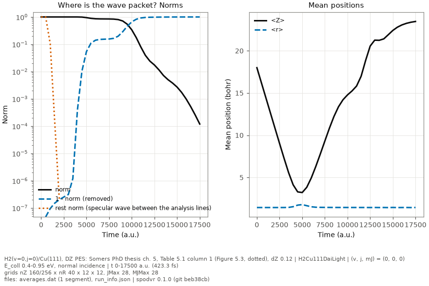

**What it shows.**

- Left: the norm on the grids; the norm removed so far; and the "rest norm", the incoming wave still
  between the two analysis lines.

- Right: the mean distance ⟨Z⟩ and the mean bond length ⟨r⟩.

**Why it matters.** This is the classic sanity check of a wave-packet run. The norm must fall only
when the packet reaches an absorber, and everything must have gone by the end.

**Take-away.**

- **Reaction:** about 15 % of the norm is removed around t = 4000–6000 a.u., absorbed at large r.
- **Scattering:** the rest leaves through the Z absorbers from t ≈ 8000 a.u.
- **The end:** 1.2 × 10⁻⁴ is left.
- **⟨Z⟩** reaches its minimum of 3.2 bohr at t = 5000 a.u. (an average over a broad packet, not a
  turning point).

### Where did the norm go?

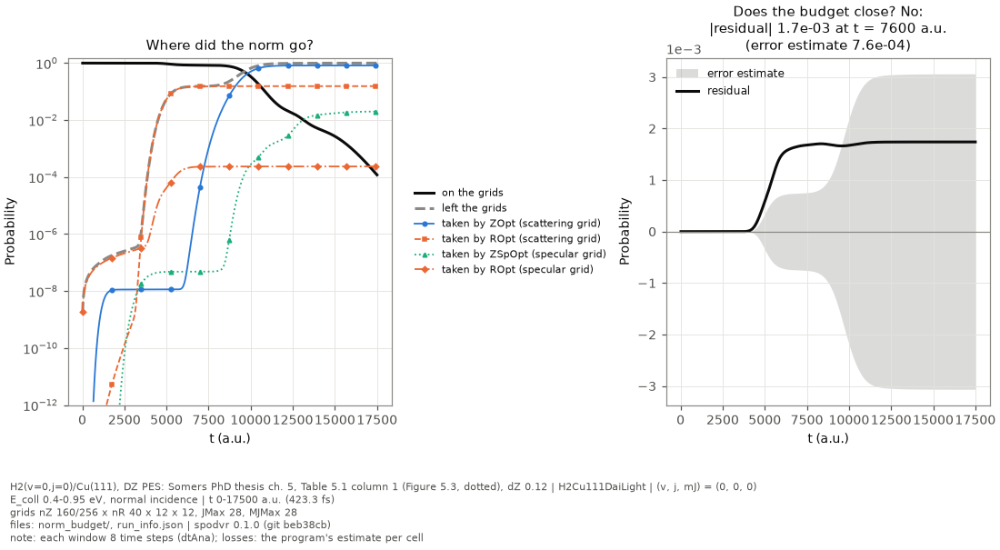

**What it shows.**

- Left: what each absorber took, against time.
- Right: the residual (the norm that left the grids minus what the absorbers account for), with its
  error estimate in grey.

**Why it matters.** P_reaction = 1 − P_scattered counts anything lost as reaction. The budget shows
whether the loss is all absorption, or partly something else.

**Take-away.**

- **The absorbers:** the Z absorber of the scattering grid takes most (scattering), the r absorber
  about 15 % (reaction), the specular absorber 2 % (the elastically reflected wave).

- **The residual:** 1.7 × 10⁻³ appears at impact, about 10⁻³ beyond its error estimate. (The estimate
  grows later, as the absorbers work.)

- **The most likely cause** is the angular transform. At every time step the wave packet is projected
  back onto the rotational basis (J ≤ 28), and what lies outside it is lost. The Fortran code loses
  it in the same way, and it should shrink with a smaller `dtStep`; a run with a larger `JMax` or a
  smaller `dtStep` would confirm it.

- **The consequence:** it counts as reaction, so P_reaction below about 10⁻³ (the floor and the
  onset) is uncertain at that level.

### When does each channel pass? Convergence in time

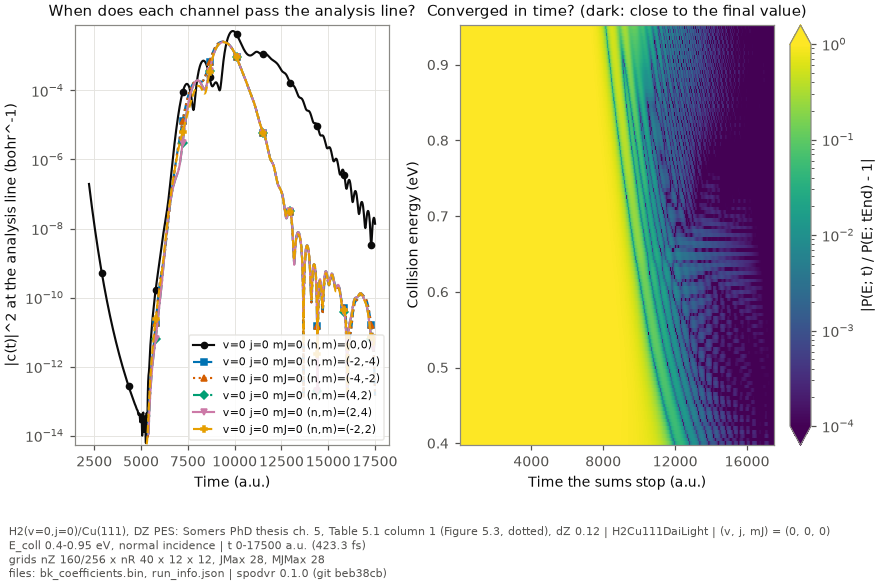

**What it shows.**

- Left: when the flux of the strongest channels crosses the analysis line.
- Right: how far the scattering probability at each energy would be from its final value if the time
  sums had stopped at time t. Dark is within 10⁻⁴ of the value at tEnd.

**Why it matters.** It answers the question every wave-packet user asks: was tEnd long enough? Slow
channels (just above their threshold, or highly excited) arrive last.

**Take-away.** The scattered flux passes between 7000 and 13 000 a.u. The last energies (around
0.6–0.75 eV) settle at about 15 000 a.u., 2500 a.u. before tEnd.

<details>
<summary>Four more checks: on-the-fly against fine analysis, basis and grid edges, momentum grids, the gas-phase molecule</summary>

### On-the-fly and fine analysis

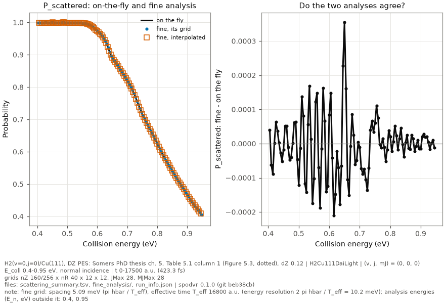

**What it shows.** P_scattered from the analysis during the run and from the fine analysis after it
(`alsoAnalysis`), and their difference.

**Why it matters.** Both transform the same Balint-Kurti time series, in two ways: summed during the
run, and as a transform of the stored series afterwards. They check the step from time to energy and
the cut-off of the series, not the propagation.

**Take-away.**

- **Agreement:** the two agree within 3.5 × 10⁻⁴, comparable to the reaction-probability floor at low
  energy.

- **The pattern:** the difference changes sign from point to point at the fine analysis's energy
  resolution (10 meV); a longer run would shrink it.

### Does the basis hold the wave?

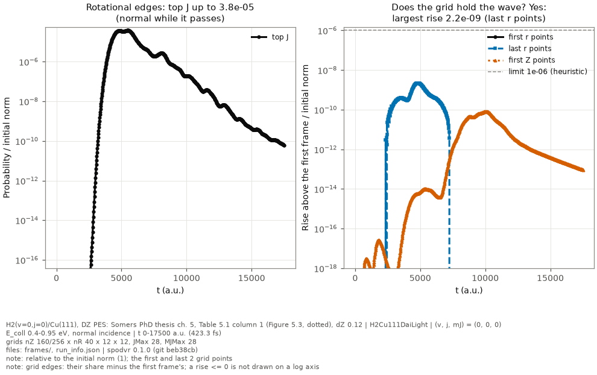

**What it shows.**

- Left: the population of the highest rotational state.
- Right: how much probability reaches the first and last points of the r and Z grids, where an FFT
  grid would wrap it around to the other side.

**Why it matters.** A basis or grid that is too small corrupts the results without an error message.

**Take-away.**

- **The grids:** their edges stay below 2.2 × 10⁻⁹, far below the limit of 10⁻⁶, so the r and Z
  grids are large enough.

- **The rotational basis:** the top state J = 28 peaks at 3.8 × 10⁻⁵ during impact. The basis is
  adequate for the final states (j′ = 10 carries at most 1.3 × 10⁻⁸ of P_scattered), but it is the
  most likely source of the norm-budget residual.

### Momentum distributions and the momentum grids

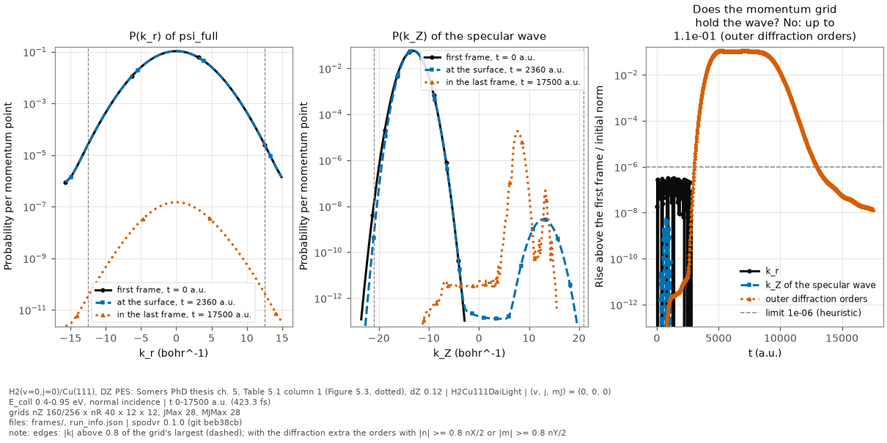

**What it shows.**

- Left and middle: the momentum distribution along r, and along Z for the specular wave, at the
  start, before impact and at the end.

- Right: how much probability the run moves to the edges of each momentum grid, above the first
  frame's.

**Why it matters.** It is the same check as the previous figure, in momentum space. The grid spacing
limits the largest momentum, and anything beyond it folds over (aliasing).

**Take-away.**

- **r and Z:** the run moves no probability towards the edges of these momentum grids. The gas-phase
  states themselves reach the edge of the r momentum grid at about 10⁻⁶ per point.

- **Parallel momentum:** the outer diffraction orders take up to 11 % during impact. This is the
  12 × 12 limit of the verdict, seen from the momentum side.

### The gas-phase molecule

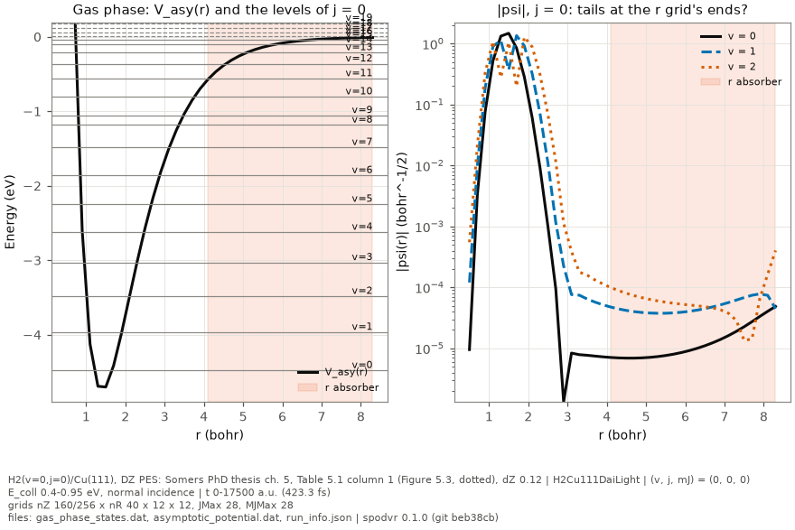

**What it shows.**

- Left: the H₂ potential far from the surface, in absolute eV, with its vibrational levels for
  j = 0 and the r absorber shaded.

- Right: the vibrational wave functions on a log scale.

**Why it matters.** The final states are defined by these levels. They must be bound on the r grid,
with small tails at the grid's ends, or the analysis is wrong from the start.

**Take-away.**

- **The levels:** v = 0, 1 and 2 are well bound.
- **The tails:** the wave functions fall by four to five decades to a flat floor of 10⁻⁵ (v = 0)
  to 10⁻⁴ (v = 2). That floor is the resolution limit of the 0.2 bohr r grid, not a physical tail.
  The part inside the r absorber is removed from the start, and counts, tiny as it is, as reaction.

</details>

## Make your own

**Try it in a few minutes, without a GPU.** The [Quick start](../README.md#quick-start) run already
gives the verdict and the results, convergence, gas-phase and time-delay figures:

```bash
uv run python -I -B tools/plots/spodvr_plot.py report runs/hardwall_small --out runs/hardwall_small/report
```

**This run.** It needs a CUDA build ([docs/cuda.md](cuda.md)), a GPU with about 9 GiB free and 16 GB
of disk. Run `uv sync` once for the plot tool's Python environment. From the repository root:

```bash
# the run: about 4 h on an RTX 4070 Ti
OMP_NUM_THREADS=8 build-cuda-fast/spodvr inputs/thesis_fig5_3_dz_plotting/input.json \
  --device cuda --threads 8 --output-dir runs/thesis_fig5_3_dz_plotting_cuda_fast

# every figure of this page, and report/report.md with the verdict (about a minute)
uv run python -I -B tools/plots/spodvr_plot.py report runs/thesis_fig5_3_dz_plotting_cuda_fast \
  --out runs/thesis_fig5_3_dz_plotting_cuda_fast/report

# one figure, e.g. diffraction at another energy
uv run python -I -B tools/plots/spodvr_plot.py plot diffraction runs/thesis_fig5_3_dz_plotting_cuda_fast \
  --out figures --energy 0.8

# the interactive viewer: click a surface point, slide through time, play
uv run tools/plots/view.py runs/thesis_fig5_3_dz_plotting_cuda_fast
```

**As run:** `spodvr` 0.1.0 at git `beb38cb`, the `build-cuda-fast` build on an RTX 4070 Ti,
2026-11-20. That build is the GPU build with FMA in its kernels; the validated default build
(`build-cuda`) gives the same figures, with differences in the last digits.

### What each plot key adds, and what it costs

| Input key | Writes | What you get | Size here | Time here (GPU) |
|---|---|---|---|---|
| `writeDensities` | `densities/` | the packet over (Z, r), every `dtAve` | 4.6 MiB | \<1 s |
| `writePotential` + `PlotSites` | `potential/` | the potential on the run's grid; named sites for the elbow plots and the movies | 114 MiB | at set-up |
| `dtFrames` | `frames/` | the whole packet every 20 a.u. (876 frames): movies, maps over the cell, rotational states | 8.3 GB | 2.5 s per frame |
| `FrameExtras` | inside `frames/` | axis distribution, diffraction orders, vibrational levels, alignment, momenta | (in `frames/`) | 7.7 s per frame |
| `NormBudget` | `norm_budget/` | where the norm went, absorber by absorber | 96 KiB | 55 s in all |
| `EnergyResolvedSites` + `EnergyResolvedEnergies` | `energy_resolved/` | stationary states at chosen energies and sites | 766 MiB | about 1 % |
| `alsoAnalysis` | `fine_analysis/` | the fine analysis after the run | 112 MiB | 0.8 s |

- **Run time:** with all keys the propagation took 4.0 h (2.05 s per step), against 1.3 h (0.66 s per
  step) for the same input without them, on the same fast build. (The README's 1.4 h is the validated
  default build.)

- **The frames** take 2.5 h of it: 876 frames at 10.3 s each, three quarters of that the five
  `FrameExtras`. With `dtFrames: 100` they cost a fifth.

- **Before you start:** the program prints the projected size and cost of every key at set-up, and
  refuses a run whose plot data would not fit on the disk.

- **Off by default:** without these keys a run is bitwise unchanged and no slower.
- **Every run works:** without plot keys you still get the verdict and the results, convergence,
  gas-phase and time-delay figures.

- **Restarts join:** a run split into restart segments is plotted as one run; pass every segment's
  directory.

- **Not on this page:** a 2D cut of the potential at any orientation (`write2DPES`, the Fortran key).
  It is a separate, potential-only run, drawn by `spodvr_plot.py plot pes_cut`.

The keys: [docs/input_schema.md](input_schema.md). The files they write:
[docs/output_files.md](output_files.md). The plot tool, every figure and how to add one:
[tools/plots/README.md](../tools/plots/README.md).
