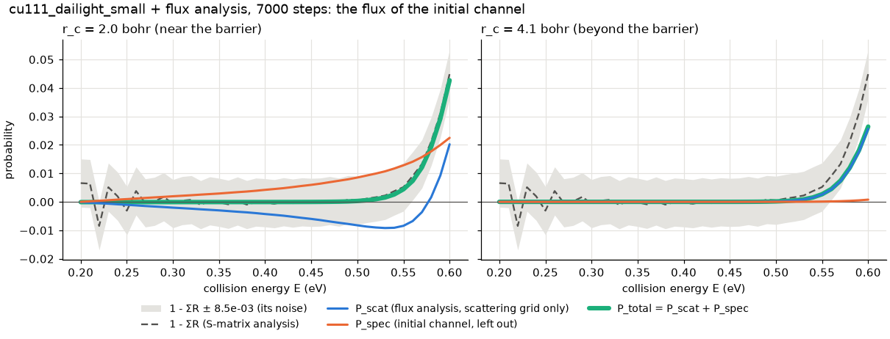

# Flux analysis: findings, test results and what was tried

The Fortran code can compute a reaction (dissociation) probability from the flux through a surface
r = r_c in the H–H distance (`FluxAnalyzor.f90`, keys `doFluxAnalysis`, `rFluxAnalysis`,
`EMinFluxAna`, `EMaxFluxAna`, `DeltaEFluxAna`). A complete C++ port of it was written and validated
against the Fortran from 2026-11-12 to 2026-11-14, and then reverted on 2026-11-14: checking it
against the physics showed that the Fortran's flux analysis leaves out the most populated channel
of the wave function. This file records what was found, what was measured and tested, and what was
tried, as the basis for deciding what a flux analysis should compute. The physics comes first
(sections 1–3), the record of the port after (sections 4–8), the open questions last (section 9).

Fortran line numbers refer to the 5.19 sources (`procfiles.dir/SOURCES.dir`, the same as upstream
commit `601d833`). Every routine cited is the same in the reference 5.24 r1713 apart from OpenMP
`SCHEDULE` clauses and line offsets (`git diff -w 601d833 dce0ecc` in the upstream repository,
checked 2026-11-14).

## 1. Status (2026-11-14)

- **Not ported.** The flux keys are read and checked ([input_schema.md](input_schema.md); two
  Fortran checks are wrong and fixed: flux Q1 and flux Q2 in [fortran_deviations.md](fortran_deviations.md)
  and [fortran_input_bugs.md](fortran_input_bugs.md)). A propagating run (new or restart) with
  `doFluxAnalysis: true` then stops with exit code 3 and "doFluxAnalysis = true: the flux analysis
  is not implemented yet" (`src/app/run.cpp`; test `FluxAnalysisGuard.PropagatingRunIsRefusedWithExitCode3`).
  Analysis-only and potential-only runs accept the keys and ignore them
  (`FluxAnalysisGuard.PotentialOnlyRunAcceptsTheFluxKeys`).
- **The port existed and was validated** (section 5), in 11 commits on main on top of `b079c19`
  (101 files, +7371/−389 lines: `git diff --stat b079c19 e6d2bf1`). One commit on 2026-11-14 reverts
  all of them; its tree equals `b079c19`. The 11 commits stay in the history of main (subjects as in
  the log; d4ad897's decision ID is shortened to Q8, section 6):

| Commit | Date | Subject |
|---|---|---|
| `1c62438` | 2026-11-12 | analysis, input: flux analysis building blocks: b(k), the flux energies, the r-derivative weights |
| `81f2ee5` | 2026-11-12 | analysis, build: flux accumulator, probability and c_n; flux analysis strict FP in every build |
| `d4ad897` | 2026-11-12 | io, docs: gfortran flux coefficient files (reader, writer, Q8) and the flux replay |
| `c6b89f9` | 2026-11-12 | propagation: the flux surface on the CPU (psi and d psi / dr at r_c) behind PropagationBackend |
| `103d1a1` | 2026-11-12 | cuda: the flux surface on the GPU (psi and d psi / dr at r_c), read back in chunks of planes |
| `c7632dd` | 2026-11-12 | propagation: the flux analysis in the time loop (accumulator, slot budget, restore hook) |
| `f902ed1` | 2026-11-13 | report, propagation: flux analysis output files, FLUX ANALYSIS report and the flux memory rule |
| `63902f9` | 2026-11-13 | tests, tools: flux analysis keys in cu111_dailight_short (r_c = 1.7 bohr) for gate 6 |
| `c3cb1a0` | 2026-11-13 | tests, app, docs: gate 6, the flux analysis against the Fortran; new flux runs allowed |
| `b7a6624` | 2026-11-14 | io, app: the flux analysis across a restart (flux_coefficients.bin and the Fortran pair) |
| `e6d2bf1` | 2026-11-14 | tools, docs: the cost of the flux analysis on the DZ grid, CPU and GPU (above 2 % on the GPU) |

- **To recover it:** `git revert` the revert commit, or `git cherry-pick b079c19..e6d2bf1` onto a
  newer main (expect conflicts in the docs). The commit messages hold every command and number of
  the validation; the docs of the port can be read with `git show e6d2bf1:<path>`
  (`docs/validation.md` gate 6, `docs/fortran_deviations.md`, `docs/performance.md` "Flux analysis
  cost on the DZ grid", `docs/cuda.md` "Flux surface and flush", `docs/validation_flux_replay/`).

## 2. The finding that stopped the port: the flux misses the initial channel

### 2.1 What the Fortran computes (ProjOp = 2)
With two grids throughout (`ProjOp` = 2, the only mode the C++ supports) the wave function is
ψ = ψ_scat + χ_spec(Z, r)·|J_in, mJ_in⟩·e^(i k_∥·x): `ScatWave` on the scattering grid holds all
channels, `SpecWave` on the long specular grid the initial channel (initial rotational state times
the initial parallel plane wave, the specular diffraction order).
- `Potential.f90 PerformEXPPotentialOp` (lines 1261–1298) calls `AddSpecToScat` before the
  interaction and `SubSpecFromScat` after it for every izr ≤ nzpot·nr (lines 1281–1282 and
  1294–1295, the non-MPI branch): at every Z < zasymp and **every r, r_c included**, the initial
  channel goes back to `SpecWave`.
- `TwoGrids.f90 SubSpecFromScat` (lines 117–147) projects `ScatWave(ichn, ·)` on `initXY` with
  `XYProj` and subtracts the result. The projection is exact: `initXY` = e^(+iκ)·uclnrm and `XYProj` =
  e^(−iκ)·uclnrm·facun (`SetupTwoGrids`, lines 59–60; uclnrm and facun from `Setup.f90`, lines
  197–199), and the measurement below printed Σ XYProj·initXY = (1, 0) in double precision.
- `FluxAnalyzor.f90 storeTimeIndependentWF` (lines 512–588) takes ψ and ∂ψ/∂r at r_c through
  `getWaveFunctionAtZr` and `getWaveFuncDerivAtZr`, which read `ScatWave` only (`WaveFunction.f90`,
  lines 1402 and 1511). `SpecWave` never enters the flux analysis.

So P_flux is the flux through r = r_c of every channel except the initial one. On the test grid that
is 1 of 960 channel blocks (15 rotational functions × 64 (x, y) points), but the most populated one:
it carries the incoming wave and, after the collision, the part of the scattered and reacting wave
that is in that channel. In P(E) the cross terms between the two parts vanish in the (x, y) sum (the
plane waves are orthogonal, and the scattering wave holds no initial-channel component at Z < zasymp),
so the full flux is P_total = P_scat + P_spec; in P(x, y; E) the cross terms do not vanish point by
point. The C++ port did the same as the Fortran (`PotentialOperator::apply_block` in
`src/propagation/potential_operator.cpp` projects at every (Z < zasymp, r); the port's flux surface
read the scattering wave), and gate 6 found the two in agreement to 1e-11 of the bound B_n
(section 5.3).

### 2.2 The measurement
**Run:** `tests/reference/cu111_dailight_small` (Dai–Light H₂/Cu(111), v = 0, j = 0, normal
incidence; 176 × 56 × 8 × 8 grid, 15 rotational functions; 7000 steps of 2 a.u.) plus the flux keys
(41 energies, 0.20–0.60 eV by 0.01 eV, the energies of the S-matrix analysis), once with r_c = 2.0 bohr
(near the barrier) and once with r_c = 4.1 bohr (beyond it, next to the r_c of upstream's only input
with flux keys: `input.dir/v0j0_WPC_H2Cu111SRP_C3v_01.inp`, rFluxAnalysis 4.15, ProjOp 2, the flux
analysis off). The scratch tool [specular_flux.cpp](flux_analysis_findings/specular_flux.cpp) ran the
port's CPU propagation (4 threads, 1083 s and 1081 s) and, in every analysis step, accumulated φ_s and
φ′_s of `SpecWave` at r_c with the run's own c_n(t) and D(ir); it then added initXY·φ_s into the
(ichn, x, y) blocks of a copy of the run's flux coefficients and evaluated P_scat (the port's result),
P_spec (the initial channel alone) and P_total with the port's `flux_results`.

**Checks** (the tool's logs and the TSV files): its P_scat equals the run's own result bitwise; the
cross term P_total − P_scat − P_spec is at most 6.2e-17 (r_c 2.0) and 1.3e-17 (r_c 4.1); the scattering
wave's own component along the initial channel carries a flux of at most 6.4e-33 and 1.4e-34 (the
projection leaves nothing there); the flux energies equal the S-matrix energies to the printed 1e-10 eV.
**The reference** 1 − ΣR (the S-matrix analysis's reaction probability, the same propagation for both
r_c) is negative at 16 of the 41 energies, by up to 8.5e-3: on this small grid its noise is about ±8e-3.

r_c = 2.0 bohr, selected energies (all 41 in [initial_channel_rc2.0.tsv](flux_analysis_findings/initial_channel_rc2.0.tsv)):

| E (eV) | P_scat (the Fortran's P_flux) | P_spec (left out) | P_total | 1 − ΣR | P_spec / P_scat |
|---|---|---|---|---|---|
| 0.20 | −9.437e-05 | 2.462e-07 | −9.412e-05 | 6.580e-03 | −0.003 |
| 0.21 | −2.740e-04 | 1.807e-04 | −9.325e-05 | 6.389e-03 | −0.660 |
| 0.30 | −2.040e-03 | 1.957e-03 | −8.346e-05 | −6.561e-04 | −0.959 |
| 0.44 | −5.635e-03 | 5.594e-03 | −4.045e-05 | −3.603e-05 | −0.993 |
| 0.46 | −6.410e-03 | 6.400e-03 | −1.073e-05 | −1.015e-04 | −0.998 |
| 0.50 | −8.238e-03 | 8.542e-03 | 3.038e-04 | 5.232e-04 | −1.037 |
| 0.55 | −8.415e-03 | 1.284e-02 | 4.421e-03 | 5.195e-03 | −1.525 |
| 0.58 | 1.589e-03 | 1.772e-02 | 1.931e-02 | 2.117e-02 | +11.15 |
| 0.59 | 9.274e-03 | 1.997e-02 | 2.924e-02 | 3.113e-02 | +2.153 |
| 0.60 | 2.022e-02 | 2.247e-02 | 4.269e-02 | 4.491e-02 | +1.112 |

r_c = 4.1 bohr, selected energies (all 41 in [initial_channel_rc4.1.tsv](flux_analysis_findings/initial_channel_rc4.1.tsv)):

| E (eV) | P_scat (the Fortran's P_flux) | P_spec (left out) | P_total | 1 − ΣR | P_spec / P_scat |
|---|---|---|---|---|---|
| 0.30 | −1.678e-12 | −2.152e-12 | −3.831e-12 | −6.561e-04 | (both below 1.1e-11) |
| 0.34 | 2.604e-10 | 2.228e-11 | 2.827e-10 | 3.236e-04 | +0.086 |
| 0.40 | 8.634e-08 | 4.688e-09 | 9.102e-08 | −3.439e-04 | +0.054 |
| 0.50 | 1.427e-04 | 7.479e-06 | 1.502e-04 | 5.232e-04 | +0.052 |
| 0.55 | 2.572e-03 | 9.953e-05 | 2.671e-03 | 5.195e-03 | +0.039 |
| 0.58 | 1.160e-02 | 3.524e-04 | 1.196e-02 | 2.117e-02 | +0.030 |
| 0.60 | 2.565e-02 | 7.753e-04 | 2.642e-02 | 4.491e-02 | +0.030 |

- **r_c = 2.0 bohr:** P_scat, the Fortran's reaction probability, is **negative** from 0.20 to 0.57 eV
  (down to −9.2e-3 at 0.53 eV). P_spec is positive and cancels 66–99.8 % of it from 0.21 to 0.46 eV;
  above that it is larger than |P_scat| (2.15 × P_scat at 0.59 eV, where both are positive). P_total
  is closer to 1 − ΣR at 39 of 41 energies (rms difference 2.4e-3 against 9.2e-3 for P_scat); at
  0.58–0.60 eV, where the reaction is well above the noise, P_total is within 1.9e-3 to 2.2e-3 of
  1 − ΣR and P_scat 2.0e-2 to 2.5e-2 off.
- **r_c = 4.1 bohr:** up to 0.32 eV nothing reaches r_c (|P| ≤ 1.1e-11). From 0.33 eV on, P_spec adds
  +3.0 to +8.6 % to P_scat. P_total is closer to 1 − ΣR at 20 of 41 energies, a count decided by the
  noise. At 0.60 eV P_total = 0.0264 against 1 − ΣR = 0.0449: a gap of about twice the noise that the
  initial channel does not explain (section 2.5).
- **The specular wave at r_c 4.1** reached max |χ_spec(r_c)| = 5.8e-3 during the run (1.5e-1 at
  r_c 2.0; the tool's logs), although the incoming v = 0 state is centred at ⟨r⟩ = 1.44 bohr (the
  run's average at t = 0) and negligible at 4.1 bohr (inferred): what crosses r_c 4.1 in the initial
  channel comes from the collision.

### 2.3 What ProjOp = 1 does
`Main.f90` calls `TwoGrids.f90 CheckOneGridContinuation` at the start of every analysis step when
nproj = 1 (line 393). Once the specular norm beyond the scattering grid falls below tolsp (or grows
again: `CheckSpecularNorm`), `ProceedWithOneGrid` adds `SpecWave` into `ScatWave` and sets nproj = 0
(`TwoGrids.f90`, lines 151–188). From then on `PerformEXPPotentialOp` skips the projection and the
flux analysis sees the whole wave function. The omission therefore belongs to ProjOp = 2. The C++
rejects ProjOp 0 and 1 ([input_schema.md](input_schema.md)). **Not run:** a Fortran ProjOp = 1
run of the same case, which would check P_total independently of the scratch tool.

### 2.4 Interpretation (not proven)
Near the barrier, part of the wave stretches beyond r_c and comes back. The outward crossing runs
largely in the initial channel (the specular, j = 0 part), the return in other channels after
scattering. The net flux of such a crossing vanishes only when all channels are summed; counting the
other channels alone gives the negative P_scat at r_c 2.0. Beyond the barrier (r_c 4.1) little comes
back, and the initial channel's share is the 3–9 % that P_spec adds. Either way, the flux of a part of
the wave function is not a reaction probability.

### 2.5 Not explained
- **The gap at r_c = 4.1 bohr:** P_total falls increasingly short of 1 − ΣR above 0.55 eV (2.5e-3 at
  0.55 eV, 0.0185 at 0.60 eV, about twice the noise), while at r_c = 2.0 the two agree to 2.2e-3
  there. So less flux crosses 4.1 bohr than 2.0 bohr at these energies. Possible causes, none
  checked: flux that has not crossed 4.1 bohr by tEnd = 14000 a.u.; reflection at the r absorber,
  which starts at ROptStart = 4.55 bohr; parts that 1 − ΣR counts as reaction but that never cross
  4.1 bohr.
- **P_total at r_c = 2.0 bohr is slightly negative** from 0.20 to 0.46 eV (−9.4e-5 to −1.1e-5), well
  inside the noise of 1 − ΣR but not zero; not examined.

### 2.6 The options that were considered
Put to the user on 2026-11-13: **A**, keep the Fortran method, document what it counts and advise an
r_c far out (near ROptStart); **B**, an opt-in key that adds the initial channel's flux (CPU and GPU),
the default reproducing the Fortran; **C**, corrected by default, with a key that reproduces the
Fortran for the comparison with it (the port fixes Fortran bugs by default). The user chose none of
them (2026-11-14): the flux analysis is not ported for now, and is to be rethought as a whole first.

## 3. What the flux analysis computes
As in `FluxAnalyzor.f90` and as ported (energies in hartree, a.u. throughout):
- **Energies** (`setupFluxAnalyzor`): E_n = EMinFluxAna + n·ΔE, n = 0 … INT((EMax − EMin)/ΔE), the
  energy of the motion normal to the surface, converted with `Constants_eV2Ha`; k_n = √(2 M E_n) with
  M the molecule's mass; E_tot,n = E_n + edifin + eviroi (the initial parallel kinetic energy,
  `GridEnergies.f90`, and the initial rovibrational energy, `GasPhase.f90`).
- **Per analysis step** at time t (`storeFluxCoeffs`, called in `Main.f90` after `Propagate` and
  `BalintKurtiCoeffs`), for every plane Z < zasymp, every rotational function and (x, y) point:
  φ_n += c_n(t)·ψ(r_c), φ′_n += c_n(t)·∂ψ/∂r(r_c), with c_n(t) = A_n·e^(+i E_tot,n t)·Δt and
  A_n = k_n / (2π M b(k_n)) (lines 560–566). b(k) is the momentum amplitude of the initial Gaussian
  packet (`MyFunctions.f90 getBkCoeffWavePacket`), Δt = dtAna. ∂ψ/∂r is the Fourier-grid derivative
  on the r grid: one column D(ir) of a table with D = 2c·(−1)^d / (2 tan(c d)) / Δr, c = π/nr, d the
  index distance, D(r_c) = 0 (`WaveFunction.f90 getWaveFuncDerivAtZr`). φ_n is the time-to-energy
  transform of ψ at r_c, normalised by the incoming amplitude.
- **At the end** (`computeFluxProbability`): P(x, y; E_n) = Σ_Z Σ_rot prefac_n·Im(conj(φ_n)·φ′_n),
  prefac_n = (2π M / (k_n μ))·ΔZ (line 428), μ the reduced mass; P(E_n) = Σ_x,y P(x, y; E_n)·Δx Δy
  sin(skew) (line 476).
- **Files:** `flux_reaction.dat` (E in eV, P), `flux_density.dat` (a header with nE, the skewing
  angle, point group, nx, dx, ny, dy; then E, x, y, P(x, y; E)), and for a restart
  `flux_coeffs.dat` and `flux_coeffs_deriv.dat` (φ, φ′; written at the end, read when NewCalc is
  false). The flux analysis is passive: with and without the flux keys the Fortran's fort.21,
  averages.out and fort.25 are bitwise identical (cu111_dailight_short at r_c 2.0 and 1.7 bohr,
  commit messages of `63902f9` and `c3cb1a0`).

## 4. The port as it was (in `e6d2bf1`)
- **Building blocks** (`src/analysis/flux_analysis.*`, `src/input/wave_packet_params.*`): b(k),
  the energies and A_n (`FluxEnergies`, the division in `flux_transform_factor`), D and the
  r-derivative summed from ir = 0 upwards with the zero term (`flux_derivative_weights`,
  `flux_r_derivative`), c_n (`flux_step_coefficient`), P and P(x, y) (`flux_results`).
- **Accumulator:** `FluxCoefficients` holds φ, φ′ in the Fortran layout (block, iz, n);
  `FluxAccumulator` collects the flux surfaces of K analysis steps in K slots and adds them in one
  pass (flush), per element in time order, so the result is bitwise the same for any K and thread
  count. K = what 2 GiB holds, at most 8 (on DZ one slot is 250.56 MB, so K = 8).
- **Flux surface** (ψ and ∂ψ/∂r at r_c on the planes Z < zasymp) behind the backend seam
  `PropagationBackend::flux_surface`: on the CPU `src/propagation/flux_surface.*` (OpenMP static over
  the planes, tiles of 1024 blocks); on the GPU the kernel `flux_surface_chunk` and `read_flux_surface`
  (`src/cuda/device_flux_surface.*`, chunks of nr/2 planes through the BK read-back buffer). One
  weights table, the same order per element.
- **Time loop** (`WavePacketPropagation`), per analysis step in the order of `Main.f90`: propagate,
  BK coefficients and S-matrix, flux surface into a slot (time = end of the step), averages; flush at
  the end of the run.
- **Output and restart:** `flux_reaction.tsv`, `flux_density.tsv`, `flux_analysis.json`, a FLUX
  ANALYSIS block and a P(E) table (`src/report/flux_*`); `flux_coefficients.bin` (the four flux keys
  and the time, checked exactly) and/or the Fortran pair (sizes checked only) next to the checkpoint.
- **Memory rule** (`check_flux_memory`): a run that fits without the flux arrays but not with φ, φ′
  and one slot stops before the potential is computed, naming DeltaEFluxAna and the most energies
  that fit (for `--device cuda` against the host memory of a GPU run).
- **Strict floating point** for `flux_analysis.cpp` in every build (CMake `strict_fp_flags`,
  `spodvr_strict_objects`), section 7.3.

## 5. Validation results
### 5.1 Routine level, against the reference Fortran's own objects
One-off gfortran drivers linked against the objects of the reference install (5.24 r1713, `-O3`)
called the Fortran routines; C++ programs compared bit patterns (commit messages of `1c62438`,
`81f2ee5`; recipe in `docs/validation_flux_replay/` of `e6d2bf1`):
- b(k) at 401 momenta: 401 of 401 bitwise; D at nr 56: 56 of 56 bitwise; the energy counts 4, 6, 3
  and 22 of four ranges equal the C++ ones.
- φ and φ′ after 5 steps on a synthetic ψ: 48 of 48 bitwise; P(E) 3 of 3 and P(x, y; E) 6 of 6 within
  half a printed unit of the E15.8 files. With the textbook complex division instead of Smith's
  algorithm only 3 of the 48 values were bitwise equal.

### 5.2 Replay of one Fortran analysis step (`d4ad897`)
hardwall_small restarted at t = 7000 a.u. for one analysis step with zero-filled flux files: from the
Fortran's ψ (fort.9), eviroi (fort.21) and t = 7010, the C++ reproduced **all 162 720 complex values**
of the two flux coefficient files (3 energies × 113 planes × 240 points × 2 files; 32 544 nonzero), by
value and bit for bit; the C++ writer's files were byte-identical. Control: with the time of the
step's start only the 65 088 zeros of φ agree (worst 0.23 of max |φ|).

### 5.3 Gate 6: the flux analysis against the Fortran (`c3cb1a0`)
In the gate-3 runs of `cu111_dailight_short` (1000 steps; flux keys r_c 1.7 bohr, 0.2/0.35/0.5 eV),
CPU and GPU. Three comparisons:
- (a) φ, φ′ element by element within 1e-11·B_n, B_n = |c_n|·Σ_t max|ψ_c(t)| (an upper bound of |φ|),
  recomputed in the test from the run's flux surfaces with the Fortran's eviroi, and the run's own;
- (b) the run's 195 values of P(E) and P(x, y; E) within max(half a printed unit, 1e-10·prefac·Σ|φ||φ′|);
- (c) the Fortran's φ, φ′ through the C++ `flux_results`: the Fortran's E15.8 text exactly.

| Build | (a) φ / φ′, Fortran eviroi (units of B_n) | (a) run's own | (b) worst / tolerance | (c) differing |
|---|---|---|---|---|
| build | 2.89e-13 / 2.20e-13 | 1.87e-12 / 1.86e-12 | 0.977099 | 0 of 781 |
| build-fast | 6.01e-13 / 5.55e-13 | 1.82e-12 / 1.81e-12 | 0.977141 | 0 of 781 |
| build-cuda | 2.04e-13 / 1.82e-13 | 1.88e-12 / 1.87e-12 | 0.977104 | 0 of 781 |
| build-cuda-fast | 6.01e-13 / 5.58e-13 | 1.83e-12 / 1.82e-12 | 0.977146 | 0 of 781 |

The run's own coefficients differ more because the C++ eviroi is 1.1e-15 to 1.2e-15 hartree off the
Fortran's, which moves the phase E·t by up to 2.3e-12 at t = 2000. In (b) the printed half unit binds
at 189 of 195 values. **Negative controls** (same runs, every build): c_n with e^(−iEt) fails (a) at
359 148 of 360 000 values of φ; D reversed fails (a) at 359 784 of φ′ and (b) at 195 of 195; one φ off
by 2e-11·B_n fails at exactly 1 value, off by 0.5e-11·B_n at none; M and μ swapped changes 195 of 195
printed probabilities. Gates 3 and 4 of the same run were unchanged.

### 5.4 Choice of r_c for the gate case (`63902f9`)
The cancellation ratio κ_n = |Σ Im(conj(φ)φ′)| / Σ|φ||φ′| (larger κ: gate (b) more sensitive), C++ at
0.2/0.35/0.5 eV: 1.7 bohr 0.0425/0.0464/0.0474 (P = 1.73e-4, 1.16e-4, 4.38e-4); 2.0 bohr
0.0324/0.0347/0.0357; 2.3 bohr 0.0386/0.0382/0.0397. Hence 1.7 bohr. At 2.0 bohr the C++ P(E) equalled
an earlier Fortran run's `flux_reaction.dat` in all 8 printed digits.

### 5.5 Restart, CPU against GPU, fast-math builds
- **Restart** (`b7a6624`): a split run (cu111_dailight_short_sym with the gate-6 flux keys, 0–60 a.u.
  split at 30) wrote the same bytes as the unsplit run in all flux, checkpoint, BK and probability
  files, for the native and the Fortran restart files; a split GPU run did so for its five flux files
  in both formats. The hard wall could not serve here: its |φ| ≤ 5.4e-32 at t = 120 is rounding
  noise (it couples no channels).
- **CPU against GPU:** 1.1e-14 (φ) and 1.5e-14 (φ′) relative on a pseudo-random packet (`c7632dd`;
  short runs from the reference cases' own initial state hold only rounding noise at r_c, hardwall_short
  |ψ| ≤ 1.2e-29 after 120 a.u. and Dai–Light ≤ 2e-13, where CPU and GPU differed at O(1) relative);
  2.3e-10 and 1.9e-10 of max |φ| unsplit and 2.1e-10 for a GPU run continuing a CPU run on Dai–Light
  with dtStep = dtAna = 10 (`b7a6624`). At dtStep 2 the same comparison gave 3.0e-3 of max |φ| while ψ
  agreed to 1.3e-14 of its maximum: there max |φ| ≈ 2e-14 is too small to separate rounding from a
  lost part, so the larger step was used.
- **Fast-math builds:** gate 6 passes with the same tolerance (table above); the flux code itself
  stays strict there (section 7.3).
- **The suites at the tip** `e6d2bf1` (after a libc6 upgrade, rebuilt from scratch): full ctest 741
  tests, 735 passed, 6 skipped; Long suite 5 of 5; CUDA ctest including Long 33 of 33.

## 6. Decisions taken during the port
The reverted code numbered them Q1–Q9. Q1 and Q2 are input checks and are still active
(flux Q1, flux Q2 in [fortran_deviations.md](fortran_deviations.md), details in
[fortran_input_bugs.md](fortran_input_bugs.md)). The others, by content:

| In the reverted code | Content | Port's choice |
|---|---|---|
| Q3 | the energy count INT((EMax − EMin)/ΔE) + 1 in hartree drops EMaxFluxAna for most inputs (0.2–0.6 eV by 0.1: 4 energies; 0.40–0.95 by 0.025: 22) | kept, with a warning |
| Q4 | the Fortran weighs each step with the input dtAna, but a step lasts nanspo·dtStep, nanspo = INT(dtAna/dtStep) (dtAna 10.5 at dtStep 2: weights 1.05 times too large; 0.3/0.1 truncates to nanspo 2) | fixed: nanspo·dtStep, as the S-matrix sums |
| Q5 | `Constants_eV2Ha` in the flux analysis, chaev = 27.2114 everywhere else (1.27e-7 apart; \|b\|² differs from the packet's momentum distribution by 2.9e-7 of its peak) | kept |
| Q6 | with `onlyAnalysis` the Fortran sets the flux analysis up but computes nothing | a note, no flux files |
| Q7 | the initial channel is left out at r_c (section 2) | kept, with a warning (section 7.4) |
| Q8 | the Fortran's flux restart files have no header and are read unchecked | sizes checked; the native file also checks the keys and the time |
| Q9 | b(k) has the phase e^(+iδk·z0), the complex conjugate of the packet's amplitude; P(E) does not depend on it, φ does | kept |

## 7. Other findings
### 7.1 The flux density on a skewed grid is not exactly symmetric
P(x, y; E) of the gate case (j = 0, normal incidence, a C6v PES) was meant to be invariant under the
usable grid operations to 1e-12. That is impossible in either code: the discrete
T_xy = (k_x² + k_y² − 2 cos 60°·k_x k_y)/2M on the 8 × 8 FFT grid of the 60° cell is not invariant.
- **C2** maps the Nyquist index onto itself (one stored momentum stands for both +4Δk and −4Δk), so
  on the Nyquist row and column the cross term takes the sign of the wrong image.
- **The two mirrors** usable with nφ = 10 map momenta out of the rhombic FFT box (aliasing). The mirror
  that swaps the lattice vectors maps the box onto itself, but it maps φ → 60° − φ, which the φ grid
  allows only for nφ divisible by 6.
- **Measured:** the Fortran's `flux_density.dat` is C2-symmetric only to 1.71e-4 of its largest value
  (per energy 2.6e-4, 1.8e-4, 1.7e-4 of that energy's largest value at 0.2, 0.35, 0.5 eV;
  recomputed 2026-11-14 from `git show c3cb1a0:tests/reference/cu111_dailight_short/fortran_flux_density.dat`);
  the C++ the same (1.7e-4 for C2, 2.1e-4 for the mirrors). With the cross term dropped on the 15
  entries of the Nyquist row and column (a test-only table), C2 held to 7.5e-15, while the mirrors
  stayed at 3.5e-4 (test `FluxPropagation.DensityIsC2InvariantWithAC2SymmetricKineticOperatorLong`).
  The user accepted that substitute test (2026-11-14), now reverted with the rest.

This is a property of the propagation's discretisation, not of the flux analysis: it holds for any
density derived from ψ on a skewed grid.

### 7.2 Signed zeros and Smith's complex division
gfortran multiplies a complex number by a real x as by (x, 0); the C++ multiplies both parts by x. The
values are equal, but an exactly zero part can differ in sign: (−0, −1)·1 gives +0 with gfortran 15.2
and −0 in the C++ (`81f2ee5`). This holds for every real × complex product of the port (FFT scaling,
b(k), the r-derivative, c_n): such data must be compared by value, not by bytes.
A_n = k / (2πM·b(k)) is the one complex division of the flux analysis. gfortran uses Smith's
algorithm; GCC's `-fcx-fortran-rules` gives the same for `std::complex` division. k·conj(d)/|d|²
differs by an ulp (3 of 48 values bitwise equal in section 5.1;
test `FluxTransformFactor.IsSmithsComplexDivision`).

### 7.3 Strict floating point, no FMA or libmvec in the Fortran's flux routines
The 13 flux routines of the reference executable, `getWaveFuncDerivAtZr` and `getBkCoeffWavePacket`
contain no FMA and no libmvec call; they call scalar `sin`, `cexp` and `pow` (objdump, 2026-11-13).
The port compiled `flux_analysis.cpp` with strict flags in every build: the sums must not be
reassociated (slot and thread invariance, restarts), the division must be Smith's, and fast-math
changed the energy count (0.2–0.6 eV by 0.08 eV: 5 energies instead of 6; 8 of 13 unit tests passed in
the fast-math build before the change, 27 of 27 after it). b(k) kept the build's flags (computed once
per energy; bitwise equal to the strict values at all 401 test momenta in build-fast).

### 7.4 The χ_vin(r_c) warning rested on a wrong premise
The port printed |χ_vin(r_c)| / max |χ_vin| and warned above 1e-6 (ratio 1.165e-01 at r_c 2.0 bohr on
hardwall_short, `f902ed1`). Its first wording assumed that only the incoming specular wave
χ_vin(r)·G(Z) is left out, which scales with χ_vin(r_c). The review of that commit found, in the
Fortran, that the whole initial channel is left out, including its scattered and reacting parts after
the collision; the ratio bounds only the incoming part. Section 2 measured the rest.

## 8. Performance
DZ grid (`inputs/thesis_fig5_3_dz` plus the flux keys, r_c 3.1 bohr, 22 energies, one slot 250.6 MB),
8 threads, Ryzen 7 5800X and RTX 4070 Ti, 2026-11-14 (`e6d2bf1`, `docs/performance.md` there). Per
analysis step of 8 time steps:

| | CPU | GPU |
|---|---|---|
| analysis step | 33.1–34.2 s | 5891–5894 ms |
| flux surface | 187.4–187.6 ms (0.56 %) | 70.9–71.4 ms (1.20 %): kernels 45.3–45.7, copies 24.8–25.0 |
| flush, 1 / 8 / 16 slots | 390–408 / 66–75 / 49–56 ms | 392–393 / 60–66 / 43–47 ms |
| **flux in all, 8 slots** | **0.76 %** | **2.23–2.32 %** |

- The target, 2 % of an analysis step, was met on the CPU, not on the GPU. The surface kernel reads ψ at
  about 110 GB/s (reads not coalesced; inferred, not profiled). The flush, one read and write of all of
  φ and φ′, is memory-bound (about 28 GB/s; inferred).
- **Nsight Systems** (`nsys`, 10 and 18 analysis steps): each flush idles the GPU for 479–514 ms; the
  SM clock then drops from 2760 to 780 MHz and needs 2.7–2.9 s to recover. A flush costs 1.18–1.21 s,
  and the flux analysis 3.8–3.9 % of a real GPU run.
- **Slot budget kept at 2 GiB:** 16 slots cost 2.0 GB more host memory and still gave 1.94–2.00 % per
  operation, about 2.8 % in a run.
- The user accepted the GPU cost as it was (2026-11-14, before the revert). Options listed for later
  in `docs/cuda.md` of `e6d2bf1`: a flush on a host thread overlapping the GPU, more slots, a coalesced
  surface kernel, pinned copies.

## 9. Open questions for a future design
1. **Include the initial channel.** P_total = P_scat + P_spec as the scratch tool computes it (the
   specular wave's φ_s embedded in the (ichn, x, y) blocks): by default, as an option, or not at all?
   On the GPU the specular wave is already on the host.
2. **ProjOp = 1 as an independent check:** a Fortran run with ProjOp = 1 sees the whole wave function
   once the grids merge (section 2.3); never run.
3. **Where to put r_c:** near the barrier the flux of the full wave function matched 1 − ΣR on the
   small grid; beyond it (4.1 bohr) it fell short at high energies. Which r_c, and how to check it?
4. **Do channel-resolved fluxes mean anything at r_c?** Channels mix in the interaction region; only
   the sum over all channels is a net flux. Does P(x, y; E) (which keeps the cross terms between the
   initial channel and the others at each point) have a physical reading?
5. **The gap at r_c = 4.1 bohr** (0.0185 at 0.60 eV) and the small negative P_total at r_c = 2.0 bohr
   (section 2.5).
6. **A DZ check against 1 − ΣR:** never run; the small grid's noise (±8e-3) limits the comparison above.
7. **The symmetry question on a finer x/y grid** (section 7.1): would the C2 and mirror asymmetry of
   P(x, y; E) shrink with nx, ny? Never run.
8. **The Fortran authors:** whether to report the finding to them, for instance with the questions in
   [scm_open_questions.md](scm_open_questions.md).

## Files in [flux_analysis_findings/](flux_analysis_findings/)

| File | Content |
|---|---|
| `initial_channel_rc2.0.tsv`, `initial_channel_rc4.1.tsv` | the measurement of section 2.2, one row per energy: `E_flux_eV`, `E_coll_smatrix_eV`, `P_scat`, `P_spec`, `P_total`, `cross` (P_total − P_scat − P_spec), `P_scat_ichn_initXY` (the scattering wave's own initial-channel flux), `one_minus_sumR`, `sumR` |
| `input_rc2.0.json`, `input_rc4.1.json` | the inputs: `tests/reference/cu111_dailight_small/input.json` plus the five flux keys (and another Title) |
| `specular_flux.cpp` | the scratch tool (comments edited, code unchanged); see below |
| `make_figure.py`, `initial_channel.png` | the figure of section 2.2 (`python3 -I -B docs/flux_analysis_findings/make_figure.py`, needs matplotlib) |

The tool builds only against the reverted port. It was compiled on a scratch branch on top of the
pre-review version of `f902ed1`, whose flux computation equals that of `e6d2bf1` (later changes to
`src/analysis/flux_analysis.cpp` only export `flux_block_xy`, a move). To rebuild it on `e6d2bf1`
(not tried): add to `WavePacketPropagation` in `src/propagation/propagation.hpp` the accessor
`[[nodiscard]] const SpecularWave& specular() const { return backend_->specular(); }`, add the
target to `tools/CMakeLists.txt` (`add_executable(spodvr_q7_specular_flux specular_flux.cpp)`, linked
with `spodvr_core spodvr_warnings spodvr_fp`), and write `.flux_slot_count()` for
`.flux_slot_count` in the call of `estimate_memory` (it became a member function in the final
`f902ed1`). Run: `OMP_NUM_THREADS=4 build/tools/spodvr_q7_specular_flux <input.json> <output.tsv>`
(about 18 minutes per input).
