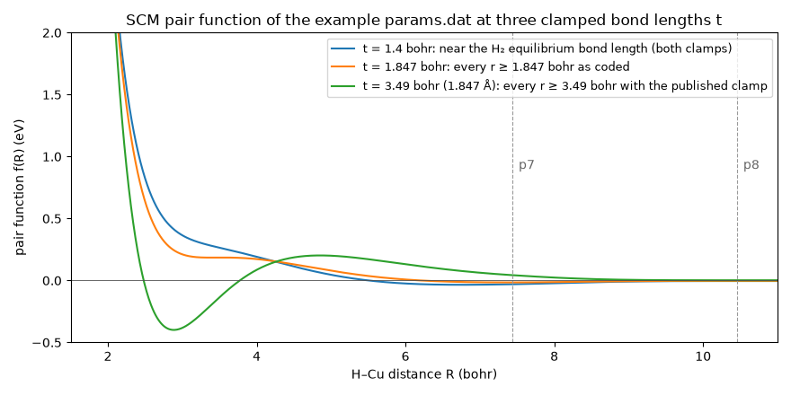
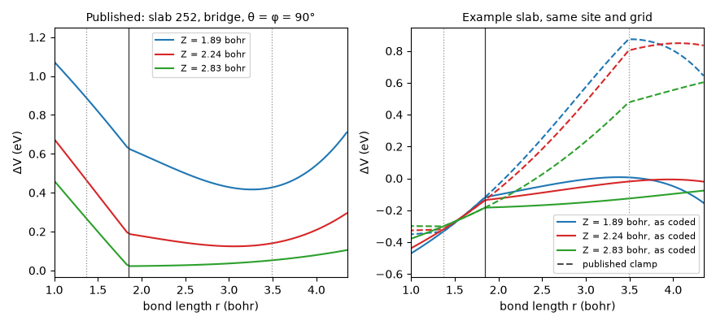
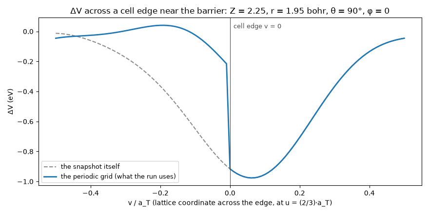

# SCM in SPO-DVR 5.24: questions from the C++ port

This page collects questions about the static corrugation model (SCM) in SPO-DVR 5.24 (svn r1713,
git mirror `dce0ecc`; SystemID `CRPDistrtSurface`). They came up while porting it to the C++
rewrite of SPO-DVR in this repository. The port reproduces the Fortran: ΔV is bitwise equal, V
agrees within 10⁻¹² × max(|V|, 1 eV), and a 3000-step SCM propagation reproduces the Fortran's
averages and probabilities within half a unit of their last printed digit
([validation.md](validation.md#gates)).

To port SCM we read its code closely, compared it with the papers, and measured it on the example
snapshot that comes with the code (`potential.dir/H2Cu111SRP_C3v.dir`). The papers answer five of
the thirteen questions we first had; our reading of those answers is listed
[near the end](#what-the-papers-answer-q4-q5-q6-q11-q13), so that a misreading can be corrected.
Four questions remain that only the authors can settle, plus three technical points and one
request for data. A short answer to each would already help. Code references name the file and
routine in `sources.dir/SOURCES.dir/`; the SCM routines are in its folder `DistortedSurfacePES.dir/`.

The labels Q1–Q13 are also used elsewhere in this repository and are not renumbered; the questions
are listed in order of priority.

## The questions in brief

| | Question | On the example snapshot |
|---|---|---|
| [Q1](#q1-the-units-of-the-bond-length-clamp) | The bond-length clamp is in Å in the paper and in bohr in the code. Were the published QD-SCM results computed with the clamp in bohr? | lowest barrier of the origin cell: 0.501 eV as coded, 0.639 eV with the published clamp (ideal surface: 0.625 eV) |
| [Q2](#q2-the-jump-at-the-cell-edges) | V steps at the cell edges. Was the effect on the quantum diffraction and specular probabilities checked? | steps up to 0.68 eV near the barrier (0.32–0.92 eV over the snapshot's 49 possible cell origins) |
| [Q3](#q3-deep-holes-where-the-crp-clamps-z-or-r) | Holes where the CRP clamps Z or r; the published grids reach both regions. Was V capped there, or the amplitude checked? | V down to 255 eV below E_gas at Z ≤ 0, and 344 eV below at r > 4.35 bohr |
| [Q12](#q12-hd-on-the-crp-and-scm-potentials) | HD on the CRP and SCM potentials: the code's HD → H₂ coordinate shift is not applied. Is HD meant to be supported? | V changes by up to 0.42 eV (ideal surface) and 0.52 eV (SCM) near the barrier |
| [Q7, Q8, Q10](#technical-points-q7-q8-q10) | Position-file version 1; the gas-phase potential and the `.pes` cache; symmetry with a C6v data set | — |
| [Q4–Q6, Q11, Q13](#what-the-papers-answer-q4-q5-q6-q11-q13) | Answered in the papers, as we read them; please correct us if not | — |
| [Q9](#data-we-would-like-to-have-q9) | The position files of three published slabs, if easy to share | — |

## How we read the code

So that a misreading is easy to spot, here is the model as we understand it from the code
(`DistortedSurfaceWrapper.f90 GetCRPDistSurfPotential`, `SCM_Potential.f90 SCM_SurfInteract_3Body`).
V_CRP is the 6D potential of the ideal surface, interpolated with the corrugation-reducing
procedure (CRP).

```
V(X, Y, Z, r, θ, φ) = V_CRP(X/s, Y/s, Z, r, θ, φ)
                    + Σ_{H atoms a = 1, 2} Σ_{Cu atoms j} [ f(|h_a − R_j^displaced|) − f(|h′_a − R_j^ideal|) ]
```

- **The H atoms** h_a lie at ±r/2 from the grid point along the bond (`SCM_Wrapper.f90
  ConvertCoMToXYZ`); h′_a are the same with the centre scaled laterally by 1/s and the bond vector
  unchanged.
- **The rescaling** (`EnableSurfExpan`, default true in `globaldata.f90`; applied in `SCM_Wrapper.f90
  SetSCMCRPParameters`): s = a_T/a_CRP, the ratio of the slab's nearest-neighbour distance to the
  CRP set's. The grid's cell takes the slab's a_T.
- **The atoms**: those of layers 1 and 2 (`UsedLayers = 2`, `SCM_Types.f90`) whose displaced
  position lies within `SCMCutoff` = 16 bohr of the origin, a top-layer site at the corner of the
  grid's cell (`SCM_IO.f90 ReadSCMSlab`, position-file version 3).
- **The pair function** f(R) = −(p3 + p4·q + p5·q² + p6·q³)·exp(−p2·q), q = R − p1, blended by a
  cosine into the constant C = f(p8) between p7 and p8 (`SCM_Potential.f90
  Switch_Rydberg_Potential`). C cancels in ΔV: an atom farther than p8 from an H atom, in both of its
  positions, adds nothing.
- **The bond-length dependence**: p_k = P_k + P_(8+k)·t, with t the bond length r clamped to
  [P17, P18] (`SCM_Types.f90 Setup_3Body_Rydberg_Par`; see Q1). The example `params.dat` holds the
  "3-Body 1-Layer" fit of Spiering et al. 2018 (Table II, "3-Body" columns), once for each layer.
  Lengths are in bohr, energies in hartree.

**The example snapshot** (`examplePosfile.dat`, with `params.dat` and the CRP set
`H2Cu111SRP_C3v`): one 7 × 7 × 7 slab, position-file version 3, tag `Multiseedv3_New`.
- a_T = 4.88967 bohr is the nearest-neighbour distance of the EAM lattice at 925 K of Smits et al.
  2024 (bulk lattice constant 3.6593 Å: the molecular-dynamics value in the data of their
  Fig. 1(b), 3.65927785611 Å, converts to the file's 4.8896663475 bohr in all 11 digits; their
  Table I lists the quasi-harmonic value, 3.6595 Å). a_CRP = 4.916153 bohr (bulk 3.6791 Å)
  is that of the 0 K SRP48 lattice of the CRP set. So s = 0.994612.
- 73 atoms enter ΔV: 37 of layer 1 and 36 of layer 2. The top-layer displacements about the layer
  mean have an rms of 0.35, 0.25 and 0.45 bohr in x, y and z. The deepest atom lies 1.15 bohr below
  its site; the highest kept atom lies 0.94 bohr above the surface plane.

**Size of ΔV in the origin cell** (12 × 12 sites, see [Conventions](#conventions); r = 1.4 bohr,
θ = 90°, φ = 0):

| Z (bohr) | ΔV min … max (eV) | cell mean (eV) |
|---|---|---|
| 2.5 | −0.70 … −0.05 | −0.24 |
| 4 | −0.17 … −0.01 | −0.12 |
| 6 | −0.008 … +0.029 | — |
| 10 | −0.0001 … +0.0002 | — |

At Z = 2.5 and 4 bohr, ΔV is negative at all 144 sites: the origin cell sits in a local depression
of this snapshot (its four corner atoms lie 0.01–0.57 bohr below their sites, a neighbour 1.15 bohr
below). At Z = 6 bohr, 117 of the 144 values are positive. ΔV is exactly zero once both H atoms are
more than p8 = 10.46 bohr above the highest kept atom, that is, above Z = 11.40 bohr.

## Conventions

- **Coordinates**: (u, v) along the two surface lattice vectors, 60° apart: X = u + v/2,
  Y = (√3/2)·v. The x, y grid covers [0, a_T)² in (u, v), with a top-layer atom at the origin: the
  origin cell. Sites are given as fractions of a_T, for example the bridge (1/2, 0)·a_T.
- **E_gas**, the energy zero: the minimum over r of V_CRP at the data set's Z_asymptotic
  (12.28 bohr): −5.1377 eV, at r = 1.416 bohr, in the data set's own zero.
- **12 × 12 sites**: (u, v) = (i, j)·a_T/12, i, j = 0 … 11. **Angles**: θ = 0, 22.5, …, 90° and
  φ = 0, 30, …, 330° ("12 φ"); at θ = 90° these are 6 distinct orientations ("6 φ").
- **Accessible**: below E_gas + 1.5 eV, the range a molecule with up to about 1 eV collision energy
  can reach.
- **The lowest V on a slice**: the minimum of V over the sites and angles at fixed (Z, r); a coarse
  sample, not a saddle-point search.
- **The lowest barrier**: for each of the 12 × 12 sites and 43 orientations (θ = 0; θ = 22.5, 45 and
  67.5° with 12 φ; θ = 90° with 6 φ), the mountain-pass barrier of V in the (Z, r) plane: the lowest
  maximum of V along a path from the entrance (Z = 4.0 bohr, r ≤ 2.0 bohr) to the exit
  (r = 4.3 bohr, Z ≤ 3.0 bohr), within Z = 0.6–4.0 and r = 1.0–4.3 bohr. Every (Z, r) plane is
  searched on a 0.025-bohr grid, the ten lowest again on a 0.005-bohr grid, and the lowest is refined
  to the exact saddle point. For the ideal surface this gives 0.625 eV at (Z, r) = (2.210, 1.942)
  bohr, at the bridge with the bond pointing towards the hollows. Smits & Somers 2023 (Fig. 2(a))
  give 0.624 eV at (Z, r) = (2.239, 1.907) bohr [(1.185, 1.009) Å], where our CRP gives 0.6244 eV.
  On the plane of the published bridge cut ((1/2, 0)·a_T, θ = φ = 90°; see Q1), an independent
  search with that cut as V_CRP agrees within 3 meV for the ideal surface and for SCM with either
  clamp (0.625, 0.506 and 1.02 eV; the last lies at the clamp kink, not at a saddle point).
- **SCM D1–D15**: the C++ port's records of where it handles SCM differently from the Fortran, or
  deliberately like it
  ([fortran_deviations.md](fortran_deviations.md#scm-distorted-surface-pes-srcpotentialscm-systemid-crpdistrtsurface)).

## Q1. The units of the bond-length clamp

**The question.** Spiering et al. 2018 clamp the bond length to the range of their fit,
0.725–1.847 Å. The code clamps r to 0.725–1.847 bohr. Is the clamp in bohr intended, or a slip in
units? The elbow cuts published with Smits & Somers 2023 show a kink at r = 1.847 bohr, where the
clamp in bohr puts one, and none at the published limits. Were the QD-SCM results published since
2022 computed with the clamp in bohr?

**What the code does.** `SCM_Types.f90 Setup_3Body_Rydberg_Par` clamps each r grid point (bohr) to
[P17, P18] = [0.725, 1.847] of `params.dat`, then forms the eight pair parameters from it. So the
pair function stops depending on r below 0.725 bohr and above 1.847 bohr (0.384 and 0.977 Å).

**What the paper says.**
- Eq. (8) of Spiering et al. 2018 clamps r_H–H at "the smallest and largest values of r_H–H used in
  the fitting procedure". Table III lists them in Å: 0.725 and 1.847. The fit varied the bond
  length by ±0.3 Å about the barrier geometries (Sec. III A), and these limits are the bridge
  barrier's 1.025 Å minus 0.3 Å and the hcp barrier's 1.547 Å plus 0.3 Å.
- Table II gives the parameters with lengths in bohr and energies in hartree, and the example
  `params.dat` equals its "3-Body" columns. So the slopes multiply r in bohr, and the published
  clamp is [1.370, 3.490] bohr.
- Fig. 5 of the paper shows f at the bond lengths of Table III. Its "highest" curve (1.847 Å) has a
  well of about −0.4 eV near 2.9 bohr: the green curve below, which the parameters give at
  t = 3.49 bohr. As coded, every bond longer than 1.847 bohr uses the orange curve, which has no
  well near 3 bohr, so the code cannot produce the paper's hcp, top and "highest" curves. (Its
  bridge curve, at 1.937 bohr, is clamped too, but changes little.)



*The pair function of `params.dat` at three clamped bond lengths. As coded, every r ≥ 1.847 bohr
uses the orange curve. With the published clamp the parameters keep changing up to r = 3.49 bohr
(1.847 Å): the green curve, the "highest" curve of Spiering et al. 2018, Fig. 5. The dashed
vertical lines mark p7 and p8 at t = 1.4 bohr.*

**What the published data show.** Clamping r freezes the parameters, so ΔV(r) has a kink at each
clamp limit. The data published with Smits & Somers 2023 (folder FIG23) hold V of three production
slabs (252, 556, 1012) and of the ideal surface (BOSS, the Born–Oppenheimer static surface:
V_CRP alone) on the same (r, Z) grid. In ΔV = V_SCM − V_BOSS we find one kink, at r = 1.847 bohr,
in all four cuts we tested (three slabs at the bridge, slab 252 at the t2f site), and none at
1.370 or 3.490 bohr. At Z = 2.24 bohr (slab 252, bridge), ∂ΔV/∂r jumps by +0.50 eV/bohr at
r = 1.847 bohr. The same test on the example slab finds the kink at 1.847 bohr with the clamp as
coded, and at 1.370 and 3.490 bohr with the published clamp. The script
[clamp_kink.py](scm_open_questions/clamp_kink.py) reproduces the test and the figure from the
published files. We read this as the published cuts having been computed with the clamp in bohr;
please correct us if they were made differently.



*ΔV along r at three heights, at the same site and on the same grid in both panels (note the
different vertical scales). Left: the published cut of slab 252 (bridge, θ = φ = 90°), V_SCM −
V_BOSS. Right: the example slab, with the clamp as coded (solid) and the published one (dashed).
Solid vertical line: the code's upper limit, 1.847 bohr. Dotted: the published limits, 1.370 and
3.490 bohr (0.725 and 1.847 Å).*

**How much it changes** (example snapshot, origin cell; see [Conventions](#conventions) for the
lowest barrier):

| | Lowest barrier (eV above E_gas) | Site, all at θ = 90° | (Z, r) in bohr |
|---|---|---|---|
| Ideal surface (V_CRP alone) | 0.625 | bridge | (2.21, 1.94) |
| SCM, clamp as coded (bohr) | 0.501 | cell edge, (5/12, 0)·a_T | (2.17, 2.13) |
| SCM, published clamp (Å) | 0.639 | bridge, (0, 1/2)·a_T | (1.99, 2.30) |

So on this snapshot SCM lowers the barrier by 0.12 eV as coded, and raises it by 0.01 eV with the
published clamp: the clamp alone moves it by 0.14 eV. One cell of one snapshot does not give the
effect on the ensemble's reaction probabilities; the production slabs would (Q9). The difference
ΔV(published clamp) − ΔV(as coded) at fixed points (12 × 12 sites, θ = 90°, 6 φ):

| (Z, r) in bohr | min … max (mean), eV | Note |
|---|---|---|
| (2.5, 1.0) | −0.0004 … +0.119 (+0.069) | compressed bond: the published clamp holds t at 1.370 bohr |
| (2.5, 1.2) | −0.0002 … +0.054 (+0.032) | |
| (2.5, 1.4), (4.0, 1.4) | 0 | both clamps leave t = r |
| (2.25, 1.95) | −0.008 … +0.040 (+0.016) | near the ideal surface's saddle |
| (2.0, 2.3) | −0.16 … +0.20 (+0.039) | |
| (1.75, 2.6) | −0.67 … +0.37 (−0.031) | exit channel |
| (1.75, 3.5) | −2.24 … +0.95 (−0.089) | |

**The C++ port** reproduces the Fortran (the clamp in bohr). If the clamp in bohr turns out to be a
slip, the published clamp becomes an input option; the default stays the Fortran's behaviour.

## Q2. The jump at the cell edges

**The question.** The periodic x, y grid repeats one distorted cell, so V steps at the cell edges:
near the barrier by up to 0.68 eV in the example's cell, and up to 0.92 eV for other choices of the
origin atom. Smits, Litjens & Somers 2022 showed with quasi-classical dynamics (QCD) that confining
the molecule to a 1 × 1 cell leaves the reaction and rovibrationally elastic scattering
probabilities unchanged. Was the effect of the step on the quantum diffraction and specular
probabilities checked too? Which observables of a 1 × 1-cell QD-SCM run do you regard as reliable:
reaction only, or also diffraction and specular scattering?

**What the code does.** The x, y grid covers one surface cell, [0, a_T)² in (u, v), with a
top-layer atom at the origin, and the FFTs make it periodic. ΔV comes from the actual atoms around
the origin (the cut-off sphere), so the grid repeats this one distorted cell everywhere. A 1 × 1 cell
holds one atom per layer, so the only distortion that is periodic in it is a rigid shift of a whole
layer; every real snapshot breaks the periodicity. Just inside one edge, an H atom feels the actual
atoms beyond that edge; its periodic copy just inside the opposite edge feels other atoms, displaced
differently. So V steps where the copies meet.



*ΔV along a line across the cell edge v = 0 at u = (2/3)·a_T, Z = 2.25 bohr, r = 1.95 bohr,
θ = 90°, φ = 0. Dashed: the snapshot itself, smooth across the edge. Solid: what the periodic grid
uses; for v < 0 it repeats the values at v + a_T, which gives a 0.68 eV step at the edge. One side
of this step lies 1.6 eV above E_gas, so it is not counted below; the largest step between
accessible points, also 0.68 eV, lies on the edge u = 0.*

**How large.** The jump is |V(u, 0) − V(u, a_T)| along the edge v = 0, and the same along u = 0:
the two values the periodic grid joins. The CRP term is periodic, so this is the jump of ΔV.
- Near the barrier, (Z, r) = (2.25, 1.95) bohr, θ = 90°, 12 points per edge and 6 φ, counting
  points where both sides are accessible: the largest jump is 0.68 eV for the example's cell.
  Taking each of the snapshot's 49 top-layer atoms in turn as the origin, this largest jump is
  0.64 eV on average, and 0.32–0.92 eV.
- The step is a discontinuity, not a steep slope. At Z = 2.5 bohr and r = 1.4 bohr, the jump is
  0.54 eV at most and 0.20 eV on average (16 points per edge, 6 φ), while neighbouring points
  a_T/16 apart inside the cell differ by 0.019 eV (median) and 0.14 eV at most.
- It fades with height (r = 1.4 bohr): 0.54 eV at Z = 2.5, 0.13 eV at Z = 4, 0.035 eV at Z = 6 and
  2 × 10⁻⁴ eV at Z = 10 bohr.
- Two of the three bridge sites of the cell lie on its edges, and on the ideal surface the barrier
  is lowest at the bridge. In this snapshot the lowest barrier lies on an edge: at (5/12, 0)·a_T as
  coded, and at the bridge (0, 1/2)·a_T with the published clamp (Q1).

**Why the QCD test may not settle it** (our reasoning, not tested). A classical trajectory that
crosses the edge sees the step as a sudden change of potential energy, without a force; a wave
packet is partly reflected and diffracted by it. A step in a periodic potential has Fourier
components that fall off only as 1/G, so it reaches every diffraction order. Its effect on a
channel's probability is a cross term with the rest of the potential, which may average out over
snapshots, plus its own square, which does not. Separately, a distorted surface that is not
periodic also scatters into diffuse, non-Bragg directions, and a 1 × 1 cell cannot. Smits et al.
2024 (Sec. III C) relate the strong decrease of the specular probability with SCM to the thermal
attenuation seen in molecular-beam experiments; in a 1 × 1 cell the lost intensity can only go into
other diffraction channels, other rovibrational states or reaction.

**Checks we could run**, if useful: a run on a small grid with ΔV blended to be periodic across the
edges; a cell origin with no bridge site on an edge; a 2 × 2 cell.

**The C++ port** reproduces the step and reports its size at a few heights in the set-up output
(SCM D10).

## Q3. Deep holes where the CRP clamps Z or r

**The question.** Below Zmin and outside [Rmin, Rmax], the CRP library evaluates V at the nearest
limit, while ΔV uses the true Z and r. There V_SCM has holes hundreds of eV deep. The published grids
reach both regions: Z from −1.0 bohr and r up to 10.05 bohr (Smits 2023, thesis Table 6.A.1). Was V
capped there, for example with `ImposeVMin`, or was the amplitude in these regions checked? Should
ΔV use the clamped Z and r?

**What the code does.** `CRPlibrary.dir/CRP_QD_Wrapper.f90 Get_CRP_QD_Wrapper_Potential_6D` clamps Z
below Zmin and r outside [Rmin, Rmax] (SRP48: Zmin = 0.472, Rmin = 0.756, Rmax = 4.346 bohr).
`DistortedSurfaceWrapper.f90 GetCRPDistSurfPotential` passes the unclamped Z and r to
`GetSCMPotential`.

**Why that makes holes.** Within 1–2 bohr of a Cu atom the pair function is very repulsive (45 eV
at 1 bohr), and ΔV is the difference of two such numbers: the repulsion from an atom's displaced
position minus that from its ideal site. Where the atom has moved away from an H atom, much more is
subtracted than added. The CRP part, frozen at its limit, does not compensate.

**How large** (example snapshot; the lowest V − E_gas in eV over the 12 × 12 sites, θ = 0–90° and
12 φ at each (Z, r); in parentheses the ideal surface's, V_CRP − E_gas):

| Z \ r (bohr) | 1.4 | 2.0 | 3.0 |
|---|---|---|---|
| 0 | −31 (+3.1) | −39 (+2.1) | −43 (+1.3) |
| −0.5 | −136 (+3.1) | −174 (+2.1) | −255 (+1.3) |
| −1.0 | −5.0 (+3.1) | −200 (+2.1) | −246 (+1.3) |

Beyond Rmax (Z = 1.5, 2.0 and 2.5 bohr; r = 6, 8 and 9.8 bohr; same sites and angles), V − E_gas
reaches −344 eV, for a tilted molecule whose lower H atom is at the height of the top layer (Z = 1.5,
r = 8 bohr, θ = 67.5°); V_CRP − E_gas is +7.3 eV there. Elsewhere, for Z ≥ 1 bohr and r within
[Rmin, Rmax], SCM lowers the minimum of V by tens of meV only (27 meV on our sampling, at r = Rmax,
where the value depends on how finely r is sampled).

**What it changes.** Amplitude in a hole never reaches the scattering analysis, so 1 − ΣP counts it
as reaction, and a grid made for energies of about 1 eV cannot represent the momenta in a well
hundreds of eV deep. The first region lies behind a wall that is low for dissociated geometries:
at Z = 0.5 bohr the lowest V is 0.79 eV above E_gas, at r = Rmax (0.74 eV on the ideal surface).
The second region lies inside the r absorber of the published grids (from 4.20 bohr). We have not
run a production-size grid to see whether amplitude reaches either region.

**The C++ port** reproduces the holes. It warns when the Z grid starts below Zmin, and reports the
lowest V − V_CRP in both regions in the set-up output (SCM D15).

## Q12. HD on the CRP and SCM potentials

Not specific to SCM, but found while porting it.

**The question.** The potential routines are written for H₂. For HD, the code's own convention
shifts the evaluation point from the centre of mass to the bond midpoint (`HDPES.f90
TransformHDToH2`), but only `HDonPt111PES.f90` applies it; the CRP library and SCM do not. Is HD
meant to be supported with SystemIDs `CRPlibrary` and `CRPDistrtSurface`? Were published HD results
computed on them?

**What the code does.**
- The kinetic operators use the total and the reduced mass (`Setup.f90 MiscellaneousSetup`:
  `rmass`, `rdmass`), so (X, Y, Z) is the centre of mass. `HomoNuc` changes the angular grid and its
  J-parity checks (`angulargrid.f90 InitAngularGrid`, `setupdvr.f90`), not the point at which the
  potential is evaluated.
- `Potential.f90 setupTheAsymptoticPotential` states the convention in its second comment
  ("COMMENT 2"): "the potential routines are all for H2, so that a coordinate transformation is
  required to compute the corresponding H2 center-of-mass coordinates from those of HD".
- `HDPES.f90 TransformHDToH2` shifts the point along the bond by r·|m₂ − m₁|/(2(m₁ + m₂)), about
  r/6 for HD, with the lighter atom on the +(θ, φ) side; `HDonPt111PES.f90 getVHDPt111` calls it.
- `CRP_QD_Wrapper.f90 Get_CRP_QD_Wrapper_Potential_6D` and `SCM_Wrapper.f90 ConvertCoMToXYZ` put the
  atoms at ±r/2 from the given point, so for HD both atoms are misplaced by about r/6 (0.23 bohr at
  r = 1.4 bohr).

**How large.** At (Z, r) = (2.25, 1.95) bohr, over the accessible sites and orientations, shifting
the evaluation point by r/6 along the bond changes V by up to 0.42 eV on the ideal surface and
0.52 eV with SCM, most for tilted molecules (θ = 67.5°). For a parallel molecule the shift is
lateral and moves the site, not the energy: the lowest V on this slice changes by only +5 meV
(ideal) and +0.25 meV (SCM). What changes is the orientation dependence near the barrier, and so
rotational and steric effects.

**The C++ port** reproduces the Fortran for `CRPlibrary` (HD accepted, as in the Fortran). With
SCM, a new code path, it rejects HD until this is answered (SCM D13).

## Technical points (Q7, Q8, Q10)

**Q7. Position-file version 1.** The version-1 reader (`SCM_IO.f90 ReadSCMSlab`, CASE(1)) declares
the bulk layer spacing `BulkZDist` as INTEGER (so √(2/3)·a_CRP = 4.014 bohr becomes 4), uses
`uCelly` where `uCellx` belongs (harmless for square slabs), and keeps layers 1–2 with a hard-coded
test instead of `UsedLayers`. The example version-3 file carries the first bug's fingerprint: its
ideal layers 4–7 lie exactly 4.000 bohr apart, while layers 1–4 keep the CRP set's spacings. That is
harmless for ΔV, which uses layers 1–2 only. Which program generated the version-3 file, and does it
share this reader's code? Is version 1 still needed? (The C++ port reads versions 3 and 2 and
rejects version 1, SCM D5.)

**Q8. The gas-phase potential and the `.pes` cache.**
- V_asy(r) is evaluated at (0, 0, Z_asymptotic, r, π/2, 0) (`Potential.f90
  setupTheAsymptoticPotential`). It includes ΔV in runs that compute the potential, but not in
  analysis-only runs (`nread = 2`), which skip `SetupDistPESModule` (`Main.f90`); there
  `GetSCMPotential` passes the unallocated `MySCMPar(:, rIndex)`, harmless only because no atoms are
  loaded. For the example, ΔV is exactly zero at those points: on the example's r grid, its highest
  kept atom could rise by 0.90 bohr before ΔV reached them at the data set's Z_asymptotic =
  12.28 bohr, or by 0.51 bohr with `UseSwitching`, which takes Z_asymptotic = `ZmaxSwitch` (11.9 bohr
  in our example input). A snapshot with a higher atom would change V_asy, and analysis-only runs
  would then use other channel energies than the propagation. Should V_asy be computed from V_CRP
  alone?
- The `.pes` cache of an SCM run is never read. Its file name (`Potential.f90 GetPESStringName`) is
  built before `ParameterVersion` is set, so the lookup asks for version 0 while the file written
  says version 2. Its reader also returns the inverted result (`DistortedSurfaceWrapper.f90
  ReadDistPESSetup`, cancelled by a second negation in `Potential.f90`), opens the never-assigned
  unit `TempParFileUnit` (`SCM_Wrapper.f90 CheckPESVariables_SCM`), and compares only set-up scalars,
  not the contents of `params.dat` or the positions. A repaired cache would also skip
  `SetupDistPESModule`, so V_asy would lose ΔV as in analysis-only runs. Is the cache meant to work
  for SCM runs?
- The C++ port has no `.pes` cache, and stops when ΔV changes V_asy (SCM D3, D11).

**Q10. Symmetry.** The potential's point group is the CRP set's. `CxvSurfaceSymmetry.f90
setupCxvSurfaceSymmetry` switches `UseSymmetry` off for C3v, with a warning, but keeps it for C6v,
so with a C6v data set the distorted V would be symmetrised. Should symmetry be off for every SCM
run? (The C++ port rejects `UseSymmetry` with SCM, SCM D2.)

## What the papers answer (Q4, Q5, Q6, Q11, Q13)

We asked these too; the papers answer them as far as we can tell. Please tell us if we misread.

- **Q4. The lattice rescaling is the published method.** The CRP set is the 0 K SRP48 PES of Mondal
  et al. 2013 (bulk 3.6791 Å; Smits et al. 2024, Sec. II C and Table I), and a_T is the EAM lattice
  at 925 K (bulk 3.6593 Å, the molecular-dynamics value of Smits et al. 2024, Fig. 1(b)). The code
  maps the CRP onto the slab's lattice by scaling the centre of mass along X and Y only, in V_CRP
  and in the subtracted term: the "corrected surface stretching procedure" of Spiering et al. 2018
  (Sec. II B, Eq. (7)), with the ratio of the two lattice constants as in Smits & Somers 2021 (Sec.
  II C). On the example, the rescaling alone (an undistorted slab at a_T) raises ΔV at (Z, r) =
  (2.25, 1.95) bohr by 14 meV on average and 25 meV at most (12 × 12 sites, θ = 90°, 6 φ): the pair
  model's estimate of compressing the lattice by 0.54 % at fixed Z and r. The code relies on the
  ideal positions of a version-3 file lying on the CRP lattice and does not check it; the example's
  73 atoms do, within 1.2 × 10⁻⁶ bohr (the C++ port checks this, SCM D9).
- **Q5. One parameter set for both layers is intended.** Spiering et al. 2018 (Sec. III B) found
  the two-layer fit unreliable and used the "3-Body 1-Layer" set for both layers; the example
  `params.dat` holds that set.
- **Q6. The ensemble.** 104 slabs, generated as in Smits & Somers 2021 (Appendix), each from its own
  EAM trajectory at 925 K, and averaged (Smits, Litjens & Somers 2022, Sec. II B; we read this as
  equal weights). The example's a_T and its displacements fit such a snapshot: below the top layer
  the rms is 0.24–0.36 bohr per component, against the classical Debye estimate for Cu at 925 K of
  0.25–0.29 bohr (θ_D = 343–300 K).
- **Q11. Centring.** Each trajectory's slab is shifted so that its time-averaged top layer lies at
  (0, 0, 0) (Smits & Somers 2021, Appendix, item 2). A snapshot's own top-layer mean,
  (−0.144, +0.197, −0.026) bohr in the example, is therefore a thermal fluctuation, kept by design.
  The pair model is sensitive to it: at (Z, r) = (2.25, 1.95) bohr, the cell-mean ΔV (12 × 12 sites,
  θ = 90°, 6 φ) changes by about 1 eV per bohr of mean top-layer height, 28 meV for the example's
  −0.026 bohr. One cell per slab is used; the snapshot's 48 other cells would be further, correlated,
  samples.
- **Q13. The cut-off.** 16 bohr around the cell corner, top two layers (Smits, Litjens & Somers
  2022, Sec. II C). Compared with layers 1–2 of the whole 7 × 7 slab plus its eight periodic images
  (882 atoms), leaving out the other atoms changes ΔV by at most 4.7 meV at r ≤ 2.6 bohr (2.9 meV
  for Z ≥ 1 bohr; rms ≤ 0.5 meV), 7 meV at r = 6 bohr and 26 meV at r = 9.8 bohr, inside the r
  absorber (Z = 0–3 bohr, r = 1.0, 1.4, 2.0, 2.6, 4.5, 6 and 9.8 bohr, 12 × 12 sites, all angles).
  We take 16 bohr as adequate.

## Data we would like to have (Q9)

None of this is needed for the port, which is validated against the Fortran on the example.
Published data exist for three production slabs, 252, 556 and 1012: their QD reaction and
scattering probabilities (the data of Smits, Litjens & Somers 2022, folder FIG4) and their elbow
cuts (the data of Smits & Somers 2023, folder FIG23), at
`https://pubs.tc.lic.leidenuniv.nl/public/bauke.smits/`. Could you share the position files of these
three slabs, with one `DVR.inp` of the published runs? With them we could reproduce the published
elbow cuts and QD results with the port, and size Q1 on the production slabs themselves.

## Data and code behind the numbers

- **Data**: the example files of `potential.dir/H2Cu111SRP_C3v.dir` (`examplePosfile.dat`,
  `params.dat`, the CRP set `H2Cu111SRP_C3v`; in this repository under `potentials/`), and for Q1
  the published elbow cuts named above.
- **Code**: the C++ port (ΔV bitwise equal to the Fortran's; V_CRP from the C++ port of the CRP
  library, equal to the Fortran library's bitwise or within a few ulp), driven by small measurement
  programs that are not part of this repository (available on request). The figures and the kink
  test come from the scripts in [scm_open_questions/](scm_open_questions/).

## References

- M. Wijzenbroek and M. F. Somers, "Static surface temperature effects on the dissociation of H₂
  and D₂ on Cu(111)", J. Chem. Phys. 137, 054703 (2012), doi:10.1063/1.4738956. The original SCM.
- A. Mondal, M. Wijzenbroek, M. Bonfanti, C. Díaz and G.-J. Kroes, "Thermal lattice expansion effect
  on reactive scattering of H₂ from Cu(111) at T<sub>s</sub> = 925 K", J. Phys. Chem. A 117, 8770
  (2013), doi:10.1021/jp4042183. The SRP48 CRP sets for the 0 K and the expanded lattice;
  `H2Cu111SRP_C3v` is the 0 K one.
- P. Spiering, M. Wijzenbroek and M. F. Somers, "An improved static corrugation model", J. Chem.
  Phys. 149, 234702 (2018), doi:10.1063/1.5058271. The three-body pair function, its parameters and
  the clamp (Eq. (8), Tables II and III, Fig. 5); the corrected surface stretching (Eq. (7)).
- B. Smits and M. F. Somers, "Beyond the static corrugation model: Dynamic surfaces with the
  embedded atom method", J. Chem. Phys. 154, 074710 (2021), doi:10.1063/5.0036611. The EAM slabs,
  their centring and the rescaling factor.
- B. Smits, L. G. B. Litjens and M. F. Somers, "Accurate description of the quantum dynamical
  surface temperature effects on the dissociative chemisorption of H₂ from Cu(111)", J. Chem. Phys.
  156, 214706 (2022), doi:10.1063/5.0094985. QD with the EAM-SCM; the 1 × 1 cell test with QCD; the
  16 bohr cut-off; the 104 slabs; per-slab QD results in its data (folder FIG4).
- B. Smits and M. F. Somers, "The quantum dynamics of H₂ on Cu(111) at a surface temperature of
  925 K: Comparing state-of-the-art theory to state-of-the-art experiments", J. Chem. Phys. 157,
  134704 (2022), doi:10.1063/5.0112036.
- B. Smits and M. F. Somers, "The quantum dynamics of H₂ on Cu(111) at a surface temperature of
  925 K: Comparing state-of-the-art theory to state-of-the-art experiments 2", J. Chem. Phys. 158,
  014704 (2023), doi:10.1063/5.0134817. The BOSS barrier (Fig. 2(a)); the elbow cuts of Q1 in its
  data (folder FIG23).
- B. Smits, "Surface temperature and the dynamics of H₂ on Cu(111)", PhD thesis, Leiden University
  (2023), hdl:1887/3628423. Table 6.A.1: the grids of the QD-SCM runs.
- B. Smits, M. K. Sah, K. Naskar, S. Adhikari, J. Meyer and M. F. Somers, "Reactive scattering of
  H₂ on Cu(111) at 925 K: Effective Hartree potential vs sudden approximation", J. Chem. Phys. 161,
  154702 (2024), doi:10.1063/5.0231559. The lattice constants (Table I, Fig. 1(b)); the specular
  attenuation (Sec. III C).
