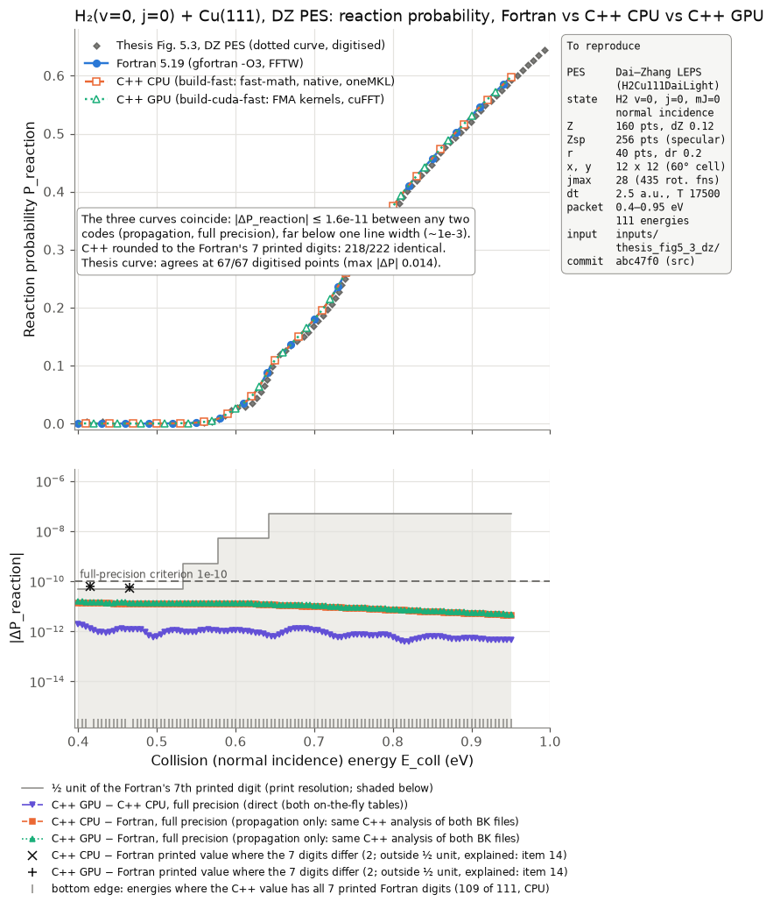
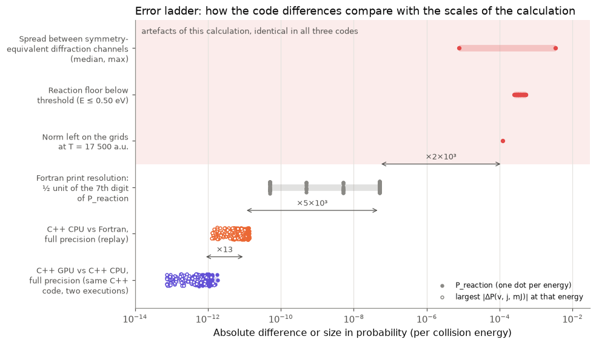
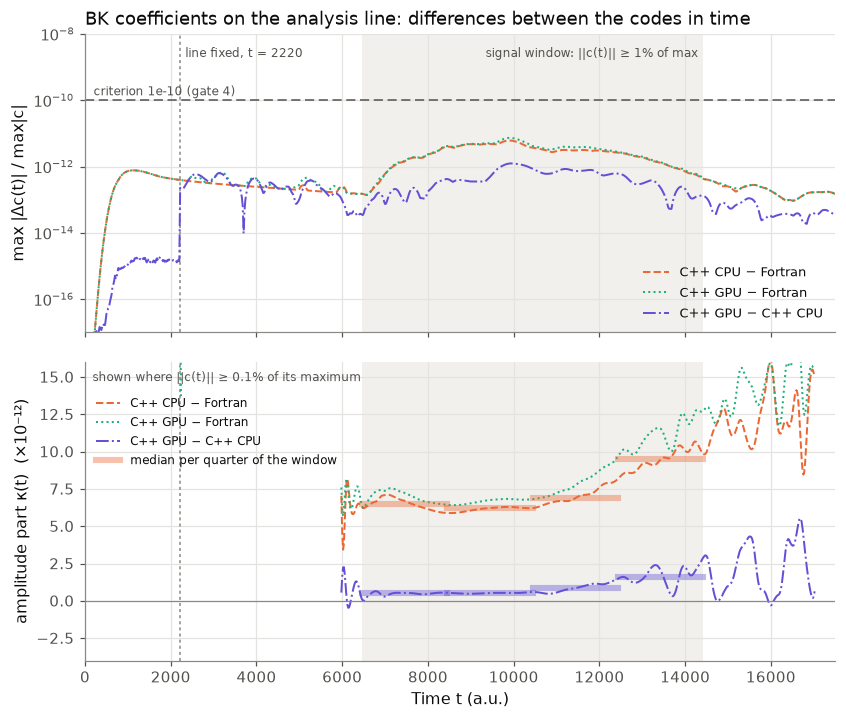
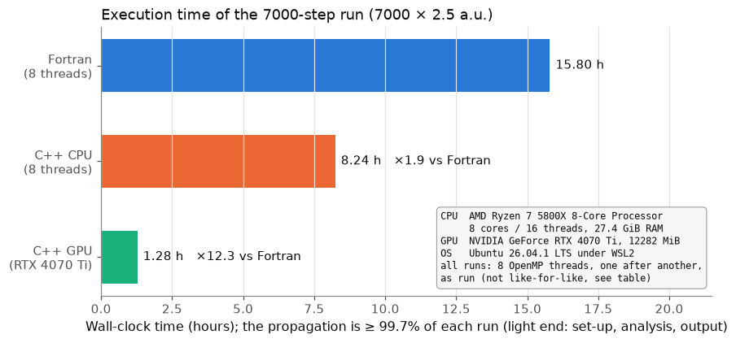

# Fortran vs C++ vs CUDA: three-way validation on thesis Figure 5.3 (DZ PES)

2026-11-07, strict GPU run added 2026-11-08 · source commit `abc47f0` (unchanged to `e0c231b`) · input
[`inputs/thesis_fig5_3_dz/`](../../inputs/thesis_fig5_3_dz/) · runs on one machine, 8 threads

**What was done.** The same input ran in the original Fortran code and in the C++ port on the CPU
and on the GPU. Every output was compared: each set-up line, the 6D potential on the full grid,
the BK coefficients (the wave packet's projections on the asymptotic channels) of every analysis
step, and every probability and S-matrix element. A *replay*, the C++ analysis applied to each
run's stored BK coefficients, separates differences of the propagation from differences of the
analysis.

<details>
<summary>Terms used in this report</summary>

- **DZ PES**: the Dai–Zhang LEPS potential (J. Dai and J. Z. H. Zhang, J. Chem. Phys. 102, 6280
  (1995)); in both codes the module is named `DaiLight` (SystemID `H2Cu111DaiLight`).
  **Thesis**: M. F. Somers, PhD thesis (Leiden, [repository](https://hdl.handle.net/1887/3250648)),
  chapter 5, Figure 5.3. **Paper**: chapter 5 is published as M. F. Somers, S. M. Kingma,
  E. Pijper, G. J. Kroes and D. Lemoine, *Six-dimensional quantum dynamics of scattering of
  (v=0, j=0) H<sub>2</sub> and D<sub>2</sub> from Cu(111): test of two LEPS potential energy surfaces*,
  Chem. Phys. Lett. 360, 390 (2002), [DOI](https://doi.org/10.1016/S0009-2614%2802%2900869-2).
- **BK coefficients c(t)**: the Balint-Kurti projection of the wave packet on the asymptotic channels
  (v, j, m<sub>J</sub>, diffraction (n, m)) at the analysis line Z<sub>ana</sub> = 15 a₀, every 20 a.u.;
  their time-to-energy transform gives the S-matrix. 19008 coefficients per step, 875 steps.
  Fortran file `fort.21`, C++ `bk_coefficients.bin`; the S-matrix is in `fort.25` / `s_matrix.tsv`,
  the final wave function in `fort.9` / `checkpoint.bin`; `enymo` are the Fortran's channel energies.
- **Specular grid**: a long (Z, r) grid that carries the incoming packet and the outgoing part in the
  initial channel; the 6D scattering grid holds the rest. Its analysis line starts far out and
  moves in until it is **fixed** at Z<sub>ana</sub> (here at t = 2220 a.u.); the **rest norm** is the norm
  of the specular wave beyond that line, iLow/iHigh the grid range the initial packet must lie in.
  **Specular rotationally inelastic channels**: specular diffraction ((n, m) = (0, 0)),
  m<sub>J</sub> = 0, j > 0.
- **DVR⇄FBR**: the transform between the angular grid (θ, φ points) and the rotational basis
  (j, m<sub>J</sub>), applied around every potential step.
- **Full precision (f) / printed precision (p)**: both values in double precision / a Fortran value
  as printed (e.g. `0.4661086D-03`) against the C++ value; **½ unit**: half a unit of the last
  printed digit (tolerance 1.01 × ½ unit).
- **Replay**: the C++ on-the-fly analysis run on a stored BK file; replay vs replay =
  propagation-only difference. **onlyAnalysis**: the C++ fine analysis (a windowed FFT of the BK
  series), a second estimator.
- **Fast-math build**: `SPODVR_FAST_MATH=ON`, `-ffast-math -march=native` on the host and fused
  multiply-add (FMA) in the GPU kernels; the project default (**strict**) uses
  `-ffp-contract=off -fno-fast-math` and no FMA.
- **Gate 4**: the project's regression test of the on-the-fly analysis (docs/validation.md);
  **kinetic block**: one T(dt) application with its FFT round trips (9 per analysis step).
- **Known Fortran/C++ deviations** (docs/fortran_deviations.md): *quad-precision sites*, where
  `-fdefault-real-8` makes the Fortran evaluate an expression in 128-bit precision; *libmvec*, the
  vectorised maths library the Fortran's exp/sin/cos/acos use; *Jacobi* (Fortran) vs *LAPACK*
  (C++) diagonalisation of the gas-phase states.
- **CAP**: complex absorbing potential; **eviroi**: the initial rovibrational energy.

</details>

## Verdict

**For the fast-math builds that ran, the C++ port and its CUDA backend reproduce the Fortran code:
the reaction probabilities to 1.4e-11 (absolute) and every appreciably populated channel to ~1e-11
relative. One weakly populated family of channels differs by up to ~1e-6 relative and is not yet
attributed.** A GPU run of the strict default build, added on 2026-11-08
([section](#strict-build-gpu-run-added-2026-11-08)), agrees with the Fortran 17× more closely in
P_reaction (8.2e-13) and 21× in the S-matrix (3.5e-13, norm-weighted). The uniform part of the
fast-math runs' difference is therefore fast math. The family excess shrinks 8.9× in the strict run
but remains (single elements up to 1.8e-7).

- **Propagation** (full precision; the same C++ analysis applied to both codes' BK coefficients).
  P_reaction differs by ≤ **1.4e-11** (C++ CPU vs Fortran) and ≤ **1.6e-11** (C++ GPU vs Fortran),
  against ≤ **1.9e-12** between the GPU and CPU runs. S-matrix elements with |S|² > 1e-2 differ by
  **7.0e-12** relative (median). The BK coefficients of all 875 steps agree to ≤ **7.3e-12** of
  their maximum (criterion 1e-10).
- **Analysis** (at the Fortran's print resolution: 7 digits for probabilities, 6 for S). The
  Fortran's own BK coefficients through the C++ analysis reproduce **every** printed probability
  and phase within ½ unit, and all but at most 20 of the 636373 S-matrix elements. A bias common to
  all channels is ≲ 5e-9. End to end, the C++ reaction probabilities rounded to 7 digits equal
  the Fortran's in **218 of 222** cases (2 runs × 111 energies; the other 4 lie within 1.4e-11 of a
  rounding boundary).
- **Set-up.** Every integer, decision and channel list is identical; the 6D potential agrees to
  ≤ **2.8e-14** of max(|V|, 1 eV) (criterion 1e-13).
- **Open.** The C++↔Fortran differences are 12× the GPU↔CPU spread (predicted: ≲10×). In the
  specular rotationally inelastic channels (v = 0, (n, m) = (0, 0), m<sub>J</sub> = 0, j = 2…10) they
  reach 8.4e-9 relative (norm-weighted; single elements up to 1.6e-6), 31–303× the GPU↔CPU value.
  In absolute terms this excess is small (≤ 3.3e-13 in the BK coefficients) and within the absolute
  criteria; no relative per-channel criterion was set in advance. In the strict GPU run κ is gone
  and the family excess is 8.9× smaller, still 3.8 × 10³ times the residual of all other channels.

**Thesis:** all three runs agree with the digitised curve at **67 of 67** points.
**Performance, as run:** the GPU run took **1.28 h**, **12.3×** faster than the Fortran (15.80 h);
the C++ CPU run took 8.24 h (1.9×).



*Figure 1. Reaction probability of H₂(v=0, j=0) on Cu(111), DZ PES, against collision (normal
incidence) energy. Top: the three runs and the digitised dotted curve of thesis Fig. 5.3 (markers
offset so the coinciding curves stay visible; a line width is ≈ 1e-3 in P). Bottom: |ΔP_reaction|
at full precision, GPU vs CPU directly and C++ vs Fortran through the same C++ analysis (the
propagation only, [item 18b](stages.md#item-18b)); shaded: the Fortran's print resolution; dashed:
the criterion. Crosses: |C++ − printed Fortran value| at the 2 energies (× 2 runs, overlapping)
where the 7 digits differ; they include the print rounding (½ unit = 5.05e-11 there) and are
explained in [item 14](stages.md#item-14). Bottom edge: energies where all 7 digits agree.*

<!-- BEGIN table:parameters -->

| Parameter | Value |
|---|---|
| PES | Dai–Zhang LEPS (`H2Cu111DaiLight`), lattice constant 4.84 a₀, 60° cell, C6v symmetry used |
| Initial state | H₂ v = 0, j = 0, mJ = 0, normal incidence |
| Z grid | 160 points from 0.0 a₀, ΔZ 0.12 a₀; specular grid 256 points |
| r grid | 40 points from 0.5 a₀, Δr 0.2 a₀ |
| x, y grid | 12 × 12 |
| Rotation | j_max = m_j,max = 28: 435 functions; 15 θ, 60 φ points |
| Time | Δt 2.5 a.u., 7000 steps to T = 17500 a.u.; analysis every 20.0 a.u. |
| Wave packet | 0.4–0.95 eV, Z₀ = 18.0 a₀; 111 analysis energies |
| Analysis line | Z_ana = 15.0 a₀ (dynamic specular line) |
| Absorbers | Z 15.0–19.08 (0.2 eV), Z_spec 22.08–30.6 (0.4 eV), r 4.1–8.3 (0.3 eV) |
| Input | `inputs/thesis_fig5_3_dz/input.json` (C++), `DVR.inp` (Fortran); choices: `inputs/thesis_fig5_3_dz/README.md` |

<!-- END table:parameters -->

## The argument: two ladders of error scales



*Figure 2. Ladder 1, one quantity: the absolute difference in probability per energy (filled:
P_reaction; open: the largest |ΔP(v, j, m<sub>J</sub>)|). Bars span min–max; arrows give the ratio of
the medians of adjacent rungs.*

Two independent codes and three runs. Fortran ↔ C++ CPU and Fortran ↔ C++ GPU test the ports end to
end. C++ CPU ↔ C++ GPU are two executions of the same C++ code: they share the host code and every
table (set-up, potential, exp(−iV dt), angular transform, analysis) and differ in the propagation
kernels, FFT library and operation order. Their spread is the rounding of one implementation and
cannot show table-level deviations such as the Fortran's quad-precision sites. The ladder:

1. **Same C++ code, two executions (GPU ↔ CPU):** P_reaction 7.9e-13 (median), ≤ 1.9e-12.
2. **C++ ↔ Fortran, propagation only (replay):** P_reaction 1.0e-11 (median), ≤ 1.4e-11; 13× rung 1
   in P_reaction medians, 12× in ‖ΔS‖/‖S‖. Narrowly above the prediction (table below).
3. **The Fortran's print resolution of P_reaction:** ½ unit of its 7th digit, 5.1e-8 (median),
   5×10³ above rung 2. The margin is smallest at the lowest energies (3.7× for the CPU run, 3.2× for
   the GPU run, at 0.40 eV), where P_reaction ~ 3e-4 has a half unit of 5e-11. For the
   state-resolved printed values the margin is smaller: 1003 of them lie outside ½ unit (explained,
   below).
4. **Visible artefacts of this calculation, the same in all three codes:** the norm left on the
   grids at T (1.2e-4), the reaction floor below threshold (2.5e-4…5.2e-4), the spread between
   symmetry-equivalent diffraction channels (median 7.7e-6, up to 3.4e-3). No convergence study
   was done; these are not error bars.

<!-- BEGIN table:prediction -->

| Pre-registered prediction | Outcome | Met? |
|---|---|---|
| set-up integers, decisions, channel lists identical | identical (items 1–3, 7–9, 12) | yes |
| potential at identical points ≤ 1e-13 | 2.8e-14 | yes |
| C++↔Fortran BK ≈ 1e-12, at most 1e-11 of max\|c\| | 6.1e-12 | within the bound, above the central estimate |
| growth ∝ √t to ∝ t, no jump | no jump at the fixing step; the growth law is not identifiable (window spans a factor 2.2 in t) | partly |
| C++↔Fortran \|ΔP_reaction\| ≲ 1e-11 | 1.4e-11 (CPU), 1.6e-11 (GPU) | **no**, narrowly |
| C++↔Fortran within ~10× of CPU↔GPU | 12× (‖ΔS‖/‖S‖), 13× (P_reaction medians) | **no**, narrowly |
| … also per channel | specular inelastic channels 31–303× (S), 22–766× (BK) | **no** |
| printed set-up reals within printed precision | all but the two \|ψ(k)\| tails (337 and 346 half units, explained, item 11) | partly |
| printed comparisons within ½ unit except small values | 1003 values outside (CPU), all explained by a rule adopted after seeing them | partly |
| analysis line fixed at the same step | same step, t = 2220 a.u. | yes |

<!-- END table:prediction -->

**What the C++↔Fortran difference consists of** ([items 13c, 14](stages.md#item-14)). Per energy,
S<sub>C++</sub> = S<sub>F</sub> (1 + κ + iβ) + residual, with κ + iβ the |S|²-weighted least-squares factor of
that energy:

<!-- BEGIN table:composition -->

| Part of the S-matrix difference (propagation only; relative to \|S\|) | C++ CPU − Fortran | C++ GPU − C++ CPU |
|---|---|---|
| all channels, ‖ΔS‖/‖S‖ (norm-weighted over all channels and energies) | 7.5e-12 | 6.2e-13 |
| large channels (\|S\|² > 1e-2), \|ΔS\|/\|S\| median | 7.0e-12 | 5.5e-13 |
| uniform amplitude part κ(E), one factor for every channel at an energy | 5.4e-12 … 6.9e-12 | 2.9e-13 … 9.4e-13 |
| phase part of that factor | ≤ 6.1e-13 | ≤ 2.7e-13 |
| what remains per channel after removing it: share of the norm ‖ΔS‖ (of ‖ΔS‖²) | 57% (33%) | 44% (19%) |
| … diffuse, outside the specular inelastic channels | 4.2e-12 | 2.7e-13 |
| … specular inelastic channels (v=0, (n,m)=(0,0), m_J=0), j = 2 / 4 / 6 / 8 / 10 | 1.0e-11 / 1.8e-11 / 2.7e-11 / 8.1e-11 / 8.4e-9 | 3.4e-13 / 2.9e-13 / 3.5e-13 / 3.8e-13 / 2.8e-11 |
| … the same, single elements \|ΔS\|/\|S\|: largest per j | 2.7e-11 / 6.6e-11 / 2.2e-9 / 8.0e-7 / 1.6e-6 | 1.4e-12 / 1.7e-12 / 1.0e-11 / 1.5e-9 / 1.9e-9 |

<!-- END table:composition -->

- **The uniform part κ** is the same in both C++ executions: κ(GPU−F) 6.6e-12 ≈ κ(CPU−F) 6.0e-12 +
  κ(GPU−CPU) 5.3e-13 (medians). It therefore comes from what they share (the host-computed tables,
  built with fast-math, and the operator decomposition) or from the Fortran side, not from the
  rounding inside one propagation kernel. It is present by t ≈ 6000 a.u. In the BK coefficients its
  medians are 6.5e-12, 6.2e-12, 6.9e-12 and 9.5e-12 in the four quarters of the signal window
  (Figure 3). The final specular wave differs almost only in amplitude (7.7e-12 of its 7.8e-12), and
  κ(E) correlates with 1/√E (r = 0.96). That is consistent with an amplitude error accumulated along
  the incoming path, which slow components travel longer. The FFT scale factors of the two codes
  predict an amplitude ratio of 4.9e-13 by T (`item13_norm_bias.py`), < 10% of it. **The strict
  GPU run settles it: κ is fast math** (1.5e-13 there; [section](#strict-build-gpu-run-added-2026-11-08)).
- **The specular rotationally inelastic channels.** The specular component is uniform in (x, y),
  independent of φ and in j = 0. Whatever an angular DVR⇄FBR round trip does to it lands exactly in
  v = 0, (n, m) = (0, 0), m<sub>J</sub> = 0, even j, with |Δc| independent of the channel's size. That is
  the observed pattern (|Δc| 4.8e-14…3.3e-13), and the excess carries 98.5% of the BK difference
  before the analysis line is fixed. The CPU and GPU runs share the angular matrices and cannot show
  it. The θ nodes of the two codes differ by up to 6 ulp, and the Fortran evaluates its Legendre
  functions with libmvec. **Not yet attributed**; testable offline with both codes' angular
  matrices (not done). The strict GPU run reduces it 8.9× but does not remove it
  ([section](#strict-build-gpu-run-added-2026-11-08)).
- **Per channel**, the large elements (|S|² > 1e-2) differ by 7.0e-12 relative (median), i.e. by κ.
  P_reaction shows the same 1e-11. It is the physics headline, but the state-resolved values are
  the primary evidence.

**What the comparison resolves** ([item 18b](stages.md#item-18b)). An error injected into one
channel of a copy of `fort.21` shows in the per-channel residual by linearity. 1e-10 relative in a
channel of the first diffraction order stands 4.7× above the 95th percentile at all 111 energies,
while P_reaction moves by only 7.2e-12. The natural residual sets the threshold by channel size:
at most 3.2e-11 for |S|² in 1e-4…1e-2, 2.1e-10 in 1e-6…1e-4, 8.9e-10 in 1e-8…1e-6. The specular
inelastic excess lies above these levels. Errors spread over many channels, like κ, are not
distinguishable from what is accepted here.

**Ladder 2: the BK coefficients in time.** Both codes fix the specular analysis line at the same
step. The gate-4 metric stays ≥ 13× below its criterion at every step, and the C++↔Fortran
difference shows no step at the fixing (×1.02 in ‖Δc‖). A different discrete decision would show as
a jump; the GPU↔CPU difference does step up there (×17 in ‖Δc‖, ×165 in the max metric). From that
step on, the initial-channel coefficient comes from the specular grid, which the two executions round
differently. The growth law of the difference is not identifiable over the factor 2.2 in time of
the signal window ([criteria change](scripts/criteria.md#criteria-changes)).

<a id="figure-3"></a>



*Figure 3. Top: the gate-4 metric, max over the 19008 coefficients of |c<sub>a</sub> − c<sub>b</sub>| / max |c|,
per analysis step, with its criterion 1e-10. Bottom: the amplitude part κ(t) of the difference
(c<sub>a</sub> = c<sub>b</sub> (1 + κ + iβ) on average, |c<sub>b</sub>|² weighted), shown where ‖c(t)‖ ≥ 0.1% of its
maximum, with its median per quarter of the signal window (shaded: ‖c(t)‖ ≥ 1%).*

## Strict-build GPU run (added 2026-11-08)

The fast-math runs left κ unattributed: both C++ executions share it, so it came from what they
share (host tables built with fast math, the operator decomposition) or from the Fortran side. The
same input therefore ran once more on the GPU with the strict default build (`build-cuda`: no fast
math on the host, no FMA in the kernels). It was compared with the same estimators and through the
same `build-fast` replay helper as the other runs. The criteria were written while it was still
propagating ([criteria.md](scripts/criteria.md#criteria-changes), 2026-11-08).

<!-- BEGIN table:strict_composition -->

| Propagation only (replay vs replay, relative to \|S\|) | C++ CPU fast − F | C++ GPU fast − F | C++ GPU strict − F | GPU strict − GPU fast | Criterion (2026-11-08) |
|---|---|---|---|---|---|
| κ, uniform amplitude part (median over E) | 6.0e-12 | 6.6e-12 | 1.5e-13 | -6.4e-12 | fast math if \|κ\| ≤ 1.5e-12, not if ≥ 4.5e-12 |
| κ range over E | 5.4e-12 … 6.9e-12 | 6.0e-12 … 7.8e-12 | -3.8e-14 … 4.1e-13 | -7.4e-12 … -5.8e-12 |  |
| BK amplitude part (window median) | 6.7e-12 | 7.3e-12 | 2.0e-13 | -7.1e-12 | second estimator |
| residual outside the family (norm-weighted) | 4.2e-12 | 4.2e-12 | 2.5e-13 | 4.2e-12 |  |
| family j = 10, residual (norm-weighted) | 8.4e-9 | 8.4e-9 | 9.5e-10 | 9.3e-9 | fast math involved if ≤ 8.4e-10, not if ≥ 4.2e-9 |
| family j = 10, per element (max) | 1.6e-6 | 1.6e-6 | 1.8e-7 | 1.8e-6 |  |
| family j = 8, per element (max) | 8.0e-7 | 8.0e-7 | 3.1e-8 | 7.7e-7 |  |
| S, norm-weighted relative difference | 7.5e-12 | 7.9e-12 | 3.5e-13 | 7.8e-12 | strict − fast predicted ≈ 1e-12 |
| \|ΔS\| max | 1.7e-12 | 2.2e-12 | 2.5e-13 | 2.0e-12 |  |
| \|ΔP_reaction\| max | 1.4e-11 | 1.6e-11 | 8.2e-13 | 1.5e-11 |  |

<!-- END table:strict_composition -->

- **κ is fast math.** Against the Fortran it drops from 6.0e-12 (fast CPU run) to 1.5e-13, 39×
  less. The strict and fast GPU runs differ by κ = −6.4e-12, so the fast-math build adds it. With it
  go most of the diffuse residual (4.2e-12 → 2.5e-13), the reaction-probability difference
  (1.4e-11 → 8.2e-13) and the BK difference (6.1e-12 → 6.6e-13 of the maximum). The strict GPU run
  is closer to the Fortran than the fast GPU run is to the fast CPU run (0.56× in ‖ΔS‖/‖S‖). The
  fast-math effect itself is 7.8e-12, 7.8× the ~1e-12 documented for the gate grids and predicted
  here.
- **The specular rotationally inelastic family is partly fast math.** Its j = 10 residual drops
  8.9× (8.4e-9 → 9.5e-10), short of the pre-registered 8.4e-10 for "fast math involved": partly. It
  still stands 3.8 × 10³ times above the residual of all other channels, with single elements up
  to 1.8e-7 (j = 10) and 3.1e-8 (j = 8). The angular quadrature is where the set-ups of the two
  builds differ most (the first θ weight by 1.3e-13 relative). That fits the angular-transform
  hypothesis but does not test it; the offline comparison of both codes' angular matrices would.
- **End to end**, the strict run meets every criterion: averages 144/144 within ½ printed unit, and
  P_reaction 111/111 within ½ unit of the Fortran's 7 digits, none needing the 1e-11 floor. A replay
  helper linked against `build-cuda` reproduces its tables bitwise, as predicted (the fast-math
  helper reproduces its runs to 2.0e-14).
- **Cost:** 1.43 h, 1.12× the fast GPU run.

<!-- BEGIN table:strict_validity -->

| Check | Result |
|---|---|
| Run | exit status 0, 7000 steps, wall 1.43 h (1.12× the fast GPU run) |
| Build | `build-cuda/spodvr` (2026-11-06 15:57), FAST_MATH OFF, ARCH x86-64-v3; source commits after the build: none |
| Input | `inputs/thesis_fig5_3_dz/input.json` unchanged since before the fast runs and clean: yes |
| Input echo vs the fast GPU run | 84 lines: 65 identical, 17 with derived values differing (≤ 1.3e-13 rel., 1 above 1e-13), 2 PES self-check diagnostics, 0 text differences |
| BK file header vs the fast GPU run | 34/35 restart parameters identical; ZOptFactor (effective): 1.4e-16 rel. |
| Analysis line | fixed at Z = 15 a₀, t = 2220 a.u. |
| V_asy and gas-phase states vs the fast GPU run | max \|Δ\| / max \|value\|: 6.5e-17 and 2.3e-14 |
| Averages vs Fortran (item 13a rule) | 144/144 within ½ printed unit, worst 0.95 of it |
| P_reaction vs Fortran printed (item 14 rule) | 111/111 within ½ unit (floor 1e-11), 0 explained, 0 outside |
| Replay self-check, helper linked against `build-cuda` | bitwise |

<!-- END table:strict_validity -->

One stored restart parameter differs between the builds: the effective absorber factor ZOptFactor,
by 1 ulp. The C++ BK reader checks these parameters exactly, so the `build-fast` helper reads a copy
of the strict file with that one header field set to its own value
([scripts/strict_bk_copy.py](scripts/strict_bk_copy.py); records untouched). For the same reason a
restart from a fast-math build's checkpoint is refused by a strict build, and vice versa.

## Verdict per item

<!-- BEGIN table:verdict -->

| # | Item | Verdict | C++ CPU − Fortran | C++ GPU − Fortran | C++ GPU − C++ CPU | Criterion |
|---|---|---|---|---|---|---|
| [1](stages.md#item-1) | Input read, decisions taken | identical / printed | 54/54 echoed values = input (p); input.json ≡ DVR.inp 55/56 keys (Title by design) | same | shared code | exact; ½ printed unit |
| [2](stages.md#item-2) | Grids (Z, r, x, y, k, θ, φ, J) | identical / rounding | grids, φ, counts identical; θ nodes ≤ 6 ulp (f) | same | shared code | exact; few ulp |
| [3](stages.md#item-3) | MISC SETUP lines | identical / printed | identical 8, n/a 1, printed 19 | same | shared code | exact; ½ printed unit |
| [4](stages.md#item-4) | 6D potential, full grid | rounding | 2.8e-14 at the same point, 7.5e-14 as used (f) | same (V computed on the host) | identical (bitwise) | 1e-13 · max(\|V\|, 1 eV) |
| [5](stages.md#item-5) | Gas-phase V_asy(r) | rounding | 5.1e-16 (f) | same | identical | 1e-14 · max(\|V\|, 1 eV) |
| [6](stages.md#item-6) | Rovibrational states | printed / rounding | 348 values ≤ 0.99 ½ unit (p); E(0,0) 7.1e-15 rel. (f) | same | identical | ½ printed unit; 1e-12 rel. |
| [7](stages.md#item-7) | Diffraction basis (incl. warning) | identical | identical 5 | same | shared code | exact |
| [8](stages.md#item-8) | Rotation channels | identical | identical 4 | same | shared code | exact |
| [9](stages.md#item-9) | Rotation-diffraction channels | identical / rounding | labels of 9504 states identical; channel energies ≤ 1.3e-14 rel. (f) | same | identical | exact; 1e-13 rel. |
| [10](stages.md#item-10) | Optical potentials | printed | printed 6 | same | shared code | ½ printed unit |
| [11](stages.md#item-11) | Initial wave packet | printed / rounding / explained | explained 2, identical 5, printed 3, rounding 3 | same | shared code | ½ printed unit; 1e-13 rel. |
| [12](stages.md#item-12) | Analysis set-up, energy grid | identical / printed | identical 5, printed 1; 111/111 energies (p) | same | identical | exact; ½ printed unit |
| [13a](stages.md#item-13a) | Averages every 500 a.u. | printed | 144/144 within ½ unit (p) | 144/144 (p) | norm 5.0e-12 rel. (f) | ½ printed unit; 1e-10 |
| [13b](stages.md#item-13b) | Specular analysis line fixed | identical | same step (t = 2220 a.u.) | same step | same step | exact |
| [13c](stages.md#item-13c) | BK coefficients, 875 steps | rounding · open (channel-local excess) | 6.1e-12 (f) | 7.3e-12 (f) | 1.2e-12 (f) | 1e-10 · max\|c\| |
| [13d](stages.md#item-13d) | Final wave function | rounding | ‖Δψ‖/‖ψ_T‖ 2.0e-10, 1.2e-13 of the initial norm (f) | 1.2e-13 (f) | 1.9e-14 (f) | reported (no threshold) |
| [14](stages.md#item-14) | P_reaction, ΣP, P(v), P(v, j, mJ) | printed / explained / rounding | P_reaction 109/111 within ½ unit, 2 explained (p); full precision ≤ 1.4e-11 (f) | ≤ 1.6e-11 (f) | ≤ 1.9e-12 (f) | ½ printed unit, floor 1e-11 for P_reaction; 1e-10 |
| [15](stages.md#item-15) | Diffraction-order probabilities | printed / explained | 82432/82488 within ½ unit, 56 explained (p) | 82430/82488 within ½ unit, 58 explained (p) | 6.4e-13 (f) | ½ printed unit; 1e-10 |
| [16](stages.md#item-16) | S-matrix elements | printed / explained / rounding · open (channel-local excess) | \|S\|² 636327/636373 within ½ unit (p); \|ΔS\| ≤ 1.7e-12 (f) | \|ΔS\| ≤ 2.2e-12 (f) | \|ΔS\| ≤ 5.5e-13 (f) | ½ printed unit; 1e-10 |
| [17](stages.md#item-17) | Thesis Fig. 5.3 (dotted) | agrees | 67/67 points; max \|ΔP\| 0.014 | 67/67 | — | digitisation + 0.01 |
| [18a](stages.md#item-18a) | Fine analysis (onlyAnalysis) of each BK file | rounding | P_reaction ≤ 1.4e-11 (f) | ≤ 1.5e-11 (f) | ≤ 1.8e-12 (f) | 1e-10 |
| [18b](stages.md#item-18b) | Replay through one analysis code | rounding / printed | propagation only: \|ΔP\| ≤ 9.5e-13 (f); analysis only: all printed P within ½ unit (p) | \|ΔP\| ≤ 1.2e-12 (f) | \|ΔP\| ≤ 2.7e-13 (f) | 1e-10; ½ printed unit |
| [19](stages.md#item-19) | Physics checks | same in all codes | thresholds, bounds, P(mJ) = P(−mJ) ≤ 4.7e-12 rel. | same | same | property shared by all three |

<!-- END table:verdict -->

(p) printed precision: the Fortran value as printed against the C++ value at full precision
(tolerance 1.01 × ½ unit of the last printed digit). (f) full precision on both sides. "same":
the GPU column equals the CPU column because the set-up output is identical text (item 1).

**"Explained" entries.** 1003 printed values of the C++ CPU run lie outside ½ printed unit:
P_reaction 2, P(v, j, m<sub>J</sub>) 17, diffraction orders 56, |S|² 46, Re S 502, Im S 380. They are
small values, values next to a rounding boundary, or (10 of the 46 |S|²) elements of the specular
inelastic family whose propagation difference exceeds their half unit. The replay decomposes each
into measured parts. The Fortran's own BK coefficients through the C++ analysis reproduce the
printed value, and the remaining full-precision propagation difference is below 1e-10. That rule
was adopted after seeing the first results
([criteria changes](scripts/criteria.md#criteria-changes)), and its second condition is weak; the
decisive part is the first. For 14 of the S components the analysis itself differs at the printing
boundary. They lie within a first-order bound of the analysis difference (the initial-state energy
differs by 1.2e-15 hartree between Jacobi and LAPACK), but that bound is loose, and a correction
for the Fortran's set-up scalars did not reduce their number, so this explanation is weak
([appendix](appendix.md#analysis-side-s-matrix-differences)). Item 11: the |ψ(k)| tails come from
a quad-precision site, reproduced exactly. Details: [stages.md](stages.md).

## What ran

| | |
|---|---|
| Machine | AMD Ryzen 7 5800X (8 cores / 16 threads), 27.4 GiB RAM, NVIDIA RTX 4070 Ti (12 GiB), Ubuntu 26.04.1 LTS under WSL2 |
| Compilers | g++ 15.2, nvcc 13.3 (host compiler g++ 15.2), gfortran 15.2; oneMKL 2026.2, cuFFT 12.3, FFTW 3.3.10 |
| C++ builds | `build-fast` and `build-cuda-fast`: `SPODVR_FAST_MATH=ON`, `-march=native`, the experimental fast builds (README "Build variants"); src unchanged from the build commit `abc47f0` to `HEAD` (clean tree assumed at build time); binaries 3.5 h (CPU) and 2.2 h (GPU) older than their runs |
| Fortran | SPO-DVR 5.19, gfortran `-O3 -fopenmp -fdefault-real-8`, FFTW (ESTIMATE plans), built 2026-11-06 11:39 |
| Input | `input.json` ≡ `DVR.inp` key by key (Title shorter by design); the Fortran's `DVR.inp` is bitwise the committed one |
| Regression gates | `ctest -R Gate`: build-fast 20 passed, 2 skipped (long), 1 failed; build-cuda-fast 23 passed, 4 skipped, 1 failed. The failure is the hard-wall V<sub>asy</sub> table, 1.6e-14 against 1e-14, in both fast-math builds; the strict `build` passes it. The hard wall is not used here ([data/gates_ctest_summary.txt](data/gates_ctest_summary.txt)) |

<!-- BEGIN table:provenance -->

| Run | Executable (built) | Build | Started | Wall | Output |
|---|---|---|---|---|---|
| C++ CPU | `build-fast/spodvr` (2026-11-06 15:56) | FAST_MATH ON, ARCH native, oneMKL | 2026-11-06 19:29 | 8:14:37 | `runs/thesis_fig5_3_dz_cpu_fast/` |
| C++ GPU | `build-cuda-fast/spodvr` (2026-11-06 15:58) | FAST_MATH ON, ARCH native, CUDA, cuFFT | 2026-11-06 18:12 | 1:16:47 | `runs/thesis_fig5_3_dz_cuda_fast/` |
| Fortran 5.19 | `~/work/SPO-DVR/EXECUTABLE.DIR/SPO-DVR_5.19_O3_GFORTRAN_OMP_FFTW.x` (2026-11-06 11:39) | -O3 -fopenmp -fdefault-real-8 (GFORTRAN.mk), FFTW_ESTIMATE plans | 2026-11-07 03:43 | 15:47:58 | `runs/thesis_fig5_3_dz_fortran/` |

<!-- END table:provenance -->

The three runs ran one after another under `script` and `/usr/bin/time -v`; the machine was not
reserved. Raw and cleaned logs: [data/logs/](data/logs/); sha256 of every raw file:
[data/sha256_manifest.txt](data/sha256_manifest.txt).

## Method and criteria

Criteria and the prediction were written before any comparison
([scripts/criteria.md](scripts/criteria.md), with dated changes). Every number in this report comes
from a script reading the raw files ([scripts/](scripts/), `make_all.sh`):

- **Set-up** (`setup_items.py`): a Fortran↔C++ label map of every printed set-up value
  ([appendix](appendix.md#label-map)), plus the full-precision values in `fort.21` and `.pes`.
- **Potential** (`potential_check.cpp`, `item04_potential.py`): a helper linked against each build's
  library recomputes the run's potential on the full grid; it reproduces the runs' own set-up files
  bitwise.
- **Propagation** (`item13_propagation.py`): averages, the analysis-line step, every BK coefficient of
  every analysis step, the final ψ (`fort.9` vs `checkpoint.bin`, 6.4 GB each).
- **Analysis** (`item14_16_analysis.py`): every probability the Fortran prints and every `fort.25`
  row, joined on quantum numbers and energy.
- **Replay** (`replay.cpp`, `item18b_replay.py`, `negative_control.py`): propagation-only and
  analysis-only differences, the composition above, the global bias test and the negative control;
  plus the C++ fine analysis (`onlyAnalysis`) of the three BK files as a second estimator (item 18a).
- **Reviews**: three rounds of independent reviewers (a professor, a PhD student, an adversarial
  verifier who re-derived the numbers from the raw files); points and triage in
  [scripts/review_log.md](scripts/review_log.md).

## Comparison with the thesis

Chapter 5 of the thesis is published as Somers et al., Chem. Phys. Lett. (2002); the full
reference is in the *Terms* box at the top. The curve below was taken from the thesis PDF; the
paper's figure was not compared.

The x-axis of thesis Fig. 5.3 is the normal incidence energy, the runs' E<sub>coll</sub>. The dotted
curve was taken from the PDF's vector drawing: 74 dots, axes calibrated on 108 x and 24 y tick
marks, frozen in [data/thesis_fig5_3_dz_digitised.tsv](data/thesis_fig5_3_dz_digitised.tsv) before
any run was drawn on it ([check image](figures/thesis_digitisation_check.png)). With the
pre-registered tolerance (digitisation u<sub>P</sub> = 0.0024 and u<sub>E</sub> = 0.0020 eV times the slope,
plus 0.01 for the different set-up: ΔZ 0.15, N<sub>Z</sub> 128, T = 25000 a.u. in the thesis), all three
runs agree at **67/67** points in 0.40–0.95 eV. The largest difference is 0.014 at 0.632 eV, on the
steep rise. The runs lie +0.0072 above the thesis curve on average, as if shifted by −4.6 meV.
This tests the reconstruction of the thesis input at the 1e-2 level, not the port: the tolerance is
an allowance, at least 0.012, and does not resolve that offset ([item 17](stages.md#item-17)).

## Performance (as run)



*Figure 4. Wall-clock time of the three runs; the propagation is ≥ 99.7% of each.*

<!-- BEGIN table:timing -->

| Run | Wall | Propagation | s/step | User CPU | CPU busy | Max RSS | Compiler, flags | FFT library | Threads |
|---|---|---|---|---|---|---|---|---|---|
| Fortran | 15:47:58 (56878 s) | 56816 s | 8.12 | 435768 s | 766% | 9.9 GiB | gfortran 15.2 -O3 -fopenmp -fdefault-real-8 | FFTW 3.3.10, ESTIMATE plans | 8 |
| C++ CPU | 8:14:37 (29677 s) | 29666 s | 4.24 | 230485 s | 776% | 7.9 GiB | g++ 15.2, fast-math, -march=native, LTO | oneMKL 2026.2 (FFTW3 interface) | 8 |
| C++ GPU | 1:16:47 (4607 s) | 4593 s | 0.66 | 4672 s | 101% | 6.3 GiB | g++ 15.2 + nvcc 13.3, fast-math (FMA kernels), -march=native | cuFFT 12.3 (CUDA 13.3) | 8 |

<!-- END table:timing -->

As run, not like-for-like: both C++ runs are fast-math, `-march=native` builds with oneMKL / cuFFT,
the Fortran is a generic `-O3` build with FFTW ESTIMATE plans; single runs, threads not pinned, the
machine not idle (a light interactive session ran during the Fortran run). A repeated benchmark
was not part of this validation (docs/performance.md, docs/cuda.md have controlled measurements).

## Scope and limitations

- **Fast-math builds.** Both C++ runs are `SPODVR_FAST_MATH=ON` builds; a strict build (the
  project default) did not run on this grid. Strict vs fast-math differs by ~1e-12 on the gate grids
  (README "Build variants", docs/performance.md: norm 2e-12, probabilities 1.5e-12) and by 1–2 ulp
  in unit tests. Two consequences seen here: the hard-wall V<sub>asy</sub> gate fails by 1.6e-14 in both
  fast-math builds (the docs say their gates pass), and the replay helper reproduces the runs'
  analysis only to |ΔS| ≤ 2.0e-14 instead of bitwise (machine code generated at link time,
  [item 18b](stages.md#item-18b)). The strict GPU run added on 2026-11-08
  ([section](#strict-build-gpu-run-added-2026-11-08)) shows that κ is fast math. The fast-math
  effect on this grid is 7.8e-12 (‖ΔS‖/‖S‖), 7.8× the ~1e-12 of the gate grids, and fast and strict
  builds refuse each other's restart files (one parameter differs by 1 ulp).
- **Open**: the specular rotationally inelastic excess (above): within every criterion, 8.9×
  smaller in the strict build but not removed, not yet attributed.
- **What these comparisons would miss.** They detected and traced deviations of a few ulp: k<sub>Z</sub>
  and α 3 and 11 ulp apart (item 11), the 1.2e-15 hartree initial-state energy (item 16), and the
  specular inelastic excess. They also check every discrete decision: integers, open channels, the
  analysis-line step. They would miss:
  (i) an analysis error below the Fortran's print resolution: up to ~5e-7 relative in a single |S|²
  or 5e-7 rad in a phase (`fort.25` prints 6 digits), ~5e-8 in a summed probability (7 digits). A
  bias common to all channels is ≲ 5e-9 (item 18b).
  (ii) a propagation error below the full-precision criterion (1e-10) that is spread over many
  channels. A single-channel error shows from ~1e-12 (|S|² > 1e-2) and ~3e-11 (|S|² > 1e-4) to
  ~1e-9 (|S|² ~ 1e-8) relative.
  (iii) a uniform amplitude error of ~5e-12 in the fast-math comparison, e.g. on the incoming
  path: it would look exactly like κ. In the strict run |κ| is 1.5e-13.
  (iv) any error common to both codes: a bug ported faithfully looks like agreement.
  (v) code paths this input does not run (next point).
- **Not exercised by this input**, and the gates that cover it (docs/validation.md): the hard
  wall PES and the Persson PES (gates 1–4), restarts across the codes (gate 4, `test_restart`), the
  Fortran fine analysis (gate 5), parallel momentum (E<sub>∥</sub> = 0 here), C2v/C4v/C3v symmetry
  (C++-only tests), ProjOp ≠ 2 (not ported).
- **Deviations active in this run** (docs/fortran_deviations.md): the quad-precision sites (grids,
  momenta, kinetic energies, CAP profiles, α and k<sub>Z</sub>, analysis energies), libmvec in the θ grid
  and the Legendre and potential exponentials, oneMKL/cuFFT vs FFTW, LAPACK vs Jacobi for the
  gas-phase states, different symmetry representatives for V. Kept in both codes: the replacement of
  the initial channel's BK coefficient by the specular projection, phase 0 when Re S = 0, and the
  Dai–Zhang PES jump at Z<sub>asy</sub> = 15.
- **Physics of this input, not of the port.** Both programs warn that the diffraction basis is too
  small for the open channels. All C6v operations except the mirror (n, m) ↔ (m, n) are broken
  between equivalent diffraction channels (median 2.5–3.9%), identically in all three runs. That
  mirror is the only operation that maps the parallelogram of FFT momenta in (x, y) onto itself, so
  the breaking comes from the dynamics on this grid ([item 19](stages.md#item-19)). The
  sub-threshold reaction floor (2.5e-4…5.2e-4) and the norm left at T (1.2e-4) are equal in all
  codes. A converged result would need a larger (x, y) grid and a longer T. This document validates
  the port, not the convergence.

## How to reproduce

The runs (commands as recorded in the logs; ~1.3 h GPU, ~8.2 h CPU, ~15.8 h Fortran on this machine):

```bash
OMP_NUM_THREADS=8 build-cuda-fast/spodvr inputs/thesis_fig5_3_dz/input.json --device cuda --threads 8 --output-dir runs/thesis_fig5_3_dz_cuda_fast
OMP_NUM_THREADS=8 build-fast/spodvr inputs/thesis_fig5_3_dz/input.json --device cpu --threads 8 --output-dir runs/thesis_fig5_3_dz_cpu_fast
mkdir -p runs/thesis_fig5_3_dz_fortran && cp inputs/thesis_fig5_3_dz/DVR.inp runs/thesis_fig5_3_dz_fortran/
cd runs/thesis_fig5_3_dz_fortran && OMP_NUM_THREADS=8 ~/work/SPO-DVR/EXECUTABLE.DIR/SPO-DVR_5.19_O3_GFORTRAN_OMP_FFTW.x
# strict-build GPU run (added 2026-11-08, ~1.4 h)
OMP_NUM_THREADS=8 build-cuda/spodvr inputs/thesis_fig5_3_dz/input.json --device cuda --threads 8 --output-dir runs/thesis_fig5_3_dz_cuda
```

The report: `scripts/make_all.sh` regenerates `results.json`, all tables and figures from the
extracts in [data/](data/) (no run files needed); `--extract` re-reads the run directories and logs;
`--strict` redoes the strict GPU run's replays and comparison (`strict_gpu.py`);
`--heavy` also rebuilds the helpers and reruns the potential, replay, negative-control,
`onlyAnalysis`, ψ, thesis and manifest passes. Status of every item:
[scripts/STATUS.md](scripts/STATUS.md); long tables: [appendix.md](appendix.md).
