# Setting up the Z grids, the wave packet and the absorbers

How to choose the Z-direction parameters of a new input (`dZ`, `nZ`, `nZSpecular`, `Zana`, `Z0`,
`EMinWP`/`EMaxWP`, the absorbers, `tEnd`). Section 2 is the recipe; the sections after it explain
each rule. The wave-packet designer ([tools/wave_packet_designer](../tools/wave_packet_designer/README.md))
checks an input against them (`check`; not JMax, nX/nY and dtStep: see the "Not checked" line of its
window) and applies them interactively: it runs the program's input checks, shows the grids, the
packet, the absorbers and the memory, and has sliders for the recipe's knobs. The two worked cases
are `thesis_fig5_3_dz/` and `thesis_fig5_3_er/` (their READMEs give the numbers). Atomic units
throughout (energies converted with 1 Ha = 27.2114 eV, masses with 1 amu = 1822.89 mₑ); M is the
total molecular mass (H₂: 3674.2 mₑ), μ the reduced mass.

## 1. Terms

- **Scattering grid**: the full 6D grid (Z, r, x, y, θ, φ). Points `Z_i = ZStart + i·dZ`,
  i = 0 … `nZ`−1; the last point is `ZStart + (nZ−1)·dZ`.
- **Specular grid**: a (Z, r) grid with the same `ZStart` and `dZ` but `nZSpecular` points,
  reaching further out. It holds the initial channel only (the incident j, m_j and the specular
  diffraction order, every v); that is why it is cheap. The packet starts here; below `Z_asymp` it is coupled
  into the scattering grid.
- **Z_asymp**: beyond it the PES is replaced by its asymptotic form V(r). Fixed by the PES (DZ 15.0,
  ER 8.0 bohr); the setup output prints it. `nzpot` (derived, not an input) = number of grid points
  with Z < Z_asymp: the 6D potential is stored only there.
- **`Zana`**: the analysis line on the scattering grid, where the wave function is projected on
  the asymptotic channels at every analysis step (Balint-Kurti (BK) analysis).
- **Specular analysis line** (`DynamZSpAna: true`): analysis line of the initial channel on the
  specular grid. It moves with the packet (section 6).
- **`TolSp`**: norm tolerance of the specular grid (required, no default; 1e-7 in the examples):
  initial norm outside the allowed region, and the threshold that stops the specular analysis line.
- **Absorber** (complex absorbing potential, CAP): −iV_opt over [start, end]; removes outgoing
  waves. R and T: the fractions of a 1D plane wave that it reflects and transmits.
- **Wrap-around**: the grids are periodic (FFT). A wave leaving one end of a grid re-enters at the
  other; a momentum beyond the grid's limit re-appears with the opposite sign.

### Layout (DZ case, `thesis_fig5_3_dz`)

Both charts use a numeric axis: **1 s on the axis = 1 bohr**. Bars are ranges; the diamonds in the first row
are the input positions.

```mermaid
gantt
    title Z grids (bohr)
    dateFormat x
    axisFormat %S
    tickInterval 2second
    todayMarker off

    section Input positions
    Zana = Z_asymp (15.0)        : milestone, za, 15000, 1ms
    Z0 (18.0)                    : milestone, z0, 18000, 1ms
    ZSpOptStart (22.08)          : milestone, zs, 22080, 1ms
    section Scattering grid 6D
    grid, 160 points             : 0, 19080
    6D potential V, nzpot = 125  : 0, 15000
    absorber ZOptStart to ZOptEnd: crit, 15000, 19080
    section Specular grid Z r
    grid, 256 points             : 0, 30600
    coupled into scattering grid : 0, 15000
    initial packet, Z0 ± 5.2σ_Z  : active, 16150, 19850
    specular analysis line moves inwards from the packet tail : 15000, 19850
    absorber ZSpOptStart to ZSpOptEnd : crit, 22080, 30600
```

```mermaid
gantt
    title r grid (bohr)
    dateFormat x
    axisFormat %S
    tickInterval 1second
    todayMarker off

    section Input positions
    ROptStart (4.1)              : milestone, rs, 4100, 1ms
    section r grid
    grid RStart to last point, 40 points : 500, 8300
    H2 bound states up to the analysed v and j : 800, 2600
    reaction barrier region      : active, 1800, 2600
    absorber ROptStart to ROptEnd : crit, 4100, 8300
```

The bound-state and barrier ranges in the r chart are indicative (H₂ v = 0 around r_e = 1.4 bohr;
DZ barrier near r ≈ 2.1 bohr). Read the bound-state extent from the gas-phase output (ψ at the grid
ends) for the states you analyse.

## 2. Recipe

Worked example in brackets: H₂, 0.40–0.95 eV, Z_asymp = 15.0 (`thesis_fig5_3_dz`).

1. **Energy range** `EMinWP`/`EMaxWP`: the normal energies you need plus some margin, with
   `EMaxWP` ≤ 4·`EMinWP` (section 3). [0.40–0.95]
2. **Packet widths**: k_min,max = √(2M·E_min,max), k₀ = (k_min + k_max)/2, σ_k = (k₀ − k_min)/2,
   σ_Z = 1/(2σ_k). [k₀ = 13.21, σ_k = 1.41, σ_Z = 0.356]
3. **`dZ`** ≤ π/(k₀ + 6σ_k) (section 4). [≤ 0.145; 0.12 chosen, the margin is then 9.2σ_k]
4. **`Zana`** = first grid point ≥ Z_asymp. [15.0 = point 125]
5. **`Z0`** ≥ `Zana` + 8σ_Z. [≥ 17.85; 18.0]
6. **`ZSpOptStart`** ≥ `Z0` + 5.2σ_Z + 2. [≥ 21.85; 22.08]
7. **Absorber lengths** (section 7): scattering ≥ ~4 bohr from `ZOptStart` = `Zana`; specular as
   long as the strength table allows (L/λ ≤ 15 at its target energy, ~9 bohr for H₂ at 0.4 eV).
8. **`nZ`**: the smallest valid FFT size (section 9) with last point ≥ `Zana` + absorber length;
   **`nZSpecular`** likewise for the specular absorber. [160 → 19.08; 256 → 30.60]
9. **End each absorber on the last grid point** (`ZOptEnd`, `ZSpOptEnd`). Starts need not be grid
   points. [15.0–19.08, 22.08–30.60]
10. **Targets** `ZOptEnergy` ~0.2 eV, `ZSpOptEnergy` ≈ `EMinWP`, `ROptEnergy` ~0.3 eV; check R and
    T with the designer's `check` (section "ABSORBERS: REFLECTION + TRANSMISSION") or its absorber
    panel and adjust.
11. **`tEnd`** from section 8. [25 000; the DZ input uses 17 500]
12. **Memory** (section 9), then a **test run** to t ≈ 500 (section 10).

## 3. The wave packet is set by its energy range

There is no width input: ψ(Z) ∝ exp(−α(Z−Z0)² − ik₀Z) with α = (k₀ − k_min)²/4 (Fortran
`getAlphaCoeffWavePacket`); σ_k = √α and σ_Z = 1/(2√α) are the widths of |ψ|² in k and Z. The packet
moves inwards (momentum −k₀) and spreads on a time scale 2Mσ_Z² (~900 a.u. in the example).

- k_min and k_max lie 2σ_k from k₀: the momentum density there is e⁻² ≈ 14% of the peak. Results
  at the ends of the range are weaker and less accurate; keep a margin.
- The same pair sets the analysis energies (`NrOfEs` points from `EMinWP` to `EMaxWP`).
- A wider range gives a narrower packet with a wider momentum spread.
- **`EMaxWP` ≤ 4·`EMinWP`** (k₀/σ_k ≥ 6): otherwise the packet itself has outward-moving momentum
  (0.05–1.0 eV: k₀/σ_k = 3.2, ~1e-3 outward), which reaches the specular absorber and stops the
  specular analysis line.
- `EMinWP`/`EMaxWP` are normal energies. With `EParallel` ≠ 0 the channel thresholds shift and the
  parallel momentum enters the (x, y) phases; the rules here still apply to the normal motion.

## 4. dZ: the grid must hold the momenta

The Z grid holds |k| ≤ k_grid = π/dZ. The incoming packet's momenta lie around −k₀; whatever lies
beyond −k_grid re-appears near +k_grid: fast outward motion. It runs into the specular absorber
(the norm drops from t = 0) and stops the specular analysis line at once. **Require
(k_grid − k₀)/σ_k ≥ 6** (outward fraction 1e-9 ≪ `TolSp`). H₂ examples (wrapped fraction = Gaussian
tail beyond k_grid):

| dZ | Energy range (eV) | (k_grid − k₀)/σ_k | Wrapped outward |
|---|---|---|---|
| 0.15 | 0.35–1.05 | 4.3 | 8e-6 (norm visibly drops) |
| 0.15 | 0.40–1.00 | 5.0 | 3e-7 |
| 0.14 | 0.35–1.05 | 5.1 | 1.3e-7 (still > `TolSp`) |
| 0.12 | 0.40–0.95 | 9.2 | 1e-20 |

At fixed dZ the only other knob is a narrower energy range. Two further limits:

- **Local momenta**: in wells or the exit channel the molecule is faster; k_grid must exceed
  √(2M(E_max + |V_min|)) wherever the wave goes. Same for r: π/dR must hold √(2μE_r) of the
  dissociating fragments (dR 0.2: E_r up to ~3.6 eV for H₂).
- **Time step**: the largest kinetic energy on the grid, k_grid²/2M (2.5 eV at dZ 0.12), and the r
  and rotational energies set the split-operator error. Check a new grid with a short run at half
  `dtStep`.

## 5. Z0

- **≥ `Zana` + 8σ_Z.** The input check only needs the norm below `Zana` < `TolSp` (~5.2σ_Z for 1e-7); the
  extra margin keeps the overlap with Z < Z_asymp, where the specular wave is coupled into the
  scattering grid, negligible (~1e-15).
- **Outer tail** (Z0 + 5.2σ_Z, the 1e-7 point) at least ~2 bohr below `ZSpOptStart`.
- The packet may lie above the end of the scattering grid, inside the region of its absorber:
  it is on the specular grid only.
- Further out only costs time: M/k_min a.u. per bohr for the slowest part (354 at 0.40 eV for H₂).
  It does not help against wrap-around.

## 6. The specular analysis line

With `DynamZSpAna: true` the line starts at the last point below `ZSpOptStart`. At the first
analysis step it jumps inwards to the packet's outer tail: the outermost point where the norm
between the line and the absorber exceeds the tolerance (max(`TolSp`, initial norm in the specular
absorber)). It then follows the tail inwards. It is fixed ("analysis surface on the specular grid
fixed at Z = …") when that point moves outwards (flux is coming back) or when it reaches `Zana`.
A stop in the first few hundred a.u., near `ZSpOptStart`, means outward momentum in the initial
packet (sections 3, 4). `ZAnaSp` with `DynamZSpAna: false` fixes the line by hand (≥ `Z0`).

## 7. Absorbers

V_opt = A·(3/2)·((q − start)/L)² on [start, end], zero elsewhere; A from the Vibók–Balint-Kurti
table at the target energy `…OptEnergy` (`optical_potential_strength`; Z absorbers with M, the r
absorber with μ). The target is a tuning knob, not the packet energy: a low target transmits fast
waves, a high one reflects slow ones.

- **Table range**: L/λ = L·√(2m·E_target)/(2π) must lie in (1, 15]. Outside, the strength is
  clamped to the table end, and both codes warn (the C++ set-up names the absorber's energy key and
  L/λ). At exactly 1 no interval of the table matches: the strength is 0, the absorber is off, and
  the C++ warns ([absorber D2](../docs/fortran_deviations.md#absorber-d2)). This scales with the
  mass: for D₂ the same L/λ needs √2 shorter absorbers.
- **End on the last grid point**: whatever passes the end wraps around to ZStart. There the wall
  reflects it, and it crosses the absorber again: it comes back with amplitude about T (section 8,
  "Errors no norm shows").
- **Scattering absorber**: sees all channels, down to their thresholds: target ~0.2 eV, L ≥ ~4 bohr
  (H₂: R + T ≤ 4e-5 for 0.05–1.0 eV, 8e-5 at 1.5 eV). Below ~0.03 eV it reflects whatever the choice
  (section 8: why that limit is set by T anyway, and the error this gives in P).
- **Specular absorber**: sees only the initial channel, reflected elastically at the packet
  energies: target ≈ `EMinWP`, length up to L/λ ≈ 15 (R + T ≤ 4e-9 for 0.2–1.0 eV in the examples).
  Extra specular points cost nothing.
- **r absorber**: only prevents wrap-around in r (reaction is 1 − Σ reflection, not a flux in r).
  `ROptStart` beyond the barrier region and beyond the extent of the bound states up to the
  analysed v and j_max; target ~0.3 eV.
- The designer's `check` computes R and T (1D transfer matrix through the exact −iV_opt) and L/λ
  for all three; after a run, the plot tool's verdict estimates the error this gives per channel
  (section 8).

### Low-Z absorbers and the grid-point trap

- **Low-Z absorbers** (`ZOptLow…` on the scattering grid, `ZSpOptLow…` on the specular grid; keys
  of upstream 5.24, [input_schema.md](../docs/input_schema.md)): the mirror image at the start of a
  Z grid, V_opt = A·(3/2)·((end − q)/L)², strongest at Start, with ZStart ≤ Start < End ≤ `Zana`.
- **When to use them:** off by default; only for amplitude that reaches the start of a Z grid, which
  the periodic grid carries over to its far end. Like every absorber they remove whatever they
  overlap. The specular grid holds the initial channel (the initial j, mJ and diffraction order (0, 0), every v),
  the incoming molecule included; inside the interaction region it feels the full potential, and it crosses the
  surface region towards ZStart: a `ZSpOptLow…` absorber also absorbs incoming amplitude. In the
  gate case `cu111_dailight_short_lowz` (both weak, from −2 to `Zana` = 8) the specular one absorbed
  1.6 % of the norm by t = 2000, the scattering one 0.02 % (C++ runs with one of them removed,
  2026-11-12; [validation.md](../docs/validation.md)).
- **The trap:** an absorber's strongest end (Start of a low-Z absorber, End of the others) lying
  exactly on a grid point. The grid points here are `ZStart + i·dZ` in double precision; the
  Fortran rounds the same expression from quad precision, so some points differ by one ulp
  ([fortran_deviations.md](../docs/fortran_deviations.md)). A point on the strongest end can then be
  inside the absorber in one program and outside in the other: one multiplies it by exp(−1.5·A·dt)
  every step, the other by 1. Example: with ZStart −2 and dZ 0.08, point 30 is 0.3999999999999999
  here and 0.4 in the Fortran, so a low-Z absorber from Start = 0.4 contains it only in the Fortran.
- **What to do:** start a low-Z absorber at ZStart (point 0 is exact in both programs) or between
  grid points. The set-up checks every absorber and prints a WARNING naming the point when the two
  programs disagree; moving that end by about 1e-13 bohr (within the 1e-12 tolerance of the
  grid-end checks) removes the disagreement. The rule "end on the last grid point" (step 9) is
  checked in the same way.

## 8. Total time and energy grid

The reaction probability is 1 − Σ(reflection probabilities): flux that has not crossed `Zana` by
`tEnd` is counted as reaction. So `tEnd` sets the lowest outgoing normal energy E_n,min that is
converged:

  T ≳ (Z0 − Z_turn)·M/k_min + (`Zana` − Z_turn)·M/k_n,min, k_n,min = √(2M·E_n,min),

with Z_turn the classical turning point (~2 bohr). Diffraction channels open every few meV
(Cu(111): |G|²/2M ≈ 8 meV for H₂), so slow outgoing waves are always present. DZ example: 16·354 +
13·1290 ≈ 22 000 < 25 000 a.u. for E_n ≥ 0.03 eV.

Check the norm N not yet across the analysis lines at `tEnd`: the norm inside `Zana` (both grids,
all channels) plus the rest norm of the averages table (the initial channel between `Zana` and its
specular line); the plot tool's "norm by region at the end" lists both. N bounds only the loss
averaged over the packet's energies. At one energy the error of P is first order in the amplitude:
up to about 2√N where P ≈ 1 (measured on the hard wall), of order 2√(P·N) for a channel of
probability P (an estimate), larger where the packet carries little weight (the ends of its energy
range), and it oscillates in energy with a period of about 2π/(`tEnd` − arrival time). On the hard
wall a rest norm of 1.5e-5 gave errors in P up to 6.5e-3, and with the line fixed further out
(`ZAnaSp` 15.04) a rest norm of 3.6e-3 gave 0.12. Converge by comparing two `tEnd`.

- **Energy resolution** ≈ 2π/T (6.8 meV at 25 000 a.u.). A finer `NrOfEs` spacing interpolates.
- **`dtAna`**: 2π/`dtAna` must exceed the span of total energies (incl. internal energy) in the
  analysis (8.5 eV at 20 a.u.). It must be a whole multiple of `dtStep` whose ratio is exact in
  binary (20 / 2.5 = 8); the program refuses 2.4 / 0.8 = 2.9999999999999996, which it would truncate to 2.
- **Errors no norm shows**: an absorber returns part of a channel's outgoing wave across the
  analysis line. It reflects √R of the amplitude; the transmitted part wraps round to ZStart, is
  reflected by the wall and crosses the absorber again, so about T comes back too (when V at ZStart
  exceeds the channel's normal energy). With a = √R + T at the channel's outgoing normal energy
  (`ZSpOpt` for every v of the initial channel, `ZOpt` for the others), the error of P_f is, to
  first order in a and at the worst phase, up to
  - 2·a_f·P_f: the channel's own wave returned, a direct relative error 2a_f;
  - plus 2·√(P_f·Q), Q = Σ_c min(a_c, 1)²·P_c over the analysed channels at that energy: the
    returned waves scatter at the surface again, into every channel.

  It oscillates in energy. Hard wall, R = 5e-7: |S| off by up to 8.7e-4, between √R = 7e-4 and
  2√R. Since a holds √R, not R, T dominates it only late: for the DZ `ZOpt` T exceeds R above
  0.35 eV but √R only above 1.06 eV (at 1 eV √R 1.3e-5, T 1.1e-5). For the specular absorber
  targets of section 7 (R + T ≤ 4e-9) the direct relative error 2a is up to ≈ 1.3e-4; for the
  scattering absorber's (R + T ≤ 4e-5 from 0.05 to 1.0 eV) up to ≈ 1.3e-2, more for channels just
  above their threshold. The plot tool's verdict estimates both terms per channel (finding
  "absorber reflection", [tools/plots](../tools/plots/README.md#the-verdict)). It leaves out
  `ROpt`, the low-Z absorbers, unanalysed channels, the tail below, multiple reflections and
  channels with R > 0.1 (near a threshold, where first order fails; their error can be of order
  P, so it quotes their largest P and warns when 2P exceeds 1e-3), and counts as if everything
  returned before `tEnd`.
- **The tail beyond the specular line**: with `DynamZSpAna`, up to max(`TolSp`, the initial norm in
  the specular absorber) of incoming tail lies beyond the line when it is fixed (section 6). It
  crosses the line later and adds an error of order √`TolSp` to the elastic element's |S|
  (2√`TolSp` in P: 6e-4 for 1e-7), larger at the ends of the energy range. An estimate: on the
  hard wall `TolSp` 1e-11 lowered the error, but the line moved too.

## 9. Grid sizes and memory

- FFT sizes (`nZ`, `nZSpecular`, `nR`, `nX`, `nY`): even, 2^h·3^i·5^j·7^k·11^m with i ≤ 2,
  j, k, m ≤ 1 (e.g. 112, 160, 198, 210, 240, 256; not 196, 200, 216, 250, 270).
- After changing dZ, re-check `Zana` (must be a grid point) and `nzpot`: the potential and the
  exp(−iV dt) table scale with it.
- **Memory**: start the run (with `--device cuda` for the GPU) and stop it after the MEMORY
  ESTIMATE / GPU MEMORY ESTIMATE blocks; add a few hundred MiB for the CUDA context. Without a run:
  the designer's `memory` command, which copies both estimates (with `UseSymmetry`, give it the
  representative count of the run's SURFACE SYMMETRY block, else it shows the worst case). Without
  `UseSymmetry` the exp(−iV dt) table holds every (x, y) point and quickly exceeds a 12 GB GPU
  (ER case: 7.4 GiB).

## 10. Verifying a new input

1. `uv run python -I -B tools/wave_packet_designer/wave_packet_designer.py check input.json`
   (`--zasymp Z --point-group G` for CRP data sets): the program's input checks pass, all margins
   met, absorbers inside the table, R + T small over the relevant energies.
2. Run to t ≈ 500 a.u.: the total norm drops by ≲ 1e-7 (DZ: 1 − 4.7e-8; with dZ 0.15 it was
   1 − 3.3e-6), and no "fixed at" message appears before the packet reaches `Zana`.
3. At the end: the norm not yet analysed, and a second run with a longer `tEnd` (section 8).

## 11. CRP data sets (`SystemID` `CRPlibrary`)

The data set ([docs/crp_library.md](../docs/crp_library.md)) limits the grids:

- r outside [Rmin, Rmax] and Z below Zmin (the ranges covered by all molecular cuts) are evaluated
  at the nearest end, as in the Fortran: V is constant there. Keep the r range where the dynamics
  happens inside [Rmin, Rmax]; beyond Rmax the r absorber has to do the rest. The `CRP DATA SET`
  block of the setup output shows the ranges and counts the clamped grid points.
- "(Z, r) points without data" must be 0: there the Fortran library silently returns V = 0.
- `zasymp` is the last Z of the data set's Z dependence (`Molecule/extrapol.dat`), unless
  `UseSwitching` lowers it (`ZmaxSwitch`).
- An atom outside the atom-surface data stops the set-up with an error naming `CRPlibDataSet` and
  the grid point: the data set does not cover the grid.
- Use `UseSymmetry` with `nPhisOptimal`: 4 to 8 times fewer PES evaluations (the set-up of a CRP
  potential costs microseconds per point; docs/performance.md "CRP library").

## 12. SCM distorted surface (SystemID `CRPDistrtSurface`)

A CRP data set plus the correction ΔV of one distorted-slab snapshot ([docs/scm.md](../docs/scm.md):
the model, the files, the set-up report, ensembles and the open questions). Section 11 applies, and:

- **The 6D region must hold all of ΔV.** V is stored only below `zasymp` (the data set's, or
  `ZmaxSwitch` with `UseSwitching`); above it V is V_asy(r). An H atom feels ΔV up to p8 (10.46 bohr
  in the example `params.dat`) above the highest kept atom (the report's "Highest atom": 0.94 bohr),
  so up to Z = 11.40 bohr in the example; the lower atom of a tilted molecule lies (r/2)·|cos θ|
  below Z. The set-up stops when ΔV changes a gas-phase point, and warns when |V − V_CRP| on the
  plane Z = `zasymp` exceeds 1 meV (SCM D3; the example: 4.8e-5 eV at r = 4 bohr, θ = 25°).
- **`ZStart` ≥ the CRP's Zmin** (0.47 bohr for SRP48), or `ImposeVMin` with `VMin` at least 0.1 eV
  below the ideal surface's lowest V on the grid ([Q3](../docs/scm_open_questions.md#q3-deep-holes-where-the-crp-clamps-z-or-r)):
  below Zmin the CRP is frozen at Zmin but ΔV is not, and V has holes of hundreds of eV (SCM D15).
  The same happens where the CRP clamps r (below Rmin, beyond Rmax): keep r beyond Rmax inside the
  r absorber (the report gives the lowest value there and whether it lies in the absorber).
- **No `UseSymmetry`** (an error, SCM D2): the distorted slab has no symmetry, so V is computed at
  every (x, y) point, 4 to 8 times more evaluations than a symmetric CRP run (section 11).
- **nX, nY cannot converge across the edge jump.** The grid repeats one distorted cell, and V jumps
  where the copies meet (report table "Jump of V across the cell edges", SCM D10): treat
  per-snapshot diffraction as unconverged in nX, nY.
- **One snapshot is not representative:** the result is an average over N runs that differ only in
  `PosFileSlabNum` ([docs/scm.md](../docs/scm.md#ensembles-by-hand)).
- **Paths** (`CRPlibDataSet`, `SCMParFilepath`, `PosFilepath`) are relative to the working
  directory: run all inputs from one working directory, or use absolute paths.
- A technical example (not physics): [scm_example/](scm_example/README.md).
