# Setting up the Z grids, the wave packet and the absorbers

How to choose the Z-direction parameters of a new input (`dZ`, `nZ`, `nZSpecular`, `Zana`, `Z0`,
`EMinWP`/`EMaxWP`, the absorbers, `tEnd`). Section 2 is the recipe; the sections after it explain
each rule. `tools/wave_packet_check.py` checks an input against all of them. The two worked cases
are `thesis_fig5_3_dz/` and `thesis_fig5_3_er/` (their READMEs give the numbers). Atomic units
throughout (energies converted with 1 Ha = 27.2114 eV, masses with 1 amu = 1822.89 mₑ); M is the
total molecular mass (H₂: 3674.2 mₑ), μ the reduced mass.

## 1. Terms
- **Scattering grid**: the full 6D grid (Z, r, x, y, θ, φ). Points `Z_i = ZStart + i·dZ`,
  i = 0 … `nZ`−1; the last point is `ZStart + (nZ−1)·dZ`.
- **Specular grid**: a (Z, r) grid with the same `ZStart` and `dZ` but `nZSpecular` points,
  reaching further out. It holds the initial channel only (incident v, j and the specular
  diffraction order); that is why it is cheap. The packet starts here; below `Z_asymp` it is coupled
  into the scattering grid.
- **Z_asymp**: beyond it the PES is replaced by its asymptotic form V(r). Fixed by the PES (DZ 15.0,
  ER 8.0 bohr); the setup output prints it. `nzpot` (derived, not an input) = number of grid points
  with Z < Z_asymp: the 6D potential is stored only there.
- **`Zana`**: the analysis line on the scattering grid, where the wave function is projected on
  the asymptotic channels at every analysis step (Balint-Kurti (BK) analysis).
- **Specular analysis line** (`DynamZSpAna: true`): analysis line of the initial channel on the
  specular grid. It moves with the packet (section 6).
- **`TolSp`**: norm tolerance of the specular grid (default 1e-7): initial norm outside the allowed
  region, and the threshold that stops the specular analysis line.
- **Absorber** (complex absorbing potential, CAP): −iV_opt over [start, end]; removes outgoing
  waves. R and T: the fractions of a 1D plane wave that it reflects and transmits.
- **Wrap-around**: the grids are periodic (FFT). A wave leaving one end of a grid re-enters at the
  other; a momentum beyond the grid's limit re-appears with the opposite sign.

### Layout (DZ case, `thesis_fig5_3_dz`)
Both charts use a numeric axis: **1 s on the axis = 1 bohr**. Bars are ranges; vertical marker lines
are the input positions.

```mermaid
gantt
    title Z grids (bohr)
    dateFormat x
    axisFormat %S
    tickInterval 2second
    todayMarker off

    Zana = Z_asymp (15.0)        : vert, za, 15000, 1ms
    Z0 (18.0)                    : vert, z0, 18000, 1ms
    ZSpOptStart (22.08)          : vert, zs, 22080, 1ms

    section Scattering grid 6D
    grid, 160 points             : 0, 19080
    6D potential V, nzpot = 125  : 0, 15000
    absorber ZOptStart to ZOptEnd: crit, 15000, 19080
    section Specular grid Z r
    grid, 256 points             : 0, 30600
    coupled into scattering grid : 0, 15000
    initial packet, Z0 ± 5.2σ_Z  : active, 16150, 19850
    specular analysis line moves inwards from the packet tail : 15000, 19850
    absorber ZSpOptStart to ZSpOptEnd : crit, 22080, 30600
```

```mermaid
gantt
    title r grid (bohr)
    dateFormat x
    axisFormat %S
    tickInterval 1second
    todayMarker off

    ROptStart (4.1)              : vert, rs, 4100, 1ms

    section r grid
    grid RStart to last point, 40 points : 500, 8300
    H2 bound states up to the analysed v and j : 800, 2600
    reaction barrier region      : active, 1800, 2600
    absorber ROptStart to ROptEnd : crit, 4100, 8300
```

The bound-state and barrier ranges in the r chart are indicative (H₂ v = 0 around r_e = 1.4 bohr;
DZ barrier near r ≈ 2.1 bohr). Read the bound-state extent from the gas-phase output (ψ at the grid
ends) for the states you analyse.

## 2. Recipe
Worked example in brackets: H₂, 0.40–0.95 eV, Z_asymp = 15.0 (`thesis_fig5_3_dz`).

1. **Energy range** `EMinWP`/`EMaxWP`: the normal energies you need plus some margin, with
   `EMaxWP` ≤ 4·`EMinWP` (section 3). [0.40–0.95]
2. **Packet widths**: k_min,max = √(2M·E_min,max), k₀ = (k_min + k_max)/2, σ_k = (k₀ − k_min)/2,
   σ_Z = 1/(2σ_k). [k₀ = 13.21, σ_k = 1.41, σ_Z = 0.356]
3. **`dZ`** ≤ π/(k₀ + 6σ_k) (section 4). [≤ 0.145; 0.12 chosen, the margin is then 9.2σ_k]
4. **`Zana`** = first grid point ≥ Z_asymp. [15.0 = point 125]
5. **`Z0`** ≥ `Zana` + 8σ_Z. [≥ 17.85; 18.0]
6. **`ZSpOptStart`** ≥ `Z0` + 5.2σ_Z + 2. [≥ 21.85; 22.08]
7. **Absorber lengths** (section 7): scattering ≥ ~4 bohr from `ZOptStart` = `Zana`; specular as
   long as the strength table allows (L/λ ≤ 15 at its target energy, ~9 bohr for H₂ at 0.4 eV).
8. **`nZ`**: the smallest valid FFT size (section 9) with last point ≥ `Zana` + absorber length;
   **`nZSpecular`** likewise for the specular absorber. [160 → 19.08; 256 → 30.60]
9. **End each absorber on the last grid point** (`ZOptEnd`, `ZSpOptEnd`). Starts need not be grid
   points. [15.0–19.08, 22.08–30.60]
10. **Targets** `ZOptEnergy` ~0.2 eV, `ZSpOptEnergy` ≈ `EMinWP`, `ROptEnergy` ~0.3 eV; check R and
    T with `tools/wave_packet_check.py` and adjust.
11. **`tEnd`** from section 8. [25 000; the DZ input uses 17 500]
12. **Memory** (section 9), then a **test run** to t ≈ 500 (section 10).

## 3. The wave packet is set by its energy range
There is no width input: ψ(Z) ∝ exp(−α(Z−Z0)² − ik₀Z) with α = (k₀ − k_min)²/4 (Fortran
`getAlphaCoeffWavePacket`); σ_k = √α and σ_Z = 1/(2√α) are the widths of |ψ|² in k and Z. The packet
moves inwards (momentum −k₀) and spreads on a time scale 2Mσ_Z² (~900 a.u. in the example).
- k_min and k_max lie 2σ_k from k₀: the momentum density there is e⁻² ≈ 14% of the peak. Results
  at the ends of the range are weaker and less accurate; keep a margin.
- The same pair sets the analysis energies (`NrOfEs` points from `EMinWP` to `EMaxWP`).
- A wider range gives a narrower packet with a wider momentum spread.
- **`EMaxWP` ≤ 4·`EMinWP`** (k₀/σ_k ≥ 6): otherwise the packet itself has outward-moving momentum
  (0.05–1.0 eV: k₀/σ_k = 3.2, ~1e-3 outward), which reaches the specular absorber and stops the
  specular analysis line.
- `EMinWP`/`EMaxWP` are normal energies. With `EParallel` ≠ 0 the channel thresholds shift and the
  parallel momentum enters the (x, y) phases; the rules here still apply to the normal motion.

## 4. dZ: the grid must hold the momenta
The Z grid holds |k| ≤ k_grid = π/dZ. The incoming packet's momenta lie around −k₀; whatever lies
beyond −k_grid re-appears near +k_grid: fast outward motion. It runs into the specular absorber
(the norm drops from t = 0) and stops the specular analysis line at once. **Require
(k_grid − k₀)/σ_k ≥ 6** (outward fraction 1e-9 ≪ `TolSp`). H₂ examples (wrapped fraction = Gaussian
tail beyond k_grid):

| dZ | Energy range (eV) | (k_grid − k₀)/σ_k | Wrapped outward |
|---|---|---|---|
| 0.15 | 0.35–1.05 | 4.3 | 8e-6 (norm visibly drops) |
| 0.15 | 0.40–1.00 | 5.0 | 3e-7 |
| 0.14 | 0.35–1.05 | 5.2 | 1.3e-7 (still > `TolSp`) |
| 0.12 | 0.40–0.95 | 9.2 | 1e-20 |

At fixed dZ the only other knob is a narrower energy range. Two further limits:
- **Local momenta**: in wells or the exit channel the molecule is faster; k_grid must exceed
  √(2M(E_max + |V_min|)) wherever the wave goes. Same for r: π/dR must hold √(2μE_r) of the
  dissociating fragments (dR 0.2: E_r up to ~3.6 eV for H₂).
- **Time step**: the largest kinetic energy on the grid, k_grid²/2M (2.5 eV at dZ 0.12), and the r
  and rotational energies set the split-operator error. Check a new grid with a short run at half
  `dtStep`.

## 5. Z0
- **≥ `Zana` + 8σ_Z.** The input check only needs the norm below `Zana` < `TolSp` (~5.5σ_Z); the
  extra margin keeps the overlap with Z < Z_asymp, where the specular wave is coupled into the
  scattering grid, negligible (~1e-15).
- **Outer tail** (Z0 + 5.2σ_Z, the 1e-7 point) at least ~2 bohr below `ZSpOptStart`.
- The packet may lie above the end of the scattering grid, inside the region of its absorber:
  it is on the specular grid only.
- Further out only costs time: M/k_min a.u. per bohr for the slowest part (354 at 0.40 eV for H₂).
  It does not help against wrap-around.

## 6. The specular analysis line
With `DynamZSpAna: true` the line starts at the last point below `ZSpOptStart`. At the first
analysis step it jumps inwards to the packet's outer tail: the outermost point where the norm
between the line and the absorber exceeds the tolerance (max(`TolSp`, initial norm in the specular
absorber)). It then follows the tail inwards. It is fixed ("analysis surface on the specular grid
fixed at Z = …") when that point moves outwards (flux is coming back) or when it reaches `Zana`.
A stop in the first few hundred a.u., near `ZSpOptStart`, means outward momentum in the initial
packet (sections 3, 4). `ZAnaSp` with `DynamZSpAna: false` fixes the line by hand (≥ `Z0`).

## 7. Absorbers
V_opt = A·(3/2)·((q − start)/L)² on [start, end], zero elsewhere; A from the Vibók–Balint-Kurti
table at the target energy `…OptEnergy` (`optical_potential_strength`; Z absorbers with M, the r
absorber with μ). The target is a tuning knob, not the packet energy: a low target transmits fast
waves, a high one reflects slow ones.
- **Table range**: L/λ = L·√(2m·E_target)/(2π) must lie in [1, 15]. Outside, the strength is
  clamped to the table end (the Fortran warns, the C++ does not). This scales with the mass: for D₂
  the same L/λ needs √2 shorter absorbers.
- **End on the last grid point**: whatever passes the end wraps around to Z = 0.
- **Scattering absorber**: sees all channels, down to their thresholds: target ~0.2 eV, L ≥ ~4 bohr
  (H₂: R + T ≤ 4e-5 for 0.05–1.0 eV, 8e-5 at 1.5 eV). Below ~0.03 eV it reflects whatever the choice
  (section 8 for why that limit is set by T anyway).
- **Specular absorber**: sees only the initial channel, reflected elastically at the packet
  energies: target ≈ `EMinWP`, length up to L/λ ≈ 15 (R + T ≤ 4e-9 for 0.2–1.0 eV in the examples).
  Extra specular points cost nothing.
- **r absorber**: only prevents wrap-around in r (reaction is 1 − Σ reflection, not a flux in r).
  `ROptStart` beyond the barrier region and beyond the extent of the bound states up to the
  analysed v and j_max; target ~0.3 eV.
- `tools/wave_packet_check.py` computes R and T (1D transfer matrix through the exact −iV_opt) and
  L/λ for all three.

## 8. Total time and energy grid
The reaction probability is 1 − Σ(reflection probabilities): flux that has not crossed `Zana` by
`tEnd` is counted as reaction. So `tEnd` sets the lowest outgoing normal energy E_n,min that is
converged:

  T ≳ (Z0 − Z_turn)·M/k_min + (`Zana` − Z_turn)·M/k_n,min, k_n,min = √(2M·E_n,min),

with Z_turn the classical turning point (~2 bohr). Diffraction channels open every few meV
(Cu(111): |G|²/2M ≈ 8 meV for H₂), so slow outgoing waves are always present. DZ example: 16·354 +
13·1290 ≈ 22 000 < 25 000 a.u. for E_n ≥ 0.03 eV. Check the norm left at `tEnd` (averages table):
it bounds the error in 1 − Σ R.
- **Energy resolution** ≈ 2π/T (6.8 meV at 25 000 a.u.). A finer `NrOfEs` spacing interpolates.
- **`dtAna`**: 2π/`dtAna` must exceed the span of total energies (incl. internal energy) in the
  analysis (8.5 eV at 20 a.u.).

## 9. Grid sizes and memory
- FFT sizes (`nZ`, `nZSpecular`, `nR`, `nX`, `nY`): even, 2^h·3^i·5^j·7^k·11^m with i ≤ 2,
  j, k, m ≤ 1 (e.g. 112, 160, 198, 210, 240, 256; not 196, 200, 216, 250, 270).
- After changing dZ, re-check `Zana` (must be a grid point) and `nzpot`: the potential and the
  exp(−iV dt) table scale with it.
- **Memory**: start the run (with `--device cuda` for the GPU) and stop it after the MEMORY
  ESTIMATE / GPU MEMORY ESTIMATE blocks; add a few hundred MiB for the CUDA context. Without
  `UseSymmetry` the exp(−iV dt) table holds every (x, y) point and quickly exceeds a 12 GB GPU
  (ER case: 7.4 GiB).

## 10. Verifying a new input
1. `uv run -q --with numpy python -I tools/wave_packet_check.py input.json --zasymp <Z_asymp>`:
   all margins met, absorbers inside the table, R + T small over the relevant energies.
2. Run to t ≈ 500 a.u.: the total norm drops by ≲ 1e-7 (DZ: 1 − 4.7e-8; with dZ 0.15 it was
   1 − 3.3e-6), and no "fixed at" message appears before the packet reaches `Zana`.
3. At the end: the norm left on the grids (section 8).
