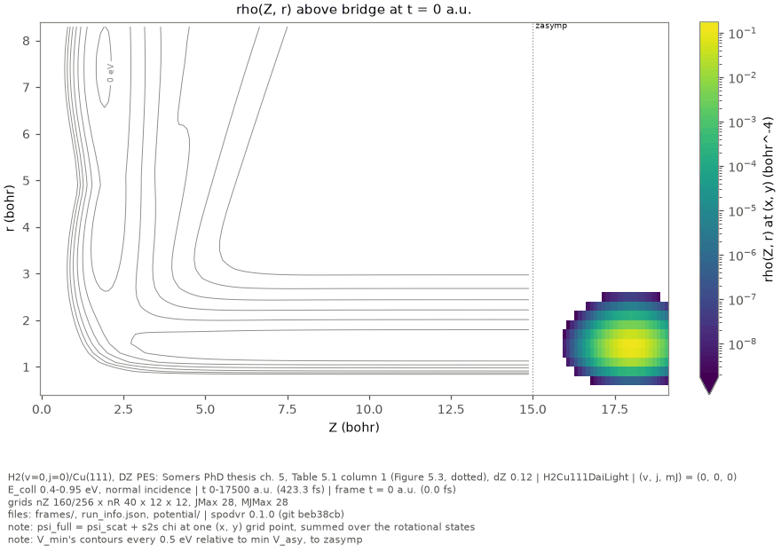
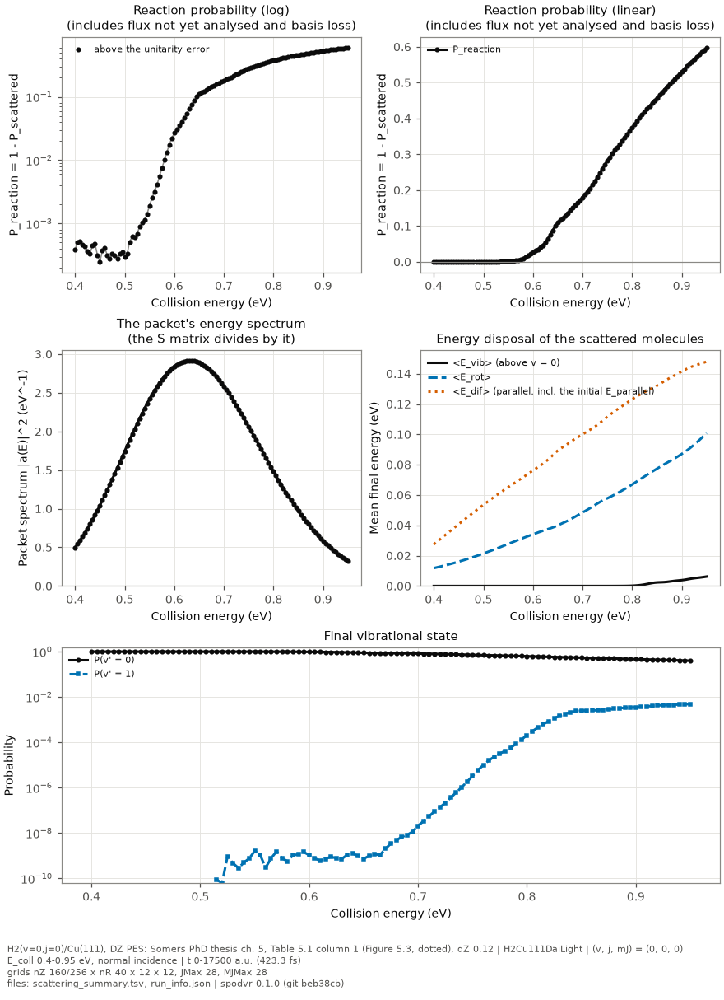
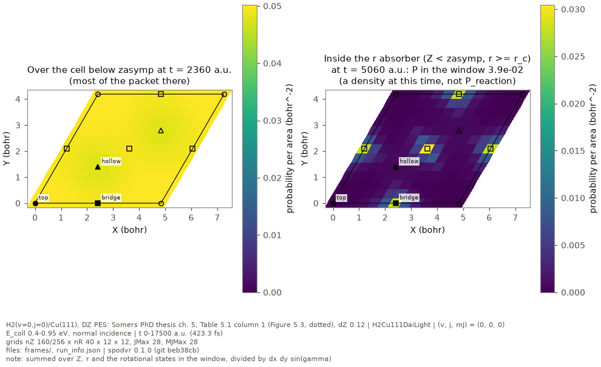
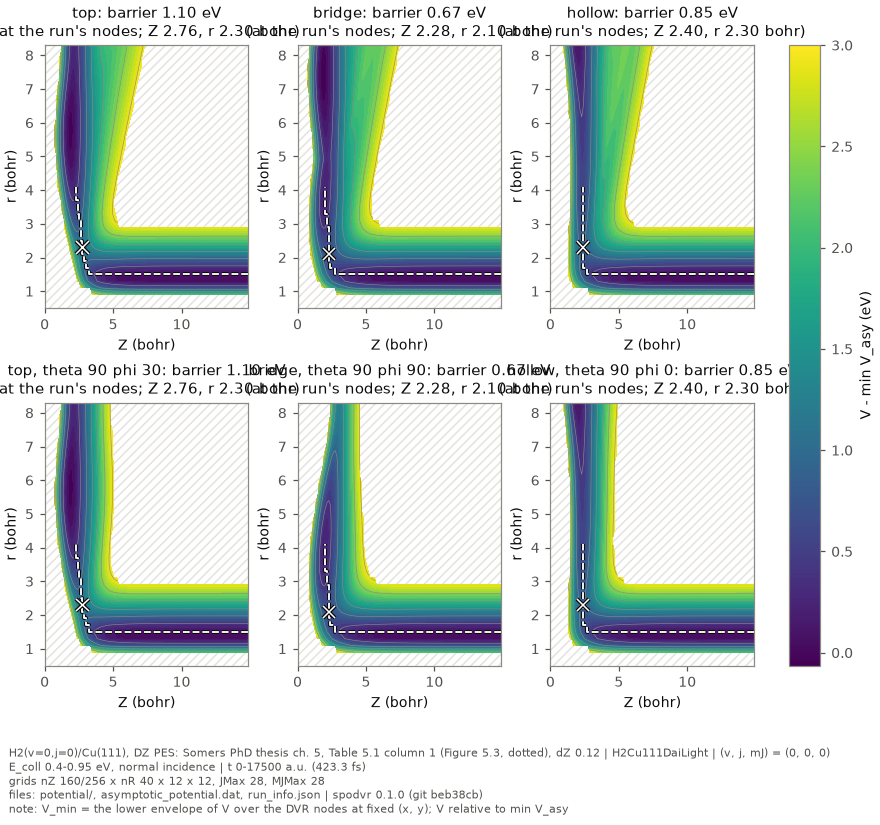

# Thesis Figure 5.3 (DZ PES) with every plot switched on

The production calculation of [`../thesis_fig5_3_dz/`](../thesis_fig5_3_dz/README.md) (H₂(v = 0,
j = 0) on Cu(111), Dai–Zhang PES, the grid of Somers' thesis, Table 5.1, with ΔZ = 0.12 and N_Z = 160
instead of 0.15 and 128), with every key that writes plot data. It is the run behind the
**[analysis gallery](../../docs/analysis_gallery.md)**: 23 figures and 4 movies, each with what it shows, why it
matters and the take-away.

[](../../docs/analysis_gallery.md)

| Reaction and energy disposal | The packet over the unit cell | Elbow plots at three sites |
|---|---|---|
| [](../../docs/analysis_gallery.md#reaction-and-energy-disposal) | [](../../docs/analysis_gallery.md#the-packet-over-the-unit-cell) | [](../../docs/analysis_gallery.md#elbow-plots-and-the-minimax-barrier) |

## What differs from `thesis_fig5_3_dz`

The physics is the same, key for key: grids, wave packet, times, absorbers, analysis. Only these
keys are added (all optional, off by default; [docs/input_schema.md](../../docs/input_schema.md)):

| Key | Value | Writes |
|---|---|---|
| `writeDensities` | true | `densities/`: the packet over (Z, r) every `dtAve` (500 a.u.) |
| `writePotential` | true | `potential/`: the potential on the run's grid, at set-up |
| `PlotSites` | top (0, 0), bridge (½, 0), hollow (⅓, ⅓) | named sites for the elbow plots and the movies (fractions of the lattice vectors; on grid points) |
| `dtFrames` | 20 a.u. | `frames/`: the whole packet every 20 a.u., 876 frames |
| `FrameExtras` | all five | per frame: axis distribution, diffraction orders, vibrational levels, alignment, momenta |
| `NormBudget` | true | `norm_budget/`: what each absorber took, every analysis step |
| `EnergyResolvedSites`, `EnergyResolvedEnergies` | the three sites; 0.50, 0.65, 0.80 eV | `energy_resolved/`: stationary scattering states |
| `alsoAnalysis` | true | `fine_analysis/`: the fine analysis after the run |

**`dtFrames`** must be a whole multiple of `dtAna` (20 a.u.), and `tStart` and `tEnd` must be whole
multiples of it. With `tEnd` = 17 500 a.u. the valid values below 100 a.u. are 20 only (40, 60 and
80 do not divide 17 500); 100 a.u. is the next. `tEnd` = 17 520 (`nStep` 7008) would make 40 valid.

## Cost

Measured on 2026-11-20 with the `build-cuda-fast` build on an RTX 4070 Ti:

- **Run time:** 4.0 h, against 1.3 h for the same propagation without plot keys. The frames take
  2.5 h (10.3 s each, three quarters of it the five `FrameExtras`). `dtFrames` 100 makes them five
  times cheaper.
- **Disk:** about 16 GB in all: 8.3 GB of frames, 6.4 GB checkpoint, 766 MiB `energy_resolved/`,
  266 MiB BK coefficients, 114 MiB `potential/`. The program prints the projected size and cost of
  each key at set-up and refuses a run whose plot data would not fit on the disk.
- **Memory:** 6.7 GiB host (peak); on the GPU as `../thesis_fig5_3_dz/` (8.8 GiB estimated).

## Running it

From the repository root (the output directory as in the gallery):

```bash
OMP_NUM_THREADS=8 build-cuda-fast/spodvr inputs/thesis_fig5_3_dz_plotting/input.json \
  --device cuda --threads 8 --output-dir runs/thesis_fig5_3_dz_plotting_cuda_fast

uv run python -I -B tools/plots/spodvr_plot.py report runs/thesis_fig5_3_dz_plotting_cuda_fast \
  --out runs/thesis_fig5_3_dz_plotting_cuda_fast/report
uv run tools/plots/view.py runs/thesis_fig5_3_dz_plotting_cuda_fast
```

The report writes the figures, a Markdown page with the run's verdict and an explanation under every
figure. The viewer shows the packet at any surface point and time. On the CPU, leave out
`--device cuda`: the program projects 6.6 s per frame there (20 % of the propagation between
frames), but the propagation itself is several times slower.
There is no Fortran `DVR.inp` here: the plot keys exist only in the C++ program.
