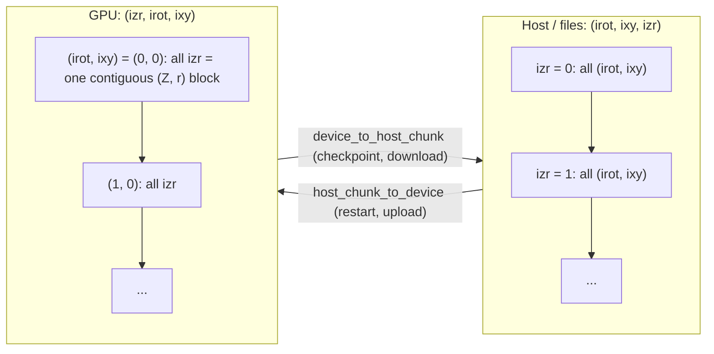
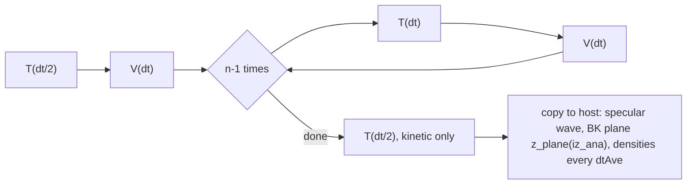
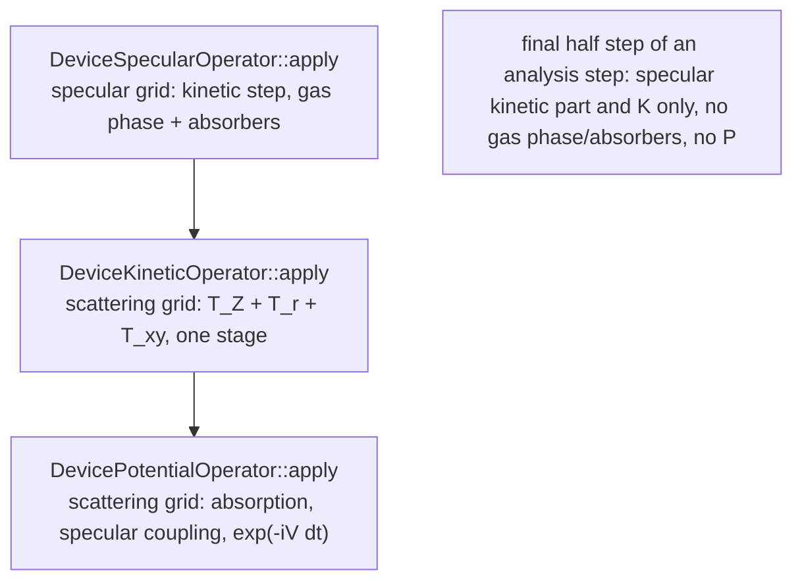
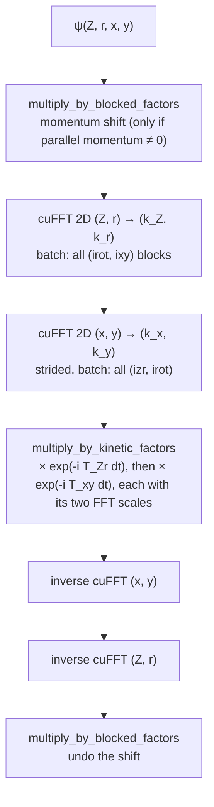
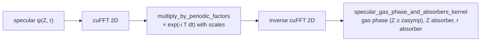
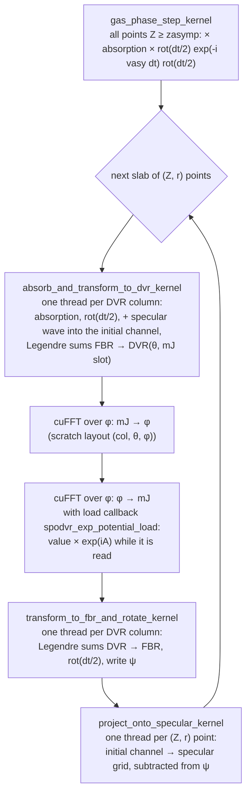
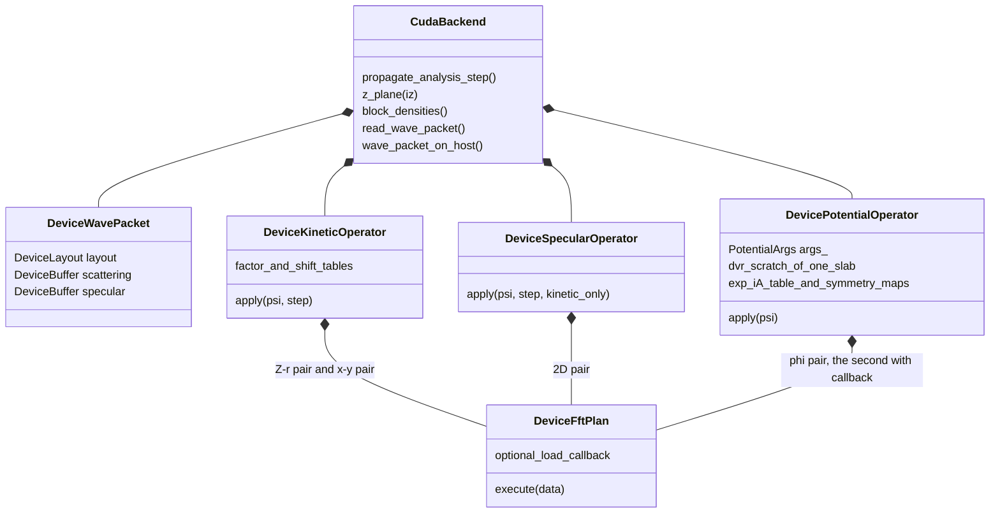

# `src/cuda/`: the GPU propagation backend

This directory holds the CUDA implementation of the split-operator propagation (`--device cuda`).
The wave packet lives in GPU memory for the whole run. Per analysis step the host receives only
three small pieces:
- the specular wave;
- one Z plane, the input of the Balint-Kurti (BK) analysis;
- now and then, the densities per (Z, r) point.

This file explains which kernels exist, why each exists, and how they fit together. Building,
running, memory, benchmarks and the measured optimisations are in
[`docs/cuda.md`](../../docs/cuda.md).

**The ground rule** (docs/cuda.md, "One method, two executions"): the GPU computes *the same
method* as the CPU backend (`src/propagation/`), with the same tables and the same operation
order per element. Only the execution differs. Every kernel therefore has a **CPU twin**, named
below.
- The one deliberate exception is the merged kinetic stage, described in the docs with its test.
- Whenever you change a kernel, also check its twin.

---

## 1. Files

| File | Content |
|---|---|
| `cuda_backend.{hpp,cpp}` | `CudaBackend` (the `PropagationBackend` of the GPU): owns the wave packet and the three operators, runs an analysis step, copies data to and from the host. Also the device summary and the GPU memory estimate. |
| `device_kinetic_operator.{hpp,cpp}` | `DeviceKineticOperator` (kinetic stage T on the scattering grid) and `DeviceSpecularOperator` (the specular grid). Host code: tables, cuFFT plans, launch order. |
| `device_potential_operator.{hpp,cpp}` | `DevicePotentialOperator`: the potential stage V (absorption, specular coupling, angular transform, exp(−iV dt)), slab by slab. Host code. |
| `kernels.hpp` | Declarations of all kernel **launchers**, plus the argument structs the kernels read (`FftScales`, `SpecularStepArgs`, `PotentialArgs`, `ExpPotentialTable`). |
| `kinetic_kernels.cu` | Multiplications in momentum space: the kinetic factors and the momentum shift. |
| `potential_kernels.cu` | The potential-stage kernels. |
| `specular_kernels.cu` | Gas-phase step and absorbers on the specular grid. |
| `wave_function_kernels.cu` | Kernels on the whole ψ: densities, the BK plane, host ⇄ device layout conversion. |
| `fft_callbacks.{hpp,cu,cpp}` | The cuFFT **load callback** that applies exp(iA) inside the φ FFT. It is compiled separately to LTO-IR and embedded (section 6). |
| `cuda_fft.{hpp,cpp}` | `DeviceFftPlan`: a cuFFT plan (64-bit sizes, optionally split into slabs of batches, shared work area, optional load callback). |
| `device_buffer.{hpp,cpp}` | `DeviceBuffer<T>`: owning device memory (a `unique_ptr` with a `cudaFree` deleter), upload and download. |
| `device_complex.hpp` | `Complex` (two doubles, the layout of `std::complex<double>`), its operators, and `DeviceLayout` (the index of ψ on the GPU). |
| `device_wave_packet.hpp` | `DeviceWavePacket`: the scattering and the specular wave in GPU memory. |
| `launch.cuh` | Launch helpers: `threads_per_block` (256), `blocks_for`, `grid_2d`, `thread_index`. |
| `cuda_error.{hpp,cpp}` | `CudaError`, status checks, `check_kernel_launch`. |

Division of labour (a project rule):
- **`.cu` files:** kernels and their launchers only (`kernels.hpp` declares the launchers);
- **`.cpp` files:** all host logic (tables, plans, loops), compiled by the normal C++ compiler.

This keeps nvcc away from the project headers, and the host code inside the C++ build (warnings,
LTO).

---

## 2. Data layout: why izr is the fastest index

The host and the files keep the Fortran layout of the scattering wave, `(irot, ixy, izr)`, with
irot fastest. On the GPU, ψ is stored as **`(izr, irot, ixy)` with izr = ir + nr·iz fastest**
(`DeviceLayout`):

With izr fastest, every stage becomes one of two simple shapes:
- **one batched cuFFT with a single batch dimension.**
  - Every (irot, ixy) is a contiguous (Z, r) block, so T_Z + T_r is a single 2D cuFFT over all
    blocks.
  - The (x, y) transform of all (izr, irot) is one strided plan with batches at distance 1.
  - cuFFT, like oneMKL's FFTW interface, supports only one batch dimension.
- **a kernel whose neighbouring threads read neighbouring memory** (coalesced). Almost every
  kernel maps `threadIdx.x` to izr.

The CPU needs gather/scatter code to get the same effect. The GPU does without it.

The specular wave keeps its host layout `(ir, iz)`, which is already contiguous.

---

## 3. How the stages go together

### 3.1 One analysis step

The time loop (`WavePacketPropagation::run`, CPU code) calls `propagate_analysis_step()` once per
analysis step. That is n = `steps_per_analysis` time steps, with adjacent half steps of T merged:

Each box "T" is `kinetic_and_potential_step` without its V part. Inside it the stages run in a
fixed order on the default stream:

All work goes to **one stream** (the legacy default stream), so the kernels and FFTs run one
after the other in launch order, like the CPU code. No atomics, fixed launch shapes: two runs on
the same GPU and library versions are bitwise identical, also across a restart.

### 3.2 Kinetic stage T (scattering grid)

- **Why one stage:** T_Z + T_r and T_xy commute, and so do the shift (a factor per ixy) and the
  (Z, r) transform. One multiplication pass therefore replaces two. Each pass over ψ costs about
  25 ms on the DZ benchmark grid, and the merge saved 29 ms per time step.
- **Why it is a methodology exception:** the CPU applies T_Z + T_r and T_xy as two stages. Its
  T_xy is fused with V per group of (Z, r) points for cache reasons, so the merge would not help
  there.
- **What is kept the same per element:** the order of the factors. First the (Z, r) factor with
  its scales, then the (x, y) factor with its scales.
- **Test:** `CudaBackend.MergedKineticStageMatchesTheCpuStages`.
- **Why the FFT scales are separate multiplications:** cuFFT does not scale, so the kernel
  applies `backward * (forward * v)`, two multiplications as on the CPU. Folding the two scales
  into the factor table rounds once more per step, and that bias accumulated: 2.6e-13 drift in
  the norm after 1000 steps.

### 3.3 Specular grid

The incoming channel is propagated on its own, longer (Z, r) grid:

The last kernel is skipped on the final half step (kinetic only). The specular wave couples to
the scattering grid inside the potential stage (3.4).

### 3.4 Potential stage V (scattering grid)

V splits the Z range in two:
- **Z ≥ zasymp:** V depends on r only (the free molecule). The step is diagonal in the
  rotational basis, so one elementwise kernel does it, `gas_phase_step_kernel`.
- **Z < zasymp, the interaction region:** V(x, y, Z, r, θ, φ) couples the rotational states. ψ
  goes from the rotational basis (FBR, |J mJ⟩) to the angular grid (DVR, θ × φ). There it is
  multiplied by exp(iA), with A = −V dt, and transformed back.

The interaction region is processed in **slabs** of consecutive (Z, r) points. The slab is the
largest divisor of the number of points whose DVR scratch fits in 1 GiB, so the scratch array has
a fixed size and all slabs have the same shape (one set of cuFFT plans). Within a slab every
(Z, r, x, y) point is one **DVR column**:

Why these kernels are cut this way:
- **The Legendre sums are per column and per mJ block.** A thread first loads its column's FBR
  coefficients of one mJ block (at most `max_j_per_mj_block` = 64 values of J). It then forms
  `dvr(θ) = Σ_J P(θ, J) fbr[J]` for every θ.
  - The matrix P is read at the same address by all threads of a warp: one cached load,
    broadcast to the warp.
  - The θ-sums keep the CPU order (`AngularTransform`), so with the same input they are bitwise
    equal to the CPU.
  - Absorption, rot(dt/2) and the specular coupling are folded into the same kernel, because they
    act on the same coefficients just before the sums. That saves passes over ψ.
- **The φ transform is a cuFFT,** not a hand-written DFT: length nφ, batch columns·nθ at
  distance 1.
- **exp(iA) is a cuFFT load callback** of the second φ FFT (section 6). Without it, a separate
  kernel would read and write the whole DVR scratch once more per slab. The callback saves about
  45 ms per DZ time step. The kernel version, `multiply_by_exp_potential_kernel`, is kept: it
  serves nφ = 1 (no φ FFT to attach a callback to) and is the test reference of the callback.
- **Surface symmetry:** exp(iA) is stored only at the (x, y) representatives. A point ixy reads
  the values of its representative at the rotated or mirrored φ. `ExpPotentialTable::at()` is the
  one place that encodes this layout; both the kernel and the callback use it.
- **The projection onto the specular grid** sums over (x, y) in the CPU order. One thread per
  (Z, r) point makes that order fixed: no atomics, no tree reduction. It launches few threads,
  but takes only about 1 ms per step.

### 3.5 What the analysis reads (once per analysis step)

| Launcher | Purpose |
|---|---|
| `pack_z_plane` | The nr (Z, r) blocks of Z index iz, gathered into host layout `(irot, ixy, ir)`. This is the BK input. Copied to the host. |
| `block_densities` | Σ\|ψ\|² per (Z, r) point, summed in host memory order. Used for the averages (every dtAve). |
| the specular wave | Downloaded as it is (analysis surface, BK coefficient of the initial channel). |

---

## 4. Host objects

- **cuFFT work area:** `CudaBackend::share_fft_work_area` gives all plans one shared work area.
  That is safe because everything runs on one stream.
- **Tables:** every table is computed on the host by the CPU code (`PropagationTables`,
  `potential_step_factors`, `specular_gas_phase_factors`, `AngularTransform::matrix()`, exp(iA)
  with the CPU's `exp_i`) and uploaded once. Only the layout changes (izr fastest). So the GPU
  multiplies by bitwise the same numbers as the CPU.
- **Kernel arguments:** the operators fill plain argument structs (`PotentialArgs`,
  `SpecularStepArgs`) with device pointers, and the launchers pass them by value.
  `PotentialArgs::izr_first` changes per slab.

---

## 5. Kernel reference

"x" and "y" are the CUDA grid dimensions. `grid_2d(n_inner, n_outer)` launches x over the inner
index and y over the outer one, as a grid-stride loop in y. This avoids a 64-bit division per
element: integer division is emulated in software on the GPU.

### Kinetic stages (`kinetic_kernels.cu`)

| Kernel | Thread mapping | Computes | CPU twin | Fortran |
|---|---|---|---|---|
| `multiply_by_kinetic_factors_kernel` | x: izr; y: ixy; loop over irot | `v = zr[izr]·(sb_zr·(sf_zr·v))`, then `v = xy[ixy]·(sb_xy·(sf_xy·v))` | `ScatteringKineticOperator::apply_zr` + `apply_xy` (two stages) | KineticOp.f90 MultByEXPKinEnergy |
| `multiply_by_blocked_factors_kernel` | x: position in block (izr, irot); y: block (ixy) | momentum shift: `v = f[ixy]·v` (scales 1) | `apply_xy_group` (shift) | MomentumShifting.f90 |
| `multiply_by_periodic_factors_kernel` | x: position in period; y: period | specular kinetic step: `v = f[i]·(sb·(sf·v))` | `SpecularOperator` | KineticOp.f90 MultByEXPKinEnergy |

### Specular grid (`specular_kernels.cu`)

| Kernel | Thread mapping | Computes | CPU twin | Fortran |
|---|---|---|---|---|
| `specular_gas_phase_and_absorbers_kernel` | one thread per specular point ir + nr·iz | gas phase (iz ≥ nz_potential), Z absorber, r absorber, in the CPU's pass order | `SpecularOperator` | GasPhase.f90 PerformEXPGasPhaseOnSpecGrid, Absorption.f90 PerformEXPOpticalOpSpec |

### Potential stage (`potential_kernels.cu`)

| Kernel | Thread mapping | Computes | CPU twin | Fortran |
|---|---|---|---|---|
| `gas_phase_step_kernel` | x: izr ≥ n_zr_potential; y: irot + n_rot·ixy | `v = optical_z·(gas_phase_step[irot, ir]·v)` | `PotentialOperator::apply_block` (Z ≥ zasymp) | Absorption.f90, GasPhase.f90 PerformEXPGasPhaseOnScatGrid |
| `absorb_and_transform_to_dvr_kernel` | one thread per DVR column (izr, ixy) of the slab | absorption, rot(dt/2), + specular wave in the initial channel; FBR → DVR Legendre sums per mJ block; zeroes the unused φ slots | `apply_block` (up to `apply_interaction`), `AngularTransform::fbr_to_dvr` | Absorption.f90, TwoGrids.f90 AddSpecToScat, transform.f90 FBRToDVRGenComplexTransform |
| `multiply_by_exp_potential_kernel` | x: DVR column; y: (θ, φ) point | `v = exp(iA)·v` (only for nφ = 1, and as the callback's test reference) | `PotentialOperator::apply_interaction` | Potential.f90 PerformEXPInteractionOp |
| `transform_to_fbr_and_rotate_kernel` | one thread per DVR column | DVR → FBR Legendre sums per mJ block (θ in the CPU order), rot(dt/2), writes ψ | `AngularTransform::dvr_to_fbr`, `apply_rotation_half_step` | transform.f90 DVRToFBRGenComplexTransform |
| `project_onto_specular_kernel` | one thread per (Z, r) point of the slab | `spec = Σ_xy scattering_to_specular[ixy]·ψ(initial channel, ixy)`, then `ψ −= specular_to_scattering[ixy]·spec` | `apply_block` (projection) | TwoGrids.f90 SubSpecFromScat |

### cuFFT callback (`fft_callbacks.cu`)

| Function | Called | Computes | Notes |
|---|---|---|---|
| `spodvr_exp_potential_load` | by cuFFT, once per value the second φ FFT reads | `exp(iA)·v`, through `ExpPotentialTable::at` | Explicitly rounded (`__dmul_rn`, `__dadd_rn`, `__dsub_rn`). Reads `ExpPotentialCallbackInfo` (device memory); its `izr_first` is updated before every slab by an in-stream device-to-device copy. |

### Whole wave function (`wave_function_kernels.cu`)

| Kernel | Thread mapping | Computes | Used by |
|---|---|---|---|
| `block_densities_kernel` | one thread per izr | Σ over (irot, ixy) of \|ψ\|² (as `hypot²`, like the CPU's `std::abs²`), in host memory order | averages (Averages.f90 complexInnerProd) |
| `pack_z_plane_kernel` | one thread per output value (irot, ixy, ir) | the plane of Z index iz in host layout | BK analysis (Analyzor.f90) |
| `host_chunk_to_device_kernel` | one thread per value, izr fastest | host layout → device layout for a chunk of (Z, r) points (through a staging buffer) | restart, upload |
| `device_to_host_chunk_kernel` | as above | device layout → host layout | checkpoint, `wave_packet_on_host()` |

---

## 6. The cuFFT load callback: from source to kernel

```mermaid
flowchart LR
  A["fft_callbacks.cu"] -- "nvcc -gencode arch=compute_75,code=lto_75 -dc -fatbin" --> B["fft_callbacks.fatbin (LTO-IR)"]
  B -- "cmake/embed_binary.cmake" --> C["generated/fft_callbacks_fatbin.h (byte array)"]
  C --> D["fft_callbacks.cpp: exp_potential_callback_fatbin()"]
  D --> E["DevicePotentialOperator → DeviceFftPlan(load callback)"]
  E -- "cufftXtSetJITCallback, then cufftMakePlanMany64" --> F["cuFFT links the callback into its FFT kernel (nvJitLink, at plan creation)"]
```

Requirements, all verified on CUDA 13.3:
- **Name and scope:** the callback is a `__device__` function at global scope, **not
  `extern "C"`** and not in a namespace. cuFFT looks it up by name; with `extern "C"` the plan
  fails with `CUFFT_NVJITLINK_FAILURE`.
- **Rounding:** cuFFT chooses the link options, and nvJitLink contracts multiply-add to FMA by
  default. The product is therefore written with `__dmul_rn`/`__dadd_rn`/`__dsub_rn`, which are
  never contracted. That gives the same product as `Complex operator*` compiled with
  `-fmad=false`.
- **Offsets:** the callback receives offsets relative to the start of one `execute()` call.
  `DeviceFftPlan` therefore refuses to split the batch of a callback plan into slabs.
- **Run time:** cuFFT needs `libnvJitLink` and `libnvrtc` of its own CUDA release. Without them
  the run stops with an error naming them.
- **Numerics:** the multiplication is identical to the kernel's, but cuFFT may use a differently
  rounding FFT kernel for a plan with a callback. Measured: ≤ 4e-16 relative per stage for
  nφ = 12; bitwise equal for the DZ layout, nφ = 60. Test:
  `CudaBackend.ExpPotentialCallbackMatchesTheKernel`.

---

## 7. Numerical rules the kernels follow

- **No FMA:** the strict build compiles the kernels with `-fmad=false`, like the CPU's
  `-ffp-contract=off`. The opt-in `SPODVR_FAST_MATH` build allows FMA; its results are not
  bit-comparable with the CPU.
- **Complex arithmetic as on the CPU:** `Complex` operators (`device_complex.hpp`) compute the
  products the way GCC does with `-fcx-fortran-rules`. Real × complex is `(r·re, r·im)`.
- **Same order of operations as the CPU** in every kernel. For the same input, the elementwise
  kernels, the Legendre sums and the projection are bitwise equal to their CPU twins. The FFTs
  are cuFFT's, which round differently from oneMKL/FFTW. After 1000 steps CPU and GPU agree to
  about 1e-13, the level the CPU build also shows between FFT libraries.
- **Determinism:**
  - one stream;
  - no atomics;
  - fixed launch shapes;
  - every reduction (projection, densities) runs sequentially in a fixed order in one thread.
- **Limits:**
  - at most 64 values of J per mJ block (`max_j_per_mj_block`; the constructor checks it);
  - the DVR scratch of one slab must stay below 2³¹ values (32-bit offsets in the callback).

## 8. Where to look when …

| Task | Where |
|---|---|
| changing a kinetic or potential table | the CPU code that builds it (`src/propagation/`). The GPU uploads the same table; check that its layout on the device still matches. |
| changing the method of a stage | both backends in the same commit, or add a methodology exception in docs/cuda.md with a test |
| measuring a change | `build-cuda/tools/spodvr_cuda_operator_timing <input.json> [reps]`, and use **interleaved A/B runs** (docs/cuda.md, Performance) |
| testing | `ctest --test-dir build-cuda -R Cuda` (`tests/cuda/`); the long GPU gates with `SPODVR_LONG_TESTS=1` |
