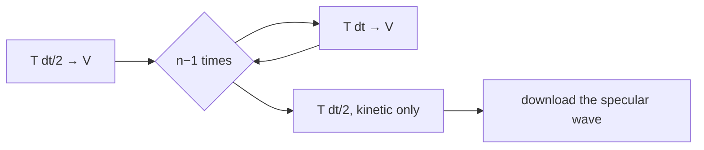
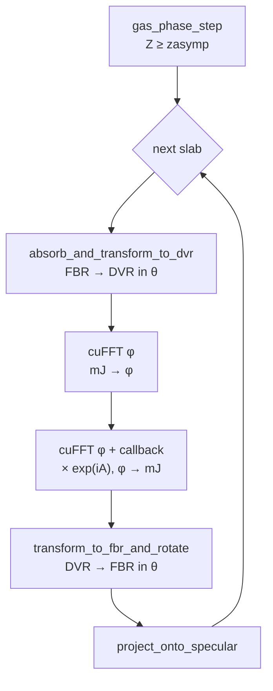

# `src/cuda/`: the GPU kernels

This directory propagates the wave packet on an NVIDIA GPU (`spodvr --device cuda`). ψ stays in
GPU memory for the whole run. The host gets back only small pieces: the specular wave, one Z
plane for the BK analysis, and now and then a density per (Z, r) point.

> **Ground rule.** Every kernel computes exactly what its *CPU twin* in `src/propagation/`
> computes, with the same tables and in the same order. Only the memory layout and the parallel
> execution differ. If you change a kernel, change its twin too. There is one documented
> exception: the merged kinetic stage (§4.1).

Building, running, benchmarks and the measured optimisations are in
[`docs/cuda.md`](../../docs/cuda.md).

**Start here.**
1. Read §1 (vocabulary) and §2 (memory layout).
2. Read §3, the list of everything that runs in one time step.
3. In the code, follow `CudaBackend::propagate_analysis_step` (`cuda_backend.cpp`) into
   `DevicePotentialOperator::apply` (`device_potential_operator.cpp`). Read the kernels it
   launches in `potential_kernels.cu`, with §4.3 at hand.

---

## 1. Vocabulary

| Term | Meaning |
|---|---|
| `izr` | (Z, r) grid point, `izr = ir + nr·iz` |
| `ixy` | (x, y) grid point, `ixy = iy + ny·ix` |
| `irot` | rotational basis state \|J mJ⟩. Ordered by mJ = −MJMax … MJMax, and within one mJ by J |
| FBR / DVR | the two angular representations of ψ: coefficients of \|J mJ⟩ (FBR), or values on the (θ, φ) grid (DVR) |
| mJ block | the consecutive irot with one value of mJ (J = \|mJ\| … JMax); the kernels support at most 64 per block |
| φ slot | position of an mJ in the φ transform: slot mJ for mJ ≥ 0, slot nφ + mJ for mJ < 0 |
| specular wave | the incoming channel (the initial rovibrational state) on its own, longer (Z, r) grid. In the interaction region it is added to ψ for the potential step and projected back afterwards |
| initial channel | the irot of the initial state |
| zasymp | the Z beyond which V depends on r only (free molecule). `n_zr_potential` = the (Z, r) points with Z < zasymp, the *interaction region* |
| A | −V·dt, premultiplied on the host; the potential step multiplies by exp(iA) |
| rot(dt/2) | exp(−i E_rot dt/2) with E_rot = J(J+1)/(2μr²) (μ: reduced mass of the molecule), so one value per (irot, ir) |
| slab | a block of consecutive (Z, r) points of the interaction region, processed together (the DVR scratch is sized for one slab) |
| DVR column | one (Z, r, x, y) point of a slab: one GPU thread in the angular-transform kernels |
| BK plane | ψ at one Z (`iz_analysis`), the input of the Balint-Kurti (BK) analysis on the host, which projects it onto the asymptotic channels |
| flux surface | ψ and ∂ψ/∂r at r = r_c (`rFluxAnalysis`) on the planes Z < zasymp, the input of the flux analysis on the host |
| read-back buffer | the GPU buffer (n_rot·nx·ny·nr values) through which the BK plane, or the flux surface chunk by chunk, is copied to the host |
| dtAve | the interval of the averages output; `block_densities` runs at this interval |
| load callback | a device function that cuFFT calls for every value it reads (used to multiply by exp(iA) inside an FFT) |

---

## 2. Memory layout

ψ on the GPU, with the (Z, r) index innermost:

```
psi[izr + n_zr * (irot + n_rot * ixy)]        (DeviceLayout, device_complex.hpp)
```

The host and the files keep the Fortran order `psi[irot + n_rot * (ixy + n_xy * izr)]`. The
kernels `host_chunk_to_device` and `device_to_host_chunk` convert between the two (restart and
checkpoint only).

```
address →
| izr = 0 1 2 … n_zr-1 | izr = 0 1 2 … n_zr-1 | … | izr = 0 1 2 … n_zr-1 | …
|   irot 0, ixy 0      |   irot 1, ixy 0      | … |   irot 0, ixy 1      | …
  ▲▲▲▲ warp: threads 0…31 read izr 0…31 of one (irot, ixy), one coalesced load
```

Why izr innermost:
- Every (irot, ixy) is one contiguous (Z, r) image, so T_Z + T_r is a single batched 2D cuFFT.
  (cuFFT allows only one batch dimension, so the batched images must be evenly spaced.)
- Thread i usually handles izr = i, so neighbouring threads touch neighbouring addresses.

**Example** (nr = 2, nz = 3, n_rot = 4, nx = ny = 2): take the element iz = 1, ir = 0, irot = 2,
ix = 1, iy = 0.
- Its indices are izr = 0 + 2·1 = 2 and ixy = 0 + 2·1 = 2.
- GPU index: 2 + 6·(2 + 4·2) = **62**.
- Host index: 2 + 4·(2 + 4·2) = **42**.

The specular wave is a plain (Z, r) array, `spec[izr]`, the same on host and GPU.

---

## 3. One time step: everything that runs, in order

The host calls `propagate_analysis_step()` once per analysis step: n time steps as
`T(dt/2) V (T V)^(n−1) T(dt/2)`.



Each box is one call of `kinetic_and_potential_step`: a T → V pair. The final T(dt/2) is called
with `kinetic_only` and skips steps 4 and 10–16. On the default stream, one after the other, a
call launches:

| # | Stage | Launch | What it does |
|---|---|---|---|
| 1 | specular grid | cuFFT 2D (Z, r) | to momentum space |
| 2 | | `multiply_by_periodic_factors` | × exp(−iT dt) |
| 3 | | cuFFT 2D (Z, r) | back to coordinates |
| 4 | | `apply_specular_gas_phase_and_absorbers` | gas phase and absorbers (*not on the final half step*) |
| 5 | kinetic T | `multiply_by_blocked_factors` | momentum shift (only with parallel momentum) |
| 6 | | cuFFT 2D (Z, r), then cuFFT 2D (x, y) | to momentum space |
| 7 | | `multiply_by_kinetic_factors` | × exp(−iT_Zr dt) × exp(−iT_xy dt) |
| 8 | | cuFFT (x, y), then cuFFT (Z, r) | back to coordinates |
| 9 | | `multiply_by_blocked_factors` | undo the shift |
| 10 | potential V (*not on the final half step*) | `apply_gas_phase_step` | Z ≥ zasymp: elementwise step |
| 11 | per slab | `absorb_and_transform_to_dvr` | absorption, rot(dt/2), add the specular wave; FBR → DVR in θ |
| 12 | | cuFFT over φ | mJ → φ |
| 13 | | copy `izr_first` into the callback's arguments | |
| 14 | | cuFFT over φ, **with load callback** | × exp(iA) while reading; φ → mJ |
| 15 | | `transform_to_fbr_and_rotate` | DVR → FBR in θ, rot(dt/2) |
| 16 | | `project_onto_specular` | initial channel back to the specular grid |

The analysis loop asks for the rest when it needs it: `z_plane(iz)` (`pack_z_plane` and a copy),
`block_densities()` every dtAve, and with the flux analysis `flux_surface(slot)`
(`read_flux_surface`: per chunk of nr/2 planes `flux_surface_chunk` and two copies into the slot).

One stream, no atomics, fixed launch shapes: two runs on the same GPU give bitwise identical
results, also across a restart.

---

## 4. The stages

### 4.1 Kinetic stage T

T_Z + T_r and T_xy commute, so the GPU transforms all four dimensions and multiplies **once**
(steps 6–8). That saves one pass over ψ.

The CPU keeps two stages, T_Z + T_r and then T_xy fused with V, so this is the documented
methodology exception (docs/cuda.md). Per element the order of the factors is kept: first
(Z, r), then (x, y). cuFFT does not scale, so each factor comes with its two FFT scale factors,
applied as two separate multiplications as on the CPU.

### 4.2 Specular grid

A 2D FFT, a multiplication and the inverse FFT (steps 1–4), then the gas phase and the absorbers.
The specular wave meets the scattering grid only in the potential stage (steps 11 and 16).

### 4.3 Potential stage V

- **Z ≥ zasymp:** V depends on r only, so the step is diagonal in irot: one elementwise kernel
  (`gas_phase_step`).
- **Z < zasymp:** V couples the rotational states. ψ goes FBR → DVR, is multiplied by exp(iA),
  and goes back DVR → FBR. This is done slab by slab, so that the DVR scratch has a fixed size
  (at most 1 GiB).



**The DVR scratch** of a slab is laid out `(col, θ, φ)` with the column fastest:
`dvr[col + n_col·(itheta + n_theta·iphi)]`. Along φ (here MJMax = 2, nφ = 6):

```
φ slot:   0      1      2      3      4       5
holds:   mJ=0   mJ=1   mJ=2   zero   mJ=−2   mJ=−1
```

`absorb_and_transform_to_dvr` fills the slots of the mJ blocks and zeroes the rest. The first φ
FFT then turns slots into φ grid points.

**One thread of `absorb_and_transform_to_dvr`**, worked through for a slab of 3 points starting
at izr_first = 9 (the fourth slab), with n_xy = 4 (12 columns), thread col = 7:
1. **Its point:** izr = izr_first + col % 3 = 10 and ixy = col / 3 = 2.
2. **Load:** for every mJ block, it loads ψ(izr = 10, irot, ixy = 2) for each irot of the block
   and multiplies it by the Z absorber and by `before_interaction` (r absorber × rot(dt/2)). In
   the initial channel it adds the specular wave `spec[10]`, which also goes through rot(dt/2).
   The results go into a per-thread array `fbr[j]` (in local memory, cached).
3. **Sum:** for every θ it forms `Σ_j legendre(θ, j)·fbr[j]` and writes it to
   `dvr[7 + 12·(itheta + n_theta·slot)]`. Note: the DVR index uses the column (7), the ψ index
   uses izr (10).
4. **Coalescing:** threads 6, 7 and 8 have the same ixy and izr 9, 10, 11. Their ψ reads and
   their DVR writes are neighbouring addresses.
5. **The Legendre matrix** is the same for all threads, so a warp reads it with one broadcast
   load.

`transform_to_fbr_and_rotate` is the same thread layout in reverse.

**Why exp(iA) is a cuFFT callback:** exp(iA) must multiply the values on the φ grid, i.e. after
the first φ FFT and before the second. The second FFT reads exactly those values, so its load
callback multiplies each one as it is read. As a separate kernel it would read and write the
whole DVR scratch once more per slab. The kernel version, `multiply_by_exp_potential`, still exists. It is
used when nφ = 1 (no φ FFT to attach to), and it is the reference in the callback's test.

**Surface symmetry:** exp(iA) is stored only at the (x, y) representatives. `ExpPotentialTable::at`
(`kernels.hpp`) maps a point to its representative and the rotated or mirrored φ. It is the only
code that knows this layout, and both the kernel and the callback use it.

---

## 5. Before you change a kernel

**Rules.**
- **Same order as the CPU twin.** Complex products as in `device_complex.hpp`. No FMA: the
  kernels are built with `-fmad=false`, and the callback uses `__dmul_rn`/`__dadd_rn`.
- **No atomics, and no reductions whose order depends on scheduling.** A reduction runs in one
  thread in a fixed order (`project_onto_specular`, `block_densities`, `flux_surface_chunk`).
  Atomics would make two runs differ in the last bits. `CudaBackend.TwoRunsAreBitwiseIdentical` and
  `CudaRestart.SplitGpuRunIsBitwiseIdenticalToTheUnsplitGpuRun` would catch that.
- **Limits:** at most 64 values of J per mJ block. The DVR scratch of one slab must stay below
  2³¹ values (the kernels and the callback use 32-bit indices within a slab). Both are checked
  in the `DevicePotentialOperator` constructor.
- **Launch shapes:** `grid_2d(n_inner, n_outer)` puts the inner index on the grid's x dimension
  (coalesced) and runs the outer index in a loop over the grid's y dimension. Integer division by a non-constant is
  slow on the GPU, so this avoids one per element.

**Recipes.**

| I want to … | Do this |
|---|---|
| change V (a new PES or term) | Implement it in `src/potential/` (a `Potential` subclass; `potential_factory.cpp` maps `SystemID` to it). No kernel changes: the program evaluates V on the grid (`compute_potential_grid`), and `DevicePotentialOperator`'s constructor turns it into the exp(iA) table |
| change a kinetic or rotational table | change it where `PropagationTables` is built (`src/propagation/propagation_tables.cpp`). The GPU uploads the same table; check that the device layout still matches |
| add a kernel | add the kernel and its launcher to a `.cu` file, declare the launcher in `kernels.hpp`, and call it from the operator's `.cpp`. Name its CPU twin and Fortran origin in a comment |
| change what a stage computes | change both backends in one commit, or document a methodology exception with a test (docs/cuda.md) |
| test | `ctest --test-dir build-cuda -R Cuda`; long gates with `SPODVR_LONG_TESTS=1` |
| time | `build-cuda/tools/spodvr_cuda_operator_timing <input.json>`, compared in interleaved A/B runs (docs/cuda.md) |

---

## 6. Kernel reference

In "Thread → data", `.x` and `.y` are the dimensions of the CUDA grid (thread index in x, block
index in y), not the coordinates x, y.

| Kernel | Thread → data | Computes |
|---|---|---|
| `multiply_by_kinetic_factors` | `.x`: izr, `.y`: ixy, loop over irot | × exp(−iT_Zr dt) × exp(−iT_xy dt), each with its FFT scales |
| `multiply_by_blocked_factors` | `.x`: (izr, irot), `.y`: ixy | momentum shift, one factor per ixy |
| `multiply_by_periodic_factors` | `.x`: position in the period, `.y`: period index | specular kinetic step |
| `apply_specular_gas_phase_and_absorbers` | one thread per specular point | gas phase, Z absorber, r absorber |
| `apply_gas_phase_step` | `.x`: izr ≥ n_zr_potential, `.y`: (irot, ixy) | absorption × rot · exp(−i V_asy(r) dt) · rot |
| `absorb_and_transform_to_dvr` | one thread per DVR column | §4.3 worked example |
| `multiply_by_exp_potential` | `.x`: DVR column, `.y`: (θ, φ) | × exp(iA) (nφ = 1; test reference) |
| `transform_to_fbr_and_rotate` | one thread per DVR column | DVR → FBR in θ, rot(dt/2), writes ψ |
| `project_onto_specular` | one thread per (Z, r) point of the slab | sums the initial channel over (x, y) into the specular wave, then subtracts that part from ψ |
| `spodvr_exp_potential_load` (callback) | one call per value the φ FFT reads | × exp(iA) |
| `block_densities` | one thread per izr | Σ \|ψ\|² over (irot, ixy), in host order |
| `pack_z_plane` | one thread per value of the plane | BK plane in host layout |
| `flux_surface_chunk` | `.x`: block (irot, ixy), `.y`: plane of the chunk; each thread walks its r column | ψ at r_c and ∂ψ/∂r = Σ_ir D(ir) ψ(ir), from ir = 0 up, in host layout (reads not coalesced) |
| `host_chunk_to_device`, `device_to_host_chunk` | one thread per value | layout conversion via a staging buffer |

(Every kernel above is launched through the function of that name in `kernels.hpp`; the
`__global__` functions carry a `_kernel` suffix.)

---

## Appendix A: files and who owns what

```
CudaBackend                      cuda_backend.{hpp,cpp}
├── DeviceWavePacket             device_wave_packet.hpp      (scattering + specular ψ)
├── read-back buffer             cuda_backend.cpp            (BK plane; flux surface chunks: read_flux_surface)
├── DeviceSpecularOperator       device_kinetic_operator.*   (2D FFT pair)
├── DeviceKineticOperator        device_kinetic_operator.*   ((Z, r) and (x, y) FFT pairs)
└── DevicePotentialOperator      device_potential_operator.* (φ FFT pair, DVR scratch, exp(iA) table)
    (all FFT plans: DeviceFftPlan, cuda_fft.*; one shared cuFFT work area)
```

| File | Content |
|---|---|
| `kernels.hpp` | launcher declarations and kernel argument structs (`PotentialArgs`, `ExpPotentialTable`, …) |
| `kinetic_kernels.cu`, `specular_kernels.cu`, `potential_kernels.cu`, `wave_function_kernels.cu` | the kernels |
| `fft_callbacks.{hpp,cu,cpp}` | the exp(iA) load callback (built separately: docs/cuda.md, Building → "cuFFT callback") |
| `device_complex.hpp` | `Complex`, `DeviceLayout` |
| `device_flux_surface.*` | `read_flux_surface`: the flux surface chunk by chunk through the read-back buffer (host loop) |
| `device_buffer.*`, `launch.cuh`, `cuda_error.*` | device memory, launch helpers, error checks |

Kernels and launchers are in `.cu` files; all host logic (tables, plans, loops) is in `.cpp`
files, compiled by the normal C++ compiler. The tables are computed on the host by the CPU
code and uploaded once, so the GPU multiplies by bitwise the same numbers.

## Appendix B: traceability

| Kernel | CPU twin | Fortran |
|---|---|---|
| `multiply_by_kinetic_factors` | `ScatteringKineticOperator::apply_zr` + `apply_xy` | KineticOp.f90 MultByEXPKinEnergy |
| `multiply_by_blocked_factors` | `apply_xy_group` (shift) | MomentumShifting.f90 |
| `multiply_by_periodic_factors`, `apply_specular_gas_phase_and_absorbers` | `SpecularOperator` | KineticOp.f90, GasPhase.f90 PerformEXPGasPhaseOnSpecGrid, Absorption.f90 PerformEXPOpticalOpSpec |
| `apply_gas_phase_step` | `PotentialOperator::apply_block` (Z ≥ zasymp) | Absorption.f90, GasPhase.f90 PerformEXPGasPhaseOnScatGrid |
| `absorb_and_transform_to_dvr` | `apply_block`, `AngularTransform::fbr_to_dvr` | Absorption.f90, TwoGrids.f90 AddSpecToScat, transform.f90 FBRToDVRGenComplexTransform |
| `multiply_by_exp_potential`, callback | `PotentialOperator::apply_interaction` | Potential.f90 PerformEXPInteractionOp |
| `transform_to_fbr_and_rotate` | `AngularTransform::dvr_to_fbr`, `apply_rotation_half_step` | transform.f90 DVRToFBRGenComplexTransform |
| `project_onto_specular` | `apply_block` (projection) | TwoGrids.f90 SubSpecFromScat |
| `block_densities` | `CpuBackend::block_densities` | Averages.f90 complexInnerProd |
| `pack_z_plane` | `CpuBackend::z_plane` | Analyzor.f90 (BK input) |
| `flux_surface_chunk` | `flux_surface` (propagation/flux_surface.cpp) | WaveFunction.f90 getWaveFunctionAtZr, getWaveFuncDerivAtZr |
