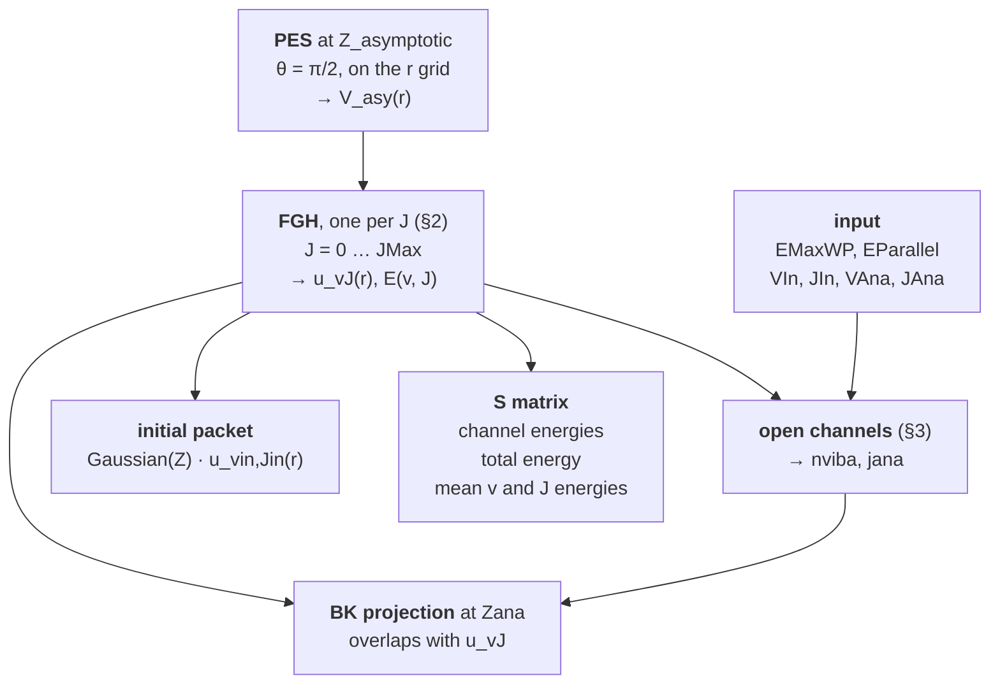

# The gas phase: states of the free molecule (`src/gasphase/`)

Far from the surface the molecule is free. Its rovibrational states u_vJ(r) and energies E(v, J) are the frame in
which the program measures the scattering, so they shape every number it prints:

- **the energies** set the thresholds (at which collision energy a final state opens) and the total energy of the
  S matrix;
- **the states** are the initial vibrational state of the wave packet and the functions the analysis projects the
  outgoing wave onto, and their **sign convention** sets the phases of the S-matrix elements;
- **the limits** decide which final states are analysed at all, and with them the scattered sum and the reaction
  probability 1 − sum.

This directory computes them once, at set-up: for every J = 0 … JMax the radial Schrödinger equation of the free
molecule, solved with a Fourier grid Hamiltonian (FGH) on the program's r grid; then which levels are energetically
open and how many the analysis uses. The propagation never uses the states themselves, but the FGH is the
propagation's own discretised Hamiltonian of the free molecule, so the states are exactly its stationary states
(section 2).

[1 The free molecule](#1-the-free-molecule) · [2 The Fourier grid Hamiltonian](#2-the-fourier-grid-hamiltonian) ·
[3 Open channels and the analysis limits](#3-open-channels-and-the-analysis-limits) ·
[4 Where the states are used](#4-where-the-states-are-used) ·
[5 Differences from the Fortran](#5-differences-from-the-fortran-code-and-why) ·
[6 Files, tests, changing the code](#6-files-tests-and-changing-the-code)



The code is two files: `fourier_grid_hamiltonian.cpp` (the FGH, a general 1D eigenproblem on a periodic grid) and
`gas_phase.cpp` (the molecule: one FGH per J, the open channels, the limits). The diagonalisation goes through the
`SymmetricEigensolver` interface of `src/linalg/`. The method in brief: [docs/method.md](../../docs/method.md#gas-phase).

---

## 1. The free molecule

Atomic units throughout (ħ = 1, energies in hartree, lengths in bohr). The reduced mass is
μ = m₁m₂/(m₁ + m₂) × 1822.89 mₑ per amu: the input's `Mass1`, `Mass2` with the Fortran's "legacy" factor, the one
it uses almost everywhere (`units::legacy`; for H₂, μ = 918.56 mₑ).

**Separation.** Without the surface the angular motion separates: the states are u_vJ(r)/r · Y_JmJ(θ, φ), with J
the rotational quantum number and mJ its projection on the surface normal. With u = r times the radial function
(the same convention as the propagated wave packet), each J gives a one-dimensional problem:

```math
\Big[-\frac{1}{2\mu}\frac{\mathrm{d}^2}{\mathrm{d}r^2} \;+\; V_\mathrm{asy}(r) \;+\; \frac{J(J+1)}{2\mu r^2}\Big]\, u_{vJ}(r)
\;=\; E(v, J)\, u_{vJ}(r).
```

The energy does not depend on mJ: each (v, J) is (2J + 1)-fold degenerate. A **channel** of the analysis is a
final state (v, J, mJ, diffraction channel); it is **open** at a given total energy when it can be reached with
positive outgoing kinetic energy.

**All J from 0 to JMax are solved.** A homonuclear molecule (`HomoNuc`, H₂, D₂) keeps the parity of J: its PES is
symmetric under the exchange of the nuclei (θ → π − θ, φ → φ + π), so it couples only J of one parity, and the
propagation basis holds only the J of the parity of J_in. The other J are still solved and printed, but nothing uses
them.

**The potential.** V_asy(r) is the PES far from the surface, taken at one point on the r grid:

```math
V_\mathrm{asy}(r) = V(x = 0,\; y = 0,\; Z = Z_\mathrm{asymptotic},\; r,\; \theta = \pi/2,\; \varphi = 0),
```

converted from eV with the legacy factor (27.2114 eV per hartree) and clipped to `VMin`/`VMax` when those keys are on
(`compute_asymptotic_potential`, `src/potential/potential_grid.cpp`; Fortran `vasy`). Z_asymptotic is where the PES
becomes the free molecule's. The run writes the curve to `asymptotic_potential.dat`.

<details>
<summary>Two caveats about V_asy</summary>

- With `UseSwitching` (the PES blended into the gas phase between `ZminSwitch` and `ZmaxSwitch`), Z_asymptotic is
  `ZmaxSwitch`, and V_asy is the PES there, while the switch blends towards the PES at the unswitched Z_asymptotic.
  Both codes do this ([physics Q1](../../docs/fortran_deviations.md#physics-q1)).
- A PES need not have reached the gas phase at its own Z_asymptotic: for the Persson PES, V_asy at r = 1.4 bohr is
  1.03 meV above the value at Z = 38.9 bohr ([docs/fortran_bugs/README.md](../../docs/fortran_bugs/README.md),
  "Candidates that are not bugs"). The states are those of V_asy, consistently within a run.

</details>

---

## 2. The Fourier grid Hamiltonian

**The grid.** The FGH lives on nR equidistant points starting at `RStart`:

```math
r_l = r_\mathrm{start} + l\,\Delta, \qquad
\Delta = \frac{(r_\mathrm{start} + n_R\,\mathrm{d}R) - r_\mathrm{start}}{n_R}, \qquad l = 0, \dots, n_R - 1 .
```

Δ equals `dR` up to rounding (the Fortran builds it the same way, from the two bounds), so these are the program's
r grid points. The grid is **periodic** with length nR·dR: the point after the last one is the first. nR must be a
valid FFT size (even, a product of small primes; the input checks it).

**The kinetic energy.** On a periodic grid of nR points a function is a sum of nR plane waves with momenta
k_q = 2πq/(nR Δ), q = −nR/2 + 1 … nR/2 (the **Nyquist** momentum q = nR/2 is the highest the grid resolves). For such
band-limited functions the kinetic energy is exact: transform to momenta, multiply by k_q²/2μ, transform back. As a
matrix:

```math
T_{lm} \;=\; \frac{1}{n_R} \sum_{q = -n_R/2 + 1}^{n_R/2} \frac{k_q^2}{2\mu}\, \cos\!\Big(\frac{2\pi q\,(l - m)}{n_R}\Big),
```

which has the closed form (c = π²/(μΔ²))

```math
T_{ll} = \frac{c}{6}\Big(1 + \frac{2}{n_R^2}\Big), \qquad
T_{lm} = (-1)^{l-m}\,\frac{c}{n_R^2 \sin^2\!\big(\pi (l - m)/n_R\big)} \quad (l \ne m).
```

This is the Fourier grid Hamiltonian of C. C. Marston and G. G. Balint-Kurti, J. Chem. Phys. 91, 3571 (1989). For
nR → ∞ at fixed l − m it becomes the sinc DVR of D. T. Colbert and W. H. Miller, J. Chem. Phys. 96, 1982 (1992)
(T_ll → π²/(6μΔ²), T_lm → (−1)^(l−m)/(μΔ²(l − m)²)). `FourierGridHamiltonian.KineticMatrixMatchesAnalyticFgh`
checks the closed form to 1e-12.

**The Hamiltonian** for one J is H_J = T + diag(V_asy(r_l) + J(J+1)/(2μr_l²)): real, symmetric, nR × nR. Its nR
eigenvalues are E(v, J), v = 0 … nR − 1. The potential enters by its values at the grid points (collocation), so the
eigenvalues are not variational bounds; they converge as the grid is refined.

**Why this grid and this T.** They are the propagation's own: the propagation applies T_r with an FFT on the same r
grid with the same momenta, Nyquist term included (`MomentumGrid`), and beyond Z_asymptotic it applies the same
V_asy(r) and the same J(J+1)/(2μr²) (`PropagationTables`). So H_J is exactly the propagation's discretised
Hamiltonian of the free molecule, and u_vJ is a stationary state of it: the initial vibrational state does not
change during the propagation except through the splitting error and the r absorber. That is why the FGH is periodic
rather than a box with walls.

<details>
<summary>How H is built, the r = 0 guard, the cost</summary>

- `FourierGridHamiltonian`'s constructor transforms the columns of the identity matrix with a real-to-complex FFT
  (sign +1, scale 1: the Fortran's "forward"), multiplies row q by k_q²/2μ (written 2/μ · (qπ/(nR Δ))², the Fortran's
  form) for q = 0 … nR/2, and transforms back with a complex-to-real FFT (scale 1/nR): the matrix above, column by
  column. `compute_gas_phase` refuses an nR that is not a valid FFT size.
- `eigenstates` adds the potential to the diagonal and calls the eigensolver.
- At r = 0 the centrifugal term would divide by zero, so r is moved by the machine epsilon there: the Fortran's
  guard, never reached, since `RStart` ≤ 0 is an input error.
- The cost is one dense diagonalisation per J: five 56 × 56 matrices for `inputs/hardwall_small`, negligible next to
  the propagation (the inputs in `inputs/` use nR = 32 to 56).

</details>

### What the grid can describe

The grid resolves kinetic energies up to (π/Δ)²/(2μ) and holds the molecule in a box of length nR·dR. For
`inputs/hardwall_small` (Δ = 0.15 bohr, nR = 56, μ = 918.56 mₑ) that is 6.5 eV (the set-up prints it as "Max.
kinetic energy in r") and 8.4 bohr, with V_asy = 4.83 eV at the last point. The lowest levels are converged bound
states; levels approaching those energies are a discretised continuum of the box. The analysis needs only the low
levels (section 3).

A bound state's tails are not those of the exact function:

- **The inner tail is cut** at `RStart`: u_00(r_first) = 1.1e-2, against a peak of 1.49.
- **It wraps round** to the last points through the periodic boundary: u_00 at the last three points is 2.3e-7,
  6.6e-5, 7.2e-4 (the reference cases have u_00(r_max) ≈ 7e-4).
- **In between**, the values alternate in sign at about 1.3e-7 (r ≈ 4.7–5.0 bohr), rising to about 1e-6 near the end.
- During the propagation the r absorber removes this tail: about 5e-8 of the norm per 10 a.u. of time
  ([docs/fortran_deviations.md](../../docs/fortran_deviations.md), "Reference-case property"). How far the r grid
  must reach: [inputs/README.md](../../inputs/README.md).

All numbers are from a potential-only run of `inputs/hardwall_small` (its `gas_phase_states.dat`).

### From eigenvectors to states

An eigensolver returns vectors of arbitrary sign and norm. `FourierGridHamiltonian::eigenstates` makes them states,
in the Fortran's order:

1. **In order of energy**: the interface returns them ascending (the Fortran sorts them itself).
2. **Fix the sign**: walk in from the last grid point while |u| does not decrease; at the point where the walk stops,
   u must be positive, otherwise the whole vector is multiplied by −1.
3. **Normalise** on the grid: Σ_l u(r_l)² Δ = 1. u then has the units bohr^(−1/2) of a continuous function sampled at
   the points, and the analysis projects with weights u(r_l) dR.

Because of the wrapped tail, the walk on the reference grids stops at once: |u| grows towards the last point. The rule
then makes u(r_last) > 0, and since the wrapped tail continues the inner lobe, the **inner lobe is positive**. For
v = 1 of `hardwall_small` the inner lobe is +1.24 at r = 1.25 bohr and the outer lobe −1.31 at r = 1.70 bohr. Which
point the rule picks depends on the grid; it is a convention, the same in both codes.

What depends on it: the BK coefficients are overlaps with u_vJ, so the **phases** of the S-matrix elements change
sign with u_vJ. |S|² and every probability do not. Gate 4 (the comparison with the Fortran's on-the-fly analysis,
[docs/validation.md](../../docs/validation.md)) compares the phases, so the convention must match the Fortran's,
whatever eigensolver is used.

---

## 3. Open channels and the analysis limits

**The available energy.** The highest energy the wave packet can bring into the internal and parallel motion,
measured from the ground state E(0, 0):

```math
E_\mathrm{avail} \;=\; E_\mathrm{MaxWP} \;+\; \big(E(v_\mathrm{in}, J_\mathrm{in}) - E(0, 0)\big) \;+\; E_\parallel .
```

`EMaxWP` is the top of the packet's normal-energy range; the packet is a Gaussian in momentum, and about 2.3 % of it
lies above `EMaxWP` (the range is its mean momentum ± 2 widths). The initial internal energy and the incident parallel
energy `EParallel` can flow into the final internal and diffraction channels, so they add to it. Both inputs are in eV
and converted with the legacy factor.

**The rules.** `compute_gas_phase` counts separately along the two axes:

| Limit | Rule | Code |
|---|---|---|
| open vibrational levels | count v = 0, 1, … at J = 0 while E(v, 0) − E(0, 0) ≤ E_avail. The count stops at nR − 1, with the warning "Vibrational basis too small" | `count_open_vibrational_levels` |
| highest open J | from J_in upwards in steps of ΔJ (2 for a homonuclear molecule) at v = 0, while E(0, J) − E(0, 0) ≤ E_avail. Past JMax: the warning "Rotational basis too small" | `highest_open_rotational_level` |
| `nviba`, the number of vibrational levels analysed | `VAna` if given, else the open count | `compute_gas_phase` |
| `jana`, the highest J analysed | `JAna` if given, else the highest open J | `compute_gas_phase` |

**An example**: `inputs/hardwall_small` (H₂, homonuclear, JMax = 4, EMaxWP = 0.6 eV, v_in = J_in = 0, normal
incidence), so E_avail = 0.6 eV. The levels above E(0, 0), in meV; markers inside the bar are open, v = 2 lies beyond
it:

```mermaid
gantt
    title Levels above E(0, 0) in meV, hardwall_small
    dateFormat x
    axisFormat %L
    todayMarker off
    section Available
    E_avail = 600 meV : active, 0, 600
    section v at J = 0
    v = 0 : milestone, 0, 1ms
    v = 1, 504 : milestone, 504, 1ms
    v = 2, 987, closed : crit, milestone, 987, 1ms
    section J at v = 0
    J = 0 : milestone, 0, 1ms
    J = 2, 43 : milestone, 43, 1ms
    J = 4, 141 : milestone, 141, 1ms
```



Two vibrational levels are open (`nviba` = 2). Every J of the basis is open up to JMax = 4. The search for J = 6 runs
past JMax, so `jana` = 4, with the warning "Rotational basis too small to describe all open channels!", which this
test case expects ([README, Quick start](../../README.md#quick-start)). The set-up table of the run (four of its ten
rows):

```text
  v  j                  E (eV)     E - E(vin,jin) (eV)    psi(r_first)     psi(r_last)            norm      <r> (bohr)
  0  0  2.5837824639241813e-01  0.0000000000000000e+00  1.08309499e-02  7.24624442e-04  1.000000000000  1.470834750556
  0  2  3.0097923671148819e-01  4.2600990319070088e-02  9.85107595e-03  6.53515778e-04  1.000000000000  1.477393891978
  0  4  3.9889823803793556e-01  1.4051999164551746e-01  7.89238004e-03  5.13251521e-04  1.000000000000  1.492533774792
  1  0  7.6284223404532847e-01  5.0446398765291034e-01  2.99668883e-02  2.33715366e-03  1.000000000000  1.561369243767
```

`psi` is u_vJ and `j` is J. `psi(r_first)` is the cut inner tail and `psi(r_last)` the wrapped tail of section 2. The
norm is Σ u² dR and ⟨r⟩ = Σ r u² dR. The table lists v \< `nviba` and every J up to JMax, the odd J of this
homonuclear case included.

**The analysis basis** is a rectangle, not the set of open channels: every (v, J, mJ, diffraction channel) of the
propagation basis with v \< `nviba`, J ≤ `jana`, and diffraction order up to `DifOrdAna` or, if absent, the highest
order open at E_avail (`AnalysisBasis`, `src/analysis/analysis_basis.cpp`). Closed combinations are included: in the
example (v, J) = (1, 4) lies 639 meV above E(0, 0), beyond E_avail, and is still analysed. Whether a channel is open
at a given collision energy is decided later, per energy, by the S matrix: open when its outgoing momentum is real,
k_z² > 0 (`SMatrixAccumulator::result_at`, `src/analysis/s_matrix.cpp`); a closed channel gets S = 0.

**The initial state** must be in the basis: the BK coefficient of the initial channel, the S matrix and the fine
analysis are indexed by it. The input checks guarantee it ([analysis D3](../../docs/fortran_deviations.md#analysis-d3)
and the upstream r1726 checks: [docs/fortran_bugs/analysis_limits.md](../../docs/fortran_bugs/analysis_limits.md)),
and `compute_gas_phase` throws a logic error if it ever fails.

**Two more warnings**, "Not all open j channels analysed" and "Not all open v channels analysed", fire when the next J
above `jana` (at v = 0), or the next v above the analysed ones (at J = 0), lies less than `EMaxWP` above
E(v_in, J_in). That is the open rule without E∥ and with a strict inequality; it can fire only when a given `JAna` or
`VAna` cuts off open levels. The set-up calls this energy the top of the "95 % confidence interval": the packet's
mean momentum + 2 widths, which is `EMaxWP` (`src/input/process.cpp`). The warnings change nothing in the analysis.

---

## 4. Where the states are used

| Quantity | Used by | For |
|---|---|---|
| u_vJ(r) of (v_in, J_in) | `make_initial_wave_packet` (`src/propagation/initial_wave_packet.cpp`) | the initial packet χ(r, Z) = Gaussian(Z) · u(r) on the specular grid (the propagation's grid for the initial channel) |
| u_vJ(r), v \< `nviba` | `BalintKurtiAnalyzer` (`src/analysis/balint_kurti.cpp`) | the Balint-Kurti (BK) projections at the analysis line Zana and on the specular grid, with weights u(r_l) dR |
| E(v, J) | `AnalysisBasis` | the channel energies E_diffraction + E(v, J), from which the S matrix decides which channels are open |
| E(v_in, J_in) | `SMatrixAccumulator`, the energy-resolved sums | the total energy = collision energy + E(v_in, J_in) |
| E(v, 0) − E(0, 0), E(0, J) − E(0, 0) | `combine_s_matrix` (`src/analysis/s_matrix.cpp`) | the mean vibrational and rotational energies of the scattered molecules |
| `nviba`, `jana` | `AnalysisBasis` | the analysed channels |
| everything | `src/report/` | the set-up table, `gas_phase_states.dat`, `analysis.json` |

**The mean energies** take E(0, J) − E(0, 0) as the rotational energy of J in every vibrational level, so for v ≥ 1
the mean vibrational and rotational energies do not add up to the mean internal energy (the rotational constant
depends on v). This is the Fortran's definition, kept ([docs/fortran_bugs/README.md](../../docs/fortran_bugs/README.md),
"Candidates that are not bugs").

**The initial state's expectation values**, printed at set-up: ⟨V_asy⟩, ⟨J(J+1)/2μr²⟩ and ⟨r⟩ as grid sums, and
"vibrational energy" = E − ⟨V_asy⟩ − ⟨E_rot⟩, which is the radial kinetic energy ⟨T_r⟩. In the example
E = 0.2584 eV = ⟨V_asy⟩ 0.1282 eV + ⟨T_r⟩ 0.1301 eV.

---

## 5. Differences from the Fortran code, and why

Gate 2 of the validation ([docs/validation.md](../../docs/validation.md)) compares the gas phase with the Fortran's:
for the analysed levels the energies to 1e-12 relative and the wave functions to 1e-10 in max |Δu|, the other levels'
energies to 1e-10 relative, and the analysis limits exactly. Measured on hardwall_small: 1.3e-14 and 8.7e-15.

| What | Fortran (`GasPhase.f90`, `FourierGridHamiltonian.f90`) | C++ | Why |
|---|---|---|---|
| the diagonaliser | Jacobi rotations on a complex copy of H (`jacobi.f90 JacobiTransformMatrix`, the FFTW build's path), then a selection sort | LAPACK `dsyevd` (divide and conquer), ascending, behind `SymmetricEigensolver` | a standard, tested library routine; a Jacobi port could be added behind the interface without touching the callers. The two round differently: the gate 2 tolerances above |
| VIn = nR − 1 without `VAna` | accepted; then no initial level is analysed | an input error | [analysis D3](../../docs/fortran_deviations.md#analysis-d3) |
| the initial state outside the analysed levels | not checked after the gas phase | a logic error (unreachable for a valid input) | the analysis indexes with it |
| the r grid of the tables and projections | quad-precision points, rounded once (`-fdefault-real-8`) | plain double | the accepted policy for all grids ([docs/fortran_deviations.md](../../docs/fortran_deviations.md)) |
| `DoDump` | writes the states to `debug_asyp.dat` when set | accepted and ignored; `gas_phase_states.dat` is always written | the data are always useful, and gate 2 reads them |

Kept as in the Fortran:

- the FGH grid, its kinetic matrix and the r = 0 guard;
- the order, sign rule and normalisation of the states;
- the open-channel rules and their warnings. The highest open J is searched from J_in, as in the reference (upstream
  r1727); 5.19 searched from 0, which missed odd levels
  ([docs/fortran_bugs/analysis_limits.md](../../docs/fortran_bugs/analysis_limits.md));
- the definition of the mean rotational energy;
- the program's choice for an absent `VAna` or `JAna`, with the Fortran's tests `nviba < 1` and `jana < 0`, although
  the input checks no longer let such values through.

Not ported: the SCSL and ESSL eigensolver paths (`DGEEV`), and the branches for runs with fewer than six dimensions
(both codes accept only six).

---

## 6. Files, tests and changing the code

| File | Responsibility | Fortran |
|---|---|---|
| `fourier_grid_hamiltonian.{hpp,cpp}` | the FGH: grid, kinetic matrix, eigenstates with order, sign and normalisation | `FourierGridHamiltonian.f90` |
| `gas_phase.{hpp,cpp}` | `compute_gas_phase`: the states for every J, the open channels, the analysis limits, the initial state's expectation values, the warnings | `GasPhase.f90 SetupAsympWF` |
| `src/linalg/symmetric_eigensolver.hpp` | `SymmetricEigensolver`, `LapackEigensolver` (`dsyevd`) | `jacobi.f90` (replaced) |

| Test | Checks |
|---|---|
| `LapackEigensolver.KnownMatrix` | the eigensolver on a 2 × 2 matrix |
| `FourierGridHamiltonian.KineticMatrixMatchesAnalyticFgh`, `.HarmonicOscillator` | the closed form of T; the first six oscillator levels to 1e-10, the normalisation, the sign |
| `GasPhase.ReferenceCaseSixDigitValues` | the reference case's printed table |
| `GasPhase.OddJInSearchReachesJ3`, `.JMax7OpensJ5`, `.OddJInWarnsForTheNextOddLevel`, `.PostConditionsThrow` | the J search from J_in, its warnings, the logic errors |
| `RegressionPes.Gate2RovibrationalStates`, `.Gate2AnalysisLimits` and their `RegressionHardWall` twins | gate 2 against the Fortran |
| `WavePacketDesigner.GasPhase` | the wave-packet designer's copy of this code against the program |

| Change | Do also | Which check notices |
|---|---|---|
| another eigensolver | implement `SymmetricEigensolver`; the order, sign and normalisation stay in `eigenstates` | gate 2, gate 4 (the phases) |
| the open-channel rules or the limits | the designer's copy (`tools/wave_packet_designer/program/gas_phase.py`, whose `Shadows:` line names these functions); a row in [docs/fortran_deviations.md](../../docs/fortran_deviations.md) if it departs from the Fortran | `GasPhase.*`, `Gate2AnalysisLimits`, `WavePacketDesigner.GasPhase` |
| the FGH or the state convention | the designer's copy too; the BK phases depend on the sign rule | gate 2, gate 4, `WavePacketDesigner.GasPhase` |
| V_asy(r) for the whole run | `compute_asymptotic_potential` (`src/potential/potential_grid.cpp`): it feeds the propagation as well (`PropagationTables`, the gas-phase step) | gate 1 (the asymptotic potential), gates 2–4 |
| V(r) for the gas phase only | what `src/app/run.cpp` passes to `compute_gas_phase`. The states are then no longer stationary states of the propagation's asymptotic Hamiltonian (section 2), and the initial packet changes during the propagation | gate 2 |
| a finer r grid for the states | `compute_gas_phase` ties the FGH to nR points, and the initial packet, the BK projection and `summarise_state` index the states on the program's r grid: the states would have to be interpolated onto it | gate 2, gate 4 |
