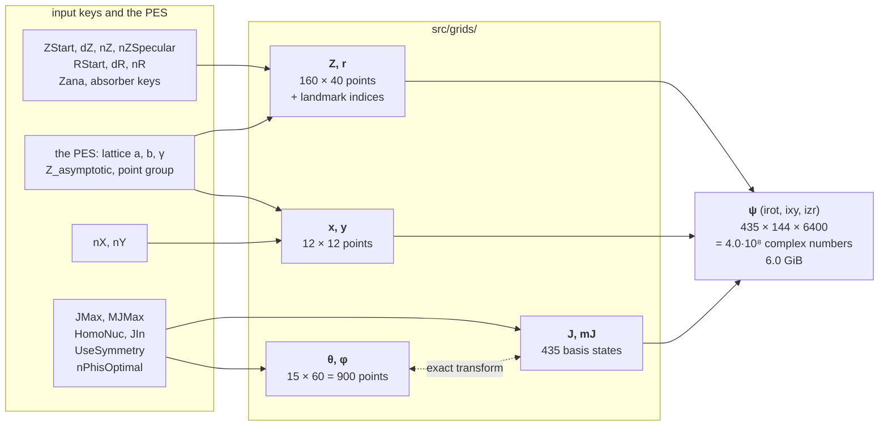

# The grids (`src/grids/`)

The grids decide how big the calculation is and what it can describe. For the DZ input
(`inputs/thesis_fig5_3_dz`) they make the wave packet ψ a set of 435 × 144 × 6400 = 4.0·10⁸ complex numbers:
6.0 GiB, rewritten in every time step. Every grid size multiplies memory and run time, and every grid limit
(the largest momentum, the highest J, the ends of the Z and r ranges) sets what the packet can represent.

This directory builds those grids from the input and the potential: equidistant FFT grids in Z, r, x and y; a
quadrature grid in the two angles θ and φ, with the rotational basis that goes with it; and the landmarks the
rest of the program works with (the interaction region, the analysis line, the absorbers) as indices on the
grids. How to **choose** the grids for a new input is in [inputs/README.md](../../inputs/README.md); this file is
the how and the why.

The main ideas:

- The kinetic energy is applied with FFTs, so Z, r, x and y are equidistant and periodic; a grid's spacing sets
  the largest momentum it holds (§2).
- Positions given in bohr become grid indices, with the Fortran's tolerant comparisons; one ulp between the two
  codes' grid points can matter at an absorber's end (§3).
- In the angles, a basis of rotational states |J mJ⟩ and a grid of (θ, φ) points are tied together so that
  switching between them is exact for every basis function; a homonuclear molecule needs only half the θ grid
  (§4).



The numbers are those of the DZ input; the point group also sets the multiple of the φ points (§4.2). Downstream, the grids feed the propagation tables (kinetic factors,
absorbers), the potential grid (V at every point of the interaction region), the angular transform, the gas
phase, the analysis and the reports.

**Contents.** [1 The six coordinates](#1-the-six-coordinates-at-a-glance) ·
[2 The FFT grids](#2-the-fft-grids-z-r-x-and-y) ·
[3 Landmarks on the Z and r grids](#3-landmarks-on-the-z-and-r-grids) ·
[4 The angular grid and the rotational basis](#4-the-angular-grid-and-the-rotational-basis) ·
for maintainers: [5 Legendre functions and Gauss quadrature](#5-legendre-functions-and-gauss-quadrature) ·
[6 Differences from the Fortran](#6-differences-from-the-fortran-code-and-why) ·
[7 Files, tests and changes](#7-files-tests-and-changes)

Related: [src/propagation/README.md](../propagation/README.md) (how the propagation uses these grids) ·
[docs/method.md](../../docs/method.md) (the method in brief) ·
[docs/fortran_deviations.md](../../docs/fortran_deviations.md) (every difference from the Fortran).

---

## 1. The six coordinates at a glance

| Coordinate | Grid | Points | DZ input |
|---|---|---|---|
| Z, distance to the surface | equidistant, periodic; two grids with the same start and spacing | ZStart + i·dZ | dZ 0.12 bohr; 160 points (scattering grid), 256 (specular grid) |
| r, bond length | equidistant, periodic | RStart + i·dR | dR 0.2 bohr, 40 points from 0.5 |
| x, y, centre of mass in the surface cell | equidistant, periodic over one unit cell | i·a/nX, j·b/nY | 12 × 12 |
| θ, polar angle of the bond | Gauss–Legendre points | cos θ = roots of P_(JMax+1) | 15 points (half grid, H₂) |
| φ, azimuth of the bond | equidistant, periodic | 2πl/nφ | 60 points |
| the rotational basis | states \|J mJ⟩ with J ≤ JMax, \|mJ\| ≤ MJMax | — | 435 states (J even ≤ 28) |

The **specular grid** is a second, longer (Z, r) grid that carries only the incoming channel, so that the
six-dimensional grid can stop just beyond the analysis line
([src/propagation/README.md](../propagation/README.md#2-the-two-grids)). All lengths are in bohr, all indices
0-based (the Fortran's index − 1). The grids are built once, by `make_spatial_grids` and `make_angular_grid`.

---

## 2. The FFT grids: Z, r, x and y

### 2.1 Points

A coordinate q with n points, start q₀ and spacing d (`UniformGrid`) has the points

```math
q_i = q_0 + i\,d, \qquad i = 0, \dots, n-1 .
```

The FFT treats the grid as periodic with period n·d: what leaves the last point re-enters at the first. The
outer ends of the Z and r grids therefore carry absorbers. The low ends of Z and r have none unless the
low-Z absorber keys are given: there the repulsive wall of the potential keeps the packet away. The x, y grid
spans exactly one surface unit cell, where the periodicity is physical.

**x and y are skewed coordinates** along the two lattice vectors a₁ and a₂, of lengths a and b at the angle γ
(90° for a rectangular cell, such as the hard wall's 6.24 × 5.24 bohr; 60° for a hexagonal one). So dx = a/nX,
dy = b/nY, the Cartesian position of a grid point is (x + y cos γ, y sin γ), and the area element is
dS = dx dy sin γ. a, b and γ come from the potential, not from the input.

### 2.2 Momenta, in FFT order

The momentum grid of an n-point coordinate with spacing d (`MomentumGrid`) has the spacing Δk, with the values
in the order in which the FFT returns them:

```math
\Delta k = \frac{2\pi}{n\,d}, \qquad
k_a = \begin{cases} a\,\Delta k, & 0 \le a \le n/2,\\ (a - n)\,\Delta k, & n/2 < a < n. \end{cases}
```

For n = 8:

```text
index a :   0     1     2     3     4     5     6     7
k_a / Δk:   0    +1    +2    +3    +4    −3    −2    −1
```

The Nyquist point a = n/2 counts as +n/2·Δk. The kinetic energies are k_a²/(2M) for Z (M the total mass) and
k_a²/(2μ) for r (μ the reduced mass). The grid holds momenta up to

```math
k_\mathrm{grid} = \frac{\pi}{d}, \qquad T_\mathrm{grid} = \frac{k_\mathrm{grid}^2}{2M}\ \text{(Z)} .
```

A momentum beyond ±k_grid reappears with the opposite sign, so an incoming component can become an outgoing one
and vice versa. For the DZ input (H₂, dZ 0.12 bohr): k_grid = 26.2 bohr⁻¹ and T_grid = 2.54 eV;
Δk = 0.327 bohr⁻¹ on the 160-point scattering grid, and the longer specular grid has the finer
Δk = 0.205 bohr⁻¹. How to choose dZ so that the packet's momenta fit:
[inputs/README.md](../../inputs/README.md#4-dz-the-grid-must-hold-the-momenta).

`SpatialGrids` holds three momentum grids: `kz_scattering`, `kz_specular` and `kr`. **The x and y momenta are
different**, and are not built here. They are the diffraction channels on the skewed cell: spacings
Δk_x = 2π/(a sin γ) and Δk_y = 2π/(b sin γ), shifted by the incident parallel momentum, with a kinetic energy
that has a cross term −2 cos γ k_x k_y (`parallel_kinetic_energies`, `src/propagation/propagation_tables.cpp`;
[src/propagation/README.md](../propagation/README.md#52-t_xy-with-the-momentum-shift-scatteringkineticoperatorapply_xy_group)).

---

## 3. Landmarks on the Z and r grids

### 3.1 What they are

The input gives positions in bohr; the program works with grid indices. The positions:

- **Z_asymptotic** comes from the potential: beyond it the PES is that of the free molecule, V_asy(r). The
  **interaction region** is Z \< Z_asymptotic.
- **`Zana`**, the analysis line: where the wave packet is projected on the asymptotic channels after every
  analysis step (the Balint-Kurti, BK, analysis). It must lie at or beyond Z_asymptotic and not beyond
  `ZOptStart`.
- **Absorbers** (complex absorbing potentials): −iV_opt over [start, end] with strength V₀, zero at one end and
  strongest at the other. A **high-end** absorber (`ZOpt…`, `ZSpOpt…`, `ROpt…`) sits at the far end of its grid
  and is strongest at its end; a **low-end** one (`ZOptLow…`, `ZSpOptLow…`) sits at the start of a Z grid and is
  strongest at its start.
- On the specular grid: **Z0**, the centre of the initial packet; the **initial packet's window**, from `Zana`
  to the last point before the specular absorber, which must hold the packet up to `TolSp`; and the **specular
  analysis line**, where the incoming channel's BK coefficients are taken. It moves inwards with the packet's
  tail and fixes when the reflected packet arrives. The specular norm between `Zana` and that line is the
  **rest norm** of the averages: what has not been analysed yet.

### 3.2 How positions become indices

`make_spatial_grids` uses the Fortran's tolerant comparisons: a ≥ b holds when a > b − 10⁻¹². This is an absolute
tolerance (`src/core/real_compare.hpp`; Fortran `MyOperators.f90`).

The specular grid has the same start and spacing as the scattering grid and at least as many points
(`nZSpecular` ≥ `nZ`, an input error otherwise), so the two share their first `nZ` points.

| Landmark | Rule | Field (Fortran) | DZ |
|---|---|---|---|
| interaction region | the Z points below Z_asymptotic; a point within 10⁻¹² of it counts as gas phase | `nz_potential` (`nzpot`) | 125 points: 0–124 |
| analysis line | the first point at or beyond `Zana`; `Zana` is moved onto it, a move of at most about 10⁻¹² because the input checks require `Zana` on a grid point | `iz_analysis`, `z_analysis` (`izanly`) | 125 |
| Z absorber, scattering grid | the points in [`ZOptStart`, `ZOptEnd`] | `z_optical` (`nzchsp` … `nzchmx`) | 125–159 |
| Z absorber, specular grid | the points in [`ZSpOptStart`, `ZSpOptEnd`] | `z_specular_optical` (`nschsp` … `nschmx`) | 184–255 |
| r absorber | the points in [`ROptStart`, `ROptEnd`] | `r_optical` (`nrchsp` … `nrchmx`) | 18–39 |
| low-Z absorbers | the points in [`ZOptLowStart`, `ZOptLowEnd`] and its specular twin, if on | `z_optical_low`, `z_specular_optical_low` | off |

On the DZ input (Z_asymptotic = `Zana` = `ZOptStart` = 15.0, Z0 = 18.0, `ZSpOptStart` = 22.08), along Z:

| Indices | Z (bohr) | Scattering grid | Specular grid |
|---|---|---|---|
| 0–124 | 0–14.88 | interaction region | coupled to the scattering grid |
| 125–159 | 15.0–19.08 | absorber; the analysis line at 125 | the packet's window begins at 125; Z0 at 150 |
| 160–183 | 19.2–21.96 | (beyond the grid) | the packet's window ends at 183 |
| 184–255 | 22.08–30.6 | (beyond the grid) | absorber |

These indices are used:

- `nz_potential` by the potential grid (V is stored only there) and the potential step;
- `iz_analysis` by the BK analysis, the initial packet's window and the rest norm;
- the specular absorber's first point by the packet's window and the specular analysis line;
- `r_optical` by the specular grid's r absorber;
- the others by the set-up report only.

The absorbing factors themselves are computed point by point from the positions, with the Fortran's plain
`<=` and `>=` (`src/propagation/propagation_tables.cpp`). Outside an absorber those tables hold exactly 1, so
a point that an index range includes only through the 10⁻¹² tolerance is multiplied by 1, as in the Fortran.

The input checks on these positions (`Zana` on a grid point and not beyond `ZOptStart`, Z0 and the absorbers in
range) are in `src/input/validate.cpp`, where the Fortran makes them; the checks in `make_spatial_grids` are the
ones the Fortran makes in `Setup.f90 MiscellaneousSetup`.

### 3.3 The grid-point trap

**The rule:** do not put an absorber's strongest end (the end of a high-end absorber, the start of a low-end one)
on a grid point, unless the set-up prints no warning for it. Start a low-Z absorber at ZStart, or between grid
points.

**Why.** The Fortran computes a grid point as `zmin + dfloat(i-1)*delz`. Under `-fdefault-real-8`, `dfloat` is
quad precision, so the point is computed in quad and rounded once to double. The C++ computes
`start + i·spacing` in double, which rounds twice. The two can differ by one ulp (unit in the last place): on
the hard-wall reference r grid (56 points, 0.8–9.05 bohr) at 13 of the points
([fortran_deviations.md](../../docs/fortran_deviations.md)). The project accepts this: the asymptotic potential
agrees to ≤ 10⁻¹⁴ and the 6D potential to about 5·10⁻¹⁴ relative (gate 1, the acceptance test of the potential
against the Fortran, tolerance 10⁻¹³; [docs/validation.md](../../docs/validation.md)).

It matters only when such a point lies on an absorber's strongest end. Then one code counts it inside and
multiplies it by exp(−1.5·V₀·dt) in every step, and the other counts it outside and multiplies by 1. Lying on a
grid point is necessary for that, not sufficient: the two codes must also put the point on different sides.

- **The DZ input is safe.** ZStart = 0, so a Z point is one rounded multiplication in both codes, and
  `ZOptEnd` = 19.08 is exactly point 159 in both. `ZSpOptEnd` = 30.6 is point 255 within the tolerance, which is
  30.599999999999998 in both. `ROptEnd` = 8.3 is exactly point 39 in both.
- **A case that splits** ([inputs/README.md](../../inputs/README.md#low-z-absorbers-and-the-grid-point-trap)):
  ZStart −2 and dZ 0.08 give point 30 = 0.3999999999999999 here and 0.4 in the Fortran, so a low-Z absorber that
  starts at 0.4 contains it only in the Fortran.

`make_spatial_grids` recomputes every point the Fortran's way (`fortran_grid_point`, with GCC's `__float128`). It
then compares both codes' sides for every absorber that is on, with the Fortran's plain `<=` and `>=`
(`absorber_split_points`). The set-up prints a warning for each point that differs (`SpatialGrids::split_points`).
`SpatialGrids.RepositoryInputsHaveNoGridPointWarnings` checks that none of the 19 inputs in the repository has
one.

---

## 4. The angular grid and the rotational basis

In the angles, ψ is stored as coefficients c_{J mJ} of the rotational states |J mJ⟩ (the finite basis
representation, FBR). The potential is applied on a grid of (θ, φ) points (the discrete variable
representation, DVR). The angular grid and the basis are chosen together, so that the transform from the
basis to the grid and back is exact.

### 4.1 The basis

The rotational basis (`RotationalBasis`) is

```math
\big\{\,|J\,m_J\rangle \;:\; J_\mathrm{min} \le J \le J_\mathrm{max},\;\; |m_J| \le \min(M_\mathrm{max}, J),\;\; J \ \text{in steps of}\ \Delta J \,\big\},
```

with M_max = MJMax (MJMax ≤ 0 means JMax, as in the Fortran). For a heteronuclear molecule ΔJ = 1 and J_min = 0.
For a homonuclear molecule (`HomoNuc`) ΔJ = 2: J keeps the parity of J_in (for H₂ in J_in = 0 only even J), and
J_min = 1 for odd J_in. §4.4 gives the physics.

The input rules that shape the basis (`src/input/validate.cpp`):

- J_in \< JMax, strictly (upstream r1726), and |MJIn| ≤ |MJMax|;
- |MJMax| ≤ JMax;
- for a homonuclear molecule, JMax has the parity of J_in, and |MJMax| that of JMax. The last rule uses the raw
  MJMax, so with an odd JMax, MJMax = 0 (meaning JMax) is rejected while −1 is accepted;
- `HomoNuc` requires equal masses within 10⁻¹², and a heteronuclear molecule unequal ones.

The states are ordered in **mJ blocks**: mJ runs from −M_max to M_max, and within a block J runs fastest. For
a homonuclear molecule with J_in even and JMax = MJMax = 2:

```text
mJ block    −2     | −1     | 0              | 1      | 2
irot         0     |  1     |  2      3      |  4     |  5
(J, mJ)     (2,−2) | (2,−1) | (0,0)   (2,0)  | (2,1)  | (2,2)
```

Each block is consecutive (`mj_block`). `initial_index()` is the position of (J_in, mJ_in) (Fortran `ichn`).
The DZ input (JMax = MJMax = 28, even J) has 435 states.

### 4.2 The φ grid: one slot per mJ

φ_l = 2πl/nφ, l = 0 … nφ − 1. On these points the discrete Fourier sum of e^{i(m − m′)φ} vanishes unless
m − m′ is a multiple of nφ. With nφ ≥ 2·M_max + 1 every mJ therefore gets its own FFT slot, and the φ sum
separates the mJ completely. That is why the basis is ordered in mJ blocks, and why the angular transform
works block by block: in θ, it only ever has to integrate products of two functions with the same mJ.

nφ is the smallest number ≥ 2·M_max + 1 of the form

```math
n_\varphi = d' \cdot 2^h\, 3^i\, 5^j\, 7^k\, 11^m, \qquad h \ge 1,\ i \le 2,\ j, k, m \le 1,
```

where d′ = 1 without surface symmetry. With `UseSymmetry` and `nPhisOptimal`, d is the φ multiple the point
group needs (C2v 2, C4v 4, C6v 6; `phi_points_multiple`, `src/symmetry/`), and d′ = d, halved once if d is even
(`nearest_fft_size`, `src/fft/fft_sizes.cpp`, as Fortran `ffts.f90 GetNearestFFTSize`). nφ is always even.
With a multiple, nφ need not be a valid FFT size in the plain sense: C6v (d′ = 3) and MJMax = 26 give
nφ = 3·2·3² = 54 = 2·3³. For the DZ input, 2·28 + 1 = 57 gives nφ = 60 with or without the C6v multiple.

### 4.3 The θ grid: one Gauss–Legendre rule for every mJ

Write u = cos θ. The θ points are the roots u_t of the Legendre polynomial P_{JMax+1}(u), with the
Gauss–Legendre weights w_t. An n-point Gauss–Legendre rule integrates every polynomial of degree ≤ 2n − 1
exactly. After the φ sum, the θ integrals the transform needs are those of two normalised associated Legendre
functions (§5) with the same mJ = m:

```math
\bar P_J^{\,m}(u)\,\bar P_{J'}^{\,m}(u) \;=\; (1-u^2)^{|m|} \times \big[\text{a polynomial of degree } (J-|m|) + (J'-|m|)\big].
```

That is a polynomial of degree J + J′ ≤ 2·JMax ≤ 2n − 1 for n = JMax + 1. So the one rule with JMax + 1 points
integrates every such product exactly, for every mJ, and the transform from the basis to the grid and back is
the identity. For a heteronuclear molecule, n_θ = JMax + 1, the full rule.

### 4.4 Homonuclear molecules: half the θ grid

For two identical nuclei, exchanging them maps (θ, φ) to (π − θ, φ + π), and the potential does not change:
V(π − θ, φ + π) = V(θ, φ). It therefore couples only states of the same J parity (ΔJ even: the ortho and para
forms of H₂ do not mix). The basis keeps one parity, and every ψ in it has the symmetry
ψ(π − θ, φ + π) = (−1)^(J_in) ψ(θ, φ). A PES without this exchange symmetry must not be run with `HomoNuc`.

The θ grid then keeps only the roots with u ≥ 0 (0 \< θ ≤ π/2) and doubles their weights:

```math
n_\theta = \frac{J_\mathrm{max} - J_\mathrm{min}}{2} + 1, \qquad w_t \to 2\,w_t .
```

When JMax + 1 is odd, θ = π/2 is a root. It belongs to both halves and keeps its single weight. This is
exact for both uses of the grid:

- **The transform.** P̄_J^m(−u) = (−1)^(J+m) P̄_J^m(u). Within one mJ block all J share one parity, so each
  product of §4.3 is even in u, and its integral over [−1, 1] is twice that over [0, 1].
- **The potential step.** exp(iA)ψ, with A = −V dt, keeps the exchange symmetry of ψ, because V has it. Each
  point of the dropped half, (π − θ, φ + π), is the image of a kept point: φ + π is on the φ grid because nφ is
  even. So the full-grid sums that project exp(iA)ψ back onto the basis equal twice the half-grid sums; the
  points at θ = π/2 map onto each other and are counted once.

A worked example, JMax = MJMax = 2, J_in = 0 (the basis of §4.1):

| Quantity | Full rule (3 points) | Half grid kept |
|---|---|---|
| roots u = cos θ | +0.774597, 0, −0.774597 | +0.774597 (θ = 39.2°), 0 (θ = 90°) |
| weights | 0.555556, 0.888889, 0.555556 | 1.111111 (doubled), 0.888889 (not doubled) |
| sum of the weights | 2 | 2 |

With nφ = 6 (2·2 + 1 = 5, rounded up to a valid size), the grid has 2 × 6 = 12 points for 6 basis states.

### 4.5 What the grid holds, and the sizes

The DVR holds quadrature-weighted values, √(w_t Δφ) ψ(θ_t, φ_l) with Δφ = 2π/nφ, not ψ itself
(`src/propagation/angular_transform.cpp`). The weights make the columns of the transform orthonormal. The grid
has more points than the basis has states, so the transform is a rectangular matrix (900 × 435 for the DZ
input). Basis → grid → basis is the identity, but grid → basis → grid is only a projection: whatever the
potential step moves out of the basis is lost, a basis-truncation error that shrinks as JMax and MJMax grow
([src/propagation/README.md](../propagation/README.md#54-the-angular-transform-b-angulartransform)).

| Quantity | Rule | DZ input |
|---|---|---|
| J values | J_min … JMax in steps of ΔJ | 0, 2, …, 28 (15 values) |
| basis states | Σ over mJ of the J ≥ \|mJ\| | 435 |
| n_θ | JMax + 1, or (JMax − J_min)/2 + 1 for a homonuclear molecule | 15 |
| nφ | §4.2 | 60 |
| DVR points per (x, y, Z, r) | n_θ · nφ | 900 |

---

## 5. Legendre functions and Gauss quadrature

**Normalised associated Legendre functions** (`associated_legendre`, Fortran `legendre.f90 AssociatedLegendre`),
for J = |m| … JMax at one θ:

```math
\int_{-1}^{1} \bar P_J^{\,m}(u)^2\, \mathrm{d}u = 1, \qquad \bar P_J^{-m} = (-1)^m\, \bar P_J^{\,m} .
```

They include the Condon–Shortley phase (−1)^m for m > 0, so that P̄_J^m(cos θ) e^{imφ}/√(2π) are the usual
spherical harmonics.

**The Gauss rule** (`gauss_associated_legendre`, Fortran `legendre.f90 GaussAssociatedLegendreQuadr`) finds the
roots by Newton iteration. It is general (weight function (1 − u²)^|m|), but the program calls it only with
m = 0.

Both follow the Fortran's expression order. The values still agree with the Fortran only to a few ulp:
gfortran vectorises the `exp` of `AssociatedLegendre` and the `ACOS` of the θ grid with glibc's libmvec, while
the C++ calls the scalar functions ([fortran_deviations.md](../../docs/fortran_deviations.md)).

<details>
<summary>The recursion, the iteration and the interval convention</summary>

- **Recursion.** Upward in J, from P̄_{|m|}^{|m|} ∝ sin^{|m|} θ:
  (J − |m| + 1) P_{J+1} = (2J + 1) u P_J − (J + |m|) P_{J−1}. Each value is then normalised with √(J + ½) and,
  for m ≠ 0, √((J − |m|)! (2|m|)! / (J + |m|)!), from tabulated log-factorials (`log_factorials`).
- **Iteration.** Newton on the same kind of recursion, from the usual starting guesses, until a step is at or
  below the Fortran's machine epsilon 2⁻⁵⁴ (`fortran_machine_epsilon`), or after at most 500 iterations. Only
  half of the roots are computed; the other half follows by symmetry.
- **Interval.** The Fortran calls the rule from 1 to −1, the reverse of the usual interval. That gives the roots
  in descending u = cos θ (θ ascending from near 0) and negative weights, which `AngularGrid` multiplies by −1,
  or by −2 for the half grid. The C++ makes the same call, so the first n_θ roots are exactly the half with
  u ≥ 0 (`GaussLegendre.FortranIntervalGivesDescendingRoots`).

</details>

---

## 6. Differences from the Fortran code, and why

The grids are the Fortran's (`Setup.f90 MiscellaneousSetup`, `setupdvr.f90 SetupDVRProj`,
`angulargrid.f90 InitAngularGrid`, `legendre.f90`): the same points, momenta, rules, basis order and landmark
indices, with the same expression order. What differs:

| What | Fortran | C++ | Why |
|---|---|---|---|
| grid points, momenta, kinetic energies | quad precision (`dfloat`, `-fdefault-real-8`), rounded once | plain double: up to 1 ulp apart | an accepted policy ([fortran_deviations.md](../../docs/fortran_deviations.md)); ≈ 10⁻¹² in phases after 7000 steps, the first suspect if a propagation gate drifts |
| θ points, Legendre values | `ACOS` and `EXP` vectorised by gfortran (libmvec, a few ulp) | scalar `std::acos`, `std::exp` | not reproduced: accepted ([fortran_deviations.md](../../docs/fortran_deviations.md)) |
| a grid point on an absorber's strongest end | — | a set-up warning when the two codes put it on different sides (§3.3) | the ulp of the first row decides there between absorbing and not |
| `nZSpecular` \< `nZ` | not checked: reads beyond the Z grid | input error | the specular grid must contain the scattering grid |
| invalid angular input in `InitAngularGrid` (JIn \< 0, \|MJIn\| > JIn, JMax \< JIn) and an invalid nφ in `transform.f90` | silent `RETURN`: the grid or the transform stays unset | input error naming the key | never continue silently ([fortran_deviations.md](../../docs/fortran_deviations.md)) |
| low-Z absorber index ranges | the index loop starts at the second point; the printout shows the last point below Start | the points inside, ZStart included | the printout names the points that absorb (low-Z D4 in [fortran_deviations.md](../../docs/fortran_deviations.md)) |
| indices | 1-based | 0-based | C++ convention; every field names its Fortran variable |

<details>
<summary>Kept on purpose, and not ported</summary>

Kept on purpose:

- MJMax ≤ 0 means JMax ([mjmax-zero](../../docs/fortran_deviations.md#mjmax-zero));
- the tolerant comparisons for every landmark;
- the reversed interval of the Gauss rule (§5);
- the check that `Zana`, once moved onto the grid, lies on the grid (unreachable);
- the parity adjustment of JMax in `InitAngularGrid`, although both codes reject a JMax of the wrong parity
  before it is reached (only the J_min adjustment ever acts).

Not ported:

- the `SymmetryInPhi` grid (a basis for one fixed mJ, with the θ rule of that |mJ|): `setupdvr.f90` sets
  `Setup_SymmetryInPhi = .FALSE.` unconditionally, so the Fortran never uses it either;
- the reduced-dimensional modes (`nmoder` 2, 3 and 5): both codes accept only all six coordinates
  ([docs/port_status.md](../../docs/port_status.md));
- the flux analysis: its r index is computed and checked (`ir_flux_analysis`), but the analysis is not ported.

</details>

---

## 7. Files, tests and changes

| File | Responsibility | Fortran |
|---|---|---|
| `uniform_grid.hpp` | `UniformGrid`: equidistant points | `Setup.f90` (`zgrid`, `rgrid`, `xgrid`, `ygrid`) |
| `momentum_grid.{hpp,cpp}` | `MomentumGrid`: momenta in FFT order and kinetic energies | `Setup.f90` (`zk`, `ekinz`, `rkg`, `ekinr`, `zksp`, `ensp`) |
| `spatial_grids.{hpp,cpp}` | `SpatialGrids`, `make_spatial_grids`: the Z, r, x, y grids, the landmark indices, the grid-point trap | `Setup.f90 MiscellaneousSetup` |
| `angular_grid.{hpp,cpp}` | `AngularGrid`, `make_angular_grid`: θ and φ points and weights | `setupdvr.f90 SetupDVRProj`, `angulargrid.f90 InitAngularGrid` |
| `rotational_basis.{hpp,cpp}` | `RotationalBasis`: the states, their order, the mJ blocks, the initial state | `transform.f90 InitGenComplexTransform`, `RotDifBasis.f90 RotationBasis` |
| `associated_legendre.{hpp,cpp}` | normalised associated Legendre functions, log-factorials | `legendre.f90 AssociatedLegendre`, `SetupLegendreModule` |
| `gauss_legendre.{hpp,cpp}` | Gauss quadrature for the associated Legendre weight | `legendre.f90 GaussAssociatedLegendreQuadr` |

| Change | Do also | Which check notices |
|---|---|---|
| a grid point formula or a landmark rule | keep the Fortran's comparison (tolerant or plain) and expression order | gates 1–4, `SpatialGrids.ReferenceCase` |
| the size of a grid or of the basis | the memory estimate and the wave-packet designer's copies (`tools/wave_packet_designer/program/spatial_grids.py`, `angular_grid.py`) | `MemoryEstimate.MatchesTheWavePacketDesignerCases` |
| the order of the rotational basis | the angular transform, the analysis basis and the GPU kernels assume mJ blocks with J fastest | `RotationalBasis.ReferenceCaseMatchesFortran`, gates 3 and 4 |
| a new absorber | its index range here and its split-point check (`absorber_split_points`) | `SpatialGrids.FindsTheGridPointsThatAnAbsorbersStrongestEndSplits` |
| a new deviation from the Fortran | a row in [docs/fortran_deviations.md](../../docs/fortran_deviations.md), with a test | review |

Against the Fortran, the grids are covered by gates 1 and 2: the potential and the gas-phase states on these
grids ([docs/validation.md](../../docs/validation.md)).

<details>
<summary>The unit tests</summary>

- `tests/test_grids.cpp`: `UniformGrid.PointsAsFortran`, `MomentumGrid.FftOrderingAndEnergies`,
  `GaussLegendre.IntegratesPolynomialsExactly`, `GaussLegendre.AssociatedRuleIntegratesWithWeightFunction`,
  `GaussLegendre.FortranIntervalGivesDescendingRoots`, `AngularGrid.HomonuclearEvenJ`,
  `AngularGrid.HomonuclearOddJ`, `AngularGrid.Heteronuclear`, `AngularGrid.InvalidInput`,
  `SpatialGrids.ReferenceCase`, `SpatialGrids.LowZAbsorberRanges`,
  `SpatialGrids.FindsTheGridPointsThatAnAbsorbersStrongestEndSplits`,
  `SpatialGrids.RepositoryInputsHaveNoGridPointWarnings`.
- `tests/test_angular.cpp`: `AssociatedLegendre.ClosedFormsAndPhaseConvention`,
  `AssociatedLegendre.OrthonormalOnTheGaussGrid`, `RotationalBasis.ReferenceCaseMatchesFortran`,
  `RotationalBasis.MjMaxBelowJMax`, `AngularTransform.RoundTripIsIdentity`.

</details>
