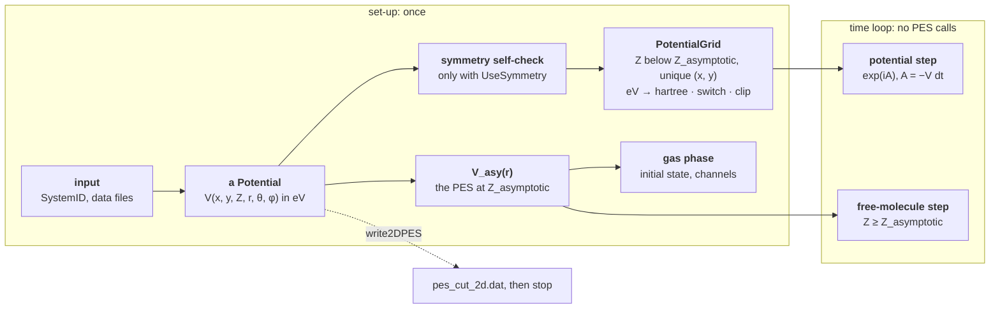

# The potential energy surfaces (`src/potential/`)

The propagation never calls a potential energy surface (PES). V is evaluated once, at set-up, on the grid points
the propagation uses, and stored as the phase A = −V dt; in the time loop the potential step only multiplies by
exp(iA) ([src/propagation/README.md](../propagation/README.md), §5.3). So everything that decides which V the wave
packet feels happens in this directory: which PES, where the program stops using it and takes the free molecule
instead, how it is switched and clipped, and at which (x, y) points it is stored. V enters only through its values
at the grid points: a feature narrower than the grid spacing is sampled, not averaged.



Five surfaces are implemented: a hard-wall test potential, two analytic surfaces for H₂/Cu(111), any data set of
the CRP library, and a CRP data set plus the static corrugation model (SCM) of one distorted surface. All return V
in eV in one set of coordinates (§1), so the rest of the program does not know which one runs.

**Reading guide.** Running a calculation: §2 (which surface, which energy zero) and §3 (what the run does to V).
Adding a PES: §1, §3 and §8. The Fortran differences: §6.

[1 Coordinates and conventions](#1-coordinates-and-conventions) ·
[2 The five surfaces](#2-the-five-surfaces) ·
[3 From the PES to the grid](#3-from-the-pes-to-the-stored-grid) ·
[4 Surface symmetry](#4-surface-symmetry-storing-the-unique-points-only) ·
[5 Side outputs](#5-the-2d-cut-and-the-other-side-outputs) ·
[6 Differences from the Fortran](#6-differences-from-the-fortran-code-and-why) ·
[7 Files](#7-files) ·
[8 Writing or changing a PES](#8-writing-or-changing-a-pes)

Related: [docs/crp_library.md](../../docs/crp_library.md) and [src/crplib/README.md](../crplib/README.md) (the CRP
library) · [docs/scm.md](../../docs/scm.md) (the SCM) · [src/symmetry/README.md](../symmetry/README.md) (the symmetry
engine) · [docs/validation.md](../../docs/validation.md) (gate 1: the potential against the Fortran).

<details>
<summary>Words used here</summary>

| Word | Meaning |
|---|---|
| DVR | discrete variable representation: the wave packet's values on a grid of orientations (θ, φ), where V is a plain multiplication |
| exp(iA) | the potential's factor in the split-operator time step, A = −V dt at each grid point |
| backend | where the wave packet lives and is propagated: the CPU or the GPU (`src/propagation/`, `src/cuda/`) |
| gate 1 | the regression test that compares the C++ potential with the Fortran's ([validation.md](../../docs/validation.md)) |
| first touch | the first write of a memory page decides which processor socket holds it |
| Fourier star | the set of cosines that a point group maps into each other: a symmetric Fourier term |
| `.SEQ.` | the Fortran's case-insensitive string comparison |
| `nPhisOptimal` | an input key that picks nφ as a multiple the point group needs |
| SCM Dn, CRP Dn, physics Qn | decisions and bugs, each an entry in [fortran_deviations.md](../../docs/fortran_deviations.md) or [fortran_bugs/](../../docs/fortran_bugs/README.md) |

</details>

---

## 1. Coordinates and conventions

A PES implements `Potential` (`potential.hpp`; Fortran `H2SurfaceSystem.f90`). Its `value(x, y, Z, r, θ, φ, iz, ir)`
returns V in eV, and `system_parameters()` returns:

| Field | Unit | Meaning |
|---|---|---|
| `lattice_constant_x`, `lattice_constant_y` | bohr | a and b, the lengths of the lattice vectors a₁ and a₂ |
| `skewing_angle` | radians | γ, the angle between a₁ and a₂: π/2 for a square or rectangular cell, π/3 for a hexagonal one |
| `z_asymptotic` | bohr | the PES's own Z_asymptotic (below) |
| `point_group` | — | one of `C2v`, `C4v`, `C6v`, `C3v`, `C3`, `none` (`src/symmetry/point_group.cpp`) |

**The cell and the origin.** a₁ = a (1, 0) and a₂ = b (cos γ, sin γ). x and y are skewed coordinates along them
(bohr): the grid runs over the cell [0, a) × [0, b) from the origin x = y = 0, and the molecule's centre lies at the
Cartesian position

```math
\mathbf R_\parallel = x\,\hat{\mathbf a}_1 + y\,\hat{\mathbf a}_2 = (x + y\cos\gamma,\; y\sin\gamma).
```

Z is the height above the surface plane (bohr, the PES's own zero). The bond has length r, polar angle θ from the
surface normal (+Z) and azimuth φ from a₁ towards a₂. The point group acts about the origin, so a PES must put its
symmetry centre (a top site, say) at x = y = 0.

**The atoms.** Every ported PES puts the two atoms at

```math
\mathbf h_{1,2} = (\mathbf R_\parallel, Z) \mp \tfrac{r}{2}\,(\sin\theta\cos\varphi,\; \sin\theta\sin\varphi,\; \cos\theta),
```

symmetric about (x, y, Z), while the kinetic energy treats (x, y, Z) as the centre of mass. For H₂ and D₂ the two
agree. For HD (masses m₁ ≠ m₂, total M) each atom is misplaced by (m₂ − m₁)/(2M)·r along the bond. Only
`CRPDistrtSurface` rejects `HomoNuc: false` (SCM D13); the other four accept it silently, and Dai–Light even has the
H mass hard-coded in its own atom weights.

**Homonuclear molecules.** With `HomoNuc` the θ grid covers only 0 \< θ ≤ π/2 (`src/grids/angular_grid.cpp`), so the
PES must be invariant under exchanging the atoms: V(x, y, Z, r, π − θ, φ + π) = V(x, y, Z, r, θ, φ). The symmetry
self-check (§4) does not test this.

**Two heights, two curves.** Each PES has its own Z_asymptotic, the `z_asymptotic` above. The run's Z_asymptotic is
the same, or `ZmaxSwitch` with `UseSwitching` (§3.2). It is where the program stops using the PES: below it V is
stored on the six-dimensional grid, beyond it the program takes the free molecule's

```math
V_\mathrm{asy}(r) = V\big(0, 0, Z_\mathrm{asymptotic}, r, \tfrac{\pi}{2}, 0\big)
\quad\text{(the run's }Z_\mathrm{asymptotic}\text{)}.
```

Where the PES is truly the free molecule, V does not depend on x, y, θ or φ and any point would do; the Fortran
takes the top site with the bond parallel to the surface. Where it is not (the Persson PES, §2.3), V steps at
Z_asymptotic. The switch of §3.2 uses a second curve, V_gas(r): the same expression at the PES's own Z_asymptotic.

**Selection.** `make_potential` (`potential_factory.cpp`) picks the PES by `SystemID`, case-insensitively as the
Fortran's `.SEQ.` does. An unknown ID is an input error.

---

## 2. The five surfaces

| SystemID | Model | a × b (bohr), γ | Z_asymptotic (bohr) | Point group | Energy zero | Used for |
|---|---|---|---|---|---|---|
| `HardWallPES` | Rydberg V(r) plus a wall in Z | 6.239660 × 5.239660, 90° | 7.0 | C2v | the free H₂ at r = 1.40 bohr | `inputs/hardwall_small`; tests `hardwall_small`, `hardwall_short` |
| `H2Cu111DaiLight` | LEPS, Dai and Zhang | 4.84 × 4.84, 60° | 15.0 | C6v | H + H far apart and far from the surface | the DZ input `inputs/thesis_fig5_3_dz`; tests `cu111_dailight_*` |
| `H2Cu111Persson` | LEPS, Persson et al. | 4.757 (2.5173 Å), 60° | 8.0 | C6v | H + H far apart and far from the surface | the ER input `inputs/thesis_fig5_3_er`; test `cu111_persson_small` |
| `CRPlibrary` | corrugation reducing procedure | from the data set | from the data set | C3v, C4v or C6v | the data set's, shifted by −V_H2 at its largest r | SRP48: test `crp_cu111_srp48_small`; synthetic sets: `crp_c*_synthetic_small` |
| `CRPDistrtSurface` | a CRP data set + the SCM correction ΔV | the CRP's (a_T with rescaling) | the CRP's | the CRP's, reported only: `UseSymmetry` is rejected (SCM D2) | the CRP's | `inputs/scm_example`; tests `scm_cu111_srp48_small*` |

The hard wall and the two Cu(111) surfaces are ports of a single Fortran file each, with the literals copied
verbatim and the Fortran's order of operations kept, so V is the Fortran's to rounding.

### 2.1 The hard wall (`hard_wall_potential.cpp`)

A test potential that depends on Z and r only (Fortran `HardWallPES.f90`): a Rydberg curve in ρ = r − 1.40 bohr, and
a wall 1/(Z⁴ + 0.001) that a cosine σ(Z) switches off between Z_w = 0.1778 bohr and Z_asymptotic = 7 bohr:

```math
V(Z, r) = V_\mathrm{Ryd}(r) + \sigma(Z)\,\frac{1}{Z^4 + 0.001},
\qquad
V_\mathrm{Ryd}(r) = D - D\,(1 + a_1\rho + a_2\rho^2 + a_3\rho^3)\,e^{-a_4\rho},
```

with D = 4.8286 eV, σ = 1 below Z_w, σ = ½ + ½ cos(π (Z − Z_w)/(Z_asymptotic − Z_w)) up to Z_asymptotic, and 0 beyond.
Nothing depends on θ, φ, x or y, so the wave packet must stay in its initial rotational state and diffraction channel:
on the hard wall the gates show that the angular transform and the (x, y) FFTs act as the identity.

### 2.2 Dai–Zhang LEPS for H₂/Cu(111) (`dai_light_cu111_potential.cpp`)

J. Dai and J. Z. H. Zhang, J. Chem. Phys. 102, 6280 (1995); the Fortran calls it Dai–Light
(`PESForCu111DaiLight.f90`), hence the SystemID. A London–Eyring–Polanyi–Sato (LEPS) surface: each pair (H–H, and each
H atom with the surface) has a Coulomb integral Q and an exchange integral J, and

```math
V = Q_\mathrm{HH} + Q_1 + Q_2 - \sqrt{J_\mathrm{HH}^2 + (J_1 + J_2)^2 - J_\mathrm{HH}\,(J_1 + J_2)},
```

```math
Q(q) = \frac{D}{4(1+\Delta)}\Big[(3+\Delta)\,e^{-2\alpha(q-q_0)} - (2+6\Delta)\,e^{-\alpha(q-q_0)}\Big],
\quad
J(q) = \frac{D}{4(1+\Delta)}\Big[(1+3\Delta)\,e^{-2\alpha(q-q_0)} - (6+2\Delta)\,e^{-\alpha(q-q_0)}\Big],
```

with q = r for H–H and q = the atom's height for an atom–surface pair. The atom–surface D, α and q₀ vary over the cell:
each is interpolated through its top, bridge and centre values with two Fourier stars (`site_interpolation`, Fortran
`AFUN`),

```math
p(x, y) = c_0 + c_1 \sum_{k \in \{x,\,y,\,x+y\}} \cos\frac{2\pi k}{c} + c_2 \sum_{k \in \{x,\,y,\,x+y\}} \cos\frac{4\pi k}{c},
```

the stars of the shortest and of twice the shortest reciprocal-lattice vector (c = 4.84 bohr). Δ = 0.10 at all three
sites. With cosines only, p is unchanged under (x, y) → (−x, −y), which swaps the fcc and hcp hollows: this surface
does not tell them apart (C6v, while Cu(111) itself is C3v). It is in hartree; `value` converts it to eV. At
Z ≥ 15 bohr it switches to the free molecule Q_HH + J_HH, while the surface terms are still 1e-4 to 1e-3 eV: V jumps
there (kept, [fortran_deviations.md](../../docs/fortran_deviations.md)).

### 2.3 Persson LEPS for H₂/Cu(111) (`persson_cu111_potential.cpp`)

M. Persson et al., J. Chem. Phys. 110, 2240 (1999); Fortran `PESForCu111Persson.f90`. A LEPS surface like §2.2, in
Å and eV, with the atom–surface parameters expanded in three Fourier stars of the hexagonal cell. In each Morse term
a factor x_mod = exp(−α(z − z_a) f / (1 + e^{−4α(z − z_a)})) multiplies the attractive exponential, which steepens its
decay beyond z_a.

- **No gas-phase branch.** Z_asymptotic = 8 bohr is only a parameter: the surface terms have not died out there. At
  the point V_asy uses (top site, θ = π/2) V lies 0.9 to 1.2 meV above the far field for r = 1.0 to 2.0 bohr, over
  other sites and with θ = 0 up to about 5 meV (the formula evaluated in Python, 2026-11-25;
  [fortran_bugs/README.md](../../docs/fortran_bugs/README.md): +1.03 meV at r = 1.4 bohr). So V steps at
  Z_asymptotic, as in the Fortran.
- **Its own bohr.** It converts the atom positions with 0.529167 Å/bohr, while the lattice constant comes from the
  program's 0.529177: the PES's period is 1.9e-5 longer than the grid's cell. Symmetric about the origin but not
  periodic on the grid, it fails the symmetry self-check (§4) with `UseSymmetry`; the Fortran would use the symmetry
  silently ([fortran_deviations.md](../../docs/fortran_deviations.md#persson-pes-quirk)).

### 2.4 The CRP library (`crp_potential.cpp`)

The corrugation reducing procedure (R. A. Olsen et al., J. Chem. Phys. 116, 3841 (2002)) interpolates
I = V − V_A − V_B, the 6D potential minus the two atom–surface potentials: I is much less corrugated than V, so a few
cuts through the 6D potential suffice. `CrpPotential` is the adapter to the port of the Fortran CRP library in
[`src/crplib/`](../crplib/README.md), and the only file that includes its headers (ctest `CrpLib.IncludeBoundary`).

- **Its own switch.** Between ZsoMin and ZsoMax the library blends the 6D potential into the gas phase
  V_H2(r) + V_1D(Z), and V_1D is constant beyond its last point: that point is the data set's Z_asymptotic. So
  `UseSwitching` is a second switch on top of the library's.
- **Energy zero.** The adapter subtracts V_H2 at the largest r of the data set's gas-phase curve
  (`crplib/qd_wrapper.cpp`).
- **Outside the data.** r is clamped into [Rmin, Rmax], and Z below Zmin is evaluated at Zmin: below Zmin V continues
  flat, without a repulsive wall. Where a cut has no data the library returns V = 0 silently (CRP D2). The set-up
  report counts the clamped points and these (Z, r) points.
- **Errors.** A data set that cannot be used, or a grid point the library cannot evaluate, is an input error naming
  `CRPlibDataSet` (and the point).

Data files, interpolation and speed-ups: [docs/crp_library.md](../../docs/crp_library.md).

### 2.5 The SCM: a CRP surface plus a distorted slab (`scm/`)

`ScmCrpPotential` (Fortran `DistortedSurfacePES.dir`, upstream 5.24) adds to a CRP surface the change ΔV of the
H₂–surface interaction when the metal atoms of the top two layers move from their ideal positions to those of one
snapshot of a hot slab:

```math
V(x, y, Z, r, \theta, \varphi) = V_\mathrm{CRP}\!\left(\tfrac{x}{s}, \tfrac{y}{s}, Z, r, \theta, \varphi\right) + \frac{\Delta V}{c},
\qquad
\Delta V = \sum_{a=1,2}\;\sum_{j}\Big[f_{L_j}\big(|\mathbf h_a - \mathbf R_j^\mathrm{distorted}|;\, r\big) - f_{L_j}\big(|\mathbf h'_a - \mathbf R_j^\mathrm{ideal}|;\, r\big)\Big].
```

- j runs over the slab's metal atoms within the cut-off, L_j ∈ {1, 2} is the layer of atom j, and f_L is that layer's
  H–metal pair function: a cubic times an exponential in the distance, switched to a constant at long range.
- **The pair functions depend on r.** Each of their eight parameters is p_k = slope_k · t + intercept_k, with
  t = r clamped to [P17, P18] (0.725 to 1.847 in the example's parameter file; whether these are bohr or Å is open
  question Q1 of [scm_open_questions.md](../../docs/scm_open_questions.md)).
- a₀ is the CRP data set's lattice constant and a_T the slab's (line 3 of the position file). With `EnableSurfExpan`
  the slab is rescaled to the CRP lattice, s = a_T/a₀, and h′ are the atoms in the ideal frame; otherwise s = 1.
- c = 0.036749308286 hartree/eV, the precise factor the Fortran uses here (SCM D4).
- ΔV uses the true Z and r, while V_CRP uses the clamped ones (§2.4). Where the CRP clamps, the two no longer cancel
  and V has holes of hundreds of eV (SCM D15).

ΔV is computed in the Fortran's order of operations and is bitwise its value. The model, the input, the set-up report
and the open questions: [docs/scm.md](../../docs/scm.md); every decision, SCM D1–D15:
[fortran_deviations.md](../../docs/fortran_deviations.md#scm-distorted-surface-pes-srcpotentialscm-systemid-crpdistrtsurface).

---

## 3. From the PES to the stored grid

`compute_potential_grid` (`potential_grid.cpp`; Fortran `Potential.f90 setupThePES`, `computeThePES`) evaluates the
PES once and returns a `PotentialGrid`: V in hartree on the DVR grid of the interaction region, and V_asy(r).

### 3.1 The steps

In the Fortran's order:

| Step | What | Fortran |
|---|---|---|
| 1 | V at every (θ, φ) DVR point, every stored (x, y) point (§4) and every (Z, r) with Z \< Z_asymptotic | `computeThePES` |
| 2 | eV → hartree: × 1/27.2114 | `computeThePES` |
| 3 | with `UseSwitching`: blend into V_gas (§3.2) | `switchPotentialToGasPhase` |
| 4 | with `ImposeVMin` / `ImposeVMax`: clip (§3.3) | `ImposeLimitOnPotential` |
| 5 | V_asy(r) on the r grid (÷ 27.2114), then clipped | `setupTheAsymptoticPotential` |
| 6 | then, in the backend: A = −V dt (`premultiply_with_time_step`) | `premultiplyWithTimestep` |

The layout keeps the Fortran's memory order, first index fastest:

```text
values[itp + n_tp · (irep + n_rep · izr)]     itp = iφ + nφ · iθ,  izr = ir + nr · iz  (iz < nz_potential)
```

irep runs over the stored (x, y) points: all of them, or only the symmetry-unique ones (§4). The units of step 2 and
5 are the program's legacy factor (27.2114 eV per hartree) and the Fortran's arithmetic: a multiplication by 1/27.2114
for the 6D grid, a division for V_asy. The CRP library has its own factor (27.2113961) inside, so data in hartree come
out scaled by 27.2113961/27.2114, as in the Fortran.

<details>
<summary>Parallel evaluation, first touch and errors</summary>

- The grid is one of the large arrays of a run (the MEMORY ESTIMATE at set-up lists it). It is written in parallel
  per group of (Z, r) points, with the schedule the propagation later uses for the same points (first touch).
- Every value is computed independently, so V does not depend on the number of threads
  (`PotentialGrid.IndependentOfThreadCount`).
- If the PES throws (a CRP grid point outside the data), the error of the lowest failing group is reported, the same
  at any thread count (`CrpPotentialGrid.ErrorIsDeterministic`).

</details>

### 3.2 Switching to the gas phase, and the step at ZmaxSwitch (a Fortran bug, kept)

A PES whose surface terms die out slowly needs a long interaction region. `UseSwitching` shortens it: between
Z_sw,min = `ZminSwitch` and Z_sw,max = `ZmaxSwitch` the stored V is blended into V_gas(r) (`switch_to_gas_phase`),

```math
V \;\leftarrow\; w(Z)\,\big[V - V_\mathrm{gas}(r)\big] + V_\mathrm{gas}(r),
\qquad
w(Z) = \tfrac12 + \tfrac12\cos\!\Big(\pi\,\frac{Z - Z_\mathrm{sw,min}}{Z_\mathrm{sw,max} - Z_\mathrm{sw,min}}\Big),
```

with w = 1 at and below Z_sw,min and V = V_gas at and beyond Z_sw,max. The run's Z_asymptotic becomes Z_sw,max, so the
6D grid stops there and V_asy is the PES at Z_sw,max. V_gas, however, is the PES at its own Z_asymptotic, often beyond
the scattering grid. On the test case `cu111_dailight_small` (its input: ZStart −2, dZ 0.08, 176 and 280 Z points,
switch 6 to 8 bohr), to scale:

```mermaid
gantt
    title cu111_dailight_small: where V comes from (Z in bohr)
    dateFormat x
    axisFormat %s
    todayMarker off
    section Scattering grid
    the PES, 6D : -2000, 6000
    blend towards V_gas : active, 6000, 8000
    V_asy(r) : 8000, 12000
    section Specular grid
    coupled into the 6D grid : -2000, 8000
    V_asy(r) : 8000, 20320
    section Where the curves are taken
    V_asy = the PES at Z = 8 : milestone, 8000, 1ms
    V_gas = the PES at Z = 15 : milestone, 15000, 1ms
```



So the blend approaches V_gas, and from Z = 8 on the program uses V_asy. For the Dai–Zhang PES switched at 6–8 bohr,
V_asy lies 8.8 to 10.9 meV above V_gas (r = 0.8 to 2.0 bohr): V steps at Z_sw,max, and the asymptotic rovibrational
states (`src/gasphase/`) are those of V_asy, about 10 meV too high. This is a Fortran bug (physics Q1), reproduced so
that the gates compare the same thing: [fortran_bugs/physics_q1_switching.md](../../docs/fortran_bugs/physics_q1_switching.md).
One difference: with `UseSwitching` and no `ZmaxSwitch` key the C++ takes the default 8.0, the Fortran the PES's own
Z_asymptotic. Test: `PotentialGrid.SwitchingToGasPhase`.

### 3.3 Clipping: VMin and VMax

Clipping bounds the range of V. The split-operator error grows with that range (the commutators of §3.1 of the
propagation README scale with V dt), and the wave packet never reaches the energies far above its own. With
`ImposeVMin` and `ImposeVMax` (`impose_limits`):

```math
V \;\leftarrow\; \min\!\big(\max(V,\ V_\mathrm{min}),\ V_\mathrm{max}\big),
```

each bound only when switched on; `VMin` and `VMax` are in eV, by default −5.5 and 10 eV. Clipping is applied after the
switch, to the 6D grid and to V_asy, but not to the V_gas of the switch (as in the Fortran). So:

- `VMax` must lie well above the energies of the wave packet, or it changes the physics;
- `VMin` must lie below the bottom of V_asy, which it clips too;
- with the SCM, where the CRP clamps Z or r (§2.5), V drops to hundreds of eV below zero. `ImposeVMin` only floors those
  holes ([inputs/README.md](../../inputs/README.md) recommends it there); the cure is a grid inside the data's ranges
  (SCM D15). A plain CRP run has no holes there, but a flat continuation below Zmin (§2.4).

Test: `PotentialGrid.ImposedLimits`.

### 3.4 Where V_asy is used

V_asy (§1) feeds the gas phase (`src/gasphase/`: the rovibrational states that define the initial state and the
analysed channels) and the free-molecule step of the propagation beyond Z_asymptotic. An analysis-only run computes
V_asy alone (`compute_asymptotic_potential`), without the 6D grid.

---

## 4. Surface symmetry: storing the unique points only

With `UseSymmetry` the program evaluates and stores V only at one representative of each orbit of (x, y) grid points
under the point group, and reads the rest through the symmetry maps. On the DZ input that is 19 of the 144 (x, y)
points; its exp(iA) table then takes 1.3 GiB ([inputs/thesis_fig5_3_dz/README.md](../../inputs/thesis_fig5_3_dz/README.md)).

A surface operation g (a rotation or mirror about the origin, in 30° steps) maps a configuration
q = (x, y, Z, r, θ, φ) to g q, with Z, r and θ unchanged. A symmetric PES has V(g q) = V(q), so

```math
V(x, y, \theta, \varphi) = V\big(x_\mathrm{rep}, y_\mathrm{rep}, \theta, \varphi'\big),
\qquad (x_\mathrm{rep}, y_\mathrm{rep}, \varphi') = g\,(x, y, \varphi),
```

with g the operation that takes (x, y) to its representative. `PotentialGrid::operator()` is this gather:

```text
V(itp, ixy, izr) = values[ phi_index(operation_of(ixy))[iφ] + nφ · iθ,  representative_of(ixy),  izr ]
```

The potential step is the only place in the time loop that reads the reduced grid; the plot data (`writePotential`)
read through `operator()`. The operations, orbits and φ maps come from the symmetry engine (the orbits drawn:
[src/symmetry/README.md](../symmetry/README.md#5-orbits-and-representatives)). `make_grid_symmetry`
(`potential_symmetry.cpp`) builds them from the PES's point group and the grid. If no operation but the identity fits
the grid (nφ not a multiple the group needs, an (x, y) grid with nX ≠ nY that a C3 group's operations do not map
onto itself, or the point group `none`), that is an input error, not a silent fallback: where a grid is the cause,
the message names it (the multiple, which `nPhisOptimal` chooses, or the (x, y) grid).

**The self-check** (`check_potential_symmetry`, not in the Fortran). Storing representatives assumes V(g q) = V(q).
Before the grid is computed the program tests that at 1000 configurations:

- (x, y, φ) spread over the cell and the circle by a fixed low-discrepancy sequence; θ, Z and r at grid points (θ is
  invariant under every operation, and a PES may be defined only where the grid reaches);
- for every operation g, V(q) against V(g q), the image wrapped back into the cell by a lattice vector, so the PES's
  periodicity is tested too;
- both values clipped as the grid is (§3.3).

If the largest |V(q) − V(g q)| exceeds `SymmetryTolerance` (eV, default 1e-5) the run stops, naming the worst
configuration and operation; a non-finite V stops it too. It catches a PES that is not periodic on the grid
(`SymmetryCheck.PerssonFailsBecauseOfItsPeriod`) or not symmetric (`SymmetryCheck.NonSymmetricPotentialFails`). It
does not test the exchange symmetry of §1.

The symmetry applies to V only, never to the wave packet. The gathered V equals the full grid to rounding: bitwise for
the hard wall (`SymmetricPotentialGrid.HardWallIsBitwiseTheFullGrid`), to the PES's rounding at the images otherwise
(`SymmetricPotentialGrid.DaiLightGathersTheFullGrid`).

---

## 5. The 2D cut and the other side outputs

- **`write2DPES`** (`pes_cut.cpp`; Fortran `Write2DPESToFile`): V(r, Z) of the PES itself, in eV, at the fixed `x2DPES`,
  `y2DPES`, `theta2DPES`, `phi2DPES`, on every r point and every scattering-grid Z point, without switching or
  clipping. Beyond Z_asymptotic and in the switch region it is therefore not the V the wave packet feels. The run
  writes `pes_cut_2d.dat` (r outer, Z inner, the Fortran's order) and stops, as the Fortran does after its
  `2dpes.dat`. Gate 1c compares the two.
- **`writePotential`**: the potential as the propagation uses it, at set-up; `minimum_over_orientations` gives the
  lowest V over the DVR orientations at each (x, y) point and where it lies
  ([docs/output_files.md](../../docs/output_files.md)).
- **Set-up reports**: the CRP data set's summary and range report (§2.4), and the SCM's checks (§2.5). The printing is
  in `src/report/`; this directory returns the data.

---

## 6. Differences from the Fortran code, and why

On every ported surface V is the Fortran's to rounding. Gate 1 compares V_asy to ≤ 1e-14 and the 6D potential to
≤ 1e-13 of max(|V|, 1 eV); 3e-13 on the real SRP48 data set, and 1e-12 for the SCM, whose terms reach ±125 eV
([docs/validation.md](../../docs/validation.md)).

<details>
<summary>Rounding, and the same values organised differently</summary>

| What | Fortran | C++ | Why |
|---|---|---|---|
| grid points | quad precision (`-fdefault-real-8` promotes `DFLOAT`), rounded once | plain double: 1 ulp off at some points | kept plain double by decision; V differs by ~5e-14 relative (the quad-precision entry of [fortran_deviations.md](../../docs/fortran_deviations.md)) |
| cos, exp in Persson; cos in the CRP library | gfortran vectorises some calls with libmvec (a few ulp) | scalar libm | not reproduced: accepted (CRP D4) |
| symmetry representatives | its own regions (C6v triangle, rectangles) | the first point of each orbit in memory order | one generic engine for every group; equal values up to the PES's rounding |
| the grid loop | OpenMP over (Z, r) points | over groups of (Z, r) points, with the propagation's schedule | first touch on multi-socket machines |
| a PES that fails | the CRP library STOPs (exit status 0) | an input error naming the key and the point; the lowest failing group | a clear message, the same at any thread count |

</details>

**Added in the C++.**

- The symmetry self-check (§4), and symmetry for every point group: the Fortran switches `UseSymmetry` off for C2v and
  C4v and has no C3v or C3 code ([fortran_deviations.md](../../docs/fortran_deviations.md#surface-symmetry-deviations)).
- `CRPlibDataSet` is required with `CRPlibrary` and an error with any other SystemID (the Fortran reads and ignores
  it); data-set paths longer than 50 characters work.
- The CRP range report and the SCM diagnostics (SCM D3, D9, D10, D15).

**Fortran behaviour kept on purpose.**

- The step at ZmaxSwitch (physics Q1, §3.2); the C++ differs only when `ZmaxSwitch` is absent.
- The Dai–Zhang jump at Z = 15 bohr (§2.2); the Persson step at Z = 8 bohr and its period (§2.3).
- The atoms at ±r/2 about (x, y, Z), also for HD (§1; SCM D13).
- The CRP library's flat continuation below Zmin and its silent V = 0 outside the data (CRP D2, reported), and its unit
  factor (§3).
- ΔV converted with the precise factor and V back with the legacy one (SCM D4).

**Not ported.**

- The `.pes` cache (`ReadPesFromFile`, `WritePesToFile`): the potential is always computed
  ([fortran_deviations.md](../../docs/fortran_deviations.md#not-ported-pes-cache); for SCM runs, SCM D11).
- PES morphing (`pesmorphparameters.dat`, physics Q3): the file is ignored
  ([fortran_bugs/physics_q3_morphing.md](../../docs/fortran_bugs/physics_q3_morphing.md)).
- `UseRCutOff` (the Fortran forces it off) and PES mixing (`SystemMix`, `PESMixingAlfa`): rejected when switched on
  ([fortran_deviations.md](../../docs/fortran_deviations.md#not-planned-pes-mixing-and-r-cut-off)).
- 23 of the Fortran's 28 potentials (their data files are in `potentials/`); the `__EXP_HARD_WALL__` variant of the
  hard wall (not in the active build).

---

## 7. Files

| File | Responsibility | Fortran |
|---|---|---|
| `potential.hpp` | `Potential`, `SystemParameters`: the interface | `H2SurfaceSystem.f90` |
| `potential_factory.{hpp,cpp}` | `make_potential`, `potential_is_implemented`: SystemID → PES | `performActionH2SurfaceSystem`, `systemIsImplemented` |
| `hard_wall_potential.{hpp,cpp}` | the hard wall | `HardWallPES.f90` |
| `dai_light_cu111_potential.{hpp,cpp}` | Dai–Zhang LEPS | `PESForCu111DaiLight.f90` |
| `persson_cu111_potential.{hpp,cpp}` | Persson LEPS | `PESForCu111Persson.f90` |
| `crp_potential.{hpp,cpp}` | the adapter to `src/crplib/`, its summary and range report | `H2SurfaceSystem.f90` (CRPlibrary), `CRP_QD_Wrapper.f90` |
| `scm/scm_crp_potential.{hpp,cpp}` | `ScmCrpPotential`: CRP + ΔV, its system parameters and identity | `DistortedSurfaceWrapper.f90` |
| `scm/scm_correction.{hpp,cpp}` | ΔV, in the Fortran's order of operations | `SCM_Potential.f90`, `SCM_Wrapper.f90`, `SCM_Types.f90` |
| `scm/scm_files.{hpp,cpp}` | the parameter and slab files | `SCM_IO.f90` |
| `scm/scm_diagnostics.{hpp,cpp}` | the SCM set-up checks (D3, D9, D10, D15) and the slab's statistics | — |
| `potential_grid.{hpp,cpp}` | `PotentialGrid`: V on the grid, switching, clipping, V_asy, premultiplication, the gather | `Potential.f90` |
| `potential_symmetry.{hpp,cpp}` | the run's grid symmetry and the PES self-check | `CxvSurfaceSymmetry.f90` (set-up only) |
| `pes_cut.{hpp,cpp}` | the write2DPES cut | `Write2DPESToFile`, `write2DPESH2SurfaceSystem` |

`src/potential/scm/*.cpp` are compiled with strict floating point in every build, the fast-math one included (the CMake
object library `spodvr_strict_objects`), so that ΔV stays bitwise the Fortran's.

---

## 8. Writing or changing a PES

### The contract

- `value` is called on the grid and off it, and from several OpenMP threads at once: it must be `const` and
  thread-safe, and return eV in the coordinates of §1.
- `iz` and `ir` are grid indices, a hint for a PES tabulated on the grid; no ported PES uses them. What each caller
  passes:

  | Caller | x, y, θ, φ | Z, r | iz, ir |
  |---|---|---|---|
  | the 6D grid (§3) | grid points | grid points | their indices, iz \< nz_potential |
  | V_asy and V_gas | 0, 0, π/2, 0 | Z_asymptotic, grid r | iz = nz_potential (one past the stored Z points), ir of r |
  | the symmetry self-check (§4) | anywhere in the cell | grid points | their indices |
  | the 2D cut (§5) | the input's | every scattering-grid point | up to nZ − 1, beyond nz_potential |
  | the SCM edge diagnostic (`scm_diagnostics.cpp`) | off the grid | fixed values | 0, 0 |

- A PES that cannot be evaluated throws an `InputError` naming the input key that chose it, as the CRP adapter does
  for `CRPlibDataSet`.
- `crp_potential()` and `scm_potential()` return the CRP and SCM parts for the set-up report and the restart files;
  a new PES leaves them empty.
- **Choosing Z_asymptotic.** The scattering grid must reach it (otherwise the input error "the scattering grid in Z does
  not reach ZAsymptotic"), and beyond it the PES should equal V_asy, or V steps there (§1, §2.3). Check the step with a
  `write2DPES` cut across it.

### Adding a PES, step by step

The full checklist is "A new potential energy surface" in
[docs/developer_guide.md](../../docs/developer_guide.md#a-new-potential-energy-surface); it lacks step 2 below.

1. A class implementing `Potential` with the conventions of §1, the symmetry centre at the origin. Copy an existing
   PES as a template.
2. Its `.cpp` in the source list of `CMakeLists.txt` (next to `src/potential/hard_wall_potential.cpp`). — The build
   fails to link.
3. Its SystemID in `make_potential` and `potential_is_implemented` (`potential_factory.cpp`). — An input with it fails
   with "unknown system ID".
4. Data files, if any, in `potentials/`; a path to them is a new input key, so the "A new input key" checklist of the
   developer guide applies too. — `Docs.Consistency` fails on an undocumented key.
5. A unit test in `tests/test_potential.cpp` (system parameters, values, symmetry). — Until step 6 it is the PES's only
   test.
6. A Fortran reference case in `tests/reference/` with a `MANIFEST.tsv`, listed in the `INSTANTIATE_TEST_SUITE_P` lists
   of `tests/test_regression_pes.cpp`, in `tools/fortran_reference/regenerate_all.sh` and in
   `required_reference_cases`. — `ReferenceManifest.FilesMatch` fails without the manifest; a missing reference file
   makes gate 1 skip unless the case is required.
7. With a point group: the symmetry tests (`tests/test_potential_symmetry.cpp`). — `SymmetryCheck.*` once added.
8. The wave-packet designer's system parameters (`tools/wave_packet_designer/program/potential_systems.py`). — Nothing
   notices.
9. The docs: `SystemID` in [input_schema.md](../../docs/input_schema.md), a row in
   [port_status.md](../../docs/port_status.md), the README's table of potentials, the table of §2 here. — Nothing checks
   the SystemID list.

When porting a Fortran PES: copy the literals verbatim, keep the order of operations, and look for quad-precision
literals (`…d0`, `DFLOAT`) and `**` with integer exponents (`fortran_integer_power`).

### Changing the code that is here

| Change | Do also | Which check notices |
|---|---|---|
| the steps of §3 | keep the order: evaluate, switch, clip | `PotentialGrid.*` (`tests/test_potential.cpp`), gate 1b |
| the symmetry gather or self-check | — | `SymmetricPotentialGrid.*`, `SymmetryCheck.*` |
| the SCM code | keep it in `spodvr_strict_objects`; references come only from the Fortran driver | `tests/scm/`, `RegressionPesScm*` |
| the CRP library | run `tools/crp_mutation_check/run.sh` after changing library code | `ctest -R CrpLib` |
