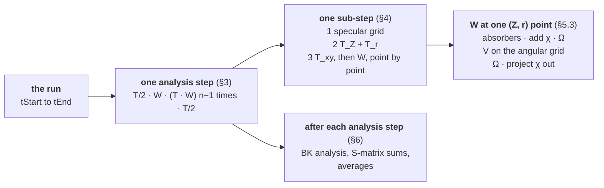
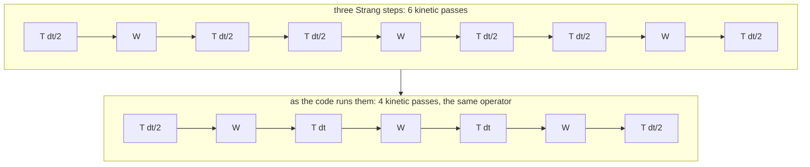
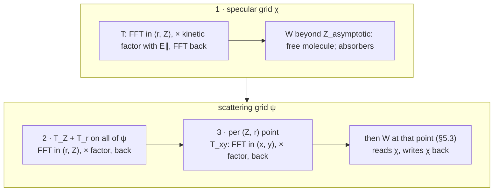
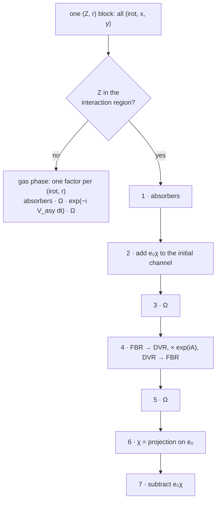
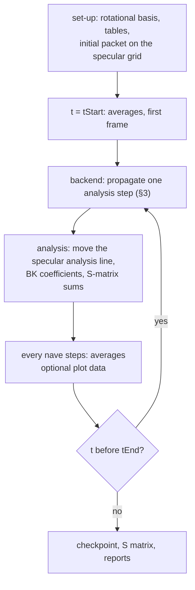

# The split-operator propagation (`src/propagation/`)

This directory moves the wave packet forward in time. Every n time steps it hands the packet to the analysis,
which extracts the S matrix. One such **analysis step** is

```math
U(\mathrm{d}t)^n \;=\; e^{-i\hat T\,\mathrm{d}t/2}\; W \;\big(e^{-i\hat T\,\mathrm{d}t}\; W\big)^{n-1}\; e^{-i\hat T\,\mathrm{d}t/2},
```

where T is the kinetic energy of the centre of mass and the bond (applied with FFTs) and W is everything else:
rotation, potential and absorbers (applied on the angular grid). Each operator acts in the representation in
which it is diagonal. The sequence of operators is the Fortran code's, factor by factor. The C++ differs only in
how the work is organised and in rounding, and it agrees with the Fortran to half a unit in the last printed
digit (§8).



**The ideas in one line each:**

- **Two grids** (§2): the incoming channel travels on a cheap, long (Z, r) grid. It joins the six-dimensional
  grid only for the potential step, through an exact projection.
- **Merged half steps** (§3.2): n Strang steps need n + 1 kinetic passes, not 2n.
- **Rotation inside W** (§3.3): the rotational energy depends on r, so it is applied with the potential, not
  with the FFTs.
- **Fused per point** (§4): T_xy and W act within one (Z, r) point, so both run while that point is in cache.
- **One method, two executions** (§10): the CPU here and the GPU in [`src/cuda/`](../cuda/README.md) run the
  same schedule with the same tables.

**Start here.** Read §1–§4 in order: the physics, the two grids, the splitting, one sub-step. Then follow the
code with §5.3 open beside it: `WavePacketPropagation::run` (`propagation.cpp`) →
`SplitOperatorPropagator::kinetic_and_potential_step` (`split_operator.cpp`) → `PotentialOperator::apply_block`
(`potential_operator.cpp`). §7–§10 are reference.

**Contents.** [1 What is propagated](#1-what-is-propagated) ·
[2 The two grids](#2-the-two-grids) ·
[3 One analysis step](#3-one-analysis-step-the-splitting) ·
[4 One sub-step](#4-one-sub-step-stage-by-stage) ·
[5 The operators](#5-the-operators) ·
[6 The time loop and the analysis](#6-the-time-loop-and-what-the-analysis-reads) ·
[7 Parallel execution](#7-parallel-execution-and-reproducibility) ·
[8 Differences from the Fortran](#8-differences-from-the-fortran-code-and-why) ·
[9 Files and tables](#9-files-and-tables) ·
[10 Changing the propagation](#10-changing-the-propagation)

Related: [docs/method.md](../../docs/method.md) (the method in brief, the S matrix, the fine analysis) ·
[inputs/README.md](../../inputs/README.md) (choosing grids, packet, time step and absorbers) ·
[src/cuda/README.md](../cuda/README.md) (the GPU kernels).

---

## 1. What is propagated

A diatomic molecule above a static, periodic surface. The coordinates are the centre of mass (x, y, Z), the
bond length r and the orientation (θ, φ). The Hamiltonian, in atomic units, with M the total mass and μ the
reduced mass:

```math
\hat H \;=\; \underbrace{-\frac{1}{2M}\frac{\partial^2}{\partial Z^2}}_{\hat T_Z}
\;\underbrace{-\,\frac{1}{2\mu}\frac{\partial^2}{\partial r^2}}_{\hat T_r}
\;\underbrace{-\,\frac{1}{2M}\nabla_{\!\rho}^2}_{\hat T_{xy}}
\;+\;\underbrace{\frac{\hat J^{2}}{2\mu r^2}}_{\hat H_{\mathrm{rot}}}
\;+\;V(x, y, Z, r, \theta, \varphi)
```

ρ = (x, y) is the position parallel to the surface. The stored ψ is r times the wave function, so T_r has this
simple form. In the angles it is stored as coefficients of normalised rotational states |J mJ⟩. The norm is
therefore Σ|ψ|² dZ dr dS, with no r² and no angular integral.

Each term is applied where it is diagonal:

| Term | Diagonal in | Applied as |
|---|---|---|
| T_Z, T_r | momenta k_Z, k_r | FFT to momenta, multiply, FFT back |
| T_xy | parallel momenta K∥ + G, one per diffraction channel | FFT in (x, y), multiply, FFT back |
| H_rot = J(J+1)/(2μr²) | (J, r): the rotational basis at each r | one factor per (J, r) |
| V | the angular grid (θ, φ) at each (x, y, Z, r) | to the grid, multiply, back |
| absorbers | the grid point in Z or r | a real factor ≤ 1 |

**Terms used throughout.**

- **Diffraction channel:** a parallel momentum K∥ + G, with G a reciprocal-lattice vector of the surface.
  **Specular** is G = 0, mirror-like scattering. K∥ is the incident parallel momentum (0 at normal incidence).
- **FBR / DVR** (finite basis / discrete variable representation): ψ as coefficients of |J mJ⟩, or as values on
  the (θ, φ) quadrature grid. H_rot is diagonal in the first, V in the second.
- **Absorbers** (complex absorbing potentials): V → V − iV_opt with V_opt ≥ 0, near the ends of the grids. They
  remove outgoing waves before they wrap round the periodic FFT box.
- **Z_asymptotic:** beyond it the potential is that of the free molecule, V = V_asy(r). It is the PES's own value,
  or `ZmaxSwitch` with `UseSwitching`. The **interaction region** is Z \< Z_asymptotic.
- **Zana**, the analysis line: where the S matrix is extracted, at or beyond Z_asymptotic (an input check).
- **Initial channel** i₀: the initial rotational state (J_in, mJ_in) in the specular diffraction channel.

**Symbols.** The sub-step's time step dt′ is dt or dt/2. Ω = exp(−iĤ_rot dt/2) is the rotational half step,
one factor per (irot, r). B is the FBR → DVR transform. A = −V dt is the potential phase, stored premultiplied.
e₀(ρ) = N exp(iK∥·ρ) is the normalised specular channel, with N = 1/√(cell area). dS = dx dy sin γ is the
area element of the skewed (x, y) grid, γ the angle between the lattice vectors.

<details>
<summary>Code vocabulary and memory layout</summary>

| Term | Meaning |
|---|---|
| `izr`, `ixy`, `irot` | the (Z, r) point `ir + nr·iz`, the (x, y) point `iy + ny·ix`, the rotational state (mJ blocks from −MJMax to MJMax, J running fastest within a block) |
| block | all (irot, ixy) values of one (Z, r) point: `ScatteringWave::block(izr)` |
| sub-step | one entry of the schedule (`SplitOperatorSubStep`): T over dt′, then W unless it is the last; Fortran `KineticAndPotentialOp` and the calls before it |
| `nz_potential` | the number of Z points in the interaction region (Fortran `nzpot`) |
| `initial_index()` | i₀ in the rotational basis (Fortran `ichn`) |
| `steps_per_analysis` | n (Fortran `nanspo`): dtAna/dtStep, a whole number by the input checks |

```text
scattering wave  ψ[irot + n_rot · (ixy + n_xy · izr)]     first index fastest, as in the Fortran
specular wave    χ[ir + nr · iz]
potential        A[iφ + nφ · iθ (+ padding), ixy, izr]    only for the nz_potential · nr points of the interaction region
```

</details>

---

## 2. The two grids

The packet starts far from the surface, where nothing couples the incoming channel to any other. Carrying that
stretch of Z on the six-dimensional grid would cost n_rot · nx · ny complex values per (Z, r) point; a (Z, r)
grid needs one. So the wave packet lives on two grids, which together hold it exactly once:

- the **scattering grid** holds the full ψ(irot, x, y, r, Z) on a Z grid that ends in an absorber just beyond Zana;
- the **specular grid** holds one function χ(r, Z): the amplitude of the initial channel, the incoming packet
  and every part scattered back into it (all v, the r continuum included). It has the same start and spacing in
  Z as the scattering grid, but more points (`nZSpecular` ≥ `nZ`).

On the DZ input (`inputs/thesis_fig5_3_dz`), to scale:

```mermaid
gantt
    title The two Z grids of the DZ input (Z in bohr)
    dateFormat x
    axisFormat %S
    todayMarker off
    section Scattering grid ψ
    interaction region, full V : 0, 15000
    Zana = Z_asymptotic, 15.0 : milestone, 15000, 1ms
    absorber : crit, 15000, 19080
    section Specular grid χ
    added into ψ for each W : active, 0, 15000
    packet centre Z0, 18.0 : milestone, 18000, 1ms
    gas phase : 15000, 22080
    absorber : crit, 22080, 30600
```



The packet starts on the specular grid, and the scattering grid starts empty (`initial_wave_packet.cpp`,
Fortran `CoherentStateFunc`). It is a Gaussian in Z moving towards the surface, times the initial rovibrational
state:

```math
\chi(r, Z;\, t_\mathrm{Start}) = \Big(\frac{2\alpha}{\pi}\Big)^{1/4} e^{-\alpha (Z - Z_0)^2 - i k_z Z}\; \phi_{v_\mathrm{in} J_\mathrm{in}}(r).
```

**How χ and ψ exchange the initial channel.** At every (Z, r) point of the interaction region, the potential
step W adds e₀χ to the initial rotational state of ψ, applies W, and projects the initial channel out again
(§5.3, steps 2 and 6–7):

```math
\chi(r, Z) \;\leftarrow\; \sum_{x,y} \mathrm{d}S\; e_0^*(\rho)\; \psi_{i_0}(\rho, r, Z),
\qquad
\psi_{i_0} \;\leftarrow\; \psi_{i_0} - e_0\,\chi .
```

This is an exact orthogonal projection, because e₀ is normalised on the grid:

```math
\sum_{x,y} \mathrm{d}S\, |e_0|^2 \;=\; N^2\,\mathrm{d}S\; n_x n_y \;=\; \frac{\mathrm{d}x\,\mathrm{d}y\,\sin\gamma\; n_x n_y}{\text{cell area}} \;=\; 1 .
```

So after every W the scattering grid holds no initial-channel component in the interaction region. No other
operator creates one: T_Z, T_r, T_xy and the momentum shift are diagonal in (irot, diffraction channel), and so is
the free molecule beyond Z_asymptotic. Hence the initial channel lives on the specular grid only, the scattering
grid holds every other channel, and ψ + e₀χ is the whole wave packet. Between the add and the projection, the
initial channel feels the full W, and whatever the potential moves out of it stays on the scattering grid.

| Region | Scattering grid ψ | Specular grid χ |
|---|---|---|
| Z \< Z_asymptotic | every channel but the initial one; full V | the initial channel; added to ψ for each W, projected back right after |
| Z_asymptotic ≤ Z ≤ end of the scattering grid | every channel but the initial one; V_asy(r) | the initial channel; V_asy(r) |
| beyond | — | the initial channel: the incoming packet, the reflected part |

What is not exact is the grids themselves: the two Z grids are periodic over different lengths, and each has its
own absorbers. Test: `PotentialOperator.ConstantPotentialIsAPhaseAndTheInitialChannelMovesToTheSpecularGrid`.
Fortran: `TwoGrids.f90 AddSpecToScat`, `SubSpecFromScat` (ProjOp = 2, the only option the C++ supports).

The next section shows where in the time step this exchange happens.

---

## 3. One analysis step: the splitting

### 3.1 The Strang splitting

Write T = T_Z + T_r + T_xy for the kinetic energy that is diagonal in momentum space, and W for the rest of one
time step (§3.3). One time step is the symmetric (Strang) splitting

```math
U(\mathrm{d}t) \;=\; e^{-i\hat T\,\mathrm{d}t/2}\; W(\mathrm{d}t)\; e^{-i\hat T\,\mathrm{d}t/2}
\;=\; e^{-i\hat H\,\mathrm{d}t} + \mathcal O(\mathrm{d}t^3).
```

The error per step is O(dt³), from the commutators [T, [T, W]] and [W, [W, T]]; over a fixed time it adds up to
O(dt²). The splitting is symmetric in time. Without absorbers it conserves the norm up to the basis truncation of
§5.4. How to choose dt: [inputs/README.md](../../inputs/README.md).

### 3.2 Merging the half steps

n time steps in a row put two half kinetic steps next to each other n − 1 times. These combine exactly (T commutes
with itself), so the code applies one full kinetic step instead:



This is the formula at the top of the page. The half steps stay at the two ends of the analysis step because the
analysis reads ψ there: at that moment ψ must be the propagated packet at t, not one shifted by an unpaired half
kinetic step. The schedule (`analysis_step_schedule`, Fortran `SplitOperator.f90 Propagate`) is

| n | Sub-steps: T over …, then W? |
|---|---|
| 1 | T dt/2, W · T dt/2 |
| 3 | T dt/2, W · T dt, W · T dt, W · T dt/2 |
| n | T dt/2, W · (n − 1) × [T dt, W] · T dt/2 |

Tests: `SplitOperatorSchedule.BlocksOfOneAnalysisStep`, `SplitOperator.ThreeTimeStepsAreHalfFullFullHalf` (three
merged time steps against three separate Strang steps).

### 3.3 What W contains, and why rotation sits inside it

W is everything that is not diagonal in momentum space. The rotational energy J(J+1)/(2μr²) depends on the
coordinate r, so it does not commute with T_r and cannot join the FFT step. It is diagonal in (J, r), which is the
basis the potential step works in. V, in turn, is diagonal on the angular grid, not in J. So W is itself a
symmetric split. Read it right to left; the absorbers act first:

```math
W(\mathrm{d}t) \;=\; \Omega\; B^\dagger e^{\,iA} B\; \Omega\; e^{-V_\mathrm{opt}\,\mathrm{d}t},
\qquad \Omega = e^{-i\hat H_\mathrm{rot}\,\mathrm{d}t/2},\quad A = -V\,\mathrm{d}t .
```

The inner split adds its own error, from [H_rot, V]. V_opt is a real function of Z and r, so exp(−V_opt dt) is one
number per (Z, r) point and commutes with the rest of W. Where it stands matters only relative to the add of χ
(§5.3): the scattering grid's absorbers act before χ is added, so they never act on the initial channel, which has
the specular grid's absorbers. In the gas phase, V = V_asy(r) and all of W is diagonal in (irot, r): one factor per
(irot, r).

§4 shows how one sub-step applies T and W to the two grids.

---

## 4. One sub-step, stage by stage

One entry of the schedule (`SplitOperatorPropagator::kinetic_and_potential_step`; Fortran `SpecularChannelOps`,
`KineticOpAlongZrOnScatGrid`, `KineticAndPotentialOp`). dt′ is dt or dt/2. E∥ is the parallel kinetic energy of
the specular channel (§5.5).



On the last sub-step of an analysis step there is no W, on either grid: T dt/2 alone, as the splitting requires.

### Why this order

- **The specular grid first.** W on the scattering grid reads χ at its own (Z, r) point and writes it back (§2).
  So χ must have had this sub-step's kinetic step before the scattering grid's W runs. χ's own share of W (the free
  molecule beyond Z_asymptotic, the absorbers) follows right after its T.
- **T_Z + T_r before T_xy.** The two commute exactly (different coordinates), so the order is free; the code keeps
  the Fortran's. The GPU merges them into one stage (§8.1).
- **T_xy and W fused per point.** All of T must act on a point before W does. T_Z + T_r mixes all Z and r, so it
  runs over the whole wave packet first. T_xy and W, however, act within one (Z, r) block (W also on χ at the same
  point, which nothing else in the pass touches). So W can follow T_xy point by point while the block is in cache.
  The Fortran does the same per point. The result is bitwise that of the two stages one after the other
  (`SplitOperator.FusedPerPointStageEqualsStageByStage`).

---

## 5. The operators

Every operator multiplies by factors precomputed once in `PropagationTables` (§9). None of them evaluates an
exponential in the time loop, except exp(iA) when its table would exceed 4 GiB (§5.3).

### 5.1 T_Z + T_r on the scattering grid (`ScatteringKineticOperator::apply_zr`)

The Z and r kinetic energies are applied together, with one 2D FFT per (irot, x, y):

```math
\psi \;\leftarrow\; \mathcal F^{-1}_{Zr}\; \exp\!\Big[-i\Big(\frac{k_Z^2}{2M} + \frac{k_r^2}{2\mu}\Big)\mathrm{d}t'\Big]\; \mathcal F_{Zr}\; \psi .
```

The momenta of a coordinate with n points and spacing d are k_q = q Δk with Δk = 2π/(n d), in FFT order: q = 0 …
n/2, then −(n/2 − 1) … −1. The table `zr_kinetic` holds the product of the Z and r factors.

The half-step factor is formed as in the Fortran (`GridEnergies.f90`): the principal square root of the
full-step factor, per coordinate. It equals exp(−iE dt/2) as long as E·dt \< π, which every reasonable time step
satisfies (the reference grids reach 0.48 rad); beyond that its sign differs (§8.3).

<details>
<summary>FFT conventions and work units</summary>

- The transform to momenta is the Fortran's "Backward" FFT: sign −1 and scale s = d/√(2π) per dimension, so the
  discrete sum approximates the continuous Fourier integral. The way back has sign +1 and scale 1/(n s):

  ```math
  \tilde\psi_{pq} = s_Z s_r \sum_{j,l} e^{-2\pi i\,(p j/n_Z + q l/n_r)}\, \psi_{jl},
  \qquad
  \psi_{jl} = \frac{1}{n_Z s_Z}\,\frac{1}{n_r s_r} \sum_{p,q} e^{+2\pi i\,(p j/n_Z + q l/n_r)}\, \tilde\psi_{pq}.
  ```

  In x and y the scale is √(d/n): the cell is periodic, and the pair of scales only has to multiply to 1/n.
- **Work units.** ψ has (irot, iy) fastest, so the (r, Z) image of one (irot, ix, iy) is strided. A unit gathers up
  to 4 adjacent (irot, iy) values (one 64-byte cache line) at one ix into a contiguous buffer, runs one 2D FFT,
  multiplies, transforms back and scatters. The unit size divides n_rot·ny (`zr_chunk_size`), so all units have the
  same shape and the result does not depend on the number of threads.
- **Fortran:** `PerformEXPKinOpZScat`, then `PerformEXPKinOpRScat`: two passes of 1D FFTs (Z, then r), each with its
  own factor. The same operator, rounded differently (§8.2).

</details>

### 5.2 T_xy, with the momentum shift (`ScatteringKineticOperator::apply_xy_group`)

The surface cell is skewed: x and y run along the lattice vectors a₁ and a₂ (lengths a and b, angle γ: 90° for
square cells, 60° for hexagonal ones). With oblique incidence ψ carries the parallel momentum K∥, so ψ itself is
not periodic in the cell, but exp(−iK∥·ρ)ψ is:

```math
\psi(\rho) \;=\; e^{\,i\mathbf K_\parallel\cdot\rho} \sum_{\mathbf G} c_{\mathbf G}\, e^{\,i\mathbf G\cdot\rho} .
```

So T_xy shifts to the frame of K∥, transforms, multiplies and shifts back:

```math
\psi \;\leftarrow\; e^{\,i\mathbf K_\parallel\cdot\rho}\;\mathcal F^{-1}_{xy}\; e^{-iT_{xy}\,\mathrm{d}t'}\;\mathcal F_{xy}\; e^{-i\mathbf K_\parallel\cdot\rho}\;\psi,
\qquad
T_{xy} = \frac{k_x^2 + k_y^2 - 2\cos\gamma\,k_x k_y}{2M} .
```

Here k_x and k_y are the expansion coefficients of K∥ + G on the unit reciprocal vectors b̂₁ and b̂₂:
k_x = k_x,0 + q Δk_x with Δk_x = 2π/(a sin γ), and Δk_y = 2π/(b sin γ). The cross term comes from b̂₁·b̂₂ = −cos γ
(`parallel_kinetic_energies`, `src/input/process.cpp`; Fortran `DifChanEnergies`). In skewed coordinates the
phase is K∥·ρ = sin γ (k_x,0 x + k_y,0 y). Each FFT point is one diffraction channel.

<details>
<summary>Groups and shortcuts</summary>

- **Groups.** A group is several consecutive r points of one Z value (up to 1 MiB, `xy_group_points`), gathered as
  (irot + n_rot·point, ixy), so that one 2D FFT with one batch dimension transforms them all.
- **Shortcuts.** At normal incidence every shift factor is exactly 1, and the shift is skipped. With one point per
  group and no shift, the block already has the gathered layout, and the FFT runs on ψ itself (`transforms_in_place`;
  bitwise the same, `ScatteringKinetic.InPlaceTxyEqualsGatheredTxyBitwise`).
- A single grid point in x or y is not transformed, as in the Fortran.
- **Fortran:** `PerformEXPKineticOp` per (Z, r) point: `MomentumShiftWF`, `TransToMomenta` (1D FFTs in x, then y),
  `MultByEXPKinEnergy`, `TransToCoords`, shift back.

</details>

### 5.3 W at one (Z, r) point (`PotentialOperator::apply_block`)

The heart of the propagation (Fortran `Potential.f90 PerformEXPPotentialOp`). The diagram's numbers are the steps of
the equations below it.



In the interaction region, at every (x, y) of the point:

```math
\begin{aligned}
&1.\;\; \psi \leftarrow e^{-V^\mathrm{opt}_Z(Z)\,\mathrm{d}t}\, e^{-V^\mathrm{opt}_r(r)\,\mathrm{d}t}\, \psi && \text{absorbers}\\
&2.\;\; \psi_{i_0} \leftarrow \psi_{i_0} + e_0(\rho)\, \chi(r, Z) && \text{add the incoming channel}\\
&3.\;\; \psi \leftarrow \Omega\,\psi && \text{rotation, half step}\\
&4.\;\; \psi \leftarrow B^\dagger\, e^{\,iA(\rho, Z, r, \theta, \varphi)}\, B\, \psi && \text{potential, on the angular grid}\\
&5.\;\; \psi \leftarrow \Omega\,\psi && \text{rotation, half step}\\
&6.\;\; \chi(r, Z) \leftarrow \textstyle\sum_{x, y} \mathrm{d}S\, e_0^*(\rho)\, \psi_{i_0}(\rho) && \text{project the initial channel out}\\
&7.\;\; \psi_{i_0} \leftarrow \psi_{i_0} - e_0(\rho)\, \chi(r, Z)
\end{aligned}
```

Steps 1 and 3–5 are W of §3.3. Steps 2 and 6–7 bring χ in and take it out again, so that W acts on the whole wave
packet (§2).

- **Merged factors.** Steps 1 and 3 are one multiplication per value: opt_Z · (opt_r · Ω) ψ, the table
  `before_interaction` per (irot, r). The added term carries its own Ω: Ω_i₀ · e₀χ. In the gas phase the whole of W
  is opt_Z · (opt_r · Ω · exp(−iV_asy dt) · Ω), the table `gas_phase_step`. The Fortran multiplies by each factor in
  turn (rounding, §8.2). The GPU reads the same tables (`potential_step_factors`).
- **exp(iA)** is formed as (cos A, sin A), like the Fortran's `COS(A) + ima*SIN(A)`. It is precomputed once if
  that table fits in 4 GiB (`default_table_limit`), else evaluated in every step. Both give the same bits
  (`PotentialOperator.PrecomputedAndOnTheFlyExponentialsAreBitwiseIdentical`).
- **Surface symmetry** (`UseSymmetry`): A is stored at the symmetry-unique (x, y) points only. The value at
  (x, y, φ) is that of its representative at the mapped φ (`GridSymmetry::representative_of`, `phi_index`). This is
  the only place in the time loop that reads the reduced potential.

### 5.4 The angular transform B (`AngularTransform`)

**The basis** is {|J mJ⟩ : J ≤ JMax, |mJ| ≤ min(MJMax, JMax)}. For a homonuclear molecule (H₂, D₂) only J of the
parity of J_in.

**The grid** is nφ equidistant φ_k = 2πk/nφ and Gauss–Legendre points θ_t with weights w_t. For a homonuclear
molecule the θ grid is the half cos θ ≥ 0 of the (JMax+1)-point rule, with doubled weights (θ = π/2 not doubled).
That suffices for two reasons. The round trip B†B: P̄_J^m(−x) = (−1)^(J+m) P̄_J^m(x), so within one mJ block all
functions share one parity in cos θ and the products the transform needs are even. The potential step: V of two
identical nuclei is symmetric under their exchange, V(π − θ, φ + π) = V(θ, φ), and with one J parity
ψ(π − θ, φ + π) = ±ψ(θ, φ); the lower hemisphere repeats the upper one at φ + π, which is on the grid because nφ
is even. A PES without that exchange symmetry must not run with `HomoNuc`. Source: `src/grids/angular_grid.cpp`.

**B** maps the coefficients c_JmJ to quadrature-weighted values on the grid:

```math
\tilde\psi_{tk} \;=\; \sqrt{w_t\,\Delta\varphi}\;\psi(\theta_t, \varphi_k)
\;=\; \sum_{m} e^{\,i m \varphi_k} \sum_{J} \sqrt{\frac{w_t}{n_\varphi}}\; \bar P_J^{\,m}(\cos\theta_t)\; c_{Jm},
```

with P̄ the normalised associated Legendre functions and Δφ = 2π/nφ. The weighting makes the columns of B
orthonormal, so DVR → FBR is the adjoint B†. It does not matter for the diagonal exp(iA), but it does when DVR
values are read or plotted.

**B†B = 1, but BB† is only a projector** on the grid: whatever exp(iA) moves out of the span of the basis is
dropped on the way back. So the potential step is a contraction, not unitary. This basis-truncation error is the
only norm loss besides the absorbers, and it shrinks as JMax and MJMax grow: a convergence check
(`AngularTransform.AnisotropicPhaseLosesTheNormOutsideTheBasis`). Every mJ needs its own φ slot, hence
nφ ≥ 2·MJMax + 1: an input error here, while the Fortran returns silently.

<details>
<summary>How B is computed</summary>

- **FBR → DVR** (`fbr_to_dvr`): per mJ block, a Legendre sum into the φ slot of that mJ (slot m for m ≥ 0,
  nφ + m for m \< 0); the unused slots are zeroed; then one batched FFT over φ (sign +1). **DVR → FBR**: the FFT
  with sign −1, then the transposed Legendre sums.
- A DVR block has the Fortran layout (iφ, iθ) with leading dimension nφ + 1 (one padding value per θ).
- **Column passes.** The (x, y) columns of one point go through in passes of `columns_per_pass` columns (at most
  58 KiB of DVR blocks; a constant, so the bits never depend on the machine), each pass one batched φ FFT. The θ
  sums run five θ rows at a time, each sum keeping its order of terms. Both are bitwise neutral
  (`AngularTransform.ColumnPassesGiveTheBitsOfOnePass`, `FiveRowSumsEqualTheRowByRowLoop`).
- **Fortran:** `transform.f90 FBRToDVRGenComplexTransform`, `DVRToFBRGenComplexTransform`, with all nx·ny columns
  of a point at once.

</details>

### 5.5 The specular grid (`SpecularOperator`)

The full specular wave is e₀(ρ)χ(r, Z), one plane wave in (x, y). On it T_xy is the constant
E∥ = T_xy(k_x,0, k_y,0) (`parallel_energy`), and H_rot is J_in(J_in+1)/(2μr²), a function of r only. So the
specular grid needs no (x, y) FFT and no angular transform:

```math
\begin{aligned}
&\chi \leftarrow \mathcal F^{-1}_{Zr}\, \exp\!\Big[-i\Big(\frac{k_Z^2}{2M} + \frac{k_r^2}{2\mu} + E_\parallel\Big)\mathrm{d}t'\Big]\, \mathcal F_{Zr}\, \chi && \text{every sub-step}\\
&\chi(r, Z) \leftarrow \Omega_{i_0}(r)\, e^{-iV_\mathrm{asy}(r)\,\mathrm{d}t}\, \Omega_{i_0}(r)\; \chi(r, Z) \quad \text{for } Z \ge Z_\mathrm{asymptotic} && \text{not on the last}\\
&\chi \leftarrow e^{-V^\mathrm{opt}_{Z,\mathrm{sp}}(Z)\,\mathrm{d}t}\; e^{-V^\mathrm{opt}_r(r)\,\mathrm{d}t}\; \chi && \text{not on the last}
\end{aligned}
```

Inside the interaction region χ gets no potential here: it gets the full W through the scattering grid (§5.3).
Fortran: `SpecularChannelOps`, `PerformEXPKinOpSpec`, `PerformEXPGasPhaseOnSpecGrid`, `PerformEXPOpticalOpSpec`.

### 5.6 The absorbers

Each absorber adds −iV_opt to the potential over [q_start, q_end] at one end of a grid, with a quadratic profile
(the power is fixed at 2):

```math
V_\mathrm{opt}(q) = \tfrac{3}{2}\, V_0\, x^2,\qquad
x = \frac{q - q_\mathrm{start}}{q_\mathrm{end} - q_\mathrm{start}}\;\text{(high end)},\quad
x = \frac{q_\mathrm{end} - q}{q_\mathrm{end} - q_\mathrm{start}}\;\text{(low end)},
```

applied as the real factor exp(−V_opt dt) ≤ 1. The strength V₀ follows from the target energy, the absorber
length and the mass (M for Z, μ for r) through Table 3 of Á. Vibók and G. G. Balint-Kurti, J. Phys. Chem. 96,
8712 (1992) (`optical_potential_strength`, `src/input/wave_packet_params.cpp`). The tables hold the factor at every
grid point, exactly 1 outside the absorbers; where a low-Z and a high-Z absorber overlap, the low end wins (the
Fortran's assignment order).

| Absorber | Keys | Acts on |
|---|---|---|
| high Z, scattering grid | `ZOpt…` | ψ, in W |
| low Z, scattering grid | `ZOptLow…` | ψ, in W; not on χ, which has its own |
| high Z, specular grid | `ZSpOpt…` | χ, after its T |
| low Z, specular grid | `ZSpOptLow…` | χ, after its T |
| large r | `ROpt…` | ψ in W, and χ after its T: the dissociating part |

---

## 6. The time loop and what the analysis reads

`WavePacketPropagation` (`propagation.cpp`) builds everything once and then runs the loop of Fortran `Main.f90`
(`DO propStep = nanspo, nstep, nanspo`):



The run has three clocks. The counts are truncated as in the Fortran (`INT`). The input checks require dtAna to be a
whole multiple of dtStep, so n · dt is dtAna to a relative 1e-12 ([analysis D5](../../docs/fortran_deviations.md#analysis-d5)), and
reject the other ratios that would break the run ([analysis D4](../../docs/fortran_deviations.md#analysis-d4)):

| Clock | Input key | Count | What happens |
|---|---|---|---|
| time step dt | `dtStep` | `nStep` steps in the run | one Strang step (§3) |
| analysis step | `dtAna` | n = INT(dtAna/dtStep) | the backend propagates, the analysis reads ψ. The highest energy the S matrix resolves is π/dtAna (`max_analysis_energy`) |
| averages | `dtAve` | nave = INT(dtAve/dtAna) analysis steps | norm, ⟨Z⟩, ⟨r⟩, rest norm |

The time at the end of analysis step k is counted back from the end of the run, as in the Fortran:
t_k = tEnd + (k n − nStep) dt, with tStart = tEnd − nStep dt.

**The backend seam.** The loop never touches ψ itself. It talks to a `PropagationBackend`
(`propagation_backend.hpp`) once per analysis step: one virtual call to propagate, then a few small reads.
`CpuBackend` keeps ψ in host memory, `CudaBackend` (`src/cuda/`) on the GPU.

| Call | What the analysis gets | Used for |
|---|---|---|
| `propagate_analysis_step()` | — | §3 |
| `specular()` | χ on the whole specular grid | the analysis line; the BK coefficients of the initial channel; the averages |
| `z_plane(iz_analysis)` | the nr blocks at Z = Zana | the BK coefficients of every other channel |
| `block_densities()` | Σ\|ψ\|² over (irot, x, y) at every (Z, r) point | the averages; the plot options `NormBudget`, `writeDensities` |
| `site_column(ixy)` | ψ at one (x, y) point for every (Z, r, irot) | the plot option `EnergyResolvedSites` |
| `wave_packet_on_host()`, `read_wave_packet()` | all of ψ | checkpoint and restart, outside the loop |

**The averages** (`averages.cpp`, Fortran `Averages.f90 ComputeAverages`) add the two grids:

```math
\langle\psi|\psi\rangle = \mathrm{d}Z\,\mathrm{d}r\,\mathrm{d}S \sum_{izr}\sum_{irot,\,ixy} |\psi|^2 \;+\; \mathrm{d}Z\,\mathrm{d}r \sum_{ir,\,iz} |\chi|^2,
```

and ⟨Z⟩, ⟨r⟩ the same with Z or r inside the sums, divided by the norm. The rest norm is the specular norm between
Zana and the analysis line: what has not been analysed yet.

**The specular analysis line** (`analysis_surface.cpp`, Fortran `FindNewAnalysisPoint`) follows the tail of the
incoming packet inwards and is fixed when the reflected packet arrives. How, and what the Balint-Kurti (BK)
analysis does with it: [docs/method.md](../../docs/method.md#asymptotic-analysis-and-the-s-matrix).

---

## 7. Parallel execution and reproducibility

Results never depend on the number of threads or on the loop schedule. Three rules ensure that:

1. **Independent work units of fixed shape.** Every parallel loop runs over units (the (r, Z) work units of §5.1, the
   groups of (Z, r) points of §5.2–5.3) whose shape depends only on the grid. Each thread has its own work arrays.
2. **Fixed summation order.** Reductions (norms, densities) run with `schedule(static)` and sum in memory order.
3. **No machine-dependent sizes.** The cache-motivated sizes are constants (4 values, 1 MiB, 58 KiB), not queries of
   the machine.

| Loop | Over | Schedule | Why |
|---|---|---|---|
| T_Z + T_r (`apply_zr`) | (r, Z) work units | `static` | equal work per unit |
| T_xy + W (`apply_xy_and_potential`) | groups of (Z, r) points | `runtime`: by default dynamic,1 on one NUMA node, static,1 on several | a point of the interaction region (angular transform, exp(iA)) costs far more than a gas-phase point (one factor) |
| first writes of ψ, the potential and exp(iA) | the same groups | `runtime` | first touch: each memory page on the socket of the thread that uses it |
| `block_densities` | (Z, r) points | `static` | fixed order |

The schedule is set once at start-up (`--schedule`, `src/core/loop_schedule.cpp`). The large arrays are
`AlignedVector` (64-byte aligned, not zeroed, first written in parallel); the memory estimate printed at set-up
(`memory_estimate.cpp`) lists each one. Tests: `SplitOperator.AnalysisStepKeepsTheNormAndDoesNotDependOnThreads`;
`Restart.SplitRunIsBitwiseIdenticalToTheUnsplitRun` (a run split by a restart gives the bits of the unsplit run).

---

## 8. Differences from the Fortran code, and why

The sequence of operators is the Fortran's (`SplitOperator.f90 Propagate`), sub-step by sub-step and factor by
factor. The differences are in how the steps run, in rounding, and in what was not ported. Together they stay
within the gates: the averages agree with the Fortran to half a unit in the last printed digit, and the BK
coefficients of the 7000-step Dai–Light run to 6.4e-13 of their largest value
([docs/validation.md](../../docs/validation.md), gates 3 and 4).

### 8.1 The same operations, organised differently (the same numbers)

| What | Fortran | C++ | Why |
|---|---|---|---|
| T_xy and W | per (Z, r) point (`KineticAndPotentialOp`): T_xy, then W | per group of (Z, r) points (up to 1 MiB): T_xy for the group, then W point by point in the same pass | one FFT call for several points; the data stay in cache |
| exp(iA) | cos and sin in every step | precomputed once if ≤ 4 GiB, else as the Fortran | no cos/sin per step on small and medium grids |
| angular transform | all nx·ny columns of a point at once | passes of `columns_per_pass` columns, θ rows five at a time | the work of a thread stays in L2; together with the in-place T_xy, 21 % less time per step on the DZ grid ([performance.md](../../docs/performance.md#what-was-optimised-and-how-it-relates-to-the-fortran-code)) |
| momentum shift | always applied (3D and higher) | skipped when every factor is exactly 1 (normal incidence); a product with 1 changes at most the sign of an exact zero | a pass less |
| specular absorbers | 5.19: only at the absorber's points; 5.24: at every Z point | at every Z point (factor 1 outside), as 5.24 | needed for the low-Z specular absorber |
| loop schedule | `DYNAMIC`, chunk (nz − nzpot)·nr / threads, over points | dynamic,1 or static,1 over groups; first touch with the same schedule | NUMA placement; load balance |

The GPU (`--device cuda`) has one more difference: it applies T_Z + T_r and T_xy as one stage, one pass over ψ
less, on its own layout (izr, irot, ixy). That changes the order of the FFTs, so it agrees with the CPU to
≤ 1e-13: the documented exception of [docs/cuda.md](../../docs/cuda.md) ("Methodology exceptions").

### 8.2 The same operator, rounded differently

Each row changes the result by about an ulp per operation. performance.md lists the reorganisations at ≤ 1e-14
([What was optimised](../../docs/performance.md#what-was-optimised-and-how-it-relates-to-the-fortran-code));
the Fortran's quad-precision grids give ≈ 1e-12 in the phases after 7000 steps
([docs/fortran_deviations.md](../../docs/fortran_deviations.md)).

| What | Fortran | C++ | Why |
|---|---|---|---|
| T_Z + T_r | 1D FFTs in Z, × the Z factor, back; then the same in r | one 2D FFT per work unit, × the product of both factors, back | one gather and one pass instead of two |
| T_xy | 1D FFT in x, then in y | one 2D FFT per group, gathered to have one batch dimension | one FFT call per group (oneMKL's FFTW3 interface and cuFFT allow one batch dimension) |
| scalar factors of W | opt_Z, opt_r and Ω each in turn; χ added before Ω | merged: opt_Z · (opt_r · Ω) ψ + Ω_i₀ · e₀χ | one multiplication per value instead of three |
| grids, momenta, kinetic and rotational energies, absorber profiles, projection phases | quad precision (`-fdefault-real-8` promotes `DFLOAT`, `…d0`), rounded once | plain double | an accepted policy; the first suspect if a propagation gate drifts |
| cos and sin of exp(iA) | vectorised by gfortran (glibc libmvec, a few ulp from scalar) | scalar libm | not reproduced: accepted |
| FFT library | FFTW (through `fftw_2_scs.f90`) | oneMKL's FFTW3 interface, or FFTW | speed |
| the time t_k | quad precision | double | the same policy as the grids |

### 8.3 Fortran behaviour kept on purpose

- **The half step as a square root.** The half-step factors of T_Z, T_r and the specular grid are the principal
  square roots of the full-step factors, not exp(−iE dt/2). They differ in sign for E·dt mod 4π in (π, 3π), at both
  ends of every analysis step. The scattering grid takes the root per coordinate and multiplies; the specular grid
  takes it of the whole factor, E∥ included: not the same function beyond E·dt = π. The reference grids stay below
  0.48 rad ([fortran_bugs/README.md](../../docs/fortran_bugs/README.md), "Candidates that are not bugs"; test
  `PropagationTables.KineticFactorsAreUnitaryAndHalfStepsSquareToFullSteps`).
- The sub-step order of §4: no W after the last T/2, on either grid.
- The scattering grid's absorbers act before χ is added, so the low-Z scattering absorber does not act on the
  initial channel; that has `ZSpOptLow…`.
- Where a low-Z and a high-Z absorber overlap, the low end replaces the high end.

### 8.4 Not ported

- ProjOp 0 and 1: no specular grid, or merging the specular wave into the scattering grid once its norm beyond the
  scattering grid is below TolSp. Legacy options, rejected by the input reader. Only ProjOp 2, two grids throughout.
- MPI (the redistribution of ψ between the Z/r and x/y passes): OpenMP and the GPU instead.
- The CPU timers per operator (`CpuTimings.f90`): the C++ prints the times of the potential, the propagation and the
  fine analysis.

---

## 9. Files and tables

| File | Responsibility | Fortran |
|---|---|---|
| `propagation.{hpp,cpp}` | `WavePacketPropagation`: set-up and the time loop; `PropagationObserver` | `Main.f90` |
| `propagation_backend.{hpp,cpp}` | `PropagationBackend`, the seam between the loop and ψ | — |
| `cpu_backend.{hpp,cpp}` | `CpuBackend`: ψ in host memory, the OpenMP stages | `SplitOperator.f90` |
| `split_operator_schedule.{hpp,cpp}` | `analysis_step_schedule`: the sub-steps, shared with the GPU | `SplitOperator.f90 Propagate` |
| `split_operator.{hpp,cpp}` | `SplitOperatorPropagator`: one sub-step; T_xy and W fused per group | `KineticAndPotentialOp` |
| `kinetic_operators.{hpp,cpp}` | `ScatteringKineticOperator`: T_Z + T_r, T_xy | `KineticOp.f90`, `PerformEXPKineticOp` |
| `potential_operator.{hpp,cpp}` | `PotentialOperator`: W, with the absorbers, the rotation and the exchange with χ | `Potential.f90`, `Absorption.f90`, `TwoGrids.f90` |
| `angular_transform.{hpp,cpp}` | `AngularTransform`: B and B† | `transform.f90` |
| `specular_operator.{hpp,cpp}` | `SpecularOperator`: the specular grid | `SpecularChannelOps`, `GasPhase.f90` |
| `propagation_tables.{hpp,cpp}` | `PropagationTables`: every factor, precomputed | `GridEnergies.f90`, `Absorption.f90`, `MomentumShifting.f90`, `TwoGrids.f90` |
| `wave_function.hpp` | `ScatteringWave`, `SpecularWave`, `WavePacket` | `WaveFunction.f90` |
| `initial_wave_packet.{hpp,cpp}` | the initial packet and its TolSp check | `CoherentStateFunc` |
| `analysis_surface.{hpp,cpp}` | the specular analysis line | `Analyzor.f90 FindNewAnalysisPoint` |
| `averages.{hpp,cpp}` | norm, ⟨Z⟩, ⟨r⟩, rest norm; block densities | `Averages.f90` |
| `memory_estimate.{hpp,cpp}` | the MEMORY ESTIMATE block | — |

<details>
<summary>The precomputed tables (PropagationTables)</summary>

| Table | Formula | Size | Fortran |
|---|---|---|---|
| `zr_kinetic` | exp(−i(k_Z²/2M + k_r²/2μ) dt), and the half step | nr·nz | `EXPKinEn%…%ZScat`, `RScat` (separate there) |
| `xy_kinetic` | exp(−i T_xy dt) | nx·ny | `EXPKinEn%…%XY` |
| `specular_kinetic` | exp(−i(k_Z²/2M + k_r²/2μ + E∥) dt) | nr·nzsp | `EXPKinEn%…%Spec` |
| `rotation` | exp(−i E_rot dt), and dt/2 (Ω) | n_rot·nr | `EXPKinEn%…%RotChan` |
| `z_optical`, `r_optical`, `z_specular_optical` | exp(−V_opt dt) | nz, nr, nzsp | `EXPOptZ`, `EXPOptR`, `EXPOptZSpec` |
| `gas_phase` | exp(−i V_asy(r) dt) | nr | `XVGasPhase` |
| `shift_forward`, `shift_backward` | exp(∓i K∥·ρ) | nx·ny | `shiftForward`, `shiftBackward` |
| `specular_to_scattering`, `scattering_to_specular` | e₀ = N exp(iK∥·ρ), dS · e₀* | nx·ny | `initXY`, `XYProj` |
| `fft_scale_*` | dZ/√(2π), dr/√(2π), √(dx/nx), √(dy/ny) | — | `scalFac*` |

</details>

---

## 10. Changing the propagation

> **The rule: one method, two executions.** The order of the sub-steps exists once, in `analysis_step_schedule`,
> and both backends run it. The order of the stages *inside* a sub-step is coded in each backend
> (`SplitOperatorPropagator::kinetic_and_potential_step`, `CudaBackend::kinetic_and_potential_step`), and the factors
> come from the same tables. A change to what is computed goes into both backends, or neither
> ([docs/cuda.md](../../docs/cuda.md), "One method, two executions").

| Change | Do also | Which check notices |
|---|---|---|
| the order of the sub-steps, or of the stages in a sub-step | `analysis_step_schedule`, or both backends in the same commit | the gates 3 and 4 (CPU and GPU), `SplitOperator.ThreeTimeStepsAreHalfFullFullHalf`, `CudaBackend.AnalysisStepMatchesTheCpu*` |
| a new factor in W that depends on (irot, r) only | multiply it into `potential_step_factors` (both tables): the GPU reads them too | `CudaBackend.*MatchesTheCpu*` |
| a new factor in W that depends on Z, or on (x, y) | `PotentialOperator::apply_block` (next to `optical_z`) and the GPU kernel (`src/cuda/potential_kernels.cu`) | `CudaBackend.*MatchesTheCpu*` |
| any new factor in W | decide whether the initial channel needs it too: then also in `SpecularOperator` beyond Z_asymptotic, or χ and ψ no longer see the same W (§2) | review |
| a refactor meant to keep the numbers | — | `tools/check_bitwise_refactor.sh [--cuda]`: every output bytewise |
| a change that may round differently | stay within ~1e-13 of the previous version | `tools/compare_propagation.sh`, the gates |
| a new large array | `AlignedVector`, first written in parallel; the memory estimate (and the designer's copy) | `MemoryEstimate.MatchesAllocations`, the `build-poison` variant ([developer guide](../../docs/developer_guide.md#a-new-large-array)) |
| an addition to the time loop | behind an input key, free when off | `TimeLoopCalls.*`, `tools/benchmark/compare_speed.sh` ([CONTRIBUTING](../../docs/CONTRIBUTING.md)) |
| a new deviation from the Fortran | a row in [docs/fortran_deviations.md](../../docs/fortran_deviations.md), with a test | review |

The unit tests of this directory are in `tests/test_propagation.cpp`, `test_propagation_tables.cpp`,
`test_angular.cpp`, `test_restart.cpp` and `test_time_loop_calls.cpp`; the gates against the Fortran in
`tests/test_regression_propagation.cpp`; the GPU twins in `tests/cuda/`. Run the quick tier while working and the
full suite before a commit ([README: Testing](../../README.md#testing)).
