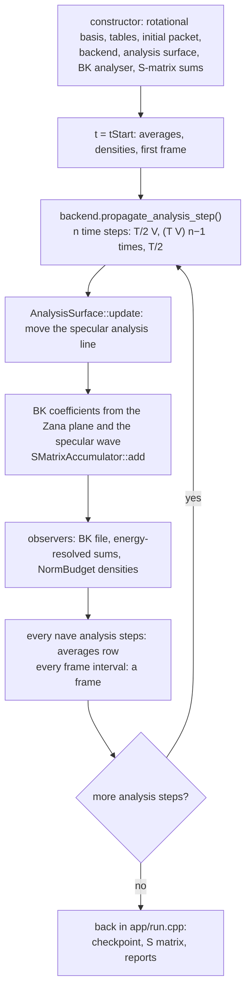
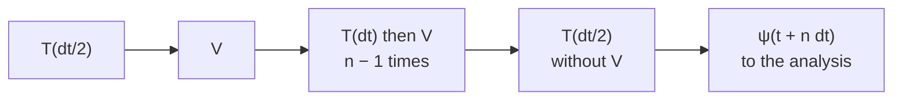
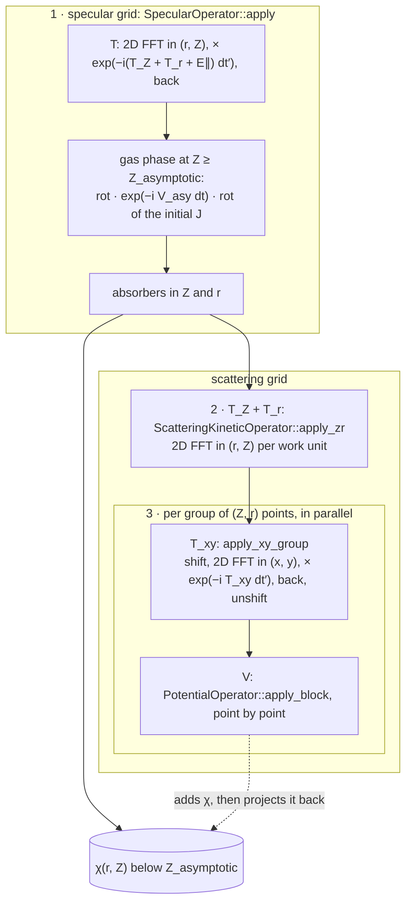
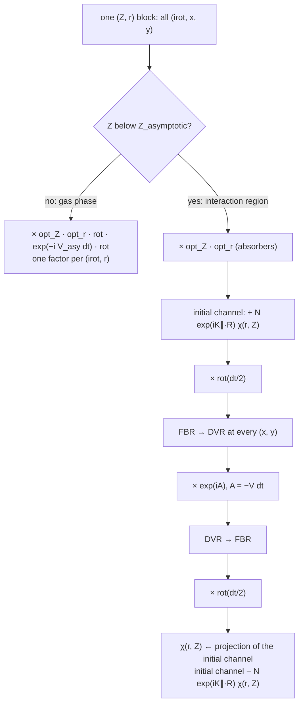

# `src/propagation/`: the split-operator propagation

This directory moves the wave packet forward in time. It holds the wave packet, the operators that act on
it (kinetic energy, potential, rotation, absorbers, the coupling of the two grids), the order in which they
are applied, and the time loop that hands the wave packet to the analysis after every analysis step.

> **Ground rule.** The order of the operators exists once, in `analysis_step_schedule`
> (`split_operator_schedule.cpp`). The CPU backend here and the GPU backend in [`src/cuda/`](../cuda/README.md)
> both run that list with the same tables, so they compute the same thing; only the execution
> differs ([docs/cuda.md](../../docs/cuda.md), "One method, two executions").

The method in brief, with the S matrix and the fine analysis: [docs/method.md](../../docs/method.md). How to
choose grids, packet, time step and absorbers: [inputs/README.md](../../inputs/README.md). The GPU kernels:
[src/cuda/README.md](../cuda/README.md).

**Start here.**

1. Read §1 (what is propagated) and §2 (the time loop).
2. Read §3 and §4: the order of the operators and why. This is the core of the method.
3. In the code, follow `WavePacketPropagation::run` (`propagation.cpp`) into
   `SplitOperatorPropagator::kinetic_and_potential_step` (`split_operator.cpp`), then
   `PotentialOperator::apply_block` (`potential_operator.cpp`) with §5.4 at hand.
4. §8 lists every difference from the Fortran code and the reason for it.

**Contents.** [1. What is propagated](#1-what-is-propagated) ·
[2. The time loop](#2-the-time-loop) ·
[3. One analysis step](#3-one-analysis-step-the-order-of-the-blocks) ·
[4. One T block](#4-one-t-block-stage-by-stage) ·
[5. The operators](#5-the-operators) ·
[6. The two grids](#6-the-two-grids-why-the-coupling-is-exact) ·
[7. Parallel execution](#7-parallel-execution-and-reproducibility) ·
[8. Differences from the Fortran](#8-differences-from-the-fortran-code-and-why) ·
[9. Files](#9-files) ·
[10. Changing the propagation](#10-changing-the-propagation)

---

## 1. What is propagated

A diatomic molecule above a static, periodic surface: the centre of mass (x, y, Z), the bond length r and
the orientation (θ, φ). The Hamiltonian (atomic units; M the total mass, μ the reduced mass):

```math
\hat H \;=\; \underbrace{-\frac{1}{2M}\frac{\partial^2}{\partial Z^2}}_{\hat T_Z}
\;\underbrace{-\,\frac{1}{2\mu}\frac{\partial^2}{\partial r^2}}_{\hat T_r}
\;\underbrace{-\,\frac{1}{2M}\nabla_{\parallel}^2}_{\hat T_{xy}}
\;+\;\underbrace{\frac{\hat{\jmath}^{\,2}}{2\mu r^2}}_{\hat H_{\mathrm{rot}}}
\;+\;V(x, y, Z, r, \theta, \varphi)
```

The program computes ψ(t + Δt) = exp(−iĤΔt) ψ(t) on a grid, approximately, with the split-operator method:
every term is applied in the representation in which it is diagonal.

| Term | Diagonal in | Applied as |
|---|---|---|
| T_Z, T_r | momenta k_Z, k_r | FFT to momenta, multiply, FFT back |
| T_xy | momenta parallel to the surface (the diffraction channels) | FFT in (x, y), multiply, FFT back |
| H_rot = J(J+1)/(2μr²) | the rotational basis \|J mJ⟩ (FBR) at each r | one factor per (J, r) |
| V | the angular grid (θ, φ) (DVR) at each (x, y, Z, r) | FBR → DVR, multiply, DVR → FBR |
| absorbers | the grid point (Z or r) | a real factor ≤ 1 |

**Two grids.** The wave packet lives on two grids, which together hold it once:

- the **scattering grid**: the full six-dimensional ψ, stored in the rotational basis, on a (Z, r, x, y)
  grid that ends in an absorber beyond the analysis line `Zana`;
- the **specular grid**: a longer (Z, r) grid with one function χ(r, Z), the *initial channel*: the
  initial rotational state (J_in, mJ_in) in the specular diffraction channel (0, 0), for every
  vibrational state. The packet starts here, far from the surface, and the elastically reflected part
  leaves here.

In the interaction region (Z \< Z_asymptotic) χ is coupled to the scattering grid in every time step; §6
explains why this is exact. The layout of each piece (first index fastest, as in the Fortran):

```text
scattering wave  ψ[irot + n_rot · (ixy + n_xy · izr)]     ixy = iy + ny · ix,  izr = ir + nr · iz
specular wave    χ[ir + nr · iz]
potential        A[iφ + nφ · iθ  (+ padding) , ixy, izr]   only for the nzpot · nr points with Z below Z_asymptotic
```

### Vocabulary

| Term | Meaning |
|---|---|
| `izr`, `ixy`, `irot` | the (Z, r) point, the (x, y) point, the rotational state \|J mJ⟩ (ordered by mJ, then J) |
| block | all (irot, ixy) values of one (Z, r) point: `ScatteringWave::block(izr)`. Most operators work block by block |
| FBR / DVR | ψ as coefficients of \|J mJ⟩ (finite basis representation) / as values on the (θ, φ) grid (discrete variable representation) |
| interaction region | Z \< Z_asymptotic: the first `nz_potential` Z points (Fortran `nzpot`), where V depends on all six coordinates |
| gas phase | Z ≥ Z_asymptotic: V = V_asy(r), the free molecule |
| initial channel | `initial_index()` in the rotational basis (Fortran `ichn`), in the diffraction channel (0, 0) |
| A | −V·dt, premultiplied once (Fortran `vdvr`); the potential step multiplies by exp(iA) |
| rot(dt/2) | exp(−i E_rot dt/2) with E_rot = J(J+1)/(2μr²): one factor per (irot, ir) |
| time step dt | `dtStep` (Fortran `dtlan`) |
| analysis step | n = `steps_per_analysis` time steps (Fortran `nanspo` = INT(dtAna/dtStep)): one call of the backend |
| T block | one entry of the schedule: a T over dt or dt/2, followed by a V unless it is the last (Fortran: `SpecularChannelOps`, `KineticOpAlongZrOnScatGrid`, `KineticAndPotentialOp`) |

---

## 2. The time loop

`WavePacketPropagation` (`propagation.cpp`) builds everything once (rotational basis, tables, initial
packet, backend, analysis) and then runs the loop of Fortran `Main.f90` (`DO propStep = nanspo, nstep, nanspo`):



Three clocks. The counts are truncated as in the Fortran (`INT`); the input checks reject the ratios that
would break the run ([analysis D4](../../docs/fortran_deviations.md#analysis-d4)):

| Clock | Input key | Derived count | What happens |
|---|---|---|---|
| time step dt | `dtStep` | `nStep` steps in a run | one split-operator step (§3) |
| analysis step | `dtAna` | n = INT(dtAna/dtStep) | the backend propagates; the BK analysis reads ψ |
| averages | `dtAve` | nave = INT(dtAve/dtAna) analysis steps | norm, ⟨Z⟩, ⟨r⟩, rest norm |

The time at the end of analysis step k is computed from the end of the run, as in the Fortran:

```math
t_k = t_\mathrm{End} + (k\,n - n_\mathrm{Step})\,\mathrm{d}t, \qquad t_\mathrm{Start} = t_\mathrm{End} - n_\mathrm{Step}\,\mathrm{d}t .
```

**The backend seam.** The loop never touches ψ itself. It talks to a `PropagationBackend`
(`propagation_backend.hpp`) once per analysis step: one virtual call to propagate, then a few small reads.
`CpuBackend` keeps ψ in host memory; `CudaBackend` (`src/cuda/`) keeps it on the GPU.

| Call | What the analysis gets | Used by |
|---|---|---|
| `propagate_analysis_step()` | — | §3 |
| `specular()` | χ(r, Z), the whole specular grid | analysis line, BK coefficients of the initial channel, averages |
| `z_plane(iz_analysis)` | the nr blocks at Z = Zana | BK coefficients of every other channel |
| `block_densities()` | Σ\|ψ\|² over (irot, x, y) at every (Z, r) point | averages (every nave steps), `NormBudget`, `writeDensities` |
| `site_column(ixy)` | ψ at one (x, y) point for every (Z, r, irot) | `EnergyResolvedSites` |
| `wave_packet_on_host()`, `read_wave_packet()` | all of ψ | checkpoint and restart, outside the loop |

**Averages** (`averages.cpp`, Fortran `Averages.f90 ComputeAverages`) add the two grids, with the volume
elements dZ dr ΔA (scattering) and dZ dr (specular), ΔA = dx dy sin γ:

```math
\mathcal N = \mathrm{d}Z\,\mathrm{d}r\,\Delta A \sum_{izr}\sum_{irot,\,ixy} |\psi|^2 \;+\; \mathrm{d}Z\,\mathrm{d}r \sum_{ir,\,iz} |\chi|^2,
\qquad
\langle Z\rangle = \frac{1}{\mathcal N}\Big(\mathrm{d}Z\,\mathrm{d}r\,\Delta A \sum Z\,|\psi|^2 + \mathrm{d}Z\,\mathrm{d}r \sum Z\,|\chi|^2\Big).
```

The rest norm is the specular norm between Zana and the analysis line: what has not yet been analysed.
**The analysis line** (`analysis_surface.cpp`, Fortran `FindNewAnalysisPoint`) follows the tail of the
incoming packet inwards until the reflected packet arrives; how, and what the BK analysis does with it:
[docs/method.md](../../docs/method.md#asymptotic-analysis-and-the-s-matrix).

---

## 3. One analysis step: the order of the blocks

### 3.1 The splitting

Write T = T_Z + T_r + T_xy for the kinetic energy that is diagonal in momentum space, and W for the rest of
one time step (rotation, potential, absorbers; §3.3). One time step is the symmetric (Strang) splitting

```math
U(\mathrm{d}t) \;=\; e^{-i\hat T\,\mathrm{d}t/2}\; W(\mathrm{d}t)\; e^{-i\hat T\,\mathrm{d}t/2}
\;=\; e^{-i\hat H\,\mathrm{d}t} + \mathcal O(\mathrm{d}t^3),
```

second-order accurate, symmetric in time and, without absorbers, unitary up to the basis truncation of §5.4.

### 3.2 Merging the half steps

n time steps in a row put two half kinetic steps next to each other n − 1 times. They combine exactly
(T commutes with itself), so the code applies one full kinetic step there:

```math
U(\mathrm{d}t)^n \;=\; e^{-i\hat T\,\mathrm{d}t/2}\; W \;\big(e^{-i\hat T\,\mathrm{d}t}\; W\big)^{n-1}\; e^{-i\hat T\,\mathrm{d}t/2} .
```

This is the same operator with n + 1 kinetic passes instead of 2n. The half steps stay at the two ends of
the analysis step because the analysis reads ψ there: at that moment ψ must be the propagated wave packet
at t_k, not one shifted by an unpaired half kinetic step. The list of blocks (`analysis_step_schedule`):



| n | Blocks (`SplitOperatorSubStep`: step, kinetic only) |
|---|---|
| 1 | (½, no) (½, yes) |
| 3 | (½, no) (1, no) (1, no) (½, yes) |
| n | (½, no), n − 1 × (1, no), (½, yes) |

Tests: `SplitOperatorSchedule.BlocksOfOneAnalysisStep`, `SplitOperator.ThreeTimeStepsAreHalfFullFullHalf`
(three time steps against three separate Strang steps).

### 3.3 What W contains, and why rotation sits inside it

W is everything that is *not* diagonal in momentum space. The rotational energy J(J+1)/(2μr²) depends on
the coordinate r, so it does not commute with T_r and cannot join the FFT kinetic step; it is diagonal in
(J, r), i.e. where the potential step works. V in turn is diagonal on the (θ, φ) grid, not in J. W is
therefore itself a symmetric split, with the absorbers in front:

```math
W(\mathrm{d}t) \;=\; e^{-i\hat H_\mathrm{rot}\,\mathrm{d}t/2}\; e^{-iV\,\mathrm{d}t}\; e^{-i\hat H_\mathrm{rot}\,\mathrm{d}t/2}\; e^{-V_\mathrm{opt}\,\mathrm{d}t} .
```

V_opt (the absorbers, §5.6) is a real function of Z and of r: exp(−V_opt dt) is one number per (Z, r) point and
commutes with every other factor of W, so its place in W does not matter. In the gas phase V = V_asy(r)
and all of W is diagonal in (irot, r): one factor per (irot, r), see §5.4.

---

## 4. One T block, stage by stage

One entry of the schedule (`SplitOperatorPropagator::kinetic_and_potential_step`; Fortran
`SpecularChannelOps`, `KineticOpAlongZrOnScatGrid`, `KineticAndPotentialOp`):



dt′ is dt or dt/2. On the last block of an analysis step (`kinetic_only`) the specular grid skips its gas-phase
step and absorbers and the scattering grid skips V: T(dt/2) alone, as the splitting requires.

**Why this order.**

- **The specular grid first.** The potential step of the scattering grid reads χ at the same (Z, r) point
  and writes it back (§6). So χ must have had its kinetic step of this block before the scattering grid's V
  runs. Its own gas-phase step and absorbers come right after its T: they are its share of W.
- **T_Z + T_r before T_xy.** The two commute exactly (different coordinates), so the order is free; the
  code keeps the Fortran's. The GPU merges them into one stage (§8.1).
- **T_xy and V fused per group of points.** All of T must act on a point before V does. T_Z + T_r mixes all
  Z and r, so it runs over the whole wave packet first. T_xy and V, however, act within one (Z, r) block
  (V also on χ at the same point, which nothing else in the pass touches), so V can follow T_xy point by
  point while the block is in cache. The Fortran does the same per point; the result is bitwise that of
  the two stages one after the other (`SplitOperator.FusedPerPointStageEqualsStageByStage`).

---

## 5. The operators

All operators multiply by factors precomputed once in `PropagationTables` (`propagation_tables.cpp`, §5.8).
None of them evaluates an exponential in the time loop, except exp(iA) when its table would exceed 4 GiB
(§5.4).

### 5.1 FFT conventions

The momenta of an FFT coordinate with n points and spacing d are in FFT order (`MomentumGrid`):

```math
\Delta k = \frac{2\pi}{n\,d}, \qquad
k_a = \begin{cases} a\,\Delta k, & 0 \le a \le n/2 \\ (a - n)\,\Delta k, & n/2 < a < n \end{cases}
```

(the Nyquist point n/2 counts as +n/2 Δk). The transform to momenta is the Fortran's "Backward" FFT: sign −1
and scale s = d/√(2π) per Z or r dimension, s = √(d/n) per x or y dimension; the way back has sign +1 and
scale 1/(n s). For T_Z + T_r:

```math
\tilde\psi_{ab} = s_Z s_r \sum_{j,l} e^{-2\pi i\,(a j/n_Z + b l/n_r)}\, \psi_{jl},
\qquad
\psi_{jl} = \frac{1}{n_Z s_Z}\,\frac{1}{n_r s_r} \sum_{a,b} e^{+2\pi i\,(a j/n_Z + b l/n_r)}\, \tilde\psi_{ab}.
```

The kinetic factor for a full step is exp(−iE dt), with E the kinetic energy at that momentum. The half step
is formed as in the Fortran (`GridEnergies.f90`): exp(−iE dt/2) for T_xy and the rotation, but the
principal square root √exp(−iE dt) for T_Z, T_r and the specular grid. The two agree while E·dt \< π, and
differ in sign for E·dt mod 4π in (π, 3π); the reference grids reach 0.48 rad
([fortran_bugs/README.md](../../docs/fortran_bugs/README.md), "Candidates that are not bugs"). Test:
`PropagationTables.KineticFactorsAreUnitaryAndHalfStepsSquareToFullSteps`.

### 5.2 T_Z + T_r on the scattering grid (`ScatteringKineticOperator::apply_zr`)

```math
\psi \;\leftarrow\; \mathcal F^{-1}_{Zr}\; \exp\!\Big[-i\Big(\frac{k_Z^2}{2M} + \frac{k_r^2}{2\mu}\Big)\mathrm{d}t'\Big]\; \mathcal F_{Zr}\; \psi
```

for every (irot, x, y), with one factor per (k_r, k_Z): the product of the Z and r factors, `zr_kinetic`.

- **Work units.** ψ has (irot, iy) fastest, so the (r, Z) image of one (irot, ix, iy) is strided. A unit
  gathers up to 4 adjacent (irot, iy) values (one 64-byte cache line) at one ix into a contiguous buffer
  (e, ir, iz), runs one 2D FFT, multiplies, transforms back and scatters. The unit size is a divisor of
  n_rot·ny (`zr_chunk_size`), so all units have the same shape and the result does not depend on the number
  of threads.
- **Fortran:** `PerformEXPKinOpZScat`, then `PerformEXPKinOpRScat`: two passes of 1D FFTs (Z, then r), each
  with its own factor. Same operator, rounding differs (§8.2).

### 5.3 T_xy, with the momentum shift (`ScatteringKineticOperator::apply_xy_group`)

The surface cell is skewed: x and y run along the lattice vectors a₁ and a₂ with angle γ (90° square cells,
60° hexagonal). With oblique incidence ψ carries the incident parallel momentum K∥, so it is not periodic in
the cell, but exp(−iK∥·R)ψ is:

```math
\psi(x, y) \;=\; e^{\,i\mathbf K_\parallel\cdot\mathbf R} \sum_{n,m} c_{nm}\, e^{\,i\mathbf G_{nm}\cdot\mathbf R},
\qquad \mathbf K_\parallel\cdot\mathbf R = \sin\gamma\,\big(k_{x,0}\,x + k_{y,0}\,y\big)
```

(k_x,0 and k_y,0 are the components of K∥ along the reciprocal lattice vectors, `DerivedParameters::kx, ky`; the
phase is the Cartesian K∥·R written in skewed coordinates). So T_xy is

```math
\psi \;\leftarrow\; e^{\,i\mathbf K_\parallel\cdot\mathbf R}\;\mathcal F^{-1}_{xy}\; e^{-iT_{xy}\,\mathrm{d}t'}\;\mathcal F_{xy}\; e^{-i\mathbf K_\parallel\cdot\mathbf R}\;\psi,
\qquad
T_{xy} = \frac{k_x^2 + k_y^2 - 2\cos\gamma\,k_x k_y}{2M},
```

with k_x = k_x,0 + n Δk_x, Δk_x = 2π/(a sin γ), and likewise for y (`parallel_kinetic_energies`; Fortran
`DifChanEnergies`). Each FFT point is one diffraction channel (n, m).

- **Groups.** One group is several consecutive r points of one Z value (up to 1 MiB, `xy_group_points`),
  gathered as (irot + n_rot·point, ixy) so that one 2D FFT with one batch dimension transforms them all.
- **Shortcuts.** At normal incidence every shift factor is exactly 1 and the shift is skipped. With one point
  per group and no shift the block already has the gathered layout: the FFT runs on ψ itself
  (`transforms_in_place`; bitwise the same, `ScatteringKinetic.InPlaceTxyEqualsGatheredTxyBitwise`).
- A single grid point in x or y is not transformed, as in the Fortran.
- **Fortran:** `PerformEXPKineticOp` per (Z, r) point: `MomentumShiftWF`, `TransToMomenta` (1D FFTs in x,
  then y), `MultByEXPKinEnergy`, `TransToCoords`, shift back.

### 5.4 The potential step (`PotentialOperator::apply_block`)

The heart of the propagation, one (Z, r) point at a time (Fortran `Potential.f90 PerformEXPPotentialOp`):



**In the interaction region**, with i₀ the initial channel, R = rot(dt/2) and U the FBR → DVR transform (§5.5):

```math
\begin{aligned}
&1.\;\; \psi \leftarrow e^{-V^\mathrm{opt}_Z(Z)\,\mathrm{d}t}\, e^{-V^\mathrm{opt}_r(r)\,\mathrm{d}t}\, \psi && \text{absorbers}\\
&2.\;\; \psi_{i_0}(x, y) \leftarrow \psi_{i_0}(x, y) + N\, e^{\,i\mathbf K_\parallel\cdot\mathbf R}\, \chi(r, Z) && \text{add the incoming channel}\\
&3.\;\; \psi \leftarrow R\,\psi\\
&4.\;\; \psi \leftarrow U^\dagger\, e^{\,iA(x, y, Z, r, \theta, \varphi)}\, U\, \psi && \text{at every }(x, y)\\
&5.\;\; \psi \leftarrow R\,\psi\\
&6.\;\; \chi(r, Z) \leftarrow N\,\Delta A \sum_{x, y} e^{-i\mathbf K_\parallel\cdot\mathbf R}\, \psi_{i_0}(x, y) && \text{project the initial channel out}\\
&7.\;\; \psi_{i_0}(x, y) \leftarrow \psi_{i_0}(x, y) - N\, e^{\,i\mathbf K_\parallel\cdot\mathbf R}\, \chi(r, Z)
\end{aligned}
```

N = 1/√(cell area) (Fortran `uclnrm`) and ΔA = dx dy sin γ (`facun`). Steps 3–5 are W of §3.3; steps 2 and
6–7 bring χ in and take it out again, so that W acts on the whole wave packet: §6 shows why this is exact.

- **Merged factors.** Steps 1 and 3 are one multiplication per value: opt_Z · (opt_r · R) ψ, the factor
  `before_interaction` per (irot, r). The added term carries its own R: R_i₀ · N exp(iK∥·R) χ. In the gas
  phase the whole step is opt_Z · (opt_r R exp(−iV_asy dt) R) ψ, the factor `gas_phase_step`. The Fortran
  multiplies by each factor in turn (rounding, §8.2). These tables (`potential_step_factors`) are shared with
  the GPU.
- **exp(iA)** is formed as (cos A, sin A), as the Fortran's `COS(A) + ima*SIN(A)`. It is precomputed once
  when that table fits in 4 GiB (`default_table_limit`), else evaluated in every step; both give the same
  bits (`PotentialOperator.PrecomputedAndOnTheFlyExponentialsAreBitwiseIdentical`).
- **Surface symmetry** (`UseSymmetry`): A is stored at the symmetry-unique (x, y) points only; the value at
  (x, y, φ) is that of its representative at the mapped φ (`GridSymmetry::representative_of`, `phi_index`).
  This is the only place in the time loop that reads the reduced potential.
- **The basis truncation.** U†U = 1, but UU† is only a projector on the DVR grid: whatever exp(iA) moves
  out of the span of the rotational basis is dropped on the way back. This is the physical cost of a finite
  JMax, not an error of the code (`AngularTransform.AnisotropicPhaseLosesTheNormOutsideTheBasis`).

### 5.5 The angular transform (`AngularTransform`)

Between the coefficients c_Jm of \|J mJ⟩ and the values on the Gauss–Legendre θ points (weights w_t) and the
nφ equidistant φ points φ_k = 2πk/nφ:

```math
\psi(\theta_t, \varphi_k) \;=\; \sum_{m} e^{\,i m \varphi_k} \sum_{J} \sqrt{\frac{w_t}{n_\varphi}}\; \bar P_J^{\,m}(\cos\theta_t)\; c_{Jm},
```

with P̄ the normalised associated Legendre functions. The columns of U are orthonormal (Gauss quadrature in θ,
the discrete Fourier sum in φ), so DVR → FBR is the adjoint U†.

- **FBR → DVR** (`fbr_to_dvr`): per mJ block a Legendre sum into the φ slot of that mJ (slot m for m ≥ 0,
  nφ + m for m \< 0), the unused slots zeroed, then one batched FFT over φ (sign +1). **DVR → FBR**: the FFT
  with sign −1, then the transposed Legendre sums.
- Hence nφ ≥ 2·MJMax + 1: every mJ needs its own slot (an input error here; the Fortran returns silently).
- A DVR block has the Fortran layout (iφ, iθ) with leading dimension nφ + 1 (one padding value per θ).
- **Column passes.** The (x, y) columns of one point go through in passes of `columns_per_pass` columns
  (≤ 58 KiB of DVR blocks, a constant, so the bits never depend on the machine), each pass one batched φ FFT.
  The θ sums run five θ rows at a time, every sum keeping its order of terms. Both are bitwise neutral
  (`AngularTransform.ColumnPassesGiveTheBitsOfOnePass`, `FiveRowSumsEqualTheRowByRowLoop`).
- **Fortran:** `transform.f90 FBRToDVRGenComplexTransform`, `DVRToFBRGenComplexTransform`, all nx·ny columns
  at once.

### 5.6 The absorbers

Quadratic (power p = `nabpow`) negative imaginary potentials at the ends of the grids; V_opt real ≥ 0, so
exp(−iV dt) becomes the real factor exp(−V_opt dt) ≤ 1:

```math
V_\mathrm{opt}(q) = V_0\,\frac{p+1}{2}\,x^p,\qquad
x = \frac{q - q_\mathrm{start}}{q_\mathrm{end} - q_\mathrm{start}}\;\text{(high end)},\quad
x = \frac{q_\mathrm{end} - q}{q_\mathrm{end} - q_\mathrm{start}}\;\text{(low end)}.
```

V_0 comes from the target energy and the length through the table of Vibók and Balint-Kurti
(`optical_potential_strength`). The tables hold the factor at every grid point, exactly 1 outside the
absorbers; where a low-Z and a high-Z absorber overlap, the low-end value wins (the Fortran's assignment
order). Which grid gets which absorber:

| Absorber | Keys | Acts on |
|---|---|---|
| high Z, scattering | `ZOpt…` | ψ, in the potential step |
| low Z, scattering | `ZOptLow…` | ψ, in the potential step (not on χ: χ has its own) |
| high Z, specular | `ZSpOpt…` | χ, after its T |
| low Z, specular | `ZSpOptLow…` | χ, after its T |
| large r | `ROpt…` | ψ in the potential step and χ after its T (the dissociating part) |

### 5.7 The specular grid (`SpecularOperator`)

χ is the initial channel only, so its operators are scalars per point:

```math
\begin{aligned}
&\chi \leftarrow \mathcal F^{-1}_{Zr}\, \exp\!\Big[-i\Big(\frac{k_Z^2}{2M} + \frac{k_r^2}{2\mu} + E_\parallel\Big)\mathrm{d}t'\Big]\, \mathcal F_{Zr}\, \chi && \text{(every block)}\\
&\chi(r, Z) \leftarrow R_{i_0}(r)\, e^{-iV_\mathrm{asy}(r)\,\mathrm{d}t}\, R_{i_0}(r)\; \chi(r, Z) \quad \text{for } Z \ge Z_\mathrm{asymptotic} && \text{(not on the last half step)}\\
&\chi \leftarrow e^{-V^\mathrm{opt}_{Z,\mathrm{sp}}(Z)\,\mathrm{d}t}\; e^{-V^\mathrm{opt}_r(r)\,\mathrm{d}t}\; \chi && \text{(not on the last half step)}
\end{aligned}
```

E∥ (`parallel_energy`) is the parallel kinetic energy of the specular channel, T_xy at k_x = k_x,0 and
k_y = k_y,0. χ stands for N exp(iK∥·R)χ, on which T_xy is this constant. Inside the interaction region χ
gets no V here: it gets the full potential through the scattering grid (§5.4). Fortran: `SpecularChannelOps`, `PerformEXPKinOpSpec`,
`PerformEXPGasPhaseOnSpecGrid`, `PerformEXPOpticalOpSpec`.

### 5.8 The tables (`PropagationTables`)

| Table | Formula | Size | Fortran |
|---|---|---|---|
| `zr_kinetic` | exp(−i(k_Z²/2M + k_r²/2μ) dt), and the half step | nr·nz | `EXPKinEn%…%ZScat`, `RScat` (separate there) |
| `xy_kinetic` | exp(−i T_xy dt) | nx·ny | `EXPKinEn%…%XY` |
| `specular_kinetic` | exp(−i(k_Z²/2M + k_r²/2μ + E∥) dt) | nr·nzsp | `EXPKinEn%…%Spec` |
| `rotation` | exp(−i E_rot dt), and dt/2 | n_rot·nr | `EXPKinEn%…%RotChan` |
| `z_optical`, `r_optical`, `z_specular_optical` | exp(−V_opt dt) | nz, nr, nzsp | `EXPOptZ`, `EXPOptR`, `EXPOptZSpec` |
| `gas_phase` | exp(−i V_asy(r) dt) | nr | `XVGasPhase` |
| `shift_forward`, `shift_backward` | exp(∓i K∥·R) | nx·ny | `shiftForward`, `shiftBackward` |
| `specular_to_scattering`, `scattering_to_specular` | N exp(iK∥·R), N ΔA exp(−iK∥·R) | nx·ny | `initXY`, `XYProj` |
| `fft_scale_*` | dZ/√(2π), dr/√(2π), √(dx/nx), √(dy/ny) | — | `scalFac*` |

The initial packet (`initial_wave_packet.cpp`, Fortran `CoherentStateFunc`) is a Gaussian in Z moving
towards the surface, times the initial rovibrational state, on the specular grid; the scattering grid starts
empty:

```math
\chi(r, Z;\, t_\mathrm{Start}) = \Big(\frac{2\alpha}{\pi}\Big)^{1/4} e^{-\alpha (Z - Z_0)^2 - i k_z Z}\; \phi_{v_\mathrm{in} j_\mathrm{in}}(r).
```

---

## 6. The two grids: why the coupling is exact

The incoming packet starts far from the surface, where nothing couples it to other channels. Carrying that
stretch of Z on the six-dimensional grid would cost n_rot·nx·ny complex values per (Z, r) point; on the
specular grid it costs one. So the initial channel gets a (Z, r) grid of its own, and the six-dimensional
grid ends shortly beyond the analysis line.

The coupling (steps 2 and 6–7 of §5.4) is an exact projection. The function e₀(x, y) = N exp(iK∥·R) is the
specular diffraction channel, normalised on the grid:

```math
\sum_{x,y} \Delta A\, |e_0|^2 = N^2\,\Delta A\, n_x n_y = \frac{\mathrm{d}x\,\mathrm{d}y\,\sin\gamma\; n_x n_y}{\text{cell area}} = 1 .
```

Step 6 takes the component ⟨e₀\|ψ_i₀⟩ and step 7 removes exactly that component, P = \|e₀⟩⟨e₀\| on the
initial rotational state. So after every potential step:

- the scattering grid holds **no** initial-channel (i₀, (0, 0)) component at Z \< Z_asymptotic;
- the kinetic steps do not create one (T_Z, T_r, T_xy and the shift are diagonal in (irot, diffraction
  channel)), nor does the gas-phase step at Z ≥ Z_asymptotic (diagonal in irot);
- so the initial channel lives entirely on the specular grid, and the scattering grid holds every other
  channel. ψ + e₀χ is the whole wave packet, held once.

Between the add (step 2) and the projection (step 6) the initial channel feels the full W: the potential
couples it to every other channel and the part that leaves it stays on the scattering grid. This is why the
add comes after the scattering grid's absorbers (χ was absorbed on its own grid, §5.6) and the projection
after the second rot(dt/2).

The split is exact up to the grids themselves: the two Z grids are periodic over different lengths, and each
has its own absorbers. Test: `PotentialOperator.ConstantPotentialIsAPhaseAndTheInitialChannelMovesToTheSpecularGrid`.
Fortran: `TwoGrids.f90 AddSpecToScat`, `SubSpecFromScat` (ProjOp = 2, the only option the C++ supports).

| Region | Scattering grid ψ | Specular grid χ |
|---|---|---|
| Z \< Z_asymptotic | every channel but the initial one; full V | coupled into ψ for each potential step |
| Z_asymptotic ≤ Z ≤ end of the scattering grid | every channel but the initial one; V_asy(r) | the initial channel; V_asy(r) |
| beyond | — | the initial channel: the incoming packet, the reflected elastic part |

The grids of an example input, drawn to scale: [inputs/README.md](../../inputs/README.md).

---

## 7. Parallel execution and reproducibility

Results never depend on the number of threads or the loop schedule. Three rules give that:

1. **Independent work units of fixed shape.** Every parallel loop runs over units (the (r, Z) work units
   of §5.2, the groups of (Z, r) points of §5.3–5.4) whose shape depends only on the grid. Each thread has
   its own work arrays.
2. **Fixed summation order.** Reductions (norms, densities) run with `schedule(static)` and sum in memory
   order.
3. **No machine-dependent sizes.** Cache-motivated sizes are constants (4 values, 1 MiB, 58 KiB), not
   queries of the machine.

| Loop | Over | Schedule | Why |
|---|---|---|---|
| T_Z + T_r (`apply_zr`) | (r, Z) work units | `static` | equal work per unit |
| T_xy + V (`apply_xy_and_potential`) | groups of (Z, r) points | `runtime`: by default dynamic,1 on one NUMA node, static,1 on several | an interaction-region point (angular transform, exp(iA)) costs far more than a gas-phase point (one factor) |
| first writes of ψ, the potential and exp(iA) | the same groups | `runtime` | first touch: each memory page on the socket of the thread that uses it |
| `block_densities` | (Z, r) points | `static` | fixed order |

The schedule is set once at start-up (`--schedule`, `src/core/loop_schedule.cpp`). Memory: the large arrays
are `AlignedVector` (64-byte aligned, not zeroed, first written in parallel); the memory estimate printed at
set-up (`memory_estimate.cpp`) lists each one. Tests: `SplitOperator.AnalysisStepKeepsTheNormAndDoesNotDependOnThreads`,
`Restart.SplitRunIsBitwiseIdenticalToTheUnsplitRun` (a run split by a restart gives the bits of the unsplit
run).

---

## 8. Differences from the Fortran code, and why

The operator sequence is the Fortran's (`SplitOperator.f90 Propagate`), block by block and factor by factor.
The differences are in *how* the steps run, in rounding, and in what was not ported. All of them together
stay within the gates: the averages agree with the Fortran to half a unit in the last printed digit, the BK
coefficients of the 7000-step Dai–Light run to 6.4e-13 of their largest value
([docs/validation.md](../../docs/validation.md), gates 3 and 4).

### 8.1 The same operations, organised differently (the same numbers)

| What | Fortran | C++ | Why |
|---|---|---|---|
| T_xy and V | per (Z, r) point (`KineticAndPotentialOp`): T_xy, then V | per group of (Z, r) points (up to 1 MiB): T_xy for the group, then V point by point in the same pass | one FFT call for several points; the data stay in cache |
| exp(iA) | cos and sin in every step | precomputed once if ≤ 4 GiB, else as the Fortran | saves the cos/sin per step on small and medium grids |
| angular transform | all nx·ny columns of a point at once (a work array of all of them) | passes of `columns_per_pass` columns, θ rows five at a time | per-thread work stays in L2; with the in-place T_xy −21 % per step on the DZ grid ([performance.md](../../docs/performance.md#what-was-optimised-and-how-it-relates-to-the-fortran-code)) |
| momentum shift | always applied (3D and higher) | skipped when every factor is exactly 1 (normal incidence); a product with 1 changes at most the sign of an exact zero | a pass less |
| specular absorbers | 5.19: only on the absorber's points; 5.24: every Z point | every Z point (factor 1 outside), as 5.24 | needed for the low-Z specular absorber |
| loop schedule | `DYNAMIC` with chunk (nz − nzpot)·nr / threads, over points | dynamic,1 or static,1 over groups; first touch with the same schedule | NUMA placement; balance |

The GPU (`--device cuda`) has one more: it applies T_Z + T_r and T_xy as one stage, one pass over ψ less, on
its own layout (izr, irot, ixy). That changes the FFT order, so it agrees with the CPU to ≤ 1e-13, the documented
exception of [docs/cuda.md](../../docs/cuda.md) ("Methodology exceptions").

### 8.2 The same operator, rounded differently

Each changes results by about an ulp per operation. performance.md lists the reorganisations at ≤ 1e-14
([What was optimised](../../docs/performance.md#what-was-optimised-and-how-it-relates-to-the-fortran-code));
the quad-precision grids of the Fortran give ≈ 1e-12 in the phases after 7000 steps
([docs/fortran_deviations.md](../../docs/fortran_deviations.md)):

| What | Fortran | C++ | Why |
|---|---|---|---|
| T_Z + T_r | 1D FFTs in Z, × Z factor, back; then the same in r | one 2D FFT per work unit, × the product of both factors, back | one gather and one pass instead of two |
| T_xy | 1D FFT in x, then in y | one 2D FFT per group, gathered so that it has one batch dimension | one FFT call per group (oneMKL's FFTW3 interface and cuFFT allow one batch dimension) |
| scalar factors of the potential step | opt_Z, opt_r, rot each in turn; χ added before rot | merged: opt_Z · (opt_r · rot) ψ + rot_i₀ · (N exp(iK∥·R) χ) | one multiplication per value instead of three |
| grids, momenta, kinetic and rotational energies, absorber profiles, the projection phases | quad precision (`-fdefault-real-8` promotes `DFLOAT`, `…d0`), rounded once | plain double | an accepted policy; the first suspect if a propagation gate drifts |
| cos/sin of exp(iA) | vectorised by gfortran (glibc libmvec, a few ulp from scalar) | scalar libm | not reproduced: accepted |
| FFT library | FFTW (`fftw_2_scs.f90` wrapper) | oneMKL's FFTW3 interface or FFTW | speed |
| the time t_k | quad precision | double | the same policy as the grids |

### 8.3 Fortran behaviour kept on purpose

- The half step of T_Z, T_r and the specular grid as √(full step) (§5.1).
- The block order of §4, `lastStep` included: no V after the last T/2, on both grids.
- The scattering grid's absorbers act before the incoming channel is added, so the low-Z scattering
  absorber does not act on χ (by design: χ has `ZSpOptLow…`).
- Where low-Z and high-Z absorbers overlap, the low-end value replaces the high-end one.

### 8.4 Not ported

- ProjOp 0 and 1 (no specular grid; or merging the specular wave into the scattering grid once its norm
  beyond the scattering grid is below TolSp): legacy options, rejected by the input reader. Only ProjOp 2,
  two grids throughout.
- MPI (the redistribution of ψ between the Z/r and x/y passes): OpenMP and the GPU instead.
- The CPU timers per operator (`CpuTimings.f90`): the C++ prints the times of the potential, the propagation
  and the fine analysis.

---

## 9. Files

| File | Responsibility | Fortran |
|---|---|---|
| `propagation.{hpp,cpp}` | `WavePacketPropagation`: set-up and the time loop; `PropagationObserver` | `Main.f90` |
| `propagation_backend.{hpp,cpp}` | `PropagationBackend`, the seam between the loop and ψ | — |
| `cpu_backend.{hpp,cpp}` | `CpuBackend`: ψ in host memory, the OpenMP stages | `SplitOperator.f90` |
| `split_operator_schedule.{hpp,cpp}` | `analysis_step_schedule`: the block order, shared with the GPU | `SplitOperator.f90 Propagate` |
| `split_operator.{hpp,cpp}` | `SplitOperatorPropagator`: one T block; T_xy + V fused per group | `KineticAndPotentialOp` |
| `kinetic_operators.{hpp,cpp}` | `ScatteringKineticOperator`: T_Z + T_r, T_xy | `KineticOp.f90`, `PerformEXPKineticOp` |
| `potential_operator.{hpp,cpp}` | `PotentialOperator`: absorbers, rotation, the coupling, exp(iA) | `Potential.f90`, `Absorption.f90`, `TwoGrids.f90` |
| `angular_transform.{hpp,cpp}` | `AngularTransform`: FBR ⇄ DVR | `transform.f90` |
| `specular_operator.{hpp,cpp}` | `SpecularOperator`: the specular grid | `SpecularChannelOps`, `GasPhase.f90` |
| `propagation_tables.{hpp,cpp}` | `PropagationTables`: every factor, precomputed | `GridEnergies.f90`, `Absorption.f90`, `MomentumShifting.f90`, `TwoGrids.f90` |
| `wave_function.hpp` | `ScatteringWave`, `SpecularWave`, `WavePacket` | `WaveFunction.f90` |
| `initial_wave_packet.{hpp,cpp}` | the initial packet and its TolSp check | `CoherentStateFunc` |
| `analysis_surface.{hpp,cpp}` | the dynamic specular analysis line | `Analyzor.f90 FindNewAnalysisPoint` |
| `averages.{hpp,cpp}` | norm, ⟨Z⟩, ⟨r⟩, rest norm; block densities | `Averages.f90` |
| `memory_estimate.{hpp,cpp}` | the MEMORY ESTIMATE block | — |

---

## 10. Changing the propagation

| Change | Do also | Which check notices |
|---|---|---|
| the order of the blocks or of the stages in a block | change `analysis_step_schedule`, or both backends in the same commit | the gates 3 and 4 (CPU and GPU), `SplitOperator.ThreeTimeStepsAreHalfFullFullHalf`, `CudaBackend.AnalysisStepMatchesTheCpu*` |
| a factor or a table | put it in `PropagationTables` (or a shared function like `potential_step_factors`) so the GPU reads the same numbers | `CudaBackend.*MatchesTheCpu*` |
| a refactor meant to keep the numbers | — | `tools/check_bitwise_refactor.sh [--cuda]`: every output bytewise |
| a change that may round differently | stay within ~1e-13 of the previous version | `tools/compare_propagation.sh`, the gates |
| a new large array | `AlignedVector`, first written in parallel; the memory estimate (and the designer's copy) | `MemoryEstimate.MatchesAllocations`, the `build-poison` variant ([developer guide](../../docs/developer_guide.md#a-new-large-array)) |
| an addition to the time loop | behind an input key, free when off | `TimeLoopCalls.*`, `tools/benchmark/compare_speed.sh` ([CONTRIBUTING](../../docs/CONTRIBUTING.md)) |
| a new deviation from the Fortran | a row in [docs/fortran_deviations.md](../../docs/fortran_deviations.md), with a test | review |

The unit tests of this directory are in `tests/test_propagation.cpp`, `test_propagation_tables.cpp`,
`test_angular.cpp`, `test_restart.cpp` and `test_time_loop_calls.cpp`; the gates against the Fortran in
`tests/test_regression_propagation.cpp`; the GPU twins in `tests/cuda/`. Run the quick tier while working and
the full suite before a commit ([README: Testing](../../README.md#testing)).
