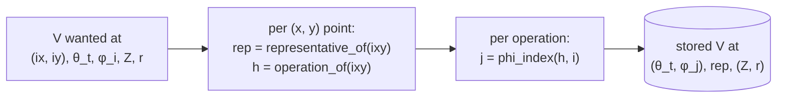
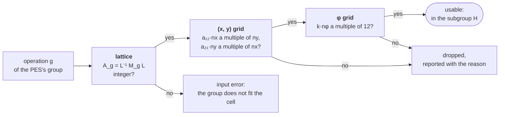

# Surface symmetry (`src/symmetry/`)

With `UseSymmetry`, the program computes and stores the six-dimensional potential at only one (x, y) point of each
set of symmetry-equivalent points, and looks the others up. On the DZ input (the thesis's Dai–Light calculation,
[inputs/thesis_fig5_3_dz](../../inputs/thesis_fig5_3_dz/README.md)) that is 19 of the 144 (x, y) points, so the
stored potential and its exp(−iV dt) table take 7.6 times less memory, on the CPU and on the GPU. On the synthetic C6v
data set of the CRP library (a 12 × 12 grid, nφ = 18), computing the potential took 1.3 s instead of 9.6 s
([performance.md](../../docs/performance.md#what-was-optimised-and-how-it-relates-to-the-fortran-code)).

Three input keys control it, all optional ([§1](#1-how-to-use-it)):

| Key | Default | Effect |
|---|---|---|
| `UseSymmetry` | false | store V at the symmetry-unique (x, y) points only |
| `nPhisOptimal` | false | with `UseSymmetry`: choose nφ so that the whole point group fits the φ grid |
| `SymmetryTolerance` | 1e-5 eV | how far the PES may deviate from its own symmetry at the self-check's samples |

The set-up output then shows a block SURFACE SYMMETRY OF THE POTENTIAL: the point group, the operations used,
"(x, y) points computed / total", the reduction factor and the self-check.

**How it works.** The point group G of the PES is a set of rotations about the surface normal and reflections in
vertical planes that leave the potential unchanged:

```math
V(g\rho,\; Z,\; r,\; \theta,\; g\varphi) \;=\; V(\rho,\; Z,\; r,\; \theta,\; \varphi) \qquad \text{for all } g \in G,
```

with ρ = (x, y) the position over the surface and gφ the transformed azimuth. The **orbit** of a grid point p is the
set of its images under the operations that fit the grid. One point of each orbit is its **representative**,
rep(p), and an operation h of the group maps p onto it: h p = rep(p). Then

```math
V(p,\; \theta_t,\; \varphi_i) \;=\; V\big(\mathrm{rep}(p),\; \theta_t,\; \varphi_j\big), \qquad j = \mathrm{phi\_index}_h(i),
```

where θ_t are the Gauss–Legendre points of the θ grid and j is the index of the image of φ_i under h. Only V at the
representatives is stored; a read goes through two small tables:



The orbits of an 8 × 8 hexagonal grid are drawn in [§5](#5-orbits-and-representatives). The symmetry is used for the
potential only, never for the wave packet ([§7](#7-why-the-wave-packet-does-not-use-it)). Also in this directory:
the surface lattice's reciprocal metric and the diffraction order of a channel, which the analysis uses
([§8](#8-the-lattice-beyond-symmetry-reciprocal-metric-and-diffraction-order)).

[1 How to use it](#1-how-to-use-it) ·
[2 Operations](#2-the-operations) ·
[3 Groups on the lattice](#3-the-point-groups-and-the-lattice) ·
[4 On the grid](#4-on-the-grid-which-operations-are-usable) ·
[5 Orbits](#5-orbits-and-representatives) ·
[6 The potential](#6-how-the-potential-uses-it) ·
[7 Not the wave packet](#7-why-the-wave-packet-does-not-use-it) ·
[8 Diffraction order](#8-the-lattice-beyond-symmetry-reciprocal-metric-and-diffraction-order) ·
[9 Differences from the Fortran](#9-differences-from-the-fortran-code) ·
[10 Files and tests](#10-files-tests-and-changing-the-code)

---

## 1. How to use it

Set `UseSymmetry: true`; the point group comes from the PES. With `nPhisOptimal: true` as well, the number of φ
points nφ becomes a multiple that the whole group fits: the smallest admissible FFT length of at least 2·MJMax + 1
(MJMax: the largest |mJ| of the rotational basis), as §4 explains. Without it, the program uses the largest part of
the group (a subgroup) that fits the grid you chose, and reports the operations it drops.

| Group | PESs | Grid needed for the whole group | Multiple of nφ |
|---|---|---|---|
| C2v | the hard wall | any nx, ny | 2 |
| C4v | C4v CRP data sets | nx = ny | 4 |
| C6v | Dai–Light, Persson, C6v CRP data sets | nx = ny | 6 |
| C3v | C3v CRP data sets (H₂/Cu(111) SRP48) | nx = ny | 6 |
| C3 | — | nx = ny | 3 (in practice 6, §4) |

CRP is the corrugation reducing procedure, the interpolated potentials of [docs/crp_library.md](../../docs/crp_library.md).

What is lost without a fitting grid: C6v on an 8 × 8 grid with nφ = 10 can use only 4 of its 12 operations and
stores 21 of the 64 (x, y) points instead of 10.

**Errors** (all input errors, exit code 2):

- the PES's group does not fit its cell (an operation is not a lattice symmetry, §3);
- only the identity is usable. The message names the cause: nφ not a multiple the group needs (set
  `nPhisOptimal`), the (x, y) grid (its operations fit it when nX = nY), or both. The input check already demands
  nX = nY for C4v, C6v and C3v (`validate_input`, as the Fortran), so the (x, y) cause can only arise for C3;
- the PES fails the self-check (§6): it differs from its symmetry images by more than `SymmetryTolerance`, or it is
  not finite at a sample. The message suggests raising the tolerance or switching `UseSymmetry` off;
- `UseSymmetry` with `CRPDistrtSurface`: the distorted slab of the SCM potential has no symmetry, although the CRP
  data set under it has (SCM D2 in [fortran_deviations.md](../../docs/fortran_deviations.md)).

nx or ny = 1 would leave no symmetry either; it cannot happen, because 1 is not a valid FFT length.

---

## 2. The operations

A surface operation (`SurfaceOperation`) is a rotation about the surface normal through the origin, or a reflection
in a vertical plane through it. Operations are active: they move the molecule, not the axes. Each is given by a
mirror flag and an integer k = 0 … 11 (`angle_twelfths`), with β = 2πk/12 = k · 30°:

| Operation | Cartesian position (x, y) | azimuth φ |
|---|---|---|
| rotation by β | R(β) (x, y) | φ → φ + β |
| mirror | R(β) diag(1, −1) (x, y) | φ → β − φ |

R(β) is the 2D rotation matrix. **A mirror's line lies at β/2 = k · 15°, not at β**: the mirror at 90° (the
reflection in the y axis) has k = 6, and `describe` prints it as "mirror at 90 deg". The polar angle θ, the height Z
and the bond length r are unchanged, since the bond's direction (sin θ cos φ, sin θ sin φ, cos θ) only turns
parallel to the surface.

**The origin.** Operations act about x = y = 0, and φ is measured from the first lattice vector a₁. The grid follows
the same convention: its (x, y) points start at the origin and its φ points at φ = 0 (`src/grids/spatial_grids.cpp`,
`src/grids/angular_grid.cpp`). A PES whose symmetry centre lies elsewhere would get the wrong group action; only
the self-check of §6 would notice.

Writing an operation as φ → sφ + β with s = ±1, the composition "first b, then a" is

```math
a \circ b:\quad \varphi \;\to\; s_a (s_b \varphi + \beta_b) + \beta_a \;=\; s_a s_b\, \varphi + (\beta_a + s_a \beta_b),
```

a mirror when exactly one of the two is (`compose`). A rotation's inverse is the rotation by −β, and a mirror is its
own inverse. The 24 operations form the dihedral group D₁₂ of order 24; every group below is a subgroup of it.

---

## 3. The point groups and the lattice

A point group (`PointGroup`) is built from its generators by closure: every element found so far is multiplied by
every generator until nothing new appears (`group_closure`). Five groups are defined, plus `none`:

| Group | Generators (k) | Order | Cell |
|---|---|---|---|
| C2v | rotation 180° (6), mirror at 0° (0) | 4 | rectangular |
| C4v | rotation 90° (3), mirror at 0° (0) | 8 | square |
| C6v | rotation 60° (2), mirror at 0° (0) | 12 | hexagonal |
| C3v | rotation 120° (4), mirror at 90° (6) | 6 | hexagonal |
| C3 | rotation 120° (4) | 3 | hexagonal |

The names are compared like the Fortran's `.SEQ.` (case-insensitive, outer blanks ignored); another name is an
input error.

**On the lattice.** The grid coordinates are skewed: x and y run along the lattice vectors a₁ = alat (1, 0) and
a₂ = blat (cos γ, sin γ), with γ = 90° for rectangular and square cells and 60° for hexagonal ones
(`SurfaceLattice`). In fractional coordinates (u, w) = (x/alat, y/blat), an operation with Cartesian matrix M_g acts
as

```math
\begin{pmatrix} u' \\ w' \end{pmatrix} = A_g \begin{pmatrix} u \\ w \end{pmatrix},
\qquad A_g = L^{-1} M_g L,\qquad L = \begin{pmatrix} \mathbf a_1 & \mathbf a_2 \end{pmatrix}.
```

g is a symmetry of the lattice exactly when its lattice matrix A_g has integer entries: it then maps lattice vectors
onto lattice vectors (`lattice_matrix`, integer to 1e-10). If an operation of the PES's group fails this test, the
group does not fit the cell. Lattice translations are symmetries of every periodic PES, so positions count modulo
the cell.

**C3v, worked out.** The six operations of C3v on the hexagonal lattice:

| Operation | k | A_g |
|---|---|---|
| identity | 0 | (1 0; 0 1) |
| rotation 120° | 4 | (−1 −1; 1 0) |
| rotation 240° | 8 | (0 1; −1 −1) |
| mirror at 30° | 2 | (0 1; 1 0): swaps a₁ and a₂ |
| mirror at 90° | 6 | (−1 −1; 0 1) |
| mirror at 150° | 10 | (1 0; −1 −1) |

(rows of A_g separated by ";"). The mirror lines are perpendicular to the lattice vectors: the plane group p3m1,
the symmetry of an fcc(111) surface about one of its threefold sites. The CRP data sets put a surface atom at the
origin (a top site) and the second layer under the hcp hollow (1/3, 1/3) (`src/potential/crp_potential.cpp`), and
these mirrors keep the fcc and hcp hollows apart. Mirrors at 0°, 60° and 120° would swap them (test
`PointGroup.C3vMirrorsKeepTheHollows`).

**What is not covered.** Mirrors must lie at multiples of 15° to a₁, and only the five groups above exist. A
centred-rectangular lattice (alat = blat, γ neither 60° nor 90°) in its primitive skewed cell has its mirrors along
a₁ ± a₂; the mirror along a₁ of `C2v` is not a lattice symmetry there, so the lattice test rejects the group.

---

## 4. On the grid: which operations are usable

The grid has nx × ny points in (x, y), at u = ix/nx and w = iy/ny, and nφ points φ_i = 2πi/nφ. An operation is
**usable** when it maps grid points onto grid points. In (x, y), A_g sends

```math
i_x' = a_{11}\, i_x + a_{12}\,\frac{n_x}{n_y}\, i_y \pmod{n_x},\qquad
i_y' = a_{21}\,\frac{n_y}{n_x}\, i_x + a_{22}\, i_y \pmod{n_y},
```

so a₁₂·nx must be a multiple of ny and a₂₁·ny a multiple of nx (`GridSymmetry::apply_to_xy`). In φ, operation k sends
index i to ±i + k·nφ/12, so k·nφ must be a multiple of 12. Every operation goes through the same three tests:



The usable operations form a subgroup H: products and inverses of grid-preserving maps preserve the grid
(`GridSymmetry.UsableOperationsFormASubgroup`). On the hexagonal lattice, every operation except the identity, C₂
and the mirrors at 0°, 60°, 90° and 150° has both off-diagonal entries nonzero, so it needs nx = ny; the mirrors at
0° and 90° need nx to be a multiple of ny, and those at 60° and 150° the reverse. On the square lattice, the 90°
rotations and the diagonal mirrors need nx = ny. Examples (`GridSymmetry.UsableSubgroupSizes`):

| Group, cell | nx × ny | nφ | Usable | Why |
|---|---|---|---|---|
| C6v, hexagonal | 8 × 8 | 12 | all 12 | — |
| C6v, hexagonal | 8 × 8 | 10 | 4: E, C₂, mirrors at 0° and 90° | k = 2, 4, 8, 10 need nφ to be a multiple of 6 |
| C6v, hexagonal | 8 × 6 | 12 | 2: E, C₂ | the others need nx and ny to be multiples of each other |
| C3v, hexagonal | 8 × 8 | 10 | 2: E, mirror at 90° | the rotations (k = 4, 8) and the mirrors at 30° and 150° (k = 2, 10) need nφ to be a multiple of 6 |
| C4v, square | 8 × 8 | 6 | 4: E, C₂, mirrors at 0° and 90° | the 90° rotations and the diagonal mirrors (k = 3, 9) need nφ to be a multiple of 4 |

**`nPhisOptimal`** (effective only with `UseSymmetry`; `src/input/process.cpp`) asks for nφ to be a multiple of

```math
m = \frac{12}{\gcd(12,\; k_1,\; k_2,\; \dots)}\qquad \text{(over all operations of the group)},
```

2 for C2v, 4 for C4v, 6 for C6v and C3v, 3 for C3 (`phi_points_multiple`). The program then takes the smallest
nφ ≥ 2·MJMax + 1 of the form m′ · 2^h · 3^i · 5^j · 7^k · 11^l with h ≥ 1, i ≤ 2 and j, k, l ≤ 1, where m′ = m/2 for even
m and m′ = m for odd m (`nearest_fft_size`). So C3 always gets a multiple of 6, and m = 6 can give a power of 3 beyond
the usual FFT-size rule (54 = 2 · 3³).

---

## 5. Orbits and representatives

`GridSymmetry::build_orbits` walks the (x, y) points in memory order (ixy = iy + ny·ix). The first point not yet in
an orbit becomes the representative of a new one, and every image of it gets:

- `representative_of(ixy)`: the index of its representative;
- `operation_of(ixy)`: the operation h that maps it onto the representative (the inverse of the first operation,
  in the group's order, that reached it).

For each usable operation a φ map holds the image index of every φ_i (`phi_index`). That is all the lookup needs:
two integers per (x, y) point and nφ integers per operation.

The orbits of an 8 × 8 hexagonal grid under C6v (nφ = 12). One letter per orbit, the representative in capitals; the
rows are sheared to show the 60° cell, and the ix labels belong to the bottom row:

```text
iy=7        b b f g h h g f
iy=6       c f c g i j i g
iy=5      d g g d h j j h
iy=4     E h i h e h i h
iy=3    D H J j h d g g
iy=2   C G I j i g c f
iy=1  B F g h h g f b
iy=0 A b c d e d c b
      0 1 2 3 4 5 6 7   <- ix
```

- A, at the origin, is the top site: every operation keeps it, so it is an orbit of one.
- e, at (4, 0), (0, 4) and (4, 4), are the bridge sites: an orbit of 3, each point kept by C₂ and two mirrors.
- The orbits of 6 lie on mirror lines; the orbits of 12 (h and g) are general points.
- The hollow sites, at a third of the cell, fall between the points of an 8 × 8 grid.
- The ten representatives all lie at ix ≤ 2, because they are the first points in memory order.

The same map to scale on the unit cell:


Look at how the green orbits of 6 sit on the dashed mirror lines and the blue orbits of 12 between them. The
figure comes from [figures/make_figures.py](figures/make_figures.py), which first checks that its orbit walk gives
the text map above letter for letter (`uv run --locked python -I -B src/symmetry/figures/make_figures.py`).

**How many representatives.** By Burnside's lemma, the number of orbits is the average, over the operations of H, of
the number of grid points each one keeps fixed:

```math
N_\mathrm{orbits} \;=\; \frac{1}{|H|} \sum_{h \in H} \big|\{\, p : h\,p = p \,\}\big| .
```

Points on mirror lines and rotation centres have smaller orbits, so N_orbits is above nx·ny/|H| (12 for C6v on 144
points):

| Group | nx × ny | nφ | Representatives | Source |
|---|---|---|---|---|
| C6v | 12 × 12 | multiple of 6 | 19 of 144 | the DZ input; the synthetic C6v CRP set |
| C4v | 12 × 12 | multiple of 4 | 28 of 144 | the synthetic C4v CRP set |
| C3v | 12 × 12 | multiple of 6 | 31 of 144 | the synthetic C3v CRP set |
| C6v | 8 × 8 | 12 | 10 of 64 | the map above |
| C6v | 8 × 8 | 10 (4 operations) | 21 of 64 | |

The 12 × 12 counts are those of [performance.md](../../docs/performance.md#what-was-optimised-and-how-it-relates-to-the-fortran-code)
and the DZ input's README; the 8 × 8 ones are tested in `GridSymmetry.RepresentativeCountsAgainstTheFortranRegions`.

---

## 6. How the potential uses it

The potential folder turns the symmetry into a smaller potential ([src/potential/README.md](../potential/README.md)).

- `make_grid_symmetry` builds the run's `GridSymmetry` from the PES's point group, or the trivial one without
  `UseSymmetry`.
- `PotentialGrid` evaluates the PES at the representatives only, and its `operator()` reads any full-grid point
  through the lookup. The potential is stored only for the interaction region (Z below the PES's asymptotic Z), so
  that is where the reduction applies. In the time loop the lookup happens in one place,
  `PotentialOperator::apply_interaction` (the potential step, [src/propagation/README.md](../propagation/README.md)),
  for the stored potential and for the precomputed exp(−iV dt) table alike. The GPU backend stores the same reduced
  arrays, and both memory estimates count representatives.
- **What the stored values mean.** At a point that is not a representative, the program uses V of its
  representative at the mapped φ. That equals V(p, φ_i) only as far as the PES is symmetric. For an exactly
  symmetric PES the difference is rounding; otherwise it is the PES's own asymmetry.
- **The self-check** (`check_potential_symmetry`; not in the Fortran) bounds that asymmetry before the potential is
  computed. It compares V with its images at 1000 sample configurations, after the VMin/VMax clipping, and fails
  above `SymmetryTolerance`. What it does and does not prove:
  - it is a sample, not a proof;
  - it tests only the usable operations, so a wrong group can pass when only a subgroup fits the grid;
  - Z is sampled only below the asymptotic Z;
  - it runs only with `UseSymmetry`, and not in analysis-only runs (they compute no potential);
  - it is the only guard of the origin convention of §2.

  The full description, with the sampling and an example of a PES that fails it:
  [src/potential/README.md](../potential/README.md), §4.

Tests: `SymmetricPotentialGrid.DaiLightGathersTheFullGrid`, `SymmetricPotentialOperator.BitwiseEqualToTheExpandedPotential`,
`SymmetricPropagation.AgreesWithTheFullPotential`; the gate case `cu111_dailight_short_sym` runs with C6v symmetry
([docs/validation.md](../../docs/validation.md)).

The homonuclear exchange symmetry (θ → π − θ, φ → φ + π) is not handled here: the rotational basis takes only one
J parity for a homonuclear molecule (`src/grids/`).

---

## 7. Why the wave packet does not use it

The exact Hamiltonian commutes with G when the potential is symmetric, so storing the wave packet reduced would be
possible in principle. It is not done, for three reasons.

- **The initial state is rarely symmetric.** ψ(0) is invariant under G only at normal incidence with mJ = 0. The
  parallel phase e^{iK∥·ρ} of oblique incidence (K∥: the incident momentum parallel to the surface) is kept only by
  the operations that fix K∥. The rotational factor e^{imφ} picks up e^{−imβ} under a rotation, and a mirror sends
  mJ to −mJ.
- **The kinetic operator of a skewed grid is not exactly symmetric.** T_xy, the kinetic energy parallel to the
  surface, has a cross term −2 cos γ k_x k_y/2M (k_x, k_y: the momentum components of the FFT grid). On a 60° cell:
  - C₂ keeps the FFT box, but on its Nyquist row and column (the index n/2, which stands for both +n/2 and −n/2 Δk)
    the cross term takes the sign of the wrong image;
  - the mirror at 30° swaps a₁ and a₂ and keeps the box and T_xy exactly (with nx = ny); the mirror at 120° keeps
    them up to the same Nyquist sign as C₂;
  - the rotations by 60° and 120° and the mirrors at 0°, 60°, 90° and 150° mix the indices and map momenta out of
    the box.

  So densities derived from ψ in a C6v case are symmetric only to about 2e-4 of their largest value on the 8 × 8 gate
  grid, in the Fortran as well
  ([flux_analysis_findings.md §7.1](../../docs/flux_analysis_findings.md#71-the-flux-density-on-a-skewed-grid-is-not-exactly-symmetric)).
  On rectangular and square cells (γ = 90°) T_xy has no cross term and is exactly symmetric.
- **The propagation and the analysis need the full grid.** The FFTs of T_xy and the projection onto the diffraction
  channels work on all (x, y) points.

---

## 8. The lattice beyond symmetry: reciprocal metric and diffraction order

The reciprocal vectors b₁, b₂ are defined by a_i · b_j = δ_ij (lengths in units of 2π). The squared length of
n b₁ + m b₂ is

```math
|n\,\mathbf b_1 + m\,\mathbf b_2|^2 \;=\; \frac{1}{\sin^2\gamma}\Big(\frac{n^2}{\mathrm{alat}^2} + \frac{m^2}{\mathrm{blat}^2} - \frac{2\,n\,m\cos\gamma}{\mathrm{alat}\;\mathrm{blat}}\Big),
```

the metric of the parallel kinetic energy (`reciprocal_length_squared`; test
`SurfaceLattice.MetricMatchesParallelKineticEnergy`).

The **diffraction order** of the channel (n, m) is the number of steps from (0, 0) to (n, m) on the reciprocal
lattice (`diffraction_order`). The steps are always ±b₁ and ±b₂. A diagonal ±(b₁ + b₂) or ±(b₁ − b₂) is added when
it is not longer than the longer of b₁ and b₂: b₁ + b₂ on a 60° cell, b₁ − b₂ on a 120° one. A step along that
diagonal covers n and m at once:

```math
\text{order}(n, m) \;=\; \begin{cases} \max(|n|, |m|), & n\,m > 0 \text{ with the step } \mathbf b_1 + \mathbf b_2, \text{ or } n\,m < 0 \text{ with } \mathbf b_1 - \mathbf b_2 \\ |n| + |m|, & \text{otherwise.} \end{cases}
```

So the order is |n| + |m| on rectangular and square cells. The reciprocal indices (n, m) transform with A_g^{−T}
under an operation g, and the steps are mapped onto steps, so the order is the same on every orbit of the point group.
It is not a shell of equal |G| (G here: the reciprocal vector n b₁ + m b₂): on a square lattice (2, 0) and (1, 1) both
have order 2 but different lengths (test `SurfaceLattice.OrdersAreShellsNotOrbits`). The analysis sorts its
diffraction channels by this order and finds the highest open order with it (`src/analysis/analysis_basis.cpp`).

---

## 9. Differences from the Fortran code

**The design.** The Fortran has one module per point group (`C2vSurfaceSymmetry.f90`, `C4vSurfaceSymmetry.f90`,
`C6vSurfaceSymmetry.f90`). Each hand-codes a region of the cell (for C6v "triangle 1" or "triangle A") and an index
for every (φ, θ, x, y) point into it. Only C6v is switched on; C2v and C4v are complete but switched off with a
warning, and C3v and C3 have no code. The C++ treats a group as data, two generators, and derives the rest:

- correctness rests on general properties, each tested once for all groups: the group axioms, that the grid action
  equals the geometric action, that the usable operations form a subgroup, and that the lookup reproduces an exactly
  symmetric function (`SurfaceOperation.GroupAxioms`, `GridSymmetry.GridActionIsTheGeometricAction`,
  `GridSymmetry.GatherReproducesAnExactlySymmetricFunction`);
- a grid that does not fit the whole group uses the largest subgroup that fits;
- a new point group is one line of generators (§10);
- the lookup needs two integers per (x, y) point instead of one per (φ, θ, x, y) point.

| What | Fortran | C++ | Why |
|---|---|---|---|
| groups with `UseSymmetry` | C6v only; C2v and C4v switched off (never validated), C3v and C3 not implemented | C2v, C4v, C6v, C3v, C3 | one engine for all; tested by runs with against without symmetry |
| `nPhisOptimal` with C3v or C3 | stops ("unknown symmetry!") | nφ a multiple of 6 or 3 | [input Q2](../../docs/fortran_deviations.md#input-q2) |
| the representatives | a hand-drawn region per group (triangle 1, triangle A, rectangle A) | the first point of each orbit in memory order | generic; the stored values agree as far as the PES is symmetric (§6) |
| the lookup | an index per (φ, θ, x, y) point | (representative, operation) per (x, y) point, a φ map per operation | smaller |
| C6v with nφ not a multiple of 6 | triangle A: 24 points stored on 8 × 8 | the subgroup {E, C₂, mirrors at 0° and 90°}, the same operations: 21 points (one per orbit) | generic; the test `GridSymmetry.RepresentativeCountsAgainstTheFortranRegions` asserts only that the C++ stores no more |
| only the identity usable | — | an input error | the requested reduction cannot happen |
| nx or ny = 1 | a warning, never reached | an error, never reached | both codes reject 1 as an FFT length first |
| PES self-check | none | `SymmetryTolerance` | a wrong group or a non-periodic PES would otherwise go unnoticed |
| diffraction order | a table per point group (`RotDifBasis.f90 getDiffractionOrder`) | from the lattice (§8) | identical integers for every Fortran group ([diffraction order](../../docs/fortran_deviations.md#diffraction-order); `SurfaceLattice.DiffractionOrderEqualsFortranTable`) |
| native checkpoint | — | records nφ | `nPhisOptimal` changes nφ |

All entries: [fortran_deviations.md, surface symmetry](../../docs/fortran_deviations.md#surface-symmetry-deviations).

---

## 10. Files, tests and changing the code

| File | Responsibility | Fortran |
|---|---|---|
| `surface_operation.{hpp,cpp}` | `SurfaceOperation`: rotations and mirrors; composition, inverse, action on φ and on Cartesian vectors | — |
| `point_group.{hpp,cpp}` | `PointGroup`: the groups from their generators, the closure, the φ multiple | `CxvSurfaceSymmetry.f90` |
| `surface_lattice.{hpp,cpp}` | `SurfaceLattice`: skewed ⇄ Cartesian coordinates, the lattice matrices, the reciprocal metric, the diffraction order | `RotDifBasis.f90 getDiffractionOrder` |
| `grid_symmetry.{hpp,cpp}` | `GridSymmetry`: the usable operations, the orbits, the representatives and the maps | `C2v/C4v/C6vSurfaceSymmetry.f90` |

The tests are in `tests/test_symmetry.cpp` (operations, groups, lattice, grid symmetry) and
`tests/test_potential_symmetry.cpp` (the run's symmetry, the self-check, the symmetric potential grid and
propagation).

| Change | Do also | Which check notices |
|---|---|---|
| a new point group | its generators in the `PointGroup` constructor and its name in the error message; the PES that has it names it | `PointGroup.OrdersAndElements`, `PointGroup.PhiPointsMultiple`, `LatticeAction.MatricesOfTheGroups` (add the group to each) |
| the same, for the wave-packet designer | its order and φ multiple in `tools/wave_packet_designer/program/point_group.py` (its `Shadows:` line names `point_group.cpp`) | nothing automatic: check by hand |
| the choice of representatives or the orbit walk | the potential is computed at other points: the numbers change as far as the PES is not exactly symmetric | `tools/check_bitwise_refactor.sh` (it includes a `UseSymmetry` Dai–Light run), the propagation gates |
| the diffraction order | the analysis's channel order and the highest open order change | `SurfaceLattice.DiffractionOrderEqualsFortranTable`, gate 4 |
