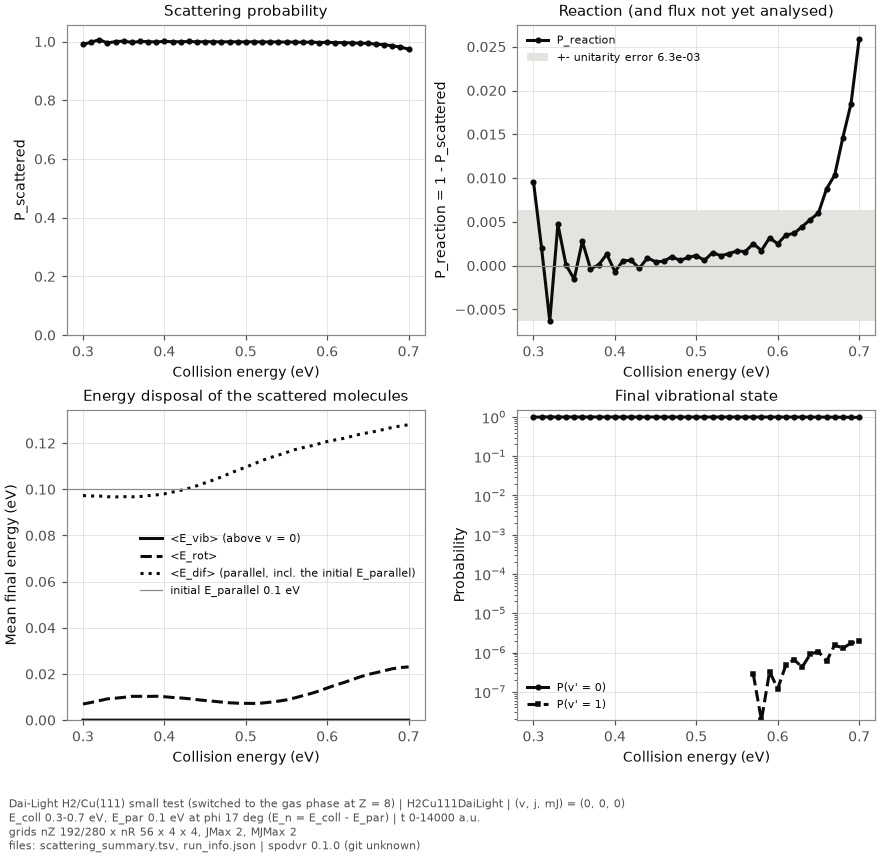
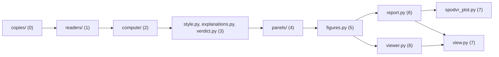

# Plots of a spodvr run

Figures and a report of one `spodvr` run, read from the files the run wrote: the run verdict (is the run
complete and converged?), the results against energy, the final rovibrational states, diffraction and the
scattering angles, time delays, the fine analysis, the Balint-Kurti coefficients, the averages, the packet's
density over (Z, r) against time (a run with `writeDensities`) and the gas phase. A run split into restart
segments is one run: give every segment's directory and the plots join them. The wave-packet designer
([tools/wave_packet_designer](../wave_packet_designer/README.md)) checks an input before a run; this tool looks at
what the run produced.

## Running

Once per checkout, `uv sync` (it builds the repository's Python environment, `.venv/`;
[README: Dependencies](../../README.md#dependencies)). Then, from the repository root:

```sh
uv run python -I -B tools/plots/spodvr_plot.py list                       # the figures and the files each needs
uv run python -I -B tools/plots/spodvr_plot.py verdict RUN...             # the verdict as text
uv run python -I -B tools/plots/spodvr_plot.py plot results RUN... --out DIR
uv run python -I -B tools/plots/spodvr_plot.py report RUN... --out DIR    # report.md + every figure
```



`plot` and `report` take `--energy EV` (the panels at one energy show the analysis energy nearest it; default
the middle one), `--channels N` (how many channels or levels the line plots show, at least 1; default 6),
`--azimuth DEG` (the in-plane direction at normal incidence; default 0, the first lattice vector; ignored at
oblique incidence, where the plane of incidence is used) and `--z BOHR`, `--r BOHR` (the point of the potential
maps: the nearest grid point; default the lowest barrier's).

- `RUN...` is the run's output directory, or every segment's directory of a restarted run, in any order.
  Segments that do not join (one does not start where another ended) are refused; a segment whose
  RestartDir names another directory gives a `warning:`. The last segment alone also works: its
  bk_coefficients.bin holds the whole run, its averages.dat only that segment.
- Each figure is written as `DIR/<stem>.png` (no metadata: reproducible bytes) and `DIR/<stem>.pdf`, a movie
  as `DIR/<stem>.gif` (GitHub plays it inline) and a PNG of its still (the last frame unless the movie names
  another); a stem starts with its entry's name (`frame_movie_site1`: one movie per site). The report opens
  with the verdict, then shows every figure whose files the run has, each with its title and what good looks
  like (`explanations.py`), and lists the figures it could not draw and why.
- `plot` and `report` write only into `--out`, and there replace only files the tool wrote before (listed in
  `DIR/written_by_spodvr_plot.json`): any other file of the same name stops them before they write anything.
- Runs made before spodvr wrote `run_info.json` are refused.

Exit status: 0 done (the verdict is advice and never changes it); 1 the report could not draw a figure or make
the verdict (report.md says which); 2 bad arguments, an unreadable run, a figure whose files the run does not
have (`plot`), or a file in `--out` that the tool did not write (`error: <file>: <what>; <fix>`). A traceback
is a bug of the tool.

| Figure | Shows | Needs |
|---|---|---|
| `verdict` | the run verdict as a text panel (the report prints it as text) | whatever the run has |
| `results` | P_reaction on a log axis (above and inside the unitarity error) and on a linear one with the unitarity-error band; the packet's energy spectrum \|a(E)\|² per eV; the mean final energies; P(v') (when two or more levels are scattered into) | scattering_summary.tsv |
| `state_to_state` | P(v', j') against energy and at one energy; P(mJ') and the alignment A0(2) (quantisation axis the surface normal) | s_matrix.tsv |
| `diffraction` | the spots at their Cartesian parallel momentum at one energy; P per order and the fraction out of the plane against energy | s_matrix.tsv |
| `scattering_angles` | polar and azimuthal angle of every open final state (summed over mJ') at one energy, and the specular direction | s_matrix.tsv, bk_coefficients.bin |
| `time_delay` | d arg S / dE of the strongest channels (each S referred to its analysis line), relative to a reflection at Z = 0, where the channel carries weight; their probabilities | bk_coefficients.bin, checkpoint.bin |
| `fine_analysis` | P_scattered of the on-the-fly and the fine analysis, and their difference | scattering_summary.tsv, fine_analysis/ |
| `averages` | norm, 1 − norm, rest norm, ⟨Z⟩ and ⟨r⟩ against time | averages.dat |
| `densities` | the probability per bohr of Z and of r against time (carpets; the specular analysis line on the Z one), the norm per region (r beyond r_c; Z bands up to zasymp, Zana, the grids' ends), 1 − norm and the probability inside each absorber | densities/ (`writeDensities`) |
| `density_movie` | ρ(Z, r) in bohr⁻², the scattering and the specular wave summed, on one log scale, with zasymp, Zana, the scattering grid's end, where each absorber begins to absorb and the specular analysis line (at most 30 frames) | densities/ (`writeDensities`) |
| `gas_phase` | V_asy(r) with the levels of the initial j and the r absorber; \|ψ(r)\| of the lowest levels on a log axis | gas_phase_states.dat, asymptotic_potential.dat |
| `potential_maps` | over the unit cell: the minimax barrier of each (x, y) point; V_min (V minimised over the DVR nodes) at the lowest barrier's (Z, r) or `--z`, `--r`; V_min at that Z and the gas-phase bond length; the sites and the lowest barrier's point marked | potential/ (`writePotential`), asymptotic_potential.dat |
| `elbows` | V_min(Z, r) at the first four sites (or the lowest barrier's point) with the minimax barrier at the run's nodes and a path to it (or "no saddle"); V at the barrier's node with its own barrier | potential/, asymptotic_potential.dat |
| `orientation` | V at every DVR node (θ, φ), as a map, at the barrier point of the site with the lowest barrier | potential/ with `PlotSites`, asymptotic_potential.dat |
| `frame_movie` | a movie per site (or the cell's origin): ρ(Z, r) of the whole packet ψ_full at that (x, y) point, with V_min's contours when potential/ exists; its PNG is the frame when most of the packet is below zasymp | frames/ (`dtFrames`) |
| `xy_maps` | the probability over the unit cell below zasymp when most of the packet is there, and inside the r absorber (below zasymp, r ≥ r_c) when the most is there | frames/ |
| `rotational_states` | P(J, mJ; Z) when most of the packet is below zasymp, and the J populations against time (χ beyond the scattering grid in the initial J) | frames/ |
| `basis_edges` | left the probability at the top J and the top \|mJ\| (when below the top J); right how much the first and last r points (both grids) and the first Z points gain above the first frame, against the verdict's limit | frames/ |
| `steric` | the distribution of the molecular axis per steradian (normalised over the sphere) at the DVR nodes, at the densest Z below zasymp when most of the packet is there and at the densest Z of the last frame | frames/ with `FrameExtras` `angular` |
| `diffraction_z` | P(n, m; Z): the probability per parallel-momentum order against Z (the six largest over both panels, the rest summed), at the surface and in the last frame | frames/ with `diffraction` |
| `vibration_z` | P(v; Z): the probability per gas-phase level against Z (the analysed v, from s_matrix.tsv; the other levels below V_asy at the last r point; those above it), at the surface and in the last frame | frames/ with `vibration`, gas_phase_states.dat, asymptotic_potential.dat |
| `rotation_moments` | ⟨P₂(cos θ)⟩ and the rotational kinetic energy ⟨J(J+1)/(2μr²)⟩ against Z in the first frame, at the surface and in the last frame | frames/ with `rotation_moments` |
| `momentum` | P(k_r) of ψ_full and P(k_Z) of the specular wave in three frames; what the run brings to the edges of the momentum grids (and to the outer diffraction orders) against time, against the verdict's limit | frames/ with `momentum` |
| `norm_budget` | where the norm went: what each absorber took, summed over the analysis windows, against the norm that left the grids; the residual against its error estimate | norm_budget/ (`NormBudget`) |
| `pes_cut` | V(Z, r) of the PES itself (no switching, no VMin/VMax) at the fixed x, y, θ, φ of a `write2DPES` run, with its minimax barrier | pes_cut_2d.dat, asymptotic_potential.dat |
| `bk` | \|c(t)\|² of the strongest channels; how far P_scattered(E) is from its final value if the time sums stopped at t | bk_coefficients.bin (one record at least) |

Every figure also reads `run_info.json` (the run's metadata). The file formats:
[docs/output_files.md](../../docs/output_files.md).

### The verdict

Each finding has a severity, its value against a limit, what it means and the section of
[inputs/README.md](../../inputs/README.md) that explains it, worst first. Thresholds are named constants in
`compute/diagnostics.py`, each marked *derived* (from the physics or inputs/README.md) or *heuristic* (a
judgement); `verdict.py` reads the run's files for them.

| Finding | Severity | When |
|---|---|---|
| run incomplete | error | averages.dat, scattering_summary.tsv or s_matrix.tsv missing: the program writes them after the propagation, so the run stopped early or is still running (bk_coefficients.bin, appended every analysis step, shows how far it got). Then no other check runs (but "propagation diverged") |
| propagation diverged | error | a NaN or inf in averages.dat or bk_coefficients.bin |
| unanalysed flux, upper bound | warning | more than 1e-3 of the norm still inside the analysis lines at tEnd (`checkpoint.bin`), summed over all energies |
| P_scattered still moving | warning | P_scattered changed by more than max(1e-3 P_s, 1e-4) over the last 10 % of the run at some energy: the check per energy |
| unitarity error | warning | P_reaction below −1e-4 |
| flux at the edge of the basis | warning | more than 1e-3 of P_scattered in j′ = JMax, or in the outermost analysed diffraction channels (s_matrix.tsv) |
| packet at the edge of the basis: a grid edge | warning | in some frame (frames/), more than 1e-6 of the initial norm beyond the first frame's at the first or last 2 r points (both grids) or the first 2 Z points (the FFT wraps the packet around) |
| packet at the edge of the basis: … (momentum grid, above the first frame's) | warning | in some frame, the probability at \|k\| above 0.8 of a momentum grid's largest (k_r of ψ_full, k_Z of the specular wave χ; `FrameExtras` `momentum`) or in the orders with \|n\| or \|m\| above 0.8 of the largest (`diffraction`) rises by more than 1e-6 of the initial norm above the first frame's: the FFT folds larger momenta over (the 0.8: `NYQUIST_FRACTION` in `compute/frame_extras.py`) |
| packet at the edge of the basis: top J or \|mJ\| | information | in some frame, more than 1e-6 of the initial norm in the top J, or in the top \|mJ\| when it is below the top J: normal while the packet is at the surface; the j′ check of the S matrix decides whether the basis is large enough |
| norm budget does not close | warning | the norm that left the grids minus the absorbers' summed losses exceeds its error estimate by more than 1e-4 of the initial norm (norm_budget/) at some window end |
| gas-phase states reach the ends of the r grid | warning | \|ψ_v,j\| at either end of the r grid above 1e-3 of its maximum, for the analysed levels (gas_phase_states.dat); the advice names the end: a smaller RStart (the first point) or a longer r grid (the last) |
| slowest converged energy | warning above 1e-3, else information | E_n,min of inputs/README.md section 8 (Z_turn 2 bohr), and the probability already in the channels that leave with a normal energy below it |
| norm left | information, always | the norm at tEnd: it includes flux already analysed but not yet absorbed, and bounds only the error averaged over the packet's spectrum |
| norm by region at the end | information | where the norm left sits at the last densities/ record: below Zana not yet analysed; between Zana and the specular analysis line the specular wave not yet either (the rest norm), the scattering wave already; beyond both lines analysed but not yet absorbed; r ≥ r_c dissociating (counted as reaction). A densities/ that cannot be read is a "not checked" finding |
| not checked: … | information | a check the run's files do not allow: no checkpoint.bin (`CheckpointFormat` `fortran`), fewer than two BK records, or a run that does not propagate (potential only, analysis only, a write2DPES run) |

E_n,min is a lower bound on the time a run needs: "P_scattered still moving" is the empirical check. The
report shows the verdict as a table; `verdict` prints it as text.

### The viewer

An interactive window on a run's frames/ (`dtFrames`), with potential/ for the contours when the run wrote it:

```sh
uv run tools/plots/view.py <run directory>...                    # the window (uv installs PyQt6 once)
uv run tools/plots/view.py <run directory>... --self-test DIR    # drives it, saves 4 PNGs into DIR, closes it
```


- Left: the probability per area over the unit cell (drawn skewed as it is), summed over a window of Z and r (the
  two range sliders, in bohr; it opens on the points below zasymp), with the probability in the window in the
  title; a window holding less than 1e-8 of the initial norm is left empty. The sites are marked where PlotSites
  puts them (filled, labelled) and at their symmetry-equivalent points (open: the run's point group and the
  lattice; also in `xy_maps` and `potential_maps`). A click picks the grid point whose drawn cell holds it. Its colour scale is the frame's own, or (the Scale button) one over all frames.
- Right: ρ(Z, r) above the picked point (the first site of PlotSites at the start), one log colour scale over all
  frames, with V_min's contours, Zana, the end of the scattering grid and where the absorbers start.
- The time slider (a.u.) picks the frame, Play steps through them; hovering shows what a panel or control shows,
  Explain lays the panels' explanations over them, the key s saves the window as a PNG in the working directory.
- The screenshot is the self-test's third PNG on the `dailight_oblique` fixture (`ctest -R '^PlotRuns\.'` writes it
  into `build/tests/plot_fixtures`).
- Without a window (no display, or no GUI backend) it says so and writes the frame movies of the sites into
  `--out` (spodvr_plot.py's `frame_movie`). On WSL2 the window opens through WSLg.

## Architecture

The tool is plain numpy and matplotlib in layers; a module imports only from lower layers (or its own
package), which `tests/test_structure.py` checks. An arrow means "is used by":



| Module | Responsibility | Shadows (the C++ it follows) |
|---|---|---|
| `copies/s_matrix.py` | the S matrix from the BK coefficients: time sums, prefactor, phases, the packet's weight of k0 | `src/analysis/s_matrix.cpp` |
| `copies/real_compare.py` | the tolerant comparison `rne` | `src/core/real_compare.hpp` |
| `readers/errors.py` | `ReadError`, the one error the tool raises for a run it cannot read | — |
| `readers/tables.py` | averages.dat and the tab-separated tables (read by column name), the gas-phase files | `src/report/propagation_report.cpp`, `analysis_files.cpp`, `sections.cpp` |
| `readers/binary.py` | bk_coefficients.bin, checkpoint.bin (memory-mapped); the byte layouts as named struct formats | `src/io/checkpoint.cpp` |
| `readers/run_info.py` | run_info.json as `RunInfo` | `src/report/run_info_file.cpp` |
| `readers/fine_analysis.py` | fine_analysis/grid.json (its tables are read by `readers/tables.py`) | `src/report/fine_analysis_report.cpp` |
| `readers/arrays.py` | series directories (densities/): the manifest, the complete records (memory-mapped), the first non-finite record; array directories written once (potential/) | `src/io/series_writer.cpp` |
| `readers/potential.py` | potential/: V_min and its orientation, V at the sites, the grids, nodes and limits; the datasets' axes and shapes checked | `src/report/potential_files.cpp` |
| `readers/frames.py` | frames/: the joined records, the grids, the rotational states, the sites, and the `FrameExtras` datasets with their grids (DVR nodes, J values) | `src/report/frame_files.cpp` |
| `readers/norm_budget.py` | norm_budget/: the joined windows and the absorbers of the loss datasets | `src/report/norm_budget_files.cpp` |
| `readers/pes_cut.py` | pes_cut_2d.dat (`write2DPES`): V(Z, r) of the cut, its grids, position and orientation; whole r blocks checked | `src/report/pes_cut_file.cpp` |
| `readers/sites.py` | the sites of PlotSites as the plot data record them (fractions, grid point, the ixy check) | `src/input/validate_outputs.cpp` |
| `readers/densities.py` | densities/: its directory name, datasets and grids (`DensityGrids`); read and joined through `readers/arrays.py` and `readers/segments.py` | `src/report/densities_files.cpp` |
| `readers/segments.py` | restart segments in time order; records of averages.dat and of series joined (a repeated record must equal the kept one to 1e-12 of its largest value) | — |
| `compute/analysis.py` | a run's analysis energies, analysis time step and S-matrix factors (run_info.json); the BK channel of each s_matrix.tsv row | — |
| `compute/grids.py` | the Cartesian parallel momentum K of a diffraction channel on the skewed lattice; Cartesian positions and periodic cells of the (x, y) grid, the grid point nearest a Cartesian point (the viewer's click); the r absorber's first point; a probability per cell as a density per volume | `src/input/process.cpp` (in its docstring) |
| `compute/states.py` | P(v', j'), P(mJ'), the alignment A0(2) and its limits, the (v', j') map | — |
| `compute/diffraction.py` | P per channel and order, in and out of plane, the scattering angles (summed over mJ') | — |
| `compute/results.py` | probabilities, mean energies and the unitarity error against energy | — |
| `compute/time_series.py` | BK coefficients per channel, P_scattered when the time sums stop at t, time delays | — |
| `compute/gas_phase.py` | the levels and which are bound | — |
| `compute/potential.py` | energies relative to the gas-phase minimum, the minimax barrier on V(Z, r) (at one and at every (x, y) point), the points the figures show, the DVR nodes' cells | — |
| `compute/frames.py` | from frames/ (read through `usable_frames`, which drops the records from the first NaN or inf on): ρ(Z, r) at a grid point and V_min's contours there, the probability over the cell in a (Z, r) window, J populations, the shares at the basis edges and the grid edges' rises | — |
| `compute/frame_extras.py` | from the `FrameExtras` datasets of frames/: the orientation per steradian, P(n, m; Z) and P(v; Z) split into labelled parts, the rotational moments, the momentum grids and the probability at their edges | — |
| `compute/norm_budget.py` | from norm_budget/: each absorber's loss summed over the windows, the residual and its error estimate, and whether the budget closes (one check for the verdict and the figure) | — |
| `compute/series.py` | any series: the records before a NaN or inf (with a note), records evenly spaced for a movie | — |
| `compute/densities.py` | from densities/: both waves summed, Z and r profiles, the norm per region and inside each absorber, the specular line, the marks of a map | — |
| `compute/diagnostics.py` | the verdict's findings and their thresholds | — |
| `verdict.py` | the verdict of a run: reads what its files allow, a missing file is a finding | — |
| `style.py` | colours, rcParams, the scale rule, the info box, saving figures and movies (`Movie`) | the designer's colours (`tools/wave_packet_designer/plots.py`) |
| `explanations.py` | each figure's title and what it shows (printed under it in the report); the viewer's panels and controls (`PANELS`, `CONTROLS`) | — |
| `panels/*.py` | one `draw_<panel>(ax, …)` per panel; draws (and masks values outside its range: below a floor, or above a cap where the background is hatched), computes nothing | — |
| `figures.py` | one `figure_<name>(runs, info, options)` per entry, and `PLOTS`, the only list of entries | — |
| `report.py` | report.md with the verdict first; the overwrite guard of `plot` and `report` | — |
| `spodvr_plot.py` | the command line | — |
| `viewer.py` | the viewer's window (`FrameViewer`: the state, the widgets wired to the panels of frames/), its self-test; the only module that uses pyplot | — |
| `view.py` | the viewer's entry (PEP 723 header: numpy, matplotlib, PyQt6) | — |

To change… edit:

- a threshold of the verdict: its constant in `compute/diagnostics.py` (the texts are formatted from it; the
  tests in `tests/test_diagnostics.py` fire just above each limit);
- which files the verdict reads: `verdict.py`;
- a colour, a font or the scale rule: `style.py` (the only place with colours);
- a figure's title or the text under it: `explanations.py`;
- the viewer's layout, controls or help texts: `viewer.py`, `explanations.py` (`PANELS`, `CONTROLS`);
- a file format the program writes: the reader whose `Shadows:` line names that writer
  (`grep -rn 'Shadows:.*<file>' tools/plots`); the fixture runs (written by the current program) fail the
  readers' tests until it follows.

### Conventions

- Write for a reader who knows Python and the physics: short functions, type hints and a docstring on every
  function (ruff's D1 and ANN rules for this tool, set in the repository's `pyproject.toml`), descriptive names
  with a unit suffix on every dimensioned value (`_ev`, `_hartree`, `_bohr`, `_au`, `_per_bohr`; none =
  dimensionless); unit factors from `RunInfo`, never module constants.
- Readers, `copies/` and `compute/` never print or draw; panels never compute; figures are
  `matplotlib.figure.Figure` objects (no pyplot; only `viewer.py`, the window, uses it). These are kept by review.
- Dataclasses are `@dataclass(frozen=True, kw_only=True)`: immutable (a changed copy through
  `dataclasses.replace`) and built with keywords; older ones follow when a change touches them.
- `tests/test_structure.py` checks: the layers; numpy only in layers 0–2 and matplotlib from layer 3 up (no
  other third-party package); functions of at most 40 code lines (except in `copies/`); a docstring on nested
  functions too; decorators only `@dataclass`, `@pytest.fixture` and `@pytest.mark.parametrize`; no classes
  but dataclasses, `ReadError` and the viewer's window `FrameViewer`; no lambda or `partial` in `figures.py`; no `matplotlib.use`; no test
  module importing a name that starts with `Test`; every `Shadows:` line names an existing C++ file and a
  function it defines or calls.
- `copies/` reproduce the C++'s formulas and, where they are plain double arithmetic, its operation order; the
  time sums are a matrix product (the C++ adds term by term), equal to rounding.
- Values outside a panel's range are masked (not drawn: below a floor, or above a cap, e.g. the potential walls,
  where the background is hatched); axes are logarithmic when a series spans more than 1e3
  (`style.scale_and_limits`); every axis is labelled with its unit; the info box under each figure names the run,
  its grids, the files read and the program version (a figure with notes asks `new_figure` for room for them).
- Errors: `ReadError("<file>: <what>; <fix>")`.

### How to add a plot

1. A reader and its test, only for a new file.
2. A compute function and a test against a hand-computed value or the program's files.
3. The panel: `draw_<panel>(ax, data…)` in `panels/<topic>.py`.
4. A `figure_<name>` in `figures.py` (the first line of its docstring is what `list` prints), its line in
   `PLOTS` (from there `list`, `plot` and `report` find it), and its title and text in `explanations.py`.
5. A content test (the texts, marks and curves the panel must show) in `tests/test_runs_figures.py`, and the
   figure's name in that test's `EXPECTED` table for each kind of run that has its files (`ALL` and
   `PROPAGATING` follow `PLOTS`; the stopped, potential-only and write2DPES kinds list their entries).

The averages figure, as `figures.py` has it (its info box also counts the segments):

```python
def figure_averages(runs: list[Path], info: RunInfo, options: argparse.Namespace) -> Figures:
    """The norms and mean positions against time, the segments joined."""
    averages, starts_au = read_joined_averages(runs)                  # read (readers/segments.py)
    fig = new_figure()                                                # style.py: the look, the info strip
    left, right = fig.subplots(1, 2)
    draw_norm(left, averages.times_au, averages.norm, averages.rest_norm, starts_au)   # one line per panel
    draw_mean_positions(right, averages.times_au, averages.z_mean_bohr, averages.r_mean_bohr, starts_au)
    add_info_box(fig, info, ["averages.dat", "run_info.json"])        # the files it read
    return [("averages", fig)]                                        # (file stem, figure)
```

and in `PLOTS`: `("averages", figure_averages, ["averages.dat"])`, the files it needs in the run directory.

A movie returns `Movie(fig=fig, update=update, n_frames=n)` (`style.py`) instead of a figure. `update(k)`, a function nested
in the figure function, clears the axes, calls the same `draw_<panel>` for frame k and sets the time in the
info box; the colour scale is fixed for all frames before the first, and `update` must not change what the
layout depends on (axes, colour bars), because `save_movie` fixes the layout after the first frame.
`figure_density_movie` is the example; the report saves a movie as a GIF and a PNG of its still, the last frame
unless `still=k` names another (`figure_frame_movie`: the frame when most of the packet is below zasymp).

## Tests

pytest, one ctest per test module, registered by a glob in the repository's `tests/CMakeLists.txt`: the file
name decides how. `tests/test_runs_<name>.py` becomes `PlotRuns.<name>`: it reads the fixture runs, which the
C++ test `PlotRuns.Fixtures` ([tests/test_plot_fixtures.cpp](../../tests/test_plot_fixtures.cpp)) writes with
the current program into `build/tests/plot_fixtures` (about 280 s at 8 threads; ctest runs it first), and gets
`--fixture-runs`. Any other `tests/test_<name>.py` becomes `Plots.<name>` and runs without them.
`tests/conftest.py` also makes runs that stopped early from one fixture. Helpers shared by test modules live in
modules without the `test_` prefix (`tests/frame_helpers.py`, `tests/absorber_profiles.py`), imported as
`tests.<module>` (tests/ has no `__init__.py`). The `PlotRuns.*` tests are not in the
quick tier: after changing the tool, run them too ([docs/CONTRIBUTING.md](../../docs/CONTRIBUTING.md#testing)):

```sh
OMP_NUM_THREADS=8 ctest --test-dir build -R '^(PlotRuns|Plots)\.'
uv run python -I -B -m pytest -c tools/plots/pytest.ini --rootdir=tools/plots tools/plots \
    --fixture-runs=build/tests/plot_fixtures
```

The fixtures are small and not fully converged; `tests/test_runs_diagnostics.py` asserts the findings each
one raises. The S matrix rebuilt from `bk_coefficients.bin` with `copies/s_matrix.py` must equal
`s_matrix.tsv` to 1e-12 of the largest |S| at each energy (`tests/test_runs_s_matrix.py`): the check that the
BK reader, the time sums, the prefactor and the phases are right. The densities/ records must sum to the norm of
averages.dat (1e-13), give its ⟨Z⟩ and ⟨r⟩ (1e-12), equal the probability per cell of the wave function in
`checkpoint.bin` (1e-12 of the largest cell, also mid-run, in a restart's first segment), and a split run's
segments must join to the unsplit run bitwise (`tests/test_runs_densities.py`). potential/ must hold V_min equal to
the minimum of each site's values over the nodes and the stored node's value (bitwise), and the hard wall's V equal
to its formula, computed in numpy, within 1e-15 of d + V_z (`tests/test_runs_potential.py`). The write2DPES cut,
taken at a site and a DVR node, must equal that site's V in potential/ where neither switching nor a clamp changed
it (`tests/test_runs_pes_cut.py`). frames/ must sum to the norm, give the densities' (Z, r) cells summed over (x, y)
and the cells' sums per Z summed over the rotational states (1e-13), equal ψ_full rebuilt in numpy from
`checkpoint.bin` with s2s from its Cartesian formula (1e-12, at the end and mid-run; with conj(s2s) it fails where
the cross terms matter), and a split run's frames must join to the unsplit run's bitwise
(`tests/test_runs_frames.py`). The `FrameExtras` datasets must sum to the frame's probability at each Z (1e-13)
and equal numpy on the checkpoints (1e-12): the angular one through normalised associated Legendre functions built
from numpy's Legendre series on numpy's Gauss-Legendre grid (without the cross terms of ψ_scat and s2s·χ it fails
mid-run), the diffraction one through numpy's FFT of exp(−i k∥·R) ψ_full (without the shift it fails at oblique
incidence), the vibration one through the levels of gas_phase_states.dat, the momenta through numpy's FFTs, the P₂
elements through a 64-point quadrature; ⟨P₂⟩ agrees with the DVR quadrature within 1.5 P(J = JMax); on the hard wall
nothing leaves the (0, 0) order (1e-14) and the vibrational populations follow a numpy split-operator propagation of
the r motion alone (1e-12) (`tests/test_runs_frame_extras.py`). norm_budget/ must equal a numpy recomputation from
the densities' cells and the absorbers of run_info.json (losses and error indicators, 1e-12), close (the residual within its error estimate) on
the hard-wall fixtures and open on the coupled one while the packet is at the surface, have an error indicator that
falls with dtAna squared (from 10 to 4 a.u.: within 4 to 9), chain its window norms bitwise, and join a split run to
the unsplit one bitwise (`tests/test_runs_norm_budget.py`).

## Limits

- One run at a time (its restart segments joined); no comparison of runs. A run in several segments is joined in
  memory: its series are read whole (frames/ of a production run: about 1.3 GB), one segment's stay memory-mapped.
- The potential is the run's (except in `pes_cut`, the PES itself at the one orientation of a write2DPES run, over
  the whole Z grid): at its grid points of Z < zasymp and its DVR nodes only (no interpolation); V_min is
  the lower envelope over the nodes at fixed (x, y) (no rotational or zero-point energy), and the minimax barrier
  is taken on that grid at those nodes, from the gas-phase side to r >= r_c (the r absorber's first point): the
  PES's own barrier can be lower when the best orientation lies between nodes. The barrier search is plain
  Python: on a 16 x 16 (x, y) grid of 160 x 64 (Z, r) points the barrier map takes up to about 5 s (measured with
  every point explored).
- Only what the run's files hold: the wave packet is seen through its (Z, r) density (`writeDensities`) and its
  frames (`dtFrames`: over (x, y) and the rotational states; with `FrameExtras` also its orientation, parallel
  momenta, vibrational levels, rotational moments and momenta, all on the run's own grids).
- The fine analysis is compared with the on-the-fly results of the same run; an `onlyAnalysis` run (its
  results only in `fine_analysis/`) is not plotted yet.
- Time delays are in atomic units of time, like every time axis of the tool (1 a.u. = 0.0242 fs).
