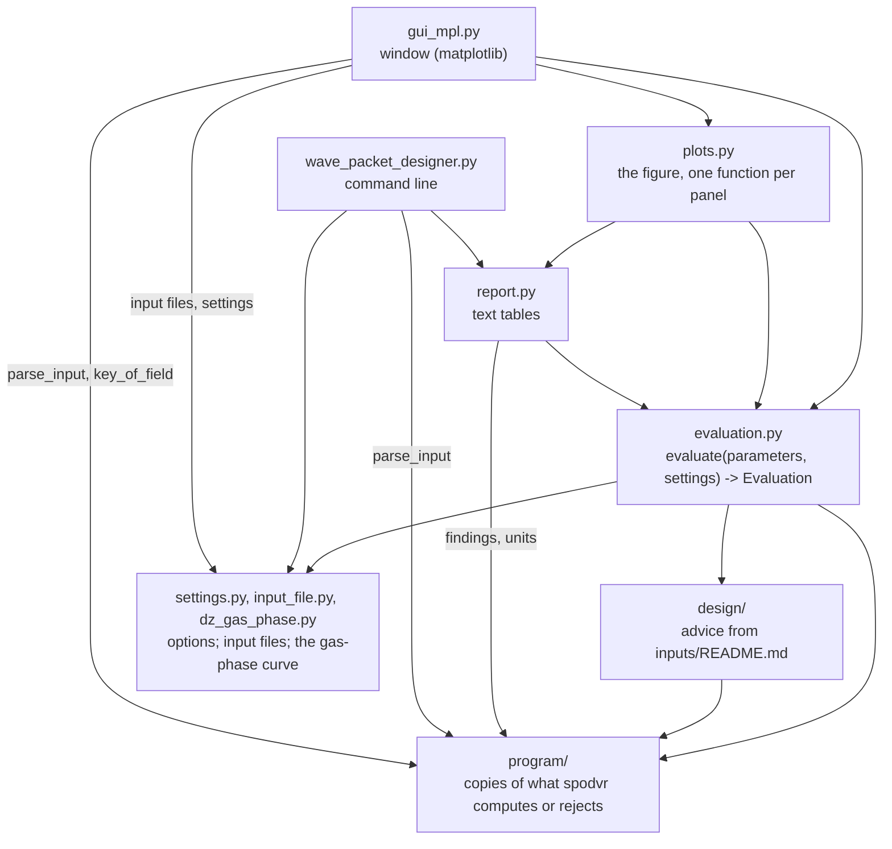

# Wave-packet designer

A standalone Python tool for setting up the Z and r part of an input: the Z grids, the initial wave
packet, the absorbers and the r grid. It tells you, before any run, whether `spodvr` accepts the input
and what the packet, grids and absorbers look like. It needs no build of the program: it carries copies
of the program's rules (marked as such, see [Keeping up with the C++](#keeping-up-with-the-c)).

The physics behind the choices (packet width, momentum margins, absorber lengths, …) is explained in
[inputs/README.md](../../inputs/README.md); this tool applies it.

## Running

Two ways, both from any directory (paths are relative to where you start them):

- **The window** (matplotlib): the figure below with sliders for the recipe's knobs. It needs
  [uv](https://docs.astral.sh/uv/) (`pipx install uv`, like pre-commit in the repository's README), which
  installs numpy, matplotlib and PyQt6 from the header of `gui_mpl.py` the first time. Under WSL the window
  opens through WSLg.
- **The command line**: text reports; needs `numpy` (the repository's `python3` has it), and matplotlib
  for `check --png`.

```bash
uv run tools/wave_packet_designer/gui_mpl.py                                   # the DZ input
uv run tools/wave_packet_designer/gui_mpl.py inputs/thesis_fig5_3_er/input.json
python3 -I -B tools/wave_packet_designer/wave_packet_designer.py check inputs/thesis_fig5_3_dz/input.json
```


The window on the DZ input (the first command above), with the mouse over the Z panel: the help box at
the bottom right explains that panel. The memory is the worst case, because the command gives no
`--representatives`; the RAM and the free GPU memory are those of the machine it ran on. To refresh the
picture after changing the window, open it the same way, keep the mouse over the Z panel and press `s`
(matplotlib's save key); the empty strip below the buttons was cropped.

The window shows six panels, a verdict and a help box:

- **Z**: the two Z grids as lanes (the scattering grid with its interaction region and absorber, the
  specular grid with its absorber and the packet's allowed region), and the initial packet |ψ(Z)|².
- **Z momentum**: |ψ(k)|² against the grid's limits ±π/dZ, with the outward fraction of the norm.
- **Absorbers**: reflection R and transmission T of each absorber over the energies it must absorb, with
  the levels of the README's examples.
- **r**: for each analysed vibrational level, the norm of the bound state beyond r, against the 1e-6
  limit and ROptStart.
- **Memory**: the peak memory on the CPU and the GPU against this machine's RAM and free GPU memory.
- **Time**: the classical paths Z(t) of the packet's fast, central and slow parts, in from Z0, reflected at
  a turning point Z_turn and, elastically, back out across Zana; and an outgoing wave of the lowest normal
  energy E_n,min that tEnd should converge (section 8). The slow part's elastic recrossing is a lower bound
  for tEnd; E_n,min (0.03 eV by default) sets what tEnd needs for the slow inelastic and diffractive
  channels.

The verdict (the eighth panel) says what `spodvr` would do with the input, then each recommendation of
inputs/README.md it misses, worst first (the run fails, the results suffer, it costs more), with its
value, limit and what to change; then the grid sizes, the absorbers as placed and tEnd, and what nothing
here checks. Hovering over a panel, a slider or a button explains it in the help box; **Explain** lays the
explanations over the panels (the texts are in `explanations.py`).

The window opens on the input as read. The sliders are EMinWP, EMaxWP, dZ, Z0, ZSpOptStart, the lengths
of the Z absorbers, dR, nR, ROptStart, tEnd, the target energies of the absorbers tuned by energy, and
E_n,min; each keeps a black tick at the input's value. When dZ, ZSpOptStart or an absorber length moves, the Z grids follow as
the recipe places them (Zana on the first grid point at or beyond Z_asymptotic; nZ and nZSpecular the
smallest valid FFT sizes that hold the absorbers, which end on their last points); tEnd moves in whole
averaging intervals dtAve. **Suggest** applies the recipe, **Reset** returns to the input, and **Save**
writes the changed input to the file named in the box (never over an existing file). Options:
`--zasymp` and `--point-group` (CRP data sets), `--threads`, `--representatives` and `--operations`
(memory, as for `memory` below), `--ram` and `--gpu` (GiB, instead of this machine's), `--zturn` (bohr, the turning point of the time
budget; 2 by default, ZStart for the worst case).

| Command | What it does |
|---|---|
| `check <input.json>` | Runs the program's input checks and set-up stages on the input and prints the packet, the Z grids, the absorbers, the r grid, the gas-phase channels, the design checks of inputs/README.md and the absorbers' R + T. |
| `check <input.json> --png figure.png` | The same, and the window's figure in a PNG file. |
| `check <input.json> --zasymp Z --point-group G` | The same for a CRP data set (SystemID `CRPlibrary`, `CRPDistrtSurface`), whose Z_asymptotic and point group come from the data set (the program's set-up output prints both). |
| `memory <input.json> [--threads N]` | The sizes that set the memory (θ and φ points, rotational basis, grid points) and the program's CPU and GPU memory estimates, array by array. `--threads` (default 8): the run's OpenMP threads, each with its own work arrays. |
| `memory <input.json> --representatives N [--operations N]` | The same for a run with `UseSymmetry`: the (x, y) points at which the program stores the potential, and the operations it uses (default: all of the point group). Its SURFACE SYMMETRY block prints both: "(x, y) points computed / total", and the names under "Operations used" (count them, identity included). Without them the estimate assumes no reduction, an upper bound. |
| `suggest <input.json> [--dz D] [--output new.json]` | The Z grids, Z0, Zana and the Z absorbers by the recipe of inputs/README.md (section 2): prints the suggested values next to the input's and checks the changed input; `--output` writes it to a new file (never over an existing one). `--dz` sets the step; by default the input's if it holds the momenta, else the largest that does (the local momenta and the time step of section 4 are not checked). |

Exit status: 0 `spodvr` accepts the input (for `suggest`: the changed input), 1 it would stop on it (or
`suggest` needs other keys fixed first), 2 the file or the options are unusable (also a CRP data set
without `--zasymp` and `--point-group`). The tool writes only the file that `suggest --output` names, and
never replaces an existing file, and the PNG that `check --png` names (replaced if it exists).

## What `check` reports

**Program checks.** What `spodvr` would do with the input, stage by stage as in its set-up: reading
(known keys, value types, the checks made while reading), the consistency checks (`validate_input`),
the grids, and the initial wave packet's TolSp check. Each finding names, in brackets, the C++ function
that raises it. Where `spodvr` stops at the first error, the tool lists every error of that stage.
Warnings the set-up prints (an absorber outside the strength table, a grid point the Fortran puts on the
other side of an absorber's end) are listed too.

**The input as the program sees it.** The packet (mean momentum kz, widths σ_k and σ_Z, the allowed
region, the norm and the part of it outside the region, |ψ(k)| at the grid edge), the Z grids (sizes,
k_grid = π/dZ, the interaction region nzpot, the analysis line), each absorber (grid indices, target
energy, L/λ, strength), the r grid, and the gas phase: the open vibrational levels and the highest open
j, which set the analysed channels. An excerpt for the DZ input:

```text
INITIAL WAVE PACKET (Z)
-----------------------
  Energy range (EMinWP .. EMaxWP) .............. 0.4 .. 0.95 eV
  Mean momentum kz (towards the surface) ....... 13.2052 1/bohr
  Width in k, sigma_k = sqrt(alpha) ............ 1.4060 1/bohr
  Width in Z, sigma_Z = 1/(2 sigma_k) .......... 0.3556 bohr
  Centre Z0 .................................... 18 bohr
  Allowed region (specular indices) ............ 125 .. 183
  Allowed region (Z) ........................... 15.0000 .. 21.9600 bohr
  Norm on the specular grid .................... 0.9999999999999998
  Norm outside the region, norm - norm inside .. 0.000e+00
  1 - norm inside (must be <= TolSp) ........... 2.220e-16 (TolSp 1e-07)
  |psi(k)| at the grid edge / maximum .......... 5.674e-10
```

"1 − norm inside" is what the program compares with TolSp; here it is the rounding of the whole norm,
not norm outside the region.

The gas phase is computed as the program does: the potential's V(r) at Z_asymptotic on the input's r
grid, solved for the input's masses and JMax. For the Dai-Light and hard-wall potentials V(r) is copied
from the C++ (`program/gas_phase_potentials.py`), so the states are the program's; a second solution on a
four times finer r grid gives the converged states, and where the two differ the r grid is too coarse. For
another potential (Persson, the CRP data sets) the DZ input's printed V(r) (`dz_gas_phase.py`) stands in
and the report marks the states as indicative.

**Design.** The recommendations of [inputs/README.md](../../inputs/README.md) applied to the input, each
with its value, the recommended limit and the README section: the momentum margins of the packet and of
dZ, Zana on the first grid point, Z0 and the packet's outer tail, the absorber lengths and ends, the r
absorber beyond the analysed bound states; for information, the lowest outgoing energy converged by tEnd
and the energy resolution. Then R + T of each absorber over the energies it must absorb (1D transfer
matrix, as `tools/wave_packet_check.py`, with the program's strengths). These are advice: they never
change the exit status.

## What `memory` reports

The program's MEMORY ESTIMATE and GPU MEMORY ESTIMATE tables, with the same rows and sizes: for the DZ
input with `--representatives 19` they equal the program's (7.9 GiB while setting up, 7.3 GiB during the
propagation, 8.8 GiB on the GPU). The CPU estimate covers run modes 0, 1 and 6 (a potential-only run
holds the potential only), the GPU estimate the propagating runs.

## Architecture

The code is layered; each layer imports only from the layers below it (checked by the test case
`structure`):



- **One computation.** `evaluate()` computes everything once and returns an `Evaluation`; the front end
  and the report only print it. A new quantity belongs in `evaluate()` (or `program/`), never in the
  presentation. The one step before it: the front end reads the file (`input_file.py`) and its keys
  (`program/json_input.py`, `parse_input`), and calls `evaluate()` only when `spodvr` would get through
  the reading.
- **The program's rules live in `program/`.** Each module's docstring has a `Shadows:` line naming the
  C++ files and functions it copies. Most modules copy one C++ file and have its name
  (`validate.py` ↔ `src/input/validate.cpp`); to find the copy of any C++ file, search those lines:
  `grep -rn "spatial_grids.cpp" tools/wave_packet_designer`. `program/` imports only the standard
  library and numpy.
- **The parameters are the program's.** `program/config.py` has `InputParameters`, flat like the C++
  struct, one field per input key (the key and unit in the comment). A front end changes a value with
  `dataclasses.replace(parameters, dz=0.15)` and calls `evaluate()` again; it saves the change under the
  field's key (`key_of_field`, `input_file.save_changed_copy`).
- **Stages like the program.** `evaluate()` runs the set-up stages in the program's order; a stage runs
  only when the ones before it passed, and `Evaluation.stopped_at` names the stage where `spodvr` would
  stop. One stage is the designer's own: `settings`, when a CRP data set lacks its Z_asymptotic and point
  group, or the symmetry counts cannot hold for the grid (the command line then exits 2).

| Module | Responsibility | Shadows |
|---|---|---|
| `wave_packet_designer.py` | command line | — |
| `gui_mpl.py` | the window: sliders and buttons wired to `evaluate()` and `plots.py` | — |
| `plots.py` | the figure of an `Evaluation`, one function per panel | — |
| `explanations.py` | the texts of the help box and of Explain: per panel and per control | — |
| `report.py` | text report of an `Evaluation` | `src/report/format.cpp` (format_bytes), `sections.cpp` (memory table) |
| `evaluation.py` | `evaluate()`: the stages, the absorber and packet summaries, the memory, the gas phase, the design checks and R + T; `suggest()`; `fitted_parameters()` and `fitted_time()` for the window | `src/app/run.cpp` (stage order) |
| `settings.py` | values that are not input keys (Z_asymptotic of a CRP data set, …) | — |
| `input_file.py` | read input.json; save changed values into a copy of its text | — |
| `design/rules.py` | the recommendations of inputs/README.md, one function each | — (README sections) |
| `design/transmission.py` | R and T of an absorber (1D transfer matrix) | — |
| `design/timing.py` | the time budget: elastic recrossing, E_n,min, the paths of the time panel | — (README section 8) |
| `design/suggest.py` | the recipe of README section 2 for the Z keys | — |
| `program/config.py` | `InputParameters`, `DerivedParameters` | `src/input/config.hpp` |
| `program/json_input.py` | key table, value types, checks while reading | `src/input/json_input.cpp` |
| `program/validate.py` | the consistency checks | `src/input/validate.cpp` |
| `program/process.py` | derived parameters: masses, absorber strengths, kz, α; the absorber-table warning | `src/input/process.cpp`, `src/report/sections.cpp` |
| `program/wave_packet_params.py` | strength table, L/λ, α | `src/input/wave_packet_params.cpp` |
| `program/spatial_grids.py` | grids, nzpot, absorber indices, the grid-point trap | `src/grids/spatial_grids.cpp`, `uniform_grid.hpp`, `momentum_grid.cpp` |
| `program/initial_wave_packet.py` | ψ(Z), \|ψ(k)\|, the TolSp check | `src/propagation/initial_wave_packet.cpp` |
| `program/angular_grid.py` | θ and φ points, the J range, the rotational basis size | `src/grids/angular_grid.cpp`, `rotational_basis.cpp` |
| `program/memory_estimate.py` | the CPU and GPU memory, array by array | `src/propagation/memory_estimate.cpp`, `src/cuda/cuda_backend.cpp`, … |
| `program/gas_phase.py` | the FGH states of V(r), the open channels | `src/gasphase/fourier_grid_hamiltonian.cpp`, `gas_phase.cpp` |
| `program/gas_phase_potentials.py` | V(r) of the Dai-Light and hard-wall potentials at Z_asymptotic | `src/potential/dai_light_cu111_potential.cpp`, `hard_wall_potential.cpp`, `potential_grid.cpp` |
| `program/point_group.py` | the φ multiple and order of each point group | `src/symmetry/point_group.cpp` |
| `dz_gas_phase.py` | the DZ input's printed V(r): the stand-in for other potentials, and test data | — |
| `program/potential_systems.py` | Z_asymptotic and point group per SystemID | the analytic potentials, `src/potential/potential_factory.cpp` |
| `program/fft_sizes.py`, `real_compare.py`, `unit_conversion.py` | valid FFT sizes; the Fortran's tolerant comparisons and NINT; units and π | `src/fft/fft_sizes.cpp`, `src/core/real_compare.hpp`, `src/core/unit_conversion.hpp`, `src/core/constants.hpp` |
| `program/findings.py` | an error or warning of the program | `src/core/error.hpp` |

### Keeping up with the C++

The copies in `program/` must follow the C++. They reproduce its numbers bitwise where the C++ uses
plain double arithmetic (same operations in the same order: e.g. `x / 27.2114`, not `x * (1/27.2114)`;
NINT rounds half away from zero, unlike Python's `round`). To change …

- **a C++ file named in a `Shadows:` line:** edit the Python modules whose `Shadows:` lines name it
  (grep, see above). The test cases compare with the program:
  - `validate`: the key and message of every check, in order, with `validate.cpp`;
  - `input-reading`: the key table with `json_input.cpp`;
  - `packet`, `grids`, `absorbers`: the set-up output of the DZ run (masses, α and kz bitwise, the grid
    indices, the packet's norms and |ψ(k)|, the absorber strengths) and the L/λ the Fortran printed;
  - `memory`: every row of the DZ run's two memory tables, and the hand counts of
    `tests/test_memory_estimate.cpp`;
  - `gas-phase`: the DZ run's state energies (to 1e-13 eV) and open channels;
  - `design` checks the rules against the numbers inputs/README.md prints (sections 3, 4, 7, 8).

  The command of the DZ run is in `tests/helpers.py`; the Fortran values come with the C++ test that
  the test's docstring names.
- **an input key:** a field in `program/config.py` and a row in `program/json_input.py`
  (`input-reading` fails until both exist and match `json_input.cpp`).
- **a consistency check:** a line in `program/validate.py` at the same place as in `validate.cpp`, and a
  violating row in `tests/test_validate.py` (`validate` fails until both exist).
- **what the report shows:** `report.py` (and `evaluation.py` if a new quantity is needed).
- **a recommendation of inputs/README.md:** a function in `design/rules.py`, added to `RULES`, and a failing
  row in `tests/test_design.py` (`design` fails for a rule without one). Its message cites the README
  section; the physics stays in the README.
- **a renamed C++ function:** the `Shadows:` line (`structure` fails otherwise).

### Conventions

- Write for a reader who knows Python and [inputs/README.md](../../inputs/README.md): short functions
  with one job, a docstring saying what and why (and the units), descriptive names (the input key in a
  comment where it differs), plain loops where they read better than numpy.
- Atomic units inside; eV, amu and degrees only where the input keys have them.
- Type hints on every function (optional local check: `uvx mypy tools/wave_packet_designer`).
- Run with `python3 -I -B`; entry files set `sys.dont_write_bytecode` and put their own directory on
  `sys.path`. Formatting and lint: ruff (pre-commit, settings in the repository's `ruff.toml`), lines up
  to 120 characters.

## Tests

```bash
OMP_NUM_THREADS=8 ctest --test-dir build -R WavePacketDesigner --output-on-failure
python3 -I -B tools/wave_packet_designer/test_designer.py <case> <scratch directory>   # one case directly
```

Each case is a module in `tests/` with a list `TESTS` of small test functions, each with a docstring
saying what it pins down. To add a test, write the function and add it to `TESTS`; a new case also gets
a line in `test_designer.py` (`CASES`) and in `tests/CMakeLists.txt`. The runner selects matplotlib's
Agg backend and keeps its cache in the scratch directory, so the case `plots` draws every panel and drives
the window's sliders and buttons without opening a window.

## Limits

- No surface potential is evaluated: Z_asymptotic and the point group of a CRP data set must be given, the gas
  phase of the Persson potential and the CRP data sets is the DZ input's stand-in, and the surface-symmetry
  reduction of the memory must be given
  (`--representatives`).
- No fine-analysis memory estimate (an analysis-only run).
- Not checked, as the program does after the grids: that some operation of the point group is usable on
  the grid with `UseSymmetry` (`src/potential/potential_symmetry.cpp`), that the GPU has the memory of the
  GPU estimate (`--device cuda`, `src/app/backend_factory.cpp`), and the physical memory against the CPU
  estimate.
- Not copied:
  - the SCM key checks (`check_scm_keys`);
  - the flux-analysis input checks (a propagating run with `doFluxAnalysis` stops anyway; the tool
    reports that);
  - the restart-directory check;
  - the checks of `make_angular_grid` (`src/grids/angular_grid.cpp`): those on JIn, JMax, MJIn and MJMax
    repeat checks of `validate_input`, and the two on the number of φ points hold by construction (it is
    the nearest valid FFT size ≥ 2·MJMax+1).
- |ψ(k)| comes from numpy's FFT, the program's from FFTW or oneMKL: equal to rounding.
